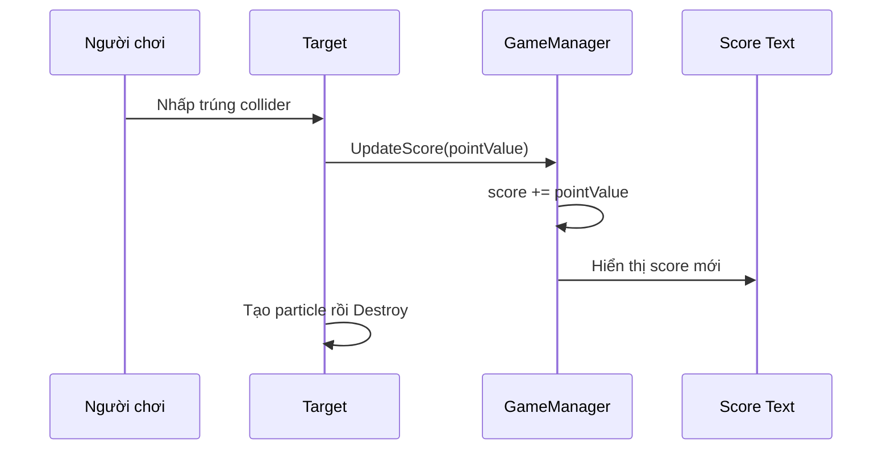

# Bài 03 — Lesson 5.2: Keeping Score — Quản lý và hiển thị điểm

> **Lộ trình:** Junior Programmer · **Chủ đề:** Unity User Interface · **Môi trường:** Unity 6.3, uGUI, TextMeshPro · **Hình thức:** Bài học lập trình.

## 1. Vấn đề và mục tiêu

Ở giai đoạn đầu, mục tiêu bay và biến mất sau khi được nhấp, nhưng người chơi không biết cú nhấp có giá trị bao nhiêu. Ta cần một hệ thống **lưu điểm**, **cộng hoặc trừ điểm đúng theo từng target** và **hiển thị kết quả ngay lập tức**. Khi nhấp thành công, một hiệu ứng hạt giúp người chơi nhận ra hành động đã được ghi nhận.

Sau bài này, bạn có thể bố trí văn bản bằng `Canvas` và `RectTransform`; sử dụng `TextMeshProUGUI`; cập nhật điểm bằng phương thức nhận tham số; truyền sự kiện từ `Target` sang `GameManager`; và tạo `ParticleSystem` tại vị trí đối tượng bị nhấp.

## 2. Phân tách dữ liệu và giao diện



`score` là **biến dữ liệu**, `pointValue` là **quy tắc của từng target**, còn `Score Text` là **thành phần trình bày**. Không tính điểm ngay khi tạo target; chỉ thay đổi khi người chơi tương tác thành công.

## 3. Tạo Score Text trong Unity Editor

1. Trong Hierarchy, chọn **UI → Text - TextMeshPro**. Nếu Unity đề nghị, nhập **TMP Essentials**.
2. Đổi tên thành `Score Text`. Unity tự tạo `Canvas` và thường tạo `EventSystem` nếu scene chưa có.
3. Chọn đối tượng `Score Text`, đặt **Anchor** ở góc trên trái và điều chỉnh `Pos X`, `Pos Y` để chữ cách rìa màn hình một khoảng dễ đọc.
4. Trong `TextMeshPro - Text (UI)`, nhập tạm `Điểm: 0`, chọn cỡ chữ, độ tương phản và tắt chế độ xuống dòng khi cần.
5. Với Canvas, kiểm tra `Canvas Scaler`. `Scale With Screen Size` là một lựa chọn phù hợp khi muốn bố cục co giãn; cần thử cả độ phân giải và tỉ lệ khung hình khác nhau.

**Phân biệt:** `TextMeshProUGUI` là component chữ nằm trong **uGUI Canvas**, không phải `TextMeshPro` dành cho văn bản ngoài thế giới 3D. Cả hai kế thừa từ các kiểu TMP nhưng được dùng ở ngữ cảnh khác nhau.

## 4. Quản lý điểm tại GameManager

Trong `GameManager.cs` của bài 5.1, bổ sung namespace `TMPro`, trường dữ liệu và các phương thức dưới đây. Đây là **đoạn tích hợp vào lớp hiện có**, không phải một lớp thứ hai cùng tên:

```csharp
using TMPro; // Thêm ở đầu file GameManager.cs

// Các thành viên bên trong lớp GameManager hiện có:
[SerializeField] private TextMeshProUGUI scoreText;
private int score;

private void InitializeScore()
{
    score = 0;
    RefreshScoreUI();
}

public void UpdateScore(int points)
{
    score += points;
    RefreshScoreUI();
}

private void RefreshScoreUI()
{
    if (scoreText != null)
        scoreText.text = $"Điểm: {score}";
}
```

**Tích hợp:** Gọi `InitializeScore()` trong `Start()` của `GameManager` trước khi bắt đầu vòng chơi; kéo `Score Text` vào trường `Score Text` trong Inspector.

Phương thức `UpdateScore(int points)` nhận số nguyên có dấu: `+5` là cộng năm điểm, còn `-3` là trừ ba điểm. Sử dụng một điểm cập nhật chung giúp tránh logic điểm nằm rải rác trong nhiều prefab.

**Tại sao nên dùng tham số `pointValue`?**

Giả sử bạn muốn có ba loại tốt trị giá **1, 3, 5 điểm** và một loại xấu trị giá **−4 điểm**. Đây là **bộ giá trị minh họa**, không phải thông số bắt buộc của khóa học. Nếu dùng `pointValue`, bạn chỉ cần đổi thuộc tính trong Inspector; không phải viết bốn nhánh điều kiện theo tên GameObject.

| Prefab minh họa | `pointValue` | Tác động khi nhấp |
|---|---:|---|
| Good 1 | `1` | Điểm tăng 1. |
| Good 2 | `3` | Điểm tăng 3. |
| Good 3 | `5` | Điểm tăng 5. |
| Bad 1 | `-4` | Điểm giảm 4. |

## 5. Gửi điểm từ target và tạo particle

Thêm trường và phương thức sau vào `Target.cs` của bài 5.1:

```csharp
[SerializeField] private int pointValue = 1;
[SerializeField] private ParticleSystem explosionPrefab;
[SerializeField] private GameManager gameManager;

private void RegisterHit()
{
    if (gameManager != null)
        gameManager.UpdateScore(pointValue);

    if (explosionPrefab != null)
        Instantiate(explosionPrefab, transform.position, explosionPrefab.transform.rotation);

    Destroy(gameObject);
}
```

**Thao tác tích hợp:** Trong `Update()` của `Target.cs`, giữ điều kiện `Physics.Raycast(...)` và kiểm tra đối tượng trúng như bài 5.1, nhưng thay dòng `Destroy(gameObject)` ở nhánh **nhấp trúng** bằng `RegisterHit()`. **Không** gọi `RegisterHit()` trong `OnTriggerEnter` của DestroyZone: mục tiêu rơi khỏi màn hình không phải mục tiêu người chơi nhấp thành công.

Kéo `Game Manager` vào trường `Game Manager` của **từng target prefab** nếu tham chiếu scene trực tiếp có thể được gán hợp lệ. **Quan trọng:** Prefab Asset lưu trong Project **không được lưu tham chiếu trực tiếp đến scene object**. Với target tạo động từ Prefab Asset, cách học tập gọn hơn là lấy tham chiếu trong runtime:

```csharp
// Bên trong Start() của Target:
if (gameManager == null)
    gameManager = FindFirstObjectByType<GameManager>();
```

Với dự án lớn hơn, nên truyền tham chiếu từ `GameManager` khi `Instantiate`, tránh gọi tìm kiếm trên mỗi target. Đoạn minh họa trên dùng `FindFirstObjectByType<T>()` có trong các phiên bản Unity hiện đại, tránh phụ thuộc chuỗi tên `Game Manager`.

**Cấu hình particle để không tồn tại mãi**

Một prefab hiệu ứng có thể gồm `ParticleSystem` và `ParticleSystemRenderer`. Trong **Particle System → Main**, bật `Play On Awake` nếu muốn phát ngay, tắt `Looping` và chọn `Stop Action = Destroy` để GameObject của hiệu ứng được dọn dẹp khi hệ hạt kết thúc. Kiểm tra thời lượng và tốc độ hạt sao cho người chơi nhìn thấy tín hiệu nhưng không bị che khuất mục tiêu khác.

Không đặt `Destroy(gameObject)` trước khi `Instantiate(explosionPrefab, ...)` mà chưa lưu vị trí nếu muốn bảo toàn ngữ cảnh hiệu ứng; trong ví dụ, tạo particle trước rồi hủy target.

## 6. Các lỗi dễ phát sinh

| Hiện tượng | Nguyên nhân có thể | Cách kiểm tra |
|---|---|---|
| Điểm luôn là 0 | Không gọi `UpdateScore` từ nhánh nhấp trúng | Đặt log trong `RegisterHit`; kiểm tra raycast. |
| Chữ điểm trống hoặc lỗi `NullReferenceException` | Chưa gán `scoreText` | Kiểm tra Inspector của `GameManager`. |
| Điểm tăng ngay khi mục tiêu xuất hiện | Đặt `UpdateScore` trong coroutine sinh prefab | Chỉ cập nhật khi ghi nhận nhấp hợp lệ. |
| Nhấp một lần tính nhiều điểm | Xử lý input hoặc event lặp; target bị xử lý hai lần | Dùng một đường xử lý, có thể thêm cờ đã xử lý khi mở rộng. |
| Particle không thấy | Chưa gán prefab, camera/layer sai, cỡ hạt quá nhỏ | Kéo prefab vào scene kiểm tra độc lập. |
| Particle tồn tại liên tục | Bật `Looping` hoặc chưa cấu hình tự hủy | Kiểm tra Main module / Stop Action. |
| Điểm bị tràn xuống hai dòng | RectTransform hẹp, wrapping bật | Mở rộng vùng chữ hoặc điều chỉnh wrapping và font size. |

## 7. Bài tập và kiểm thử

1. Thiết kế bốn loại mục tiêu có điểm khác nhau, bao gồm ít nhất một giá trị âm. Sau mỗi nhấp, kiểm tra bằng phép cộng số nguyên.
2. Bắt đầu từ 0, nhấp một mục tiêu trị giá `+5`, sau đó `−4` và `+3`. Kết quả kỳ vọng là **4 điểm**.
3. Để một mục tiêu tốt rơi khỏi vùng chơi: nó phải bị xóa nhưng **không được cộng điểm**.
4. Chạy liên tiếp nhiều lần và quan sát Hierarchy: các GameObject particle không được tích lũy vô hạn.
5. Thu nhỏ Game view và xác định Score Text còn nhìn thấy rõ hay không.

## 8. Câu hỏi ôn tập

**Câu 1.** Nên lưu giá trị điểm đang có ở đâu?

A. Trong chuỗi chữ `Score Text` và phân tích lại mỗi lần.  
B. Trong tên prefab.  
C. Trong biến `score` của bộ quản lý trạng thái.  
D. Trong màu vật liệu target.

**Đáp án:** C. **Giải thích:** Dữ liệu nên độc lập với giao diện, tránh logic phụ thuộc vào định dạng văn bản.

**Câu 2.** Target có `pointValue = -4`. Gọi `UpdateScore(pointValue)` sẽ làm gì?

A. Giảm điểm đi 4.  
B. Đổi dấu màu nền.  
C. Đặt điểm bằng 4.  
D. Tạo thêm bốn target.

**Đáp án:** A. **Giải thích:** `score += points` cộng số nguyên có dấu, nên giá trị âm làm giảm tổng.

**Câu 3.** Vì sao không nên tính điểm trong `SpawnTargets()`?

A. Vì `Instantiate` không dùng trong coroutine.  
B. Vì GameObject chưa có Collider.  
C. Vì TextMeshPro không hỗ trợ số.  
D. Vì tạo mục tiêu không đồng nghĩa người chơi đã nhấp trúng nó.

**Đáp án:** D. **Giải thích:** Điểm được ghi nhận theo kết quả tương tác, không theo số mục tiêu xuất hiện.

**Câu 4.** Thành phần chữ phù hợp cho uGUI trên Canvas là gì?

A. `Rigidbody`  
B. `TextMeshProUGUI`  
C. `MeshCollider`  
D. `AudioSource`

**Đáp án:** B. **Giải thích:** TextMeshProUGUI là thành phần UI text dành cho Canvas.

**Câu 5.** Cách dọn dẹp particle tự động sau khi hiệu ứng kết thúc là gì?

A. Cho `Looping` chạy liên tục.  
B. Tắt Collider của target.  
C. Chọn `Stop Action = Destroy` và cấu hình particle không lặp.  
D. Tăng `spawnInterval`.

**Đáp án:** C. **Giải thích:** GameObject particle có thể tự bị hủy sau khi phát xong, tránh rò rỉ đối tượng scene.

## 9. Tổng kết

Một thao tác nhấp thành công nên đi qua ba bước: **target xác nhận hit → GameManager cập nhật dữ liệu → TextMeshPro hiển thị phản hồi**. `pointValue` cho phép cấu hình điểm theo prefab; `ParticleSystem` tăng khả năng cảm nhận hành động của người chơi mà không thay đổi phép tính điểm.

## 10. Tài liệu tham khảo

- [Unity Learn — Lesson 5.2: Keeping Score](https://learn.unity.com/tutorial/lesson-5-2-keeping-score).
- [Unity Learn — UI Components](https://learn.unity.com/tutorial/ui-components).
- [Unity Learn — Working with UI in Unity](https://learn.unity.com/tutorial/working-with-ui-in-unity).
- [Unity Manual — Canvas Scaler](https://docs.unity3d.com/Manual/script-CanvasScaler.html).
