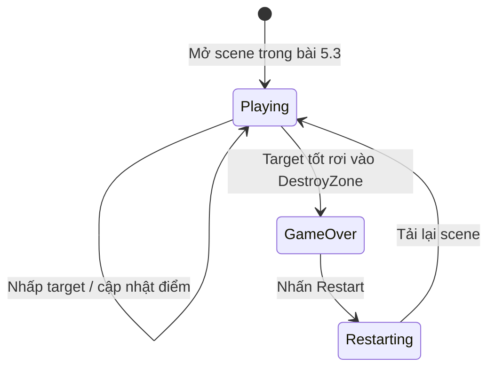

# Bài 04 — Lesson 5.3: Game Over — Kết thúc và khởi động lại trò chơi

> **Lộ trình:** Junior Programmer · **Chủ đề:** Unity User Interface · **Môi trường:** Unity 6.3, Canvas, Button, SceneManager · **Hình thức:** Bài học lập trình.

## 1. Khi nào trò chơi thực sự kết thúc?

Một dòng chữ “Game Over” chưa đủ để kết thúc phiên chơi. Nếu coroutine vẫn sinh mục tiêu hoặc target vẫn cộng điểm sau khi thua, trạng thái logic đã không còn nhất quán với những gì UI hiển thị. Bài học xây dựng quy tắc: **khi một mục tiêu tốt rơi xuống vùng sensor, kết thúc phiên chơi, ngừng sinh mục tiêu, từ chối tính điểm tiếp và hiển thị nút Restart**.

Mục tiêu sau bài học là triển khai trạng thái game rõ ràng, kiểm soát việc gọi `GameOver()` nhiều lần, tạo Game Over panel, kết nối `Button.onClick` với `RestartGame()` và đặt lại phiên bằng cách nạp lại scene.

## 2. Mô hình trạng thái



Trong bài 5.3, scene có thể vào thẳng trạng thái `Playing`. Khi bổ sung menu độ khó ở bài 5.4, trạng thái khởi đầu sẽ chuyển thành `Menu` và vòng đời được mở rộng.

## 3. Bố trí giao diện kết thúc

Trong `Canvas`, tạo một GameObject `Game Over Panel` chứa hai đối tượng:

```text
Canvas
├── Score Text
└── Game Over Panel  [Inactive lúc bắt đầu]
    ├── Game Over Text   (Text - TextMeshPro)
    └── Restart Button   (Button - TextMeshPro)
```

1. Đặt `Game Over Text` ở giữa màn hình với thông điệp nổi bật; có thể tạo Image nền mờ trong panel để tăng độ tương phản.
2. Đặt `Restart Button` dưới văn bản và đổi chữ thành **Chơi lại**.
3. Tắt `Game Over Panel` từ đầu bằng checkbox Active trong Inspector. Không tắt toàn bộ `Canvas`, vì điểm số và các đối tượng UI khác vẫn cần tồn tại.
4. Kiểm tra `Graphic Raycaster` trên Canvas, `EventSystem` trong scene và Input Module phù hợp dự án. Các thành phần này giúp Button nhận tương tác.
5. Dùng `RectTransform` anchor giữa và `Canvas Scaler` để giữ bố cục khi Game view đổi kích thước.

## 4. Viết Game Over trong GameManager

Các đoạn sau **bổ sung/chỉnh sửa `GameManager.cs`** đang chứa danh sách prefab, `score`, `scoreText`, `UpdateScore` và coroutine từ bài 5.1–5.2. Không tạo một lớp `GameManager` mới song song.

```csharp
using UnityEngine.SceneManagement; // Thêm ở đầu file

// Thành viên của GameManager:
[SerializeField] private GameObject gameOverPanel;
private bool isGameActive;
private Coroutine spawnRoutine;

private void Start()
{
    InitializeScore();
    if (gameOverPanel != null) gameOverPanel.SetActive(false);
    isGameActive = true;

    if (targetPrefabs.Count > 0)
        spawnRoutine = StartCoroutine(SpawnTargets());
}

public void GameOver()
{
    if (!isGameActive) return; // Chống gọi lặp

    isGameActive = false;
    if (spawnRoutine != null)
    {
        StopCoroutine(spawnRoutine);
        spawnRoutine = null;
    }
    if (gameOverPanel != null) gameOverPanel.SetActive(true);
}

public void RestartGame()
{
    Scene activeScene = SceneManager.GetActiveScene();
    SceneManager.LoadScene(activeScene.buildIndex);
}
```

Đồng thời sửa hai phương thức hiện có:

```csharp
// Thay thân UpdateScore hiện tại:
public void UpdateScore(int points)
{
    if (!isGameActive) return;
    score += points;
    RefreshScoreUI();
}

// Thay vòng lặp trong SpawnTargets hiện tại:
private IEnumerator SpawnTargets()
{
    while (isGameActive)
    {
        yield return new WaitForSeconds(spawnInterval);
        if (!isGameActive) yield break;

        int index = Random.Range(0, targetPrefabs.Count);
        if (targetPrefabs[index] != null)
            Instantiate(targetPrefabs[index]);
    }
}
```

**Tại sao cần cả `StopCoroutine` và kiểm tra `isGameActive`?** `StopCoroutine` dừng vòng sinh đang chạy, còn kiểm tra trạng thái cung cấp điều kiện an toàn nếu thay đổi cách khởi chạy coroutine sau này. Điều kiện trước `Instantiate` xử lý tình huống coroutine vừa chờ xong nhưng game đã kết thúc.

> **Quan trọng về đồng bộ mã:** Ở bài này, `InitializeScore()` phải được gọi trước khi bật `isGameActive`; vì nó chỉ đặt `score = 0` và cập nhật UI, nó không phụ thuộc vào `UpdateScore()` vốn đã có chốt `isGameActive`.

## 5. Phát hiện thất bại đúng điều kiện

Trong `Target.cs`, sửa phần `OnTriggerEnter` (đã có từ bài 5.1):

```csharp
private void OnTriggerEnter(Collider other)
{
    if (!other.CompareTag("DestroyZone")) return;

    // Quy tắc của Prototype 5: để mất target tốt là thua.
    if (pointValue > 0 && gameManager != null)
        gameManager.GameOver();

    Destroy(gameObject);
}
```

Quy tắc `pointValue > 0` là một cách phân biệt target tốt và xấu trong trò chơi minh họa. Nếu về sau có target **0 điểm nhưng vẫn thuộc loại tốt**, không nên suy ra loại mục tiêu từ số điểm; hãy dùng `TargetType` hoặc một cờ `isGoodTarget` riêng.

Nếu nhiều target tốt chạm sensor cùng lúc, `GameOver()` chỉ xử lý một lần vì có điều kiện `if (!isGameActive) return;`. Bản chất đây là một dạng **idempotence ở mức xử lý trạng thái**: yêu cầu kết thúc lặp lại không làm tạo thêm các thay đổi không cần thiết.

## 6. Gắn nút Restart với sự kiện UI

1. Chọn `Restart Button` → Component `Button` → `On Click ()`.
2. Bấm `+` và kéo `Game Manager` từ Hierarchy vào ô đối tượng.
3. Chọn `GameManager → RestartGame()` trong menu phương thức.
4. Đảm bảo game đã thêm scene thực hành vào **Scene List của Build Profiles** (hoặc cấu hình scene dùng để build tương ứng). Nếu scene không có build index hợp lệ, việc nạp lại theo `buildIndex` có thể thất bại.
5. Play → để target tốt rơi → nhấn Restart → kiểm tra điểm trở về 0 và target có thể sinh trở lại.

`SceneManager.LoadScene` phù hợp cho prototype nhỏ; khi xây dựng trò chơi lớn hơn cần cân nhắc `LoadSceneAsync` để tránh khựng khi chuyển scene. Nếu muốn quay về menu thay vì chơi ngay, có thể thay đổi state khởi đầu trong bài 5.4.

## 7. Kiểm tra trạng thái và lỗi thường gặp

| Kịch bản | Kỳ vọng | Cách xác minh |
|---|---|---|
| Target tốt rơi vào DestroyZone | Hiện panel và dừng sinh mới | Đợi lâu hơn một chu kỳ sinh; không thấy target mới. |
| Nhấp target sau khi thua | Điểm không thay đổi | Quan sát Score Text và log. |
| Hai target tốt rơi gần cùng lúc | Chỉ xử lý GameOver một lần | Log trong `GameOver()` để đối chiếu. |
| Nhấp Restart | Scene bắt đầu lại, điểm ban đầu | Kiểm tra Build Profiles và giá trị Score Text. |
| Nút không phản hồi | Không chuyển scene | Kiểm tra EventSystem, Raycaster, Interactable, On Click và panel chặn raycast. |
| Target tiếp tục xuất hiện sau Game Over | Coroutine chưa được dừng hoặc có nhiều coroutine | Kiểm tra `StartCoroutine` có được gọi nhiều lần và trạng thái cờ. |

## 8. Bài tập vận dụng

1. Thêm thông báo điểm cuối phiên vào `Game Over Panel`. Dữ liệu điểm cuối phải được đọc từ logic, không phân tích chuỗi Score Text.
2. Thử hai cách đặt lại game: **nạp lại scene** và **reset trạng thái trong scene hiện có**; phân tích ưu nhược điểm về dọn dẹp target.
3. Dùng `enum GameState { Menu, Playing, GameOver }` thay thế cờ `isGameActive` khi bổ sung menu nhiều trạng thái (nâng cao).
4. Khi Game Over, bảo đảm không còn khả năng bấm target ở phía sau panel, bằng cách chặn input hoặc kiểm tra trạng thái trước `RegisterHit()`.

## 9. Câu hỏi ôn tập

**Câu 1.** Vì sao chỉ bật chữ “Game Over” là chưa đủ?

A. Vì `TextMeshPro` không hiển thị chữ lớn.  
B. Vì vẫn có thể tiếp tục sinh mục tiêu và thay đổi điểm.  
C. Vì phải xóa Camera.  
D. Vì Score Text không hỗ trợ số âm.

**Đáp án:** B. **Giải thích:** Kết thúc game là thay đổi trạng thái logic và luồng tương tác, không chỉ thay đổi hình ảnh.

**Câu 2.** Khi nào nên gọi `GameOver()` theo quy tắc bài này?

A. Khi nhấp thành công target tốt.  
B. Khi target xấu xuất hiện.  
C. Khi nhấn nút độ khó.  
D. Khi target tốt chạm DestroyZone.

**Đáp án:** D. **Giải thích:** Điều kiện thua là để mục tiêu cần nhấp rơi khỏi vùng chơi.

**Câu 3.** Ý nghĩa của `if (!isGameActive) return;` ở đầu `GameOver()` là gì?

A. Tránh xử lý lặp một sự kiện kết thúc đã xảy ra.  
B. Cộng điểm ngay.  
C. Bật physics 2D.  
D. Khởi tạo lại scoreText.

**Đáp án:** A. **Giải thích:** Trạng thái đã kết thúc thì không cần kích hoạt cùng chuyển trạng thái lần nữa.

**Câu 4.** Phương thức dùng để nạp lại scene theo build index là gì?

A. `GameObject.Find`  
B. `Instantiate`  
C. `SceneManager.LoadScene`  
D. `Debug.DrawRay`

**Đáp án:** C. **Giải thích:** `SceneManager` cung cấp API chuyển/nạp scene tại runtime.

**Câu 5.** Nút hiện ra nhưng nhấn không chạy dù đã có `Button` — cần kiểm tra yếu tố nào trước?

A. Mass của Rigidbody target.  
B. EventSystem, Graphic Raycaster và On Click listener.  
C. Khoảng xoay của target.  
D. Particle Size.

**Đáp án:** B. **Giải thích:** Các thành phần này nằm trực tiếp trong đường xử lý sự kiện uGUI.

## 10. Tổng kết

Trạng thái kết thúc phải đồng bộ **logic trò chơi**, **vòng sinh mục tiêu**, **quy tắc tính điểm** và **giao diện**. Nút Restart dùng `SceneManager` để tạo một phiên mới, đồng thời đặt nền tảng cho màn hình chọn độ khó ở bài tiếp theo.

## 11. Tài liệu tham khảo

- [Unity Learn — Lesson 5.3: Game Over](https://learn.unity.com/tutorial/lesson-5-3-game-over-jp?language=ja) (trang bản tiếng Nhật có cấu trúc bước tương ứng).
- [Unity Scripting API — SceneManager.LoadScene](https://docs.unity3d.com/ScriptReference/SceneManagement.SceneManager.LoadScene.html).
- [Unity Learn — Detecting Mouse Clicks, phần UGUI Event System](https://learn.unity.com/tutorial/onmousedown).
