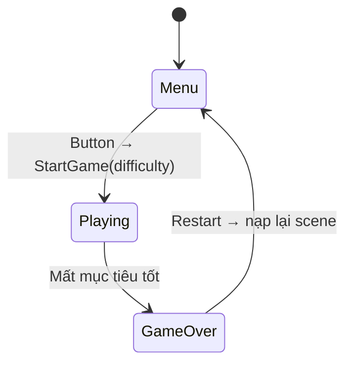

# Bài 05 — Lesson 5.4: What's the Difficulty? — Menu và lựa chọn độ khó

> **Lộ trình:** Junior Programmer · **Chủ đề:** Unity User Interface · **Môi trường:** Unity 6.3, Button, TextMeshPro, C# · **Hình thức:** Bài học lập trình.

## 1. Bài toán

Một trò chơi chơi được ngay khi mở vẫn chưa thân thiện: người chơi cần biết tên trò chơi, có cơ hội chuẩn bị và chọn độ khó phù hợp. Bài này tạo **màn hình tiêu đề** và **ba nút Easy / Medium / Hard**; mỗi nút gửi tham số vào `GameManager`, đóng menu và bắt đầu vòng sinh target với tốc độ khác nhau.

Kết thúc bài, bạn có thể tổ chức UI thành nhóm, dùng `Button.onClick.AddListener`, giao tiếp giữa script của button với `GameManager`, truyền tham số vào `StartGame(int difficulty)` và bảo đảm không nhân chia chồng giá trị độ khó khi bắt đầu lại.

## 2. Tính toán tần suất sinh mục tiêu

Gọi `baseSpawnInterval` là số giây chờ ở độ khó cơ sở và `difficulty` là hệ số nguyên dương. Một công thức đơn giản là:

$$
\text{spawnInterval} = \frac{\text{baseSpawnInterval}}{\max(1,\text{difficulty})}
$$

Chẳng hạn nếu `baseSpawnInterval = 1.2` giây, các mức 1, 2, 3 cho khoảng chờ lần lượt **1.2 giây**, **0.6 giây**, **0.4 giây**. Đây là ví dụ minh họa; tốc độ thực tế nên được kiểm nghiệm với người chơi.

| Nút | Hệ số `difficulty` | Hệ quả |
|---|---:|---|
| Easy | 1 | Khoảng sinh bằng giá trị cơ sở. |
| Medium | 2 | Khoảng sinh còn một nửa. |
| Hard | 3 | Khoảng sinh còn một phần ba. |

**Tránh sai lầm:** `spawnInterval /= difficulty` mỗi lần nhấn có thể làm khoảng sinh bị giảm tích lũy ngoài ý muốn nếu không reset. Tính lại từ **`baseSpawnInterval` bất biến** mỗi phiên mới sẽ minh bạch hơn.

## 3. Xây dựng Title Screen

Trong `Canvas`, tạo một panel/container `Title Screen` với cấu trúc:

```text
Canvas
├── Score Text                 (ẩn hoặc chỉ hiện khi Playing)
├── Title Screen               (bật lúc mở scene)
│   ├── Title Text             (TextMeshPro)
│   ├── Easy Button            (Button)
│   ├── Medium Button          (Button)
│   └── Hard Button            (Button)
└── Game Over Panel            (tắt lúc mở scene)
```

1. Tạo tiêu đề từ `Text - TextMeshPro`, chọn cỡ và màu dễ nhìn.
2. Tạo một nút độ khó rồi **Duplicate** để có ba nút nhất quán. Đổi nhãn và vị trí cho từng nút.
3. Nếu nhân bản từ `Restart Button`, **xóa callback `RestartGame`** cũ trong `Button → On Click ()`; nếu không, một cú nhấp có thể vừa bắt đầu game vừa tải lại scene.
4. Gom toàn bộ nút và tiêu đề thành con của `Title Screen`. Khi bắt đầu game, chỉ cần `titleScreen.SetActive(false)`.
5. Chọn anchors và bố cục sao cho nút không bị che ở các màn hình có tỉ lệ khác nhau.

## 4. Chỉnh GameManager để bắt đầu theo yêu cầu

Ở bài 5.3, `GameManager.Start()` tự bắt đầu sinh mục tiêu. Thay đổi hành vi để lúc mở scene **chỉ khởi tạo menu**, chưa chơi. Đoạn sau dùng các biến và hàm đã xây dựng trong các bài trước:

```csharp
// Thêm trường vào GameManager:
[SerializeField] private GameObject titleScreen;
[SerializeField, Min(0.05f)] private float baseSpawnInterval = 1f;

// Sửa Start() đã có:
private void Start()
{
    isGameActive = false;
    InitializeScore();
    if (gameOverPanel != null) gameOverPanel.SetActive(false);
    if (titleScreen != null) titleScreen.SetActive(true);
}

public void StartGame(int difficulty)
{
    if (isGameActive || targetPrefabs.Count == 0) return;

    int safeDifficulty = Mathf.Max(1, difficulty);
    spawnInterval = baseSpawnInterval / safeDifficulty;
    InitializeScore();
    isGameActive = true;

    if (titleScreen != null) titleScreen.SetActive(false);
    if (gameOverPanel != null) gameOverPanel.SetActive(false);
    spawnRoutine = StartCoroutine(SpawnTargets());
}
```

Phần `SpawnTargets()` kiểm tra `isGameActive` và `GameOver()` dừng coroutine ở bài 5.3 vẫn giữ nguyên. Sau khi Game Over, nút Restart nạp lại scene; scene mới sẽ **quay về Title Screen** thay vì tự chơi.

## 5. Kết nối nút độ khó bằng C#

Tạo `DifficultyButton.cs`, gắn vào cả ba nút:

```csharp
using UnityEngine;
using UnityEngine.UI;

[RequireComponent(typeof(Button))]
public class DifficultyButton : MonoBehaviour
{
    [SerializeField, Min(1)] private int difficulty = 1;
    [SerializeField] private GameManager gameManager;

    private Button button;

    private void Awake()
    {
        button = GetComponent<Button>();
        button.onClick.AddListener(ChooseDifficulty);
    }

    private void OnDestroy()
    {
        if (button != null)
            button.onClick.RemoveListener(ChooseDifficulty);
    }

    private void ChooseDifficulty()
    {
        if (gameManager != null)
            gameManager.StartGame(difficulty);
    }
}
```

Trong Inspector, gán `difficulty = 1`, `2`, `3` cho các nút tương ứng và kéo `Game Manager` vào trường `Game Manager` của từng button. `GetComponent<Button>()` lấy nút trên cùng đối tượng; `AddListener` đăng ký phương thức xử lý; `RemoveListener` giúp việc tháo gỡ listener do script thêm rõ ràng.

**Hai cách kết nối hợp lệ:** `On Click ()` từ Inspector **hoặc** `AddListener` từ mã. Không cấu hình cùng một hành động bằng cả hai mà không chủ ý, vì có thể làm xử lý bị gọi nhiều lần.

## 6. Luồng điều khiển



Tại `Menu`, coroutine chưa chạy. Tại `Playing`, khoảng sinh dựa trên lựa chọn. Tại `GameOver`, GameManager khóa điểm và dừng sinh; nhấn Restart nạp lại scene về menu. Điều này quan trọng hơn vẻ đẹp bề ngoài: UI và trạng thái phải khớp nhau.

## 7. Kiểm thử và xử lý lỗi

| Tình huống | Kết quả mong đợi |
|---|---|
| Mở scene | Title Screen hiện, không có target tự sinh. |
| Nhấn Easy | Menu ẩn, game bắt đầu với tốc độ cơ sở. |
| Nhấn Hard | Mục tiêu xuất hiện nhanh hơn Easy theo công thức. |
| Nhấp nút độ khó hai lần rất nhanh | Không tạo hai coroutine vì `isGameActive` khóa sau lần đầu. |
| Để target tốt rơi rồi Restart | Trở về Title Screen với điểm 0. |
| Một nút không có hiệu lực | Kiểm tra `GameManager` reference, Button listener, EventSystem và Console. |
| Chữ nút xuống dòng | Điều chỉnh RectTransform, font, anchor hoặc layout. |

Để xác nhận độ khó, có thể tạm ghi thời điểm tạo mục tiêu bằng `Debug.Log(Time.time)` và quan sát hiệu số giữa các lần xuất hiện; không nhất thiết đo bằng mắt.

## 8. Bài tập mở rộng

1. Thêm dòng mô tả ngắn cho từng độ khó để người mới hiểu trước khi chọn.
2. Thay công thức chia bằng ba giá trị tốc độ do designer cấu hình (ví dụ `AnimationCurve` hoặc mảng) và giải thích khi nào cách này linh hoạt hơn.
3. Bổ sung trạng thái `Paused` dùng nút tạm dừng, bảo đảm không nhập nhằng giữa **tạm dừng** và **Game Over**.
4. Không để người chơi tương tác target qua menu trước khi nhấn Start.

## 9. Câu hỏi ôn tập

**Câu 1.** Muốn độ khó tăng làm target xuất hiện nhanh hơn, cần thay đổi đại lượng nào?

A. Tăng `spawnInterval`.  
B. Giảm `spawnInterval`.  
C. Giảm `pointValue`.  
D. Tắt collider.

**Đáp án:** B. **Giải thích:** Khoảng chờ giữa hai lần tạo càng nhỏ thì tần suất tạo càng cao.

**Câu 2.** Vì sao nên chia `baseSpawnInterval` thay vì tiếp tục chia biến đã bị thay đổi?

A. Để kết quả mỗi phiên không phụ thuộc số lần nút đã được nhấn.  
B. Vì `float` không hỗ trợ phép chia.  
C. Để tự tạo EventSystem.  
D. Để game không cần Coroutine.

**Đáp án:** A. **Giải thích:** Tính từ giá trị gốc tránh hiệu ứng tích lũy ngoài ý muốn.

**Câu 3.** `button.onClick.AddListener(ChooseDifficulty)` có chức năng gì?

A. Tạo collider 3D.  
B. Chọn prefab ngẫu nhiên.  
C. Tăng điểm tức thì.  
D. Đăng ký hàm chạy khi Button được nhấn.

**Đáp án:** D. **Giải thích:** Listener nối sự kiện UI với mã điều khiển.

**Câu 4.** Vì sao cần xóa callback Restart cũ khi nhân bản nút?

A. Để sửa phông chữ.  
B. Để tắt Canvas Scaler.  
C. Để nút độ khó không vô tình nạp lại scene.  
D. Để tăng tốc độ physics.

**Đáp án:** C. **Giải thích:** Sự kiện `On Click` được nhân bản cùng component và có thể giữ hành vi cũ.

**Câu 5.** Phương thức nào thể hiện đúng thay đổi vòng đời game trong bài này?

A. `Start()` luôn tự sinh mục tiêu.  
B. `Start()` hiện menu, `StartGame(int difficulty)` bắt đầu chơi.  
C. `UpdateScore()` tạo menu.  
D. `DestroyZone` chọn độ khó.

**Đáp án:** B. **Giải thích:** Khởi động phiên được kích hoạt có chủ đích bởi người chơi.

## 10. Tổng kết

Màn hình tiêu đề là **trạng thái bắt đầu**; các nút không chỉ trang trí mà chuyển tham số sang logic game. Việc tách `baseSpawnInterval`, `StartGame(int difficulty)` và `DifficultyButton` giúp hệ thống nhất quán, dễ kiểm thử và tránh sinh mục tiêu trước khi người chơi sẵn sàng.

## 11. Tài liệu tham khảo

- [Unity Learn — Lesson 5.4: What's the Difficulty?, Unity 6.3](https://learn.unity.com/pathway/junior-programmer/unit/user-interface/tutorial/lesson-5-4-what-s-the-difficulty-2?version=6.3).
- [Unity Learn — Detecting Mouse Clicks, phần UGUI Event System](https://learn.unity.com/tutorial/onmousedown).
- [Unity Learn — Working with UI in Unity](https://learn.unity.com/tutorial/working-with-ui-in-unity).
