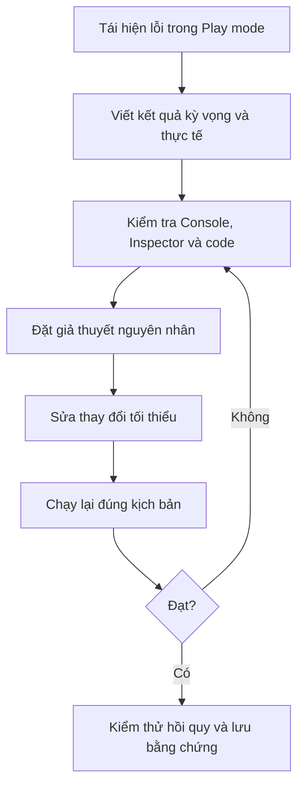

# Bài 06 — Challenge 5: Whack-a-Food — Thử thách sửa lỗi trò chơi

> **Lộ trình:** Junior Programmer · **Loại:** Bài tập/challenge · **Môi trường:** Unity 6.3, C#, uGUI · **Sản phẩm:** Dự án Whack-a-Food được sửa đúng hành vi.

## 1. Bối cảnh

Bạn tiếp nhận một trò chơi phản xạ có thức ăn xuất hiện để người chơi nhấp và ghi điểm. Dự án **có thể chạy và biên dịch**, nhưng hành vi không đáp ứng kỳ vọng: menu khó nhìn, thức ăn biến mất sai thời điểm, điểm bị hiển thị thành chữ, nút khởi động lại hoặc lựa chọn độ khó không hoạt động và điều kiện kết thúc chưa chắc chắn.

**Nhiệm vụ:** tìm nguyên nhân, sửa lỗi và chứng minh từng sửa đổi bằng kiểm thử. Không được chỉ làm cho giao diện “trông đúng”; phải làm cho trạng thái và cơ chế game đúng.

## 2. Mục tiêu và kiến thức cần dùng

Sau challenge, bạn cần chứng minh có thể: đọc Console và Inspector; truy dấu một sự kiện từ UI đến script; hiểu vòng đời `Coroutine` và thao tác `Destroy`; kiểm tra ranh giới gameplay; xử lý `TextMeshPro`; kết nối `Button`; và thử nghiệm lại các tính năng cũ sau khi sửa lỗi.

Các kiến thức nền gồm `GameManager`, `Target`, `OnTriggerEnter`, `Physics.Raycast`, `Button.onClick`, `GameOver`, `SceneManager.LoadScene`, `StartGame(int)`, `spawnInterval` và các trường Inspector. Thay đổi chỉ một nhóm nguyên nhân mỗi lượt để dễ xác định tác động.

## 3. Quy trình xử lý lỗi

Ví dụ: Nếu nhấn Hard nhưng mục tiêu không xuất hiện nhanh hơn Easy, đừng vội viết lại toàn bộ `GameManager`. Hãy xác nhận **nút nào được nhận**, **tham số nào được chuyển**, **spawnInterval sau khi tính là bao nhiêu**, và **coroutine hiện tại đang dùng biến nào**.

## 4. Danh sách lỗi bắt buộc

### 4.1. Giao diện các nút độ khó lộn xộn

**Triệu chứng:** Easy, Medium và Hard không cùng hàng hoặc cỡ; một phần bị che/đè lên nhau.

**Yêu cầu:** ba nút được bố trí rõ ràng, có khoảng cách phù hợp, vẫn đọc được khi đổi độ phân giải. Kiểm tra `RectTransform`, anchors, kích thước, các thành phần layout nếu sử dụng và `Canvas Scaler`.

**Bằng chứng:** ảnh Game view trước/sau ở ít nhất hai kích cỡ hiển thị.

### 4.2. Thức ăn bị hủy quá sớm

**Triệu chứng:** đối tượng biến mất khi chưa được nhấp hoặc khi chưa rơi khỏi vùng chơi hợp lệ.

**Yêu cầu:** xác định đúng va chạm nào phải hủy thức ăn, vị trí và kích cỡ của vùng sensor, cũng như sự khác nhau giữa collider thường và trigger. Kiểm tra điều kiện trong `OnTriggerEnter` hoặc nhánh xử lý raycast trước khi sửa.

**Bằng chứng:** một target di chuyển qua vùng chơi bình thường; khi ra ngoài vùng chơi theo đúng quy tắc mới bị hủy.

### 4.3. Điểm biến thành chữ “score”

**Triệu chứng:** thay vì `Score: 12`, màn hình hiển thị một chuỗi cố định như `score`.

**Yêu cầu:** Score Text hiển thị **số trong biến**, không phải một chuỗi gõ tay. Cần phân biệt tên biến và chữ được đặt trong dấu nháy kép.

**Gợi ý kiểm tra:** xem biểu thức gán `scoreText.text`. Đâu là literal, đâu là giá trị biến?

**Bằng chứng:** khi nhấp ít nhất hai loại thức ăn khác điểm, số trên màn hình thay đổi đúng.

### 4.4. Thua rồi không có cách chơi lại

**Triệu chứng:** trò chơi hiển thị Game Over nhưng không có nút Restart hoặc nút không hoạt động.

**Yêu cầu:** có nút khởi động lại dễ nhận ra; nhấn nút đưa game về trạng thái mới với điểm khởi tạo và logic sinh mục tiêu phù hợp. Kiểm tra `Button`, `On Click`, `EventSystem`, `Graphic Raycaster` và việc scene được đưa vào danh sách build.

**Bằng chứng:** video/chuỗi ảnh `Playing → Game Over → Restart → Playing/Menu`.

### 4.5. Các nút độ khó không đổi độ khó

**Triệu chứng:** nhấn Easy/Medium/Hard nhưng tốc độ xuất hiện thức ăn như nhau.

**Yêu cầu:** tham số độ khó được truyền từ đúng nút tới `GameManager` và ảnh hưởng đo được tới **khoảng sinh mục tiêu**. Cần kiểm tra phép tính và trường hợp nút đang giữ sự kiện cũ sau khi nhân bản.

**Bằng chứng:** lưu log thời điểm sinh ít nhất một chuỗi target cho hai mức độ khó, rút ra kết luận từ khoảng thời gian quan sát được.

### 4.6. Bonus: Trò chơi có thể chạy mãi

**Triệu chứng:** có đường đi khiến trò chơi không bao giờ kết thúc dù đã thỏa điều kiện thua.

**Yêu cầu nâng cao:** xác định điều kiện thua cần giám sát, điểm đặt kiểm tra và cơ chế khóa trạng thái; bổ sung kiểm thử các trường hợp rơi ngoài sensor, target đặc biệt hoặc thứ tự callback khác nhau.

**Bằng chứng:** tái hiện lỗi trước khi sửa và kiểm tra điều kiện kết thúc sau khi sửa.

## 5. Gợi ý theo cấp độ — không phải lời giải

| Mức | Hướng kiểm tra | Câu hỏi cần tự trả lời |
|---|---|---|
| 1 — Quan sát | Chụp Hierarchy, Inspector; đọc Console | Sai ở UI, dữ liệu hay luật chơi? |
| 2 — Truy vết | Gắn `Debug.Log` vào `StartGame`, `GameOver`, `UpdateScore`, `OnTriggerEnter` | Hàm có được gọi không, được gọi khi nào, với giá trị gì? |
| 3 — Khoanh vùng | Kiểm tra tag, collider, Active state và listener | Nếu tắt một thành phần có hết lỗi không? |
| 4 — Chỉnh sửa | Sửa một đoạn mã hoặc cấu hình rồi chạy lại | Lỗi chính có hết mà tính năng cũ còn đúng không? |

Không dùng việc **tắt toàn bộ script** làm giải pháp cuối cùng nếu điều đó khiến chức năng cần có biến mất. Mục đích là khôi phục hành vi đúng, không che triệu chứng.

## 6. Ma trận kiểm thử nghiệm thu

| ID | Tình huống | Kết quả kỳ vọng |
|---|---|---|
| C01 | Mở game | Menu không chồng lấn, chưa tự chơi nếu có Title Screen. |
| C02 | Chọn độ khó | Title Screen ẩn, game bắt đầu đúng mức đã chọn. |
| C03 | Nhấp target có lợi | Điểm tăng đúng, target biến mất, hiệu ứng phát nếu có. |
| C04 | Nhấp target bất lợi | Điểm giảm theo cấu hình. |
| C05 | Không nhấp, để target còn trong vùng chơi | Không bị hủy trước thời điểm hợp lệ. |
| C06 | Target tốt rơi vào vùng thua | Game Over xuất hiện, dừng sinh mới/tính điểm. |
| C07 | Nhấn Restart | Phiên mới hoạt động, điểm về giá trị khởi tạo. |
| C08 | So sánh Easy và Hard | Khác biệt tần suất sinh phản ánh công thức. |
| C09 | Thử nhiều chu kỳ thua và khởi động lại | Không nhân đôi coroutine hoặc sự kiện nhấp. |
| C10 | Đổi tỉ lệ Game view | Các nút và chữ quan trọng không tràn/che nhau. |

## 7. Sản phẩm cần nộp

- Dự án Unity hoặc scene có thể mở và Play được, không có lỗi biên dịch.
- Bảng lỗi chứa **hiện tượng, nguyên nhân, nơi sửa, bằng chứng và kết quả kiểm thử lại**.
- Ảnh/video chứng minh các lỗi bắt buộc đã được giải quyết.
- Một đoạn tổng kết ngắn giải thích vì sao lỗi xảy ra và cách phòng tránh.

**Tiêu chí hoàn thành:** sửa được 5 nhóm lỗi chính; các kiểm thử C01–C10 liên quan đạt; thay đổi không làm mất các chức năng điểm số, menu hay va chạm sẵn có. Bonus được đánh giá riêng.

## 8. Câu hỏi tự đánh giá

1. Có lỗi nào không gây exception nhưng vẫn làm sai gameplay? Hãy chỉ ra cách phát hiện bằng test.
2. Vì sao một button vừa có `AddListener` vừa có `On Click ()` trùng hành động có thể gây lỗi khó nhận thấy?
3. Có nên dùng tên GameObject để xác định target tốt hay xấu không? Trong tình huống nào nên có field phân loại riêng?
4. Nếu sửa vùng sensor làm target rơi đúng, kiểm thử nào cần chạy lại để tránh ảnh hưởng vòng chơi?
5. Sự khác nhau giữa **sửa nguyên nhân gốc** và **che lỗi hiển thị** là gì?

## 9. Tổng kết

Challenge nhấn mạnh tư duy kỹ thuật: **tái hiện được vấn đề → xác định kỳ vọng → kiểm tra chứng cứ → sửa tối thiểu → kiểm thử hồi quy**. Mỗi lỗi được coi là một yêu cầu hành vi có thể kiểm chứng, không chỉ là một dòng mã cần thay.

## 10. Tài liệu tham khảo

- [Unity Learn — Challenge 5: Whack-a-Food](https://learn.unity.com/tutorial/challenge-5-whack-a-food/unity-version?version=6.0).
- [Unity Learn — Unit 5: User Interface](https://learn.unity.com/pathway/junior-programmer/unit/user-interface?version=6.3).
- [Unity Learn — Detecting Mouse Clicks](https://learn.unity.com/tutorial/onmousedown).

> Bộ yêu cầu và kịch bản trên là bản thực hành tự biên soạn theo **những nhóm lỗi công khai của challenge**; không phải dự án mẫu đã sửa sẵn hay đáp án chính thức.
