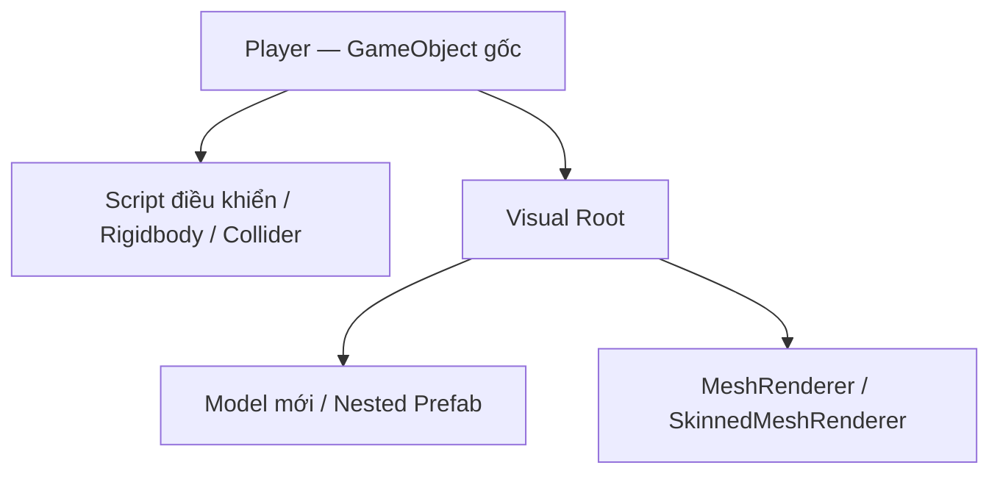

# Bài 07 — Lab 5: Swap out your Assets — Thay model và vật liệu nhưng giữ gameplay

> **Lộ trình:** Junior Programmer · **Loại:** Lab thực hành · **Môi trường:** Unity 6.3, Prefab, Rigidbody/Collider, Material · **Kết quả:** Thay hình khối nguyên thủy bằng asset mới mà không làm thay đổi chức năng chính.

## 1. Bối cảnh

Trong giai đoạn prototype, một nhân vật có thể chỉ là Capsule, chướng ngại là Cube, nền là Plane. Chúng đủ để kiểm tra điều khiển và va chạm nhưng chưa thể hiện phong cách thị giác của game. Lab này hướng dẫn **thay thế phần biểu diễn bằng model và material mới**, đồng thời giữ nguyên cấu trúc gameplay đã chạy ổn định.

Khác với Challenge 5, Lab 5 không chỉ diễn ra trong game nhấp mục tiêu: bạn có thể áp dụng vào **các prototype đã xây dựng trong khóa**, đặc biệt những scene có nhân vật điều khiển, primitive, vật cản và nền.

## 2. Mục tiêu và chuẩn bị

Sau lab, bạn có thể nhập một `.unitypackage`, đọc cấu trúc Asset Store package, chỉnh Prefab trong Prefab Mode, dùng nested Prefab để thay visual, điều chỉnh collider cho model mới, thay material nền và kiểm tra sai khác shader/render pipeline.

**Chuẩn bị:**

1. Chọn một prototype đang điều khiển được bằng Play mode; lưu scene dự phòng hoặc tạo commit trong hệ quản lý phiên bản.
2. Tải **Create with Code — Course Library** từ bài lab chính thức hoặc chọn asset có giấy phép phù hợp ở Unity Asset Store.
3. Kiểm tra render pipeline của dự án (**Built-in** hay **URP**) và yêu cầu shader của asset.
4. Tạo thư mục quản lý, ví dụ `Assets/Art/Models`, `Assets/Art/Materials`, `Assets/Art/Textures` và `Assets/Prefabs`.
5. Ghi lại hành vi gốc: di chuyển, nhảy, va chạm, hướng quay, điểm số, trigger và camera.

## 3. Phân tách gameplay và visual

Nguyên tắc thiết kế quan trọng nhất là **không thay cả đối tượng đang chứa logic chỉ để đổi hình ảnh**. Hãy giữ một GameObject gốc có script và vật lý; đặt model mới thành GameObject con.

Tách như vậy giúp điều chỉnh tỉ lệ model, vị trí và hiệu ứng mà ít tác động đến `Rigidbody`, các script phụ thuộc `transform` của player, camera follow hoặc logic collider.

## 4. Quy trình thực hành

### 4.1. Nhập và khảo sát tài nguyên

1. Trong Unity, sử dụng thao tác nhập gói `.unitypackage` (menu Import Package / Custom Package tùy phiên bản và cấu trúc Editor).
2. Duyệt folder asset: xác định **model/prefab**, **material**, **texture**, **animation** và tài nguyên đi kèm.
3. Kéo thử model vào scene kiểm tra tỉ lệ thực tế, hướng trước/sau và các component đi kèm.
4. Đối với asset từ Asset Store, dùng trang asset để xác minh **license**, phiên bản hỗ trợ và pipeline; tài nguyên “free” vẫn có điều khoản sử dụng.

**Checkpoint 1:** Model mới hiển thị đúng vật liệu, không có lỗi thiếu script hoặc shader màu hồng bất thường.

### 4.2. Thay nhân vật bằng Nested Prefab

1. Chuyển Player gốc thành prefab bằng cách kéo từ Hierarchy vào folder `Prefabs`, nếu chưa có prefab.
2. Mở Player Prefab trong **Prefab Mode**.
3. Tạo `Visual Root` làm con của Player. Kéo model hoặc prefab model mới vào dưới `Visual Root`; đây có thể là một **Nested Prefab**.
4. Chỉnh `localPosition`, `localRotation`, `localScale` để model nằm đúng vị trí, hướng đúng theo cơ chế điều khiển.
5. Giữ script điều khiển và `Rigidbody` trên root. Điều chỉnh collider ở root để bao phần thân có ý nghĩa va chạm; tránh làm collider ôm từng chi tiết trang trí.
6. Sau khi xác nhận model mới hoạt động, **tắt `Mesh Renderer` của primitive cũ**, không vô hiệu hóa root GameObject đang chứa script và Rigidbody.
7. Lưu prefab và vào Play mode kiểm tra chuyển động, va chạm, camera và animation (nếu có).

**Checkpoint 2:** Player vẫn nhận input, không xuyên qua vật cản bất thường, model nhìn đúng và primitive cũ không hiển thị.

### 4.3. Thay các primitive khác

Lặp lại với chướng ngại, vật phẩm, kẻ địch hoặc đồ vật có tương tác. Xác định rõ component phải giữ:

| Thành phần | Thường nên giữ từ đối tượng gốc | Có thể thay đổi |
|---|---|---|
| Script gameplay | Tên phương thức, logic tương tác, tag/layer liên quan | Visual reference nếu cần. |
| Collider / Trigger | Vai trò trigger hoặc collider va chạm | Hình dạng, tâm và kích thước phù hợp model. |
| Rigidbody | Chế độ động học, ràng buộc trục theo thiết kế | Mass/drag chỉ khi cần và có kiểm thử. |
| Prefab structure | Root phục vụ logic, tham chiếu script | Nested prefab con và phần hiển thị. |
| Material | Không quyết định điểm số hay va chạm | Màu, texture, shader, tiling. |

**Checkpoint 3:** Ít nhất một đối tượng không phải Player đã được thay thế và vẫn giữ đúng hành vi.

### 4.4. Thay nền và kiểm tra vật liệu

1. Chọn Ground hoặc Background có Mesh Renderer.
2. Tạo hoặc nhập `Material` mới, gán cho renderer của đối tượng nền.
3. Nếu texture bị kéo dãn hoặc quá nhỏ, thử thay **Tiling** trong các thông số material phù hợp shader. Tên trường có thể khác: `Main Maps`/`Base Map` tùy shader hoặc render pipeline.
4. Điều chỉnh độ bóng và phản xạ phù hợp phong cách. Không có một bộ checkbox chung áp dụng cho tất cả shader.
5. Nếu vật liệu xuất hiện **màu hồng**, trước hết kiểm tra shader có tương thích pipeline hay không. Với asset Built-in sử dụng trong URP, có thể cần chuyển material bằng công cụ chuyển đổi tương ứng; không áp dụng chuyển đổi bừa bãi cho mọi lỗi màu hồng.

**Checkpoint 4:** Nền có độ lặp texture hợp lý, ánh sáng/material tương thích và không che khuất vật thể quan trọng.

## 5. Những sai lầm phổ biến

| Lỗi | Vì sao xảy ra | Cách xử lý |
|---|---|---|
| Nhân vật mất điều khiển | Vô hiệu hóa Player root để ẩn primitive | Chỉ tắt renderer của phần primitive, giữ root active. |
| Va chạm lệch hình | Model đổi kích thước nhưng collider giữ nguyên | Chỉnh Collider Center/Size phù hợp, kiểm tra nhiều góc. |
| Model quay sai hướng | Trục local của asset khác trục mong đợi | Chỉnh transform của Visual Root, không phá logic player. |
| Đối tượng xuyên đất | Collider sai hoặc Rigidbody cấu hình lại vô tình | So sánh cấu hình trước/sau và dùng Physics Debugger. |
| Material hồng | Shader thiếu hoặc khác render pipeline | Xác định pipeline hiện tại, chuyển shader/material nếu cần. |
| Texture lặp quá dày | Tiling hoặc UV chưa phù hợp | Điều chỉnh Tiling, cân nhắc chất lượng UV/texture. |
| Prefab thay đổi ngoài ý muốn | Chỉnh trực tiếp prefab chung làm ảnh hưởng nhiều instance | Tách Prefab Variant hoặc phân tách trách nhiệm asset. |

## 6. Kiểm thử trước và sau khi thay asset

| ID | Kiểm thử | Trước khi thay | Sau khi thay |
|---|---|---|---|
| L01 | Player di chuyển đủ các hướng | Ghi nhận hoạt động | Phải giữ đúng. |
| L02 | Va chạm nền và vật cản | Không xuyên vật cản | Không xuyên sau khi đổi model. |
| L03 | Camera theo Player | Theo dõi đúng | Không lệch vì scale/model mới. |
| L04 | Trigger và vật phẩm | Nhận sự kiện đúng | Tiếp tục nhận đúng. |
| L05 | Renderer và material | Primitive nhìn được | Asset mới hiện, không lỗi shader. |
| L06 | Hiệu năng | Ghi FPS/chỉ số tham khảo | Không suy giảm bất thường so với thiết bị và phạm vi kiểm thử. |

Không cần tuyên bố FPS tuyệt đối nếu chưa đo. Mục tiêu là **giữ hành vi** và ghi nhận mọi thay đổi có ý nghĩa sau khi đổi visual.

## 7. Sản phẩm cần nộp

- Scene/prefab hoặc project có model mới thay cho các primitive mục tiêu.
- Ảnh trước/sau của Player, một đối tượng khác và nền.
- Bảng đối chiếu hành vi trước/sau theo ít nhất các kiểm thử L01–L05.
- Ghi chú asset, nguồn, giấy phép sử dụng và các thay đổi material/shader cần thiết.

**Tiêu chí đạt:** phần hiển thị mới hoạt động, collider hợp lý, script game cũ không mất chức năng và thay đổi được lưu vào đúng Prefab Asset.

## 8. Câu hỏi ôn tập

**Câu 1.** Vì sao nên đặt model mới làm con của Player root?

A. Vì Unity không cho thay MeshRenderer.  
B. Để model luôn có vật lý 2D.  
C. Để bảo toàn script/vật lý trên root và chỉnh visual độc lập.  
D. Để vô hiệu hóa collider.

**Đáp án:** C. **Giải thích:** Phân tách visual với logic giảm nguy cơ phá các tham chiếu và hành vi đang hoạt động.

**Câu 2.** Muốn ẩn primitive cũ mà vẫn giữ script Player chạy, nên làm gì?

A. Tắt Mesh Renderer của primitive cũ.  
B. Tắt root Player.  
C. Xóa Rigidbody.  
D. Xóa toàn bộ script điều khiển.

**Đáp án:** A. **Giải thích:** Renderer chỉ chịu trách nhiệm hiển thị, không cần vô hiệu hóa GameObject root.

**Câu 3.** Nested Prefab có vai trò chính nào?

A. Thay thế mọi Collider tự động.  
B. Chỉ dùng để phát âm thanh.  
C. Tự sửa tất cả shader.  
D. Cho phép một prefab chứa instance của prefab khác và giữ liên kết asset.

**Đáp án:** D. **Giải thích:** Nested Prefab hỗ trợ tái sử dụng asset bên trong cấu trúc prefab lớn hơn.

**Câu 4.** Material màu hồng sau khi nhập asset vào URP thường gợi ý điều gì?

A. Model không có Rigidbody.  
B. Shader/material có thể không tương thích hoặc bị thiếu.  
C. Nút UI bị chồng lấn.  
D. ScoreText đang null.

**Đáp án:** B. **Giải thích:** Màu hồng là tín hiệu render shader có vấn đề, cần kiểm tra pipeline/material.

**Câu 5.** Chỉ tiêu nào quan trọng nhất khi hoàn thành lab?

A. Có nhiều polygon nhất.  
B. Dùng asset đắt tiền.  
C. Model mới hiển thị tốt **và** gameplay/va chạm giữ nguyên chức năng.  
D. Xóa toàn bộ Prefab cũ ngay từ đầu.

**Đáp án:** C. **Giải thích:** Mục đích lab là nâng chất lượng biểu diễn mà không đánh đổi hành vi đã kiểm chứng.

## 9. Tổng kết

Một pipeline thay asset an toàn giữ **root logic ổn định**, thay **visual con**, kiểm tra **collider và material**, rồi chạy **kiểm thử hồi quy**. Nested Prefab và Prefab Mode giúp quản lý phần hình ảnh mới mà không phá cơ chế game.

## 10. Tài liệu tham khảo

- [Unity Learn — Lab 5: Swap out your Assets, Unity 6.3](https://learn.unity.com/pathway/junior-programmer/unit/user-interface/tutorial/lab-5-swap-out-your-assets?version=6.3).
- [Unity Manual — Nested Prefabs](https://docs.unity3d.com/Manual/NestedPrefabs.html).
- [Unity Manual — Prefabs](https://docs.unity3d.com/Manual/Prefabs.html).
- [Unity Asset Store](https://assetstore.unity.com/).
