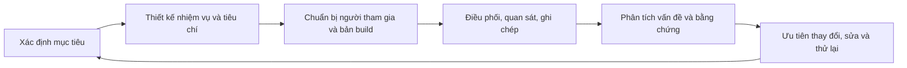

# Bài 09 — Giới thiệu phản hồi người dùng và kiểm thử trải nghiệm

> **Lộ trình:** Junior Programmer · **Chủ đề:** User feedback and testing · **Hình thức:** Bài học phương pháp kết hợp thực hành.

## 1. Tại sao game chạy đúng vẫn có thể khó chơi?

Một trò chơi có thể không có exception, điểm số cập nhật chính xác và nút bấm hoạt động, nhưng người chơi mới vẫn không biết chọn độ khó ở đâu hoặc không nhận ra mình đã thua. **Kiểm thử chức năng** trả lời câu hỏi “phần mềm có thực hiện đúng quy tắc đã lập trình không?”. **Kiểm thử khả dụng/trải nghiệm người dùng (usability testing)** tìm hiểu “người dùng mục tiêu có hoàn thành được việc họ muốn làm không, gặp trở ngại gì và vì sao?”.

Mục tiêu của hoạt động này là tạo ra **bằng chứng để cải thiện thiết kế**, không phải chứng minh sản phẩm đã hoàn hảo. Việc quan sát người sử dụng sớm, ngay từ prototype, giúp phát hiện vấn đề trước khi chi phí thay đổi tăng lên.

## 2. Mục tiêu học tập

Sau bài học, bạn có thể:

1. Phân biệt feedback tự phát, kiểm thử có cấu trúc, lỗi chức năng và vấn đề usability.
2. Xác định người dùng mục tiêu và mục đích của phiên kiểm thử.
3. Viết nhiệm vụ kiểm thử thực tế, không chứa gợi ý lời giải.
4. Điều phối phiên thử nghiệm với câu hỏi trung tính và có sự đồng ý khi ghi hình.
5. Ghi nhận dữ liệu quan sát định tính và chỉ số định lượng ở mức phù hợp.
6. Tổng hợp phát hiện, ưu tiên vấn đề và lên kế hoạch kiểm tra sau cải tiến.

## 3. Các loại thông tin cần phân biệt

| Loại thông tin | Ví dụ trong game nhấp mục tiêu | Giá trị |
|---|---|---|
| Hành vi quan sát | Người chơi bấm nhầm nút Restart hai lần | Bằng chứng về cách UI đang được hiểu và sử dụng. |
| Phản hồi trực tiếp | “Tôi không biết vì sao bị trừ điểm” | Gợi mở vấn đề cần xác minh. |
| Chỉ số định lượng | 3/5 người hoàn thành nhiệm vụ chọn Hard | Mô tả kết quả của mẫu kiểm thử hiện tại. |
| Lỗi chức năng | Button không có listener nên không gọi `StartGame` | Đòi hỏi debug, sửa code hoặc cấu hình. |
| Vấn đề usability | Button có listener đúng nhưng nhãn khó nhận ra | Đòi hỏi xem xét cách trình bày hoặc luồng tương tác. |

Chỉ số trên là **ví dụ minh họa**, không phải kết quả khảo sát thực tế. Với số người tham gia nhỏ, không nên suy rộng tỉ lệ phần trăm thành đặc điểm của toàn bộ người chơi nếu không có thiết kế nghiên cứu phù hợp.

## 4. Quy trình kiểm thử có cấu trúc

Quy trình là **vòng lặp**: sau khi sửa, phải thử lại để xác nhận vấn đề đã giảm và không gây lỗi mới. Một lượt test không thay thế các vòng phát triển tiếp theo.

## 5. Thiết kế một phiên kiểm thử cho Prototype 5

### 5.1. Xác định mục tiêu

Ví dụ các câu hỏi nghiên cứu cụ thể:

- Người chơi mới có hiểu cách bắt đầu game và chọn độ khó không?
- Họ có nhận biết mục tiêu tốt/xấu và cách tính điểm không?
- Khi trò chơi kết thúc, họ có hiểu lý do và tìm được cách chơi lại không?
- Thông tin Score Text có đủ dễ đọc trong lúc game diễn ra nhanh không?

Không hỏi mọi thứ cùng lúc. Mỗi mục tiêu cần đi kèm một nhiệm vụ và một cách thu thập bằng chứng.

### 5.2. Chọn người tham gia và chuẩn bị

Người thử nên gần với **đối tượng người chơi mục tiêu**, chẳng hạn người chưa biết trước nguyên tắc Prototype 5 nếu bạn muốn đánh giá khả năng tự tìm hiểu. Cần chuẩn bị:

1. Bản build hoặc project ổn định, có thể reset về trạng thái xuất phát.
2. Thiết bị và độ phân giải phù hợp; kiểm tra chuột/âm thanh trước khi bắt đầu.
3. Phiếu ghi chép: mã người tham gia (không cần tên thật), nhiệm vụ, kết quả và diễn biến.
4. Kịch bản hướng dẫn trung tính, nêu rõ đây là thử nghiệm **sản phẩm**, không phải kiểm tra năng lực cá nhân.
5. Cách xin phép ghi âm/ghi hình nếu sử dụng; chỉ thu thập dữ liệu cần thiết và bảo quản phù hợp.

Với thử nghiệm định tính quy mô nhỏ, một số ít người tham gia phù hợp có thể giúp tìm ra nhiều vấn đề, nhưng số lượng cần chọn theo mục tiêu và nguồn lực; không có một con số bảo đảm phát hiện mọi lỗi.

### 5.3. Viết nhiệm vụ kiểm thử thực tế

| Mục tiêu | Nhiệm vụ nên giao | Dấu hiệu hoàn thành |
|---|---|---|
| Nhận biết menu | “Hãy bắt đầu một phiên chơi ở mức bạn cho là khó nhất.” | Tìm đúng nút Hard và game bắt đầu. |
| Hiểu điểm | “Hãy thử chơi và cho biết điều gì khiến điểm thay đổi.” | Nhận ra mục tiêu dương/âm dựa trên trải nghiệm. |
| Nhận ra thua | “Hãy tiếp tục đến khi phiên chơi kết thúc.” | Nhận ra Game Over và giải thích được điều kiện xảy ra. |
| Chơi lại | “Hãy bắt đầu một phiên chơi mới.” | Sử dụng Restart thành công. |

Nhiệm vụ như “Hãy nhấp vào nút Hard nằm dưới cùng” **không phù hợp** để kiểm tra khả năng tìm nút: câu nói đã tiết lộ cả tên lẫn vị trí điều khiển. Hãy mô tả **mục tiêu thực tế**, không đưa ra **chuỗi thao tác**.

## 6. Điều phối mà không dẫn dắt

### 6.1. Trước khi bắt đầu

Giới thiệu mục tiêu buổi thử, dự kiến các nhiệm vụ và quyền ngừng tham gia. Nếu thu âm/ghi hình, xin đồng ý trước. Không giảng trước những điều bạn đang muốn đo: ví dụ, nếu muốn kiểm tra người chơi có tự nhận ra nút chọn độ khó hay không, không hướng dẫn họ cách tìm nút này.

### 6.2. Trong khi người dùng thao tác

Khuyến khích người tham gia **nói ra suy nghĩ (think aloud)** ở mức họ cảm thấy thoải mái, nhưng ưu tiên quan sát hành vi tự nhiên. Ghi lại những khoảnh khắc do dự, thao tác nhầm, bỏ cuộc, thành công và cách họ tự sửa sai.

Nếu người chơi gặp khó khăn, đừng ngay lập tức can thiệp. Có thể đặt một thời điểm trợ giúp được xác định trong kịch bản (ví dụ sau một khoảng chờ hợp lý), đánh dấu **đã cần hỗ trợ** rồi mới hướng dẫn để tiếp tục các nhiệm vụ còn lại. Phân biệt rõ kết quả **hoàn thành độc lập** và **hoàn thành nhờ trợ giúp**.

| Câu hỏi nên tránh | Câu hỏi trung tính hơn |
|---|---|
| “Bạn thấy nút Hard khó tìm đúng không?” | “Bạn đã quyết định bắt đầu theo cách nào?” |
| “Nút này rất rõ mà, sao không bấm?” | “Bạn đang mong đợi điều gì xảy ra tại bước này?” |
| “Hiệu ứng nổ có làm bạn thích thú không?” | “Bạn nhận ra điều gì sau khi nhấp mục tiêu?” |
| “Bạn muốn nút Restart to hơn chứ?” | “Điều gì giúp hoặc cản trở việc bắt đầu lại?” |

Câu hỏi trung tính không áp đặt cảm xúc hoặc câu trả lời mong muốn lên người tham gia.

### 6.3. Sau khi hoàn thành

Hỏi thêm về những điểm đã quan sát được, không tranh luận để bảo vệ thiết kế. Cảm ơn người tham gia; lưu bằng chứng được phép và ghi lại những vấn đề có thể tái hiện.

## 7. Đo lường và phân tích kết quả

Một bảng ghi chép đơn giản có thể gồm:

| Mã | Nhiệm vụ | Thành công độc lập? | Cần hỗ trợ? | Thời gian | Bằng chứng |
|---|---|---|---|---|---|
| P01 | Chọn Hard | Có | Không | Ghi số giây đo được | Nhấn đúng từ menu. |
| P01 | Chơi lại | Không | Có | Ghi số giây đo được | Tìm trên màn hình Game Over nhưng không nhận ra nút. |
| P02 | Chọn Hard | ... | ... | ... | ... |

Nếu có `n` lượt thử hợp lệ, trong đó `s` lượt hoàn thành độc lập, có thể mô tả tỉ lệ hoàn thành trong **chính mẫu đã kiểm tra** là:

$$
\text{Tỉ lệ hoàn thành nhiệm vụ} = \frac{s}{n} \times 100\%
$$

Với thời gian, cần quy định rõ **điểm bắt đầu** và **điểm kết thúc**; với trường hợp thất bại, phải chọn cách xử lý nhất quán thay vì lặng lẽ loại khỏi thống kê.

### 7.1. Từ quan sát đến vấn đề có thể sửa

**Quan sát:** “P01 nhìn quanh màn hình Game Over và nhấp vào Score Text ba lần”.

**Giả thuyết thiết kế:** nút Restart không nổi bật hoặc nhãn chưa truyền tải đúng hành động.

**Biện pháp có thể thử:** tăng độ tương phản, đặt nút gần tiêu đề Game Over, đổi nhãn rõ nghĩa.

**Tiêu chí xác nhận:** trong phiên thử tiếp theo, nhiều người có thể tìm cách chơi lại độc lập hơn; đồng thời nút vẫn hoạt động đúng kỹ thuật.

Cần phân biệt **quan sát** với **suy luận nguyên nhân**. Một lỗi chỉ mới có dấu hiệu trong một phiên test không đủ để kết luận chắc chắn nguyên nhân; có thể kết hợp thêm ghi hình, log hoặc kiểm thử lặp.

### 7.2. Ưu tiên thay đổi

| Mức | Ví dụ | Cách xử lý |
|---|---|---|
| Nghiêm trọng | Người chơi không thể bắt đầu hoặc chơi lại | Sửa trước khi triển khai rộng. |
| Cao | Không nhận ra điều kiện thua, thường xuyên thao tác nhầm | Chỉnh luồng hoặc phản hồi, kiểm thử lại. |
| Trung bình | Chữ điểm khó đọc ở một tỉ lệ màn hình | Sửa anchors/cỡ chữ, kiểm thử nhiều độ phân giải. |
| Thấp | Màu sắc phụ ít phù hợp thẩm mỹ nhưng không cản trở thao tác | Xếp sau lỗi chức năng và trở ngại lớn. |

Mức ưu tiên phụ thuộc cả **tác động tới mục tiêu người dùng**, **tần suất quan sát**, **mức độ tin cậy của bằng chứng** và **chi phí sửa**; không chỉ dựa trên số người phàn nàn.

## 8. Bài thực hành: Đánh giá một sản phẩm quen thuộc

Chọn một ứng dụng hoặc trò chơi bạn thường sử dụng. Viết bản đánh giá khoảng một trang gồm: nhu cầu người dùng mà sản phẩm đáp ứng; điều gì làm thao tác thuận tiện; ba điểm cần cải thiện; bằng chứng hoặc tình huống cụ thể; và ít nhất hai câu hỏi trung tính bạn muốn hỏi người sử dụng khác.

**Sản phẩm cần nộp (tự biên soạn):** mục tiêu kiểm thử, ba nhiệm vụ, mẫu bảng quan sát, bản tổng hợp phát hiện, đề xuất thay đổi và kế hoạch thử lại. Không cần thu dữ liệu cá nhân không liên quan.

## 9. Câu hỏi ôn tập

**Câu 1.** Điều nào phân biệt usability testing với chỉ chạy thử chức năng?

A. Usability testing chỉ kiểm tra chương trình có biên dịch không.  
B. Usability testing đo cách người dùng thật thực hiện nhiệm vụ và gặp trở ngại.  
C. Usability testing không cần quan sát hành vi.  
D. Usability testing chỉ dùng để tìm lỗi vật lý.

**Đáp án:** B. **Giải thích:** Kiểm thử trải nghiệm tập trung vào mức độ người dùng thực hiện được mục tiêu của họ.

**Câu 2.** Nhiệm vụ nào phù hợp nhất nếu muốn biết người dùng có tự tìm được nút Hard không?

A. “Nhấn nút Hard ở dưới.”  
B. “Tìm nút màu đỏ phía phải.”  
C. “Bấm button đầu tiên có chữ Hard.”  
D. “Hãy bắt đầu ở mức chơi bạn cho là khó nhất.”

**Đáp án:** D. **Giải thích:** Nhiệm vụ nêu mục tiêu, không tiết lộ giao diện hoặc thao tác cần tìm.

**Câu 3.** Người tham gia không nhấn Restart. Đâu là cách ghi chép tốt nhất?

A. Mô tả hành vi cụ thể, tách riêng suy luận nguyên nhân.  
B. Kết luận ngay “người dùng kém”.  
C. Tự sửa UI trong lúc họ đang thử.  
D. Bỏ qua vì game đã chạy đúng.

**Đáp án:** A. **Giải thích:** Bằng chứng quan sát độc lập với giả thuyết, giúp giảm thiên lệch khi phân tích.

**Câu 4.** Câu hỏi nào ít dẫn dắt hơn?

A. “Bạn có ghét màn hình này không?”  
B. “Chắc bạn thấy nút quá nhỏ?”  
C. “Điều gì dễ hoặc khó trong quá trình bắt đầu phiên chơi?”  
D. “Game này dễ dùng đúng không?”

**Đáp án:** C. **Giải thích:** Câu hỏi mở không áp đặt cảm giác hoặc câu trả lời.

**Câu 5.** Với 3/5 người tham gia một buổi thử thành công, kết luận nào hợp lý nhất?

A. Chắc chắn 60% mọi người chơi trên thế giới sẽ thành công.  
B. Trong **mẫu đã thử**, 60% người hoàn thành; cần thận trọng khi suy rộng.  
C. Không thể rút ra bất cứ quan sát hữu ích nào.  
D. Bắt buộc phải xóa chức năng đang thử.

**Đáp án:** B. **Giải thích:** Kết quả định lượng ở mẫu nhỏ là mô tả dữ liệu hiện có, không phải tỷ lệ quần thể đã được chứng minh.

## 10. Tổng kết

Kiểm thử người dùng là một quá trình **có mục tiêu, nhiệm vụ, quan sát, phân tích và lặp lại**. Người điều phối càng ít dẫn dắt, thông tin thu được càng hữu ích để phân biệt lỗi phần mềm, trở ngại thiết kế và những nhu cầu người chơi chưa được đáp ứng.

## 11. Tài liệu tham khảo

- [Unity Learn — Introduction to user feedback and testing, Unity 6.3](https://learn.unity.com/pathway/junior-programmer/unit/user-interface/tutorial/introduction-to-user-feedback?version=6.3).
- [Nielsen Norman Group — Turn User Goals into Task Scenarios for Usability Testing](https://www.nngroup.com/articles/task-scenarios-usability-testing/).
- [Nielsen Norman Group — Avoid Leading Questions](https://www.nngroup.com/articles/leading-questions/).
- [Nielsen Norman Group — Qualitative Usability Testing Study Guide](https://www.nngroup.com/articles/qual-usability-testing-study-guide/).
