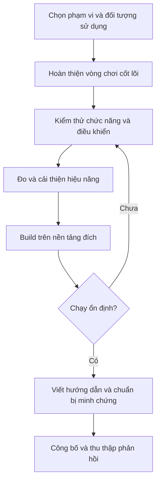

# Bài 01 — Định hướng hoàn thiện và công bố dự án Unity

> **Lộ trình:** Junior Programmer · **Chủ đề:** Next Steps / Publishing Your Project · **Mức độ:** Nhập môn · **Đối tượng:** Người đã tạo được một nguyên mẫu Unity và muốn hoàn thiện thành sản phẩm có thể giới thiệu.

## 1. Tóm tắt

Một nguyên mẫu (*prototype*) chứng minh rằng cơ chế chơi có thể hoạt động; một sản phẩm có thể chia sẻ cần thêm tính ổn định, khả năng cài đặt hoặc chạy thử, hướng dẫn sử dụng và bằng chứng về chất lượng. Giai đoạn tiếp theo của người học Unity không chỉ là viết thêm C# mà còn biết **hoàn thiện, kiểm chứng, đóng gói và trình bày** những gì đã tạo ra.

Trong chặng học này, ba mục tiêu có quan hệ trực tiếp: củng cố kỹ năng lập trình và giải quyết vấn đề; phát triển một *personal project* đủ hoàn chỉnh để người khác trải nghiệm; chuẩn bị minh chứng năng lực phục vụ học tập, chứng chỉ hoặc tuyển dụng. Chứng chỉ là một lựa chọn bổ trợ, không thay thế sản phẩm thực tế.

## 2. Mục tiêu học tập

Sau bài học, người học có thể:

- Phân biệt nguyên mẫu, bản thử nghiệm (*playtest build*) và bản phát hành (*release build*).
- Xây dựng một kế hoạch hoàn thiện dự án với đầu ra và tiêu chí đo được.
- Kiểm tra sự khác biệt giữa Play Mode trong Editor và bản build chạy độc lập.
- Chuẩn bị bộ minh chứng cơ bản gồm bản chạy được, tài liệu hướng dẫn và hình ảnh hoặc video.
- Xác định các kỹ năng cần tự nghiên cứu, kiểm thử và cải thiện trước khi công bố.

## 3. Từ nguyên mẫu đến sản phẩm có thể chia sẻ

Một trò chơi chạy được trong `Game` view mới chỉ được kiểm chứng ở môi trường phát triển. Khi xuất bản, người chơi không có cửa sổ `Hierarchy`, `Inspector` hay `Console` để tự sửa lỗi; mọi tương tác phải hoạt động trên thiết bị đích.

| Giai đoạn | Câu hỏi trung tâm | Kết quả cần có |
| --- | --- | --- |
| Prototype | Cơ chế chính có hoạt động không? | Một vòng chơi có thể thử nghiệm |
| Playable build | Người khác có tự chơi được không? | Bản chạy độc lập và hướng dẫn cơ bản |
| Release candidate | Các lỗi nghiêm trọng đã được kiểm soát chưa? | Bản kiểm thử gần với cấu hình công bố |
| Release | Người dùng có thể truy cập và phản hồi không? | Gói phân phối, mô tả, ghi chú phát hành |

Không nên hiểu đây là bốn mốc bắt buộc cho mọi bài tập nhỏ. Chúng là những mức độ hoàn thiện giúp xác định khi nào dự án đủ tốt để chuyển sang bước tiếp theo.

## 4. Quy trình hoàn thiện dự án



Sơ đồ thể hiện một chu trình lặp: nếu bản build thất bại hoặc người chơi phát hiện lỗi, dự án quay lại khâu kiểm thử thay vì tiếp tục công bố. Việc hoàn thiện có thể diễn ra nhiều vòng trước khi đạt tiêu chí chấp nhận.

### 4.1. Xác định phạm vi tối thiểu

Mô tả trò chơi trong một câu và xác định *core loop* — chuỗi hành động lặp tạo nên trải nghiệm. Ví dụ: “Người chơi di chuyển để tránh chướng ngại vật, ghi điểm theo thời gian sống sót và có thể chơi lại khi thua”. Với trò chơi này, các thành phần bắt buộc là điều khiển, va chạm, tính điểm, game over và restart; thêm nhiều màn chơi hoặc hiệu ứng phức tạp là ưu tiên thấp hơn.

Tạo danh sách công việc theo ba nhóm: **phải có**, **nên có** và **có thể bổ sung**. Một yêu cầu chỉ được xem là hoàn thành khi có cách kiểm chứng; ví dụ “Nhấn Restart ba lần liên tiếp không làm tăng số đối tượng tồn tại ngoài dự kiến”.

### 4.2. Kiểm tra tính đúng đắn

Thử các trạng thái bắt đầu, đang chơi, tạm dừng (nếu có), kết thúc và chơi lại. Kiểm tra cả trường hợp biên: nhấn nút liên tục, mất focus cửa sổ, thay đổi độ phân giải, đối tượng bị hủy, hoặc scene được tải lại. Đọc `Console` khi có cảnh báo và ngoại lệ; không đánh đồng việc game vẫn hiển thị với việc game không có lỗi.

### 4.3. Kiểm tra hiệu năng

Quan sát độ mượt, thời gian phản hồi input và việc cấp phát bộ nhớ. Dùng `Window > Analysis > Profiler` để xác định điểm nghẽn nếu có. Kết quả trong Editor chỉ dùng để tham khảo; cần xác nhận trên bản build và thiết bị phù hợp. Không kết luận một kỹ thuật “nhanh hơn” chỉ vì cảm giác chơi tốt hơn trong một lần chạy.

### 4.4. Tạo bản build

Trong Unity 6, mở `File > Build Profiles` để chọn cấu hình nền tảng. Kiểm tra `Scene List` và thứ tự scene; scene cần chạy phải được đưa vào danh sách và không bị loại khỏi build. Tạo build, sau đó chạy trực tiếp từ thư mục đầu ra thay vì chỉ nhấn Play trong Editor.

Nếu định chia sẻ công khai, nên kiểm tra bản **không bật Development Build** để trải nghiệm gần môi trường phát hành. Với Windows, hãy giữ tệp thực thi cùng thư mục dữ liệu và các tệp liên quan do Unity tạo ra; không gửi riêng mỗi `.exe` nếu build cần các tệp đi kèm. Với Web, cần máy chủ hoặc nền tảng lưu trữ tương thích thay vì giả định mọi build chạy trực tiếp khi mở tệp HTML cục bộ.

## 5. Chuẩn bị bộ sản phẩm bàn giao

Một gói cơ bản có thể được tổ chức như sau:

```text
MyGame/
├── Build/                 # Bản chạy trên nền tảng đã chọn
├── Screenshots/           # Ảnh hoặc video minh chứng
├── README.md              # Giới thiệu và cách chơi
├── CREDITS.md             # Tác giả, nguồn asset và giấy phép
└── KNOWN_ISSUES.md        # Các hạn chế đã biết (nếu có)
```

Đây là cấu trúc minh họa, không phải quy định bắt buộc của Unity. Nếu công bố mã nguồn, bổ sung hướng dẫn mở dự án bằng Unity Editor, phiên bản Unity và danh sách package cần thiết. Không đưa khóa API, mật khẩu hoặc dữ liệu cá nhân vào repository.

Một `README.md` tốt cần trả lời: trò chơi làm gì, điều khiển như thế nào, chạy bằng cách nào, nền tảng nào được hỗ trợ, ai đóng góp và những hạn chế nào còn tồn tại. Một ảnh chụp từ bản build thể hiện kết quả tốt hơn ảnh chụp cửa sổ Inspector.

## 6. Thực hành — Lập kế hoạch công bố một game nhỏ

**Tình huống:** Một trò chơi đã có điều khiển, vật cản, điểm số và màn hình kết thúc.

1. Viết mô tả trải nghiệm trong 1–2 câu và xác định tối đa năm chức năng phải hoạt động.
2. Tạo một bảng kiểm thử cho từng chức năng với cột: **thao tác**, **kỳ vọng**, **kết quả**, **trạng thái**.
3. Kiểm thử trong Editor, sau đó tạo bản build từ `Build Profiles`.
4. Chạy bản build và so sánh ít nhất ba hành vi: input, UI theo độ phân giải, kết thúc và chơi lại.
5. Ghi nhận tối thiểu một lỗi hoặc rủi ro, sau đó thực hiện kiểm tra xác nhận.
6. Viết `README.md` ngắn và chụp ít nhất một ảnh gameplay.

**Tiêu chí hoàn thành:** Người khác có thể đọc hướng dẫn, mở bản build, chơi hết một vòng và biết cách bắt đầu lại mà không cần người tạo hỗ trợ trực tiếp.

## 7. Những sai lầm thường gặp

| Sai lầm | Tác động | Cách phòng tránh |
| --- | --- | --- |
| Chỉ kiểm thử trong Editor | Không phát hiện lỗi riêng của nền tảng | Chạy trực tiếp bản build |
| Thêm tính năng không giới hạn | Không có bản hoàn chỉnh | Chốt phạm vi và tiêu chí chấp nhận |
| Quên scene trong build | Màn chơi không thể tải | Kiểm tra `Scene List` |
| Không ghi nguồn asset | Rủi ro giấy phép, khó ghi công | Lưu tác giả, đường dẫn và điều khoản sử dụng |
| Không có hướng dẫn chơi | Người đánh giá khó trải nghiệm | Viết README, hiển thị điều khiển trong game |
| Công bố cả dữ liệu nhạy cảm | Rủi ro bảo mật và riêng tư | Rà soát tệp, cấu hình và lịch sử commit |

## 8. Câu hỏi ôn tập

### Câu 1

Một trò chơi hoạt động trong Editor nhưng người khác chưa thể chạy. Bước tiếp theo phù hợp nhất là gì?

A. Thêm nhiều vật thể trang trí.  
B. Tạo bản build cho nền tảng đích và kiểm thử độc lập.  
C. Đổi tên tất cả script.  
D. Bỏ qua phần kiểm thử vì Play Mode đã chạy.

**Đáp án:** B. **Giải thích:** Bản build là môi trường mà người chơi sẽ sử dụng; kết quả trong Editor chưa bảo đảm tính tương thích.

### Câu 2

Đâu là tiêu chí chấp nhận có thể kiểm chứng?

A. Game rất thú vị.  
B. Giao diện trông hiện đại.  
C. Game đủ tốt.  
D. Nhấn Restart sau game over sẽ đưa điểm về 0 và bắt đầu vòng chơi mới.

**Đáp án:** D. **Giải thích:** Yêu cầu xác định thao tác và hành vi quan sát được.

### Câu 3

Vì sao cần ghi nguồn và giấy phép asset?

A. Để xác định quyền sử dụng và ghi công đúng.  
B. Để tăng FPS.  
C. Để script biên dịch nhanh hơn.  
D. Để thay thế kiểm thử.

**Đáp án:** A. **Giải thích:** Quyền phân phối asset là vấn đề pháp lý độc lập với hiệu năng.

### Câu 4

Sau khi phát hiện lỗi chỉ xuất hiện trong bản build, cách xử lý hợp lý là gì?

A. Xóa toàn bộ project.  
B. Tiếp tục phát hành vì Editor không lỗi.  
C. Ghi bước tái hiện, thu thập log, sửa nguyên nhân rồi build lại.  
D. Đổi tên sản phẩm.

**Đáp án:** C. **Giải thích:** Một quy trình tái hiện và kiểm chứng giúp xác định lỗi có thực sự được giải quyết hay không.

### Câu 5

Portfolio có thể chứng minh tốt nhất điều gì khi đi kèm bản build và giải thích kỹ thuật?

A. Chỉ số lượng tệp trong project.  
B. Khả năng tạo ra sản phẩm, giải quyết vấn đề và trình bày kết quả.  
C. Việc sử dụng thật nhiều asset miễn phí.  
D. Việc đã mở Unity Editor.

**Đáp án:** B. **Giải thích:** Portfolio có giá trị khi thể hiện sản phẩm và vai trò đóng góp thực tế.

## 9. Tổng kết

Giai đoạn hoàn thiện dự án nối liền kỹ năng lập trình với năng lực giao sản phẩm. Hãy ưu tiên trò chơi chạy đúng, người khác dùng được, có kiểm thử và có cách giới thiệu rõ ràng trước khi mở rộng thêm tính năng.

## 10. Tài liệu tham khảo và học tiếp

- [Unity Learn — Next Steps: Introduction](https://learn.unity.com/course/next-steps/tutorial/next-steps-introduction?version=6.0) — bối cảnh học tập, dự án cá nhân và chuẩn bị chứng chỉ.
- [Unity Learn — Publishing Your Project](https://learn.unity.com/pathway/junior-programmer/unit/publishing-your-project?version=6) — mục tiêu kỹ năng của chặng hoàn thiện dự án.
- [Unity Manual — Build scene list](https://docs.unity3d.com/6000.0/Documentation/Manual/build-profile-scene-list.html) — quản lý scene trong bản build Unity 6.
- [Unity Manual — Profiling your application](https://docs.unity3d.com/2022.2/Documentation/Manual/profiler-profiling-applications.html) — phân biệt phép đo trong Editor và trên thiết bị đích.

*Ghi chú tương thích:* Phần đối chiếu bài học trên Unity Learn có lựa chọn phiên bản 6.0; các khái niệm vẫn có ích khi dùng Unity 6.x, nhưng tên mục và thao tác cần được xác minh trong bản Editor đang cài.
