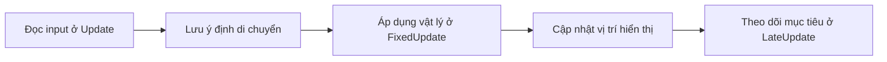
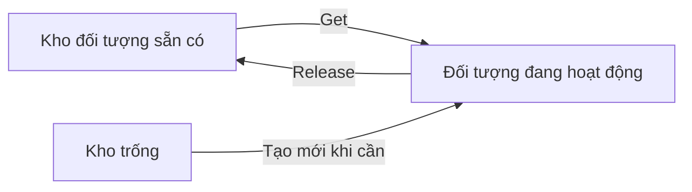

# Bài 02 — Tối ưu dự án Unity: thuộc tính biến, vòng đời script và Object Pooling

> **Lộ trình:** Junior Programmer · **Bài tương ứng:** Lesson 6.1 — Project Optimization · **Phạm vi:** `MonoBehaviour`, C#, vòng cập nhật và tái sử dụng GameObject trong Unity 6.x.

## 1. Tóm tắt

Tối ưu dự án (*project optimization*) là cải thiện mức sử dụng tài nguyên mà vẫn bảo toàn hành vi cần thiết. Với game nhỏ, lợi ích có thể chưa rõ; khi số lượng đối tượng và thiết bị hỗ trợ tăng lên, các quyết định về cách tổ chức biến, thời điểm chạy logic và cấp phát đối tượng sẽ ảnh hưởng đáng kể đến khả năng mở rộng.

Bài học triển khai ba nhóm kỹ năng: **kiểm soát dữ liệu có thể chỉnh trong Inspector**, **đặt logic vào đúng hàm sự kiện**, và **tránh tạo/hủy GameObject lặp đi lặp lại khi có thể tái sử dụng**. Phần đo bằng Profiler được dùng để đánh giá, chứ không thay thế các nguyên lý trên.

## 2. Mục tiêu học tập

Sau bài học, người học có thể:

- Phân biệt `public`, `private`, `[SerializeField]`, `const`, `readonly`, `static` và `protected` trong bối cảnh Unity.
- Chọn đúng `Awake`, `Start`, `Update`, `FixedUpdate` và `LateUpdate` cho từng loại công việc.
- Giải thích vì sao tách xử lý physics và camera-follow có thể giảm lỗi chuyển động.
- Triển khai một Object Pool đơn giản và nhận diện rủi ro do không khôi phục trạng thái đối tượng.
- Đo lường kết quả tối ưu hóa bằng điều kiện thử nghiệm nhất quán.

## 3. Thuộc tính và phạm vi truy cập biến trong C#

Các biến trong một `MonoBehaviour` không đồng nghĩa với dữ liệu luôn hiển thị trong `Inspector`. C# quyết định khả năng truy cập, còn hệ thống **serialization** của Unity quyết định dữ liệu nào được lưu cùng scene hoặc prefab và hiển thị để chỉnh sửa.

### 3.1. `public`, `private` và `[SerializeField]`

```csharp
using UnityEngine;

public class PlayerSettings : MonoBehaviour
{
    public float visibleToOtherScripts = 5f;

    [SerializeField] private float moveSpeed = 8f;
    private float temporaryCalculation = 0f;

    public float MoveSpeed => moveSpeed;
}
```

- `public` cho phép mã khác truy cập field; nếu kiểu dữ liệu được Unity hỗ trợ serialize, field thường xuất hiện trong Inspector.
- `private` giới hạn truy cập trong class. Field `private` thông thường không được Unity lưu/hiển thị.
- `[SerializeField]` yêu cầu Unity serialize field `private` hợp lệ, nhờ đó có thể điều chỉnh trong Inspector mà không mở quyền ghi cho mọi script.
- Property `MoveSpeed` là giao diện đọc giá trị; thuộc tính C# thông thường không tự động được Unity serialize theo cùng quy tắc như field.

**Nguyên tắc thiết kế:** Đừng để mọi field thành `public` chỉ để chỉnh trong Inspector. Ưu tiên đóng gói dữ liệu qua `[SerializeField] private` và công khai API khi cần.

### 3.2. Những từ khóa dễ nhầm

| Từ khóa / attribute | Mục đích chính | Có phải field Unity serialize thông thường? |
| --- | --- | --- |
| `public` | Cho phép truy cập từ mã bên ngoài | Có, nếu thuộc loại được hỗ trợ và không bị loại trừ |
| `private` | Giới hạn truy cập | Không, trừ khi có `[SerializeField]` hay cơ chế phù hợp |
| `[SerializeField]` | Yêu cầu lưu field hợp lệ, kể cả `private` | Có |
| `const` | Hằng số được xác định tại thời điểm biên dịch | Không |
| `readonly` | Field chỉ được gán khi khai báo hoặc trong constructor (theo luật C#) | Không |
| `static` | Thành viên thuộc về class thay vì từng instance | Không |
| `protected` | Cho phép class hiện tại và class kế thừa truy cập | Không tự làm field được serialize |

Lưu ý quan trọng: `readonly`, `const`, `static` **không phải attribute** như `[SerializeField]`; chúng là modifier của C#. Không nên dựa vào thay đổi tạm thời trong Play Mode để thiết lập giá trị vĩnh viễn cho scene vì các thay đổi runtime thông thường sẽ không được lưu lại sau khi thoát Play Mode.

**Bài thử:** Trong một bản sao `PlayerController.cs`, chuyển các giá trị tốc độ, lực nhảy hoặc thông số điều khiển thành `[SerializeField] private`. Trở lại Inspector, chỉnh một giá trị và quan sát kết quả. Không xóa logic đang dùng field mà chưa cập nhật các tham chiếu trong script.

## 4. Vòng đời `MonoBehaviour` và thời điểm cập nhật

Unity gọi các hàm sự kiện vào những thời điểm khác nhau. Chọn sai hàm có thể gây giật camera, bỏ sót input hoặc làm tính toán vật lý thiếu nhất quán.

### 4.1. Khởi tạo: `Awake()` và `Start()`

- `Awake()` thường dùng để thiết lập dữ liệu nội bộ, lưu tham chiếu `GetComponent`, chuẩn bị trạng thái. Nó chạy khi instance được nạp và ở điều kiện kích hoạt thích hợp.
- `Start()` chạy trước lần cập nhật khung hình đầu tiên của component đang bật; phù hợp với khởi tạo phụ thuộc trạng thái đã được chuẩn bị.
- Không mặc định thứ tự `Awake()` giữa các GameObject khác nhau; các phụ thuộc phức tạp cần được thiết kế rõ ràng thay vì dựa vào thứ tự ngẫu nhiên.

```csharp
using UnityEngine;

[RequireComponent(typeof(Rigidbody))]
public class CachedRigidBody : MonoBehaviour
{
    private Rigidbody rb;

    private void Awake()
    {
        rb = GetComponent<Rigidbody>();
    }

    private void Start()
    {
        Debug.Log($"RigidBody ready: {rb != null}");
    }
}
```

`[RequireComponent]` hỗ trợ đảm bảo một GameObject có component cần thiết khi gắn script, còn `GetComponent` được dùng một lần để lưu tham chiếu. Nếu dự án dùng `Rigidbody2D`, phải đổi cả loại component lẫn API liên quan.

### 4.2. `Update()`, `FixedUpdate()` và `LateUpdate()`

| Hàm | Thời điểm gọi | Công việc phù hợp | Lưu ý |
| --- | --- | --- | --- |
| `Update()` | Mỗi frame render | Đọc input từng frame, gameplay không phụ thuộc physics step | Số lần gọi phụ thuộc FPS |
| `FixedUpdate()` | Theo bước thời gian vật lý cố định | Áp dụng lực, xử lý `Rigidbody` | Một frame có thể có 0, 1 hoặc nhiều lượt gọi |
| `LateUpdate()` | Sau các `Update` cùng frame | Camera follow, điều chỉnh phụ thuộc vị trí mới | Không mặc định thay thế physics update |



Sơ đồ trên mô tả **quan hệ trách nhiệm**, không phải cam kết rằng Unity luôn gọi đủ ba hàm theo đúng thứ tự tuyến tính trong mỗi frame. `FixedUpdate()` vận hành theo đồng hồ vật lý nên có thể xuất hiện số lần khác nhau trong một frame hiển thị.

Với chuyển động điều khiển `Rigidbody`, đọc phím trong `Update()` và lưu đầu vào; áp dụng lực hoặc chuyển động vật lý trong `FixedUpdate()`. Một camera theo sau có thể cập nhật vị trí trong `LateUpdate()`. Khi vật thể di chuyển bằng physics mà camera vẫn giật, xem xét `Rigidbody Interpolation` và cấu hình thời gian vật lý; đổi tên `Update` thành `FixedUpdate` không tự động giải quyết mọi vấn đề.

Ví dụ camera-follow đơn giản dùng cho Transform-driven target:

```csharp
using UnityEngine;

public class FollowTarget : MonoBehaviour
{
    [SerializeField] private Transform target;
    [SerializeField] private Vector3 offset = new Vector3(0f, 3f, -6f);

    private void LateUpdate()
    {
        if (target == null) return;
        transform.position = target.position + offset;
    }
}
```

Script này không phụ thuộc Input System. Để dùng, gắn vào Camera và kéo đối tượng cần theo dõi vào field `target` trong Inspector.

## 5. Object Pooling — tái sử dụng thay vì tạo/hủy liên tục

### 5.1. Vấn đề của `Instantiate` và `Destroy`

Một game bắn đạn có thể tạo hàng chục viên đạn trong thời gian ngắn. Nếu mỗi lần bắn gọi `Instantiate`, sau đó `Destroy` khi ra khỏi màn hình, engine liên tục phải cấp phát, khởi tạo và thu hồi tài nguyên. Các đối tượng và tài nguyên quản lý còn có thể làm tăng áp lực lên Garbage Collector.

**Object Pool** giữ lại các đối tượng đã tạo và chuyển chúng giữa hai trạng thái: đang dùng và có thể tái sử dụng.



Pool không giúp mọi game nhanh hơn một cách tự động: nó đổi chi phí tạo/hủy thường xuyên lấy bộ nhớ dự trữ và logic quản lý trạng thái. Đối tượng phải được **reset** đúng cách khi lấy ra hoặc trả về.

### 5.2. Ví dụ `UnityEngine.Pool.ObjectPool<T>`

Unity 6 cung cấp `UnityEngine.Pool.ObjectPool<T>`. Ví dụ sau tạo pool cho một prefab đơn giản, lấy ra bằng phím Space và trả lại sau một khoảng thời gian.

```csharp
using System.Collections;
using UnityEngine;
using UnityEngine.Pool;

public class PooledSpawner : MonoBehaviour
{
    [SerializeField] private GameObject prefab;
    [SerializeField] private float lifetime = 1f;

    private ObjectPool<GameObject> pool;

    private void Awake()
    {
        pool = new ObjectPool<GameObject>(
            createFunc: () =>
            {
                GameObject item = Instantiate(prefab);
                item.SetActive(false);
                return item;
            },
            actionOnGet: item => item.SetActive(true),
            actionOnRelease: item => item.SetActive(false),
            actionOnDestroy: item => Destroy(item),
            collectionCheck: true,
            defaultCapacity: 10,
            maxSize: 30
        );
    }

    private void Update()
    {
        // Ví dụ dùng Legacy Input Manager.
        if (Input.GetKeyDown(KeyCode.Space))
        {
            GameObject item = pool.Get();
            item.transform.SetPositionAndRotation(transform.position, transform.rotation);
            StartCoroutine(ReturnAfter(item, lifetime));
        }
    }

    private IEnumerator ReturnAfter(GameObject item, float seconds)
    {
        yield return new WaitForSeconds(seconds);
        pool.Release(item);
    }
}
```

**Cách thử:** Tạo một prefab từ `Cube` hoặc `Sphere`, thêm GameObject trống `SpawnManager`, gắn script và kéo prefab vào field. Chạy game, nhấn Space nhiều lần, theo dõi đối tượng xuất hiện rồi ẩn đi.

**Giới hạn ví dụ:** Mỗi lần nhấn tạo một vòng đời coroutine duy nhất cho đối tượng vừa lấy ra, phù hợp minh họa nhỏ. Trong game thật, đối tượng có thể phải trả về sớm khi va chạm; cần cơ chế tránh `Release` hai lần, hủy/tạm dừng coroutine đúng cách và reset vận tốc, hiệu ứng, âm thanh, thời gian sống. Ví dụ `Input.GetKeyDown` sử dụng **Legacy Input Manager**; nếu dự án chỉ bật **Input System** mới, thay phần đọc phím bằng action của hệ đó. `ObjectPool<T>` không an toàn để thao tác đồng thời từ nhiều thread.

### 5.3. Thực hành theo mô hình Prototype 2

Với game ném thức ăn vào động vật, tạo pool cho projectile thay vì tạo và hủy mỗi lần bắn. Chỉ định các đối tượng cần pooling, chọn lượng dự trữ phù hợp với số projectile có thể cùng tồn tại và bảo đảm projectile được trả pool khi hết thời gian sống hoặc rời khỏi vùng chơi.

Nếu dùng package `Object Pooling` đi kèm bài học Unity Learn, tên script, field và hành vi phụ thuộc chính package đó. Ví dụ ở trên là triển khai độc lập bằng API Unity chuẩn; **không trộn** hai cách triển khai nếu chưa đối chiếu contract của từng script.

## 6. Đo đạc trước và sau tối ưu

Khái niệm quan trọng: **FPS là triệu chứng tổng hợp, không phải bằng chứng chỉ ra điểm nghẽn**. Cần đo CPU time, GC allocation, memory và, nếu phù hợp, GPU.

| Mục tiêu tốc độ | Ngân sách thời gian mỗi frame xấp xỉ |
| --- | --- |
| 30 FPS | 33,3 ms |
| 60 FPS | 16,7 ms |
| 120 FPS | 8,3 ms |

Tính bằng `1000 / FPS`; đây là ngân sách tham khảo, không phải cam kết đạt hiệu năng. VSync, giới hạn FPS, màn hình, thiết bị và tải của hệ thống đều ảnh hưởng phép đo.

Quy trình đo:

1. Build **Development Build** cho thiết bị đích và kết nối Unity Profiler nếu nền tảng hỗ trợ.
2. Chạy một kịch bản lặp lại được, ví dụ bắn liên tục cùng số lượng projectile.
3. Ghi trung vị hoặc một khoảng thống kê thời gian frame, GC allocation và số đối tượng tạo.
4. Thay một yếu tố — cơ chế `Instantiate/Destroy` bằng pooling.
5. Đo lại cùng điều kiện; so sánh cả hiệu năng lẫn bộ nhớ, rồi kiểm thử chức năng.

`Deep Profiling` có thể làm phép đo nặng hơn đáng kể; chỉ bật khi cần và diễn giải kết quả cẩn thận. Khi pool giữ nhiều vật thể hơn, memory có thể tăng dù chi phí CPU giảm.

## 7. Lỗi thường gặp

| Hiện tượng | Nguyên nhân khả dĩ | Kiểm tra / sửa |
| --- | --- | --- |
| Field không hiện trong Inspector | `private` thiếu `[SerializeField]`; kiểu không hỗ trợ; `static`, `const`, `readonly` | Xem quy tắc serialization |
| Camera giật | Timing chưa phù hợp, physics interpolation chưa xử lý | Theo dõi camera ở `LateUpdate`, kiểm tra physics |
| Không bắt được phím | Dùng Legacy Input khi project chỉ bật Input System mới | Kiểm tra `Active Input Handling` |
| Projectile giữ vận tốc cũ | Pool không reset `Rigidbody` | Reset trạng thái khi tái sử dụng |
| Pool báo lỗi khi trả về | Trả cùng instance hai lần | Chỉ có một đường `Release` cho mỗi lượt `Get` |
| Dùng nhiều RAM hơn | Dự trữ pool quá lớn | Chọn capacity dựa trên nhu cầu đo được |

## 8. Bài thực hành tổng hợp

**Yêu cầu:** Tạo một scene có một nhân vật hoặc vật thể di chuyển, một camera theo dõi và một bộ sinh projectile.

1. Chuyển tốc độ và offset thành `[SerializeField] private`; chỉnh được trong Inspector.
2. Đưa logic theo dõi camera sang `LateUpdate()` và ghi lại hiện tượng trước/sau.
3. Tạo hai phiên bản sinh projectile: `Instantiate/Destroy` và pooling.
4. Kiểm thử khi bắn chậm, bắn nhanh và khi projectile biến mất sớm.
5. So sánh dữ liệu Profiler và ghi chú rằng kết quả phụ thuộc thiết bị và kịch bản.

**Sản phẩm nộp:** Scene chạy được, mã C#, một bảng so sánh phép đo và một đoạn giải thích khi nào Object Pooling có lợi.

## 9. Câu hỏi ôn tập

### Câu 1

Muốn cho phép designer chỉnh tốc độ trong Inspector nhưng tránh script khác tùy ý thay field, nên chọn cách nào?

A. `public const float speed`  
B. `private static float speed`  
C. `[SerializeField] private float speed`  
D. `private readonly float speed`

**Đáp án:** C. **Giải thích:** `[SerializeField]` cho phép lưu field private hợp lệ mà không thay đổi mức truy cập C#.

### Câu 2

Thao tác nào phù hợp nhất với `FixedUpdate()`?

A. Áp dụng lực bằng `Rigidbody.AddForce`.  
B. Đọc `Input.GetKeyDown` một lần cho mỗi lần nhấn.  
C. Chỉnh màu của UI mỗi frame.  
D. Viết README.

**Đáp án:** A. **Giải thích:** `FixedUpdate` được đồng bộ với các bước mô phỏng vật lý; đọc thao tác phím một frame ở đây có nguy cơ bị bỏ sót.

### Câu 3

Điểm quan trọng nhất khi tái sử dụng projectile là gì?

A. Đổi tên GameObject liên tục.  
B. Giữ mọi vận tốc và hiệu ứng từ lượt trước.  
C. Luôn tạo bản sao mới mỗi frame.  
D. Reset đầy đủ trạng thái và bảo đảm mỗi instance được trả pool đúng một lần.

**Đáp án:** D. **Giải thích:** Pool chỉ tái sử dụng instance; việc đảm bảo trạng thái sạch là trách nhiệm của game.

### Câu 4

Vì sao không thể dựa hoàn toàn vào FPS đo trong Editor?

A. FPS không có đơn vị.  
B. Editor có tải riêng và có thể khác môi trường chạy thực.  
C. Mọi game đều chạy đúng 60 FPS.  
D. Profiler chỉ đo hình ảnh.

**Đáp án:** B. **Giải thích:** Editor và bản build dùng tài nguyên, cấu hình và luồng thực thi không hoàn toàn tương đương.

### Câu 5

Vì sao không nên dùng `readonly` thay `[SerializeField]` nếu muốn chỉnh giá trị bình thường qua Inspector?

A. `readonly` không được Unity serialize như field thông thường.  
B. `readonly` làm tăng FPS gấp đôi.  
C. `readonly` luôn là GameObject.  
D. `readonly` chỉ dùng trong Shader.

**Đáp án:** A. **Giải thích:** Unity loại trừ field `readonly` khỏi quy tắc serialize thông thường.

## 10. Tổng kết

Tối ưu đúng bắt đầu từ cách tổ chức code: giới hạn quyền truy cập hợp lý, dùng event function đúng thời điểm và tái sử dụng đối tượng khi hiệu quả. Khi đánh giá cải thiện, cần có phép đo và kiểm thử chức năng; không suy luận từ một phương pháp hay mẫu code đơn lẻ.

## 11. Tài liệu tham khảo

- [Unity Learn — Lesson 6.1: Project Optimization](https://learn.unity.com/course/next-steps/tutorial/lesson-6-1-project-optimization-1?version=6.0) — ba chủ đề trọng tâm và bài thực hành Prototype 1, 2.
- [Unity Scripting API — SerializeField](https://docs.unity3d.com/6000.0/Documentation/ScriptReference/SerializeField.html) — hành vi field serialization.
- [Unity Manual — Serialization rules](https://docs.unity.cn/Documentation/Manual/script-serialization-rules.html) — các loại field được lưu.
- [Unity Manual — Order of execution](https://docs.unity.cn/Manual/ExecutionOrder.html) — vòng đời script và cập nhật frame.
- [Unity Scripting API — ObjectPool](https://docs.unity3d.com/6000.0/Documentation/ScriptReference/Pool.ObjectPool_1.html) — các callback `Get`/`Release` và giới hạn thread-safety.
- [Unity Manual — Profiling your application](https://docs.unity3d.com/2022.2/Documentation/Manual/profiler-profiling-applications.html) — phép đo trên nền tảng đích.

*Ghi chú:* Bài Unity Learn đối chiếu theo phiên bản 6.0; ví dụ được viết theo API Unity 6.x. Cần kiểm tra gói Input, render pipeline và phiên bản package cụ thể trong dự án.
