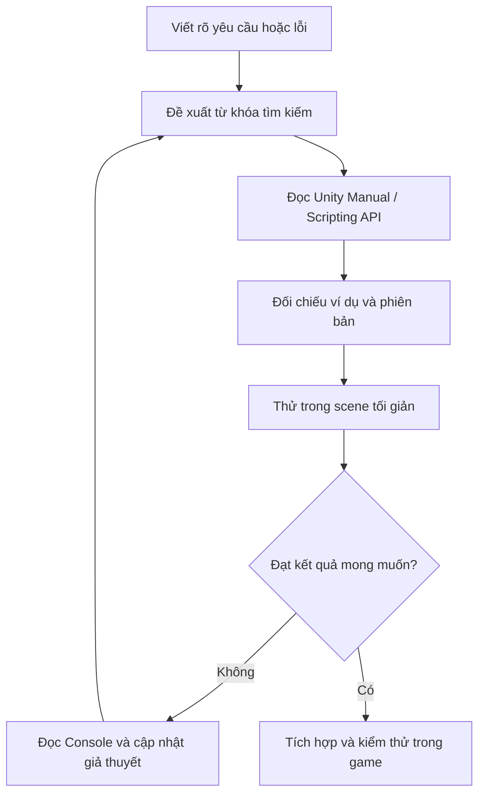

# Bài 03 — Nghiên cứu kỹ thuật và xử lý lỗi trong Unity

> **Lộ trình:** Junior Programmer · **Bài tương ứng:** Lesson 6.2 — Research and Troubleshooting · **Dự án thực hành:** Thêm tính năng đổi giữa hai camera khi nhấn phím `C`.

## 1. Tóm tắt

Lập trình không chỉ là viết code đã biết, mà còn là giải quyết những vấn đề chưa gặp. Khi triển khai một tính năng mới, người lập trình cần chuyển yêu cầu thành hành vi có thể kiểm thử, tìm thông tin phù hợp, chọn giải pháp, triển khai và **chẩn đoán lỗi dựa trên bằng chứng**. Công cụ tìm kiếm, tài liệu API, diễn đàn và trợ lý AI đều hữu ích nhưng không thay thế quá trình xác nhận trong dự án thực tế.

Bài học sử dụng một nhiệm vụ cụ thể: **nhấn `C` để chuyển qua lại giữa hai camera**. Tình huống thiếu tham chiếu camera trong Inspector minh họa cách phát hiện và sửa `UnassignedReferenceException`.

## 2. Mục tiêu học tập

Sau bài học, người học có thể:

- Chuyển một yêu cầu tự nhiên thành tiêu chí chấp nhận kiểm thử được.
- Tạo câu truy vấn có ngữ cảnh về Unity, API và thông báo lỗi.
- Phân biệt lỗi biên dịch, lỗi khi chạy và sai hành vi logic.
- Triển khai tính năng chuyển camera với C# và gán tham chiếu trong Inspector.
- Đọc stack trace, xác định nguyên nhân của `UnassignedReferenceException`, sửa lỗi và thử lại.
- Đánh giá câu trả lời của công cụ AI dựa trên tính tương thích phiên bản và kết quả thực nghiệm.

## 3. Nghiên cứu trước khi viết code

### 3.1. Diễn đạt bài toán một cách kiểm chứng được

Một yêu cầu ban đầu như “cho phép đổi góc nhìn” chưa chỉ rõ các điều kiện cần thiết. Viết lại thành:

- Trong scene có hai `Camera` với các góc nhìn khác nhau.
- Ban đầu chỉ một camera được bật.
- Mỗi lần người chơi nhấn `C`, camera đang hoạt động bị tắt và camera kia được bật.
- Giữ phím `C` không được đổi camera liên tục mỗi frame.
- Nếu chưa gán camera, hệ thống phải đưa ra thông báo rõ ràng thay vì tạo ra hành vi khó đoán.

Đây là những **acceptance criteria**: mỗi điều kiện có thể kiểm tra bằng thao tác và quan sát.

### 3.2. Quy trình tìm kiếm hiệu quả



Ưu tiên tài liệu API chính thức khi cần xác minh cú pháp và hành vi của phương thức. Thảo luận cộng đồng giúp nhận diện các trường hợp hiếm hoặc khác biệt phiên bản, nhưng câu trả lời có thể đã cũ hoặc phụ thuộc thiết lập riêng.

Ví dụ từ khóa tìm kiếm:

```text
Unity C# switch between two cameras on C key
Unity UnassignedReferenceException camera field Inspector
Unity Input.GetKeyDown legacy input vs Input System
```

Một câu hỏi hiệu quả cho công cụ AI nên chứa: **phiên bản Unity**, **hệ thống input đang dùng**, **mô tả scene**, **đoạn code liên quan**, **hành vi kỳ vọng**, **hành vi thực tế** và **toàn bộ thông báo lỗi**. Không gửi dữ liệu mật hoặc mã nguồn riêng tư không được phép chia sẻ.

## 4. Thực hành — Chuyển đổi hai camera

### 4.1. Chuẩn bị scene

1. Mở một scene có nhân vật hoặc vật thể để quan sát.
2. Giữ `Main Camera`, tạo thêm một `Camera` và đổi tên thành `Secondary Camera`.
3. Đặt `Main Camera` ở góc nhìn tổng quát, camera thứ hai ở góc nhìn gần hoặc góc nhìn thứ nhất.
4. Tạo GameObject trống tên `CameraManager` để quản lý việc chuyển đổi.
5. Trong scene chỉ nên để một trong hai camera có quyền phát âm thanh qua `AudioListener` tại một thời điểm. Cách đơn giản là đặt một `AudioListener` trên mỗi camera và bật/tắt cả `GameObject` chứa chúng; hoặc giữ một listener độc lập và quản lý vị trí của nó. Ví dụ code dưới đây chỉ bật/tắt `Camera.enabled`, do đó nếu cả hai camera đều có `AudioListener` kích hoạt đồng thời, Unity sẽ cảnh báo — cần tắt listener thừa.

### 4.2. Viết script `CameraSwitcher`

Tạo tệp `CameraSwitcher.cs`:

```csharp
using UnityEngine;

public class CameraSwitcher : MonoBehaviour
{
    [SerializeField] private Camera camera1;
    [SerializeField] private Camera camera2;

    private bool useFirstCamera = true;
    private bool ready;

    private void Awake()
    {
        ready = camera1 != null && camera2 != null && camera1 != camera2;

        if (!ready)
        {
            Debug.LogError(
                "CameraSwitcher: Hãy gán hai Camera khác nhau trong Inspector.",
                this
            );
            enabled = false;
            return;
        }

        ApplyCameraState();
    }

    private void Update()
    {
        // Legacy Input Manager: mỗi lần nhấn phím C chỉ đổi một lần.
        if (Input.GetKeyDown(KeyCode.C))
        {
            useFirstCamera = !useFirstCamera;
            ApplyCameraState();
        }
    }

    private void ApplyCameraState()
    {
        if (!ready) return;
        camera1.enabled = useFirstCamera;
        camera2.enabled = !useFirstCamera;
    }
}
```

Sau đó gắn script vào `CameraManager` và kéo hai Camera từ `Hierarchy` vào các field `Camera1` và `Camera2` trong `Inspector`.

**Ý nghĩa quan trọng:** `[SerializeField] private` giúp hiển thị hai field trong Inspector dù chúng không phải `public`. `Input.GetKeyDown(KeyCode.C)` chỉ trả `true` tại frame mới nhấn phím, thích hợp cho thao tác đổi trạng thái. Phần `Awake()` xác nhận hai tham chiếu đã được gán và không trỏ đến cùng một camera; khi sai, script dừng có chủ đích và log lỗi dễ hiểu.

**Tương thích input:** `Input.GetKeyDown` thuộc **Legacy Input Manager**. Khi dự án dùng Input System mới với chế độ `Input System Package` duy nhất, code sẽ không hoạt động như mong muốn. Khi đó cần tạo `Input Action` kiểu nút và xử lý sự kiện `performed`, hoặc chọn cấu hình `Active Input Handling` thích hợp. Không tự đổi cài đặt toàn dự án nếu đang sử dụng input mới ở các tính năng khác.

### 4.3. Kiểm thử hành vi

| Trường hợp | Thao tác | Kỳ vọng |
| --- | --- | --- |
| Khởi động | Nhấn Play | Camera 1 hiển thị, camera 2 không render |
| Chuyển lần 1 | Nhấn `C` | Hiển thị góc nhìn camera 2 |
| Chuyển lần 2 | Thả và nhấn `C` tiếp | Quay lại camera 1 |
| Giữ phím | Giữ `C` | Không liên tục chuyển qua lại |
| Thiếu tham chiếu | Xóa field camera 2 trong Inspector | Có thông báo lỗi rõ ràng, script ngừng hoạt động |
| Cùng một camera | Gán một Camera cho cả hai field | Phát hiện cấu hình không hợp lệ |

Kiểm thử bằng bản build sau khi chức năng chạy trong Editor, nhất là khi cần điều khiển bằng thiết bị không có bàn phím.

## 5. Phân tích lỗi `UnassignedReferenceException`

Giả sử đoạn code ban đầu có trường `public Camera camera1;`, nhưng người lập trình chưa kéo Camera vào ô tương ứng. Khi gọi `camera1.enabled = true`, Console có thể hiển thị:

```text
UnassignedReferenceException: The variable camera1 of CameraSwitcher
has not been assigned.
```

Đây là thông báo về tham chiếu Unity chưa được gán. Các bước chẩn đoán:

1. Đọc dòng lỗi đầu tiên và tên `CameraSwitcher.camera1`.
2. Mở GameObject đang gắn `CameraSwitcher`.
3. Quan sát field `Camera1` trong Inspector: nếu là `None (Camera)`, đây là nguyên nhân trực tiếp.
4. Kéo camera tương ứng vào field, xác nhận field còn lại cũng hợp lệ.
5. Chạy lại tình huống cũ và bảo đảm lỗi không tái xuất hiện.

**Phân biệt lỗi:** `NullReferenceException` thường xảy ra khi mã sử dụng một tham chiếu `null`; `UnassignedReferenceException` là thông báo cụ thể của Unity liên quan tham chiếu serialized chưa được gán. Thông báo không nhất thiết chứng minh thiếu GameObject — có thể GameObject vẫn tồn tại nhưng **chưa được nối** tới field script.

## 6. Khung chẩn đoán lỗi có hệ thống

| Nhóm lỗi | Dấu hiệu | Kiểm tra trước |
| --- | --- | --- |
| Compile error | Script không biên dịch, lỗi CSxxxx | Cú pháp C#, namespace, package và tên class |
| Runtime exception | Lỗi khi scene chạy | Stack trace, field `null`, trạng thái GameObject |
| Logic error | Không có exception nhưng hành vi sai | Điều kiện, thứ tự cập nhật, trạng thái biến |
| Configuration error | Chạy scene khác hoặc môi trường khác thì hỏng | Inspector, Input Handling, tag/layer, build profiles |
| Performance issue | Chậm, giật, memory tăng | Unity Profiler, kịch bản tái hiện, build trên thiết bị đích |

Quy trình debug hiệu quả cần phân biệt **triệu chứng** với **nguyên nhân**. Chẳng hạn “nhấn C không đổi camera” là triệu chứng; có thể do `Update()` không chạy, input không tương thích, camera reference thiếu hoặc hai camera đứng cùng vị trí. Mỗi giả thuyết cần một phép kiểm tra riêng.

Tạo nhật ký lỗi ngắn:

```text
Mã lỗi: CAM-01
Môi trường: Unity 6.x, Windows Editor, Legacy Input
Bước tái hiện: Play -> nhấn C
Kỳ vọng: đổi camera
Thực tế: giữ góc nhìn cũ, Console báo UnassignedReferenceException
Nguyên nhân: field camera1 chưa được gán trong Inspector
Cách sửa: gán Main Camera vào camera1
Kiểm chứng: nhấn C hai lần, góc nhìn đổi và trở lại như dự kiến
```

## 7. Cách sử dụng AI một cách có kiểm chứng

Công cụ AI hỗ trợ chuyển lỗi sang ngôn ngữ dễ hiểu, đề xuất giả thuyết và đưa ra ví dụ nhanh. Tuy nhiên, đoạn code được sinh có thể dùng API đã cũ, nhầm hệ thống input, thiếu Inspector setup hoặc đưa ra cách sửa ảnh hưởng đến kiến trúc dự án.

Một quy trình sử dụng đáng tin cậy:

1. Yêu cầu AI giải thích **vì sao** giải pháp phù hợp, không chỉ xuất mã.
2. Kiểm tra tên API tại Unity Scripting API và kiểm tra phiên bản hỗ trợ.
3. Chạy ví dụ tối giản, đối chiếu mọi bước Editor cần thiết.
4. Nếu lỗi, cung cấp nguyên văn stack trace và những gì đã thử.
5. Chỉ tích hợp vào dự án chính sau khi đã xác nhận kết quả.

Không nên giải quyết lỗi bằng cách xóa dòng gây exception khi thao tác đó chỉ che giấu nguyên nhân. `if (camera1 == null) return;` giúp tránh crash nhưng nếu không có log/biện pháp khắc phục, tính năng vẫn sẽ không hoạt động.

## 8. Bài tập vận dụng

**Bài 1 — Thay đổi cách kích hoạt:** Sửa camera switch từ phím `C` sang một nút UI. Trình bày vì sao sự kiện `Button.onClick` phù hợp với giao diện dùng chuột hoặc chạm.

**Bài 2 — Thiết kế lỗi chủ động:** Tạm xóa tham chiếu camera 2, ghi lại thông báo lỗi, sửa cấu hình và chụp Console trước/sau.

**Bài 3 — Nghiên cứu có kiểm chứng:** Tìm hai phương án khác nhau để chuyển góc nhìn, ví dụ `Camera.enabled` và bật/tắt GameObject, sau đó liệt kê khác biệt liên quan tới `AudioListener`, script phụ trợ và thời điểm `OnEnable`.

**Tiêu chí hoàn thành:** Có scene, code, một bảng test case và nhật ký phân tích ít nhất một lỗi.

## 9. Câu hỏi ôn tập

### Câu 1

Lỗi chỉ ra `camera1 ... has not been assigned`. Bước đầu tiên hợp lý nhất là gì?

A. Tăng chất lượng đồ họa.  
B. Đổi tên tất cả scene.  
C. Xóa toàn bộ prefab.  
D. Kiểm tra field `camera1` trong Inspector và gán tham chiếu Camera.

**Đáp án:** D. **Giải thích:** Thông báo xác định một serialized reference chưa được nối tới đối tượng.

### Câu 2

Vì sao `Input.GetKeyDown` thường được đọc trong `Update()`?

A. Vì trạng thái nhấn được phát hiện theo frame; `FixedUpdate` có thể bỏ lỡ.  
B. Vì `FixedUpdate` chỉ chạy khi build.  
C. Vì `Update` luôn chạy đúng 60 lần/giây.  
D. Vì `GetKeyDown` chỉ xử lý âm thanh.

**Đáp án:** A. **Giải thích:** `GetKeyDown` có ý nghĩa tại frame nhấn phím và nên được xử lý theo vòng cập nhật frame.

### Câu 3

Một câu trả lời AI đưa ra đúng cú pháp nhưng không hoạt động. Điều cần làm là gì?

A. Khẳng định engine có lỗi.  
B. Tin rằng code luôn đúng.  
C. Đối chiếu cấu hình, phiên bản, API và Console rồi thử có kiểm soát.  
D. Thử ngẫu nhiên nhiều thay đổi cùng lúc.

**Đáp án:** C. **Giải thích:** Mã đúng cú pháp không bảo đảm đúng bối cảnh dự án.

### Câu 4

Đâu là ví dụ về **logic error**?

A. Thiếu dấu `;` làm script không compile.  
B. Cả hai camera được gán đúng nhưng điều kiện bật/tắt khiến góc nhìn không đổi.  
C. `camera1` chưa gán làm phát sinh exception.  
D. Không cài Unity Editor.

**Đáp án:** B. **Giải thích:** Chương trình chạy được nhưng triển khai điều kiện trạng thái sai.

### Câu 5

Phép kiểm thử nào xác minh tốt yêu cầu “nhấn C để đổi hai camera”?

A. Chỉ kiểm tra scene có hai Camera.  
B. Chỉ đọc tên class.  
C. Chỉ nhấn C một lần rồi dừng.  
D. Nhấn, thả, nhấn lại và kiểm tra góc nhìn chuyển đi rồi trở về.

**Đáp án:** D. **Giải thích:** Kiểm thử cả hai chiều chuyển trạng thái và hành vi của một lần nhấn.

## 10. Tổng kết

Năng lực giải quyết vấn đề là quá trình có thể rèn luyện: đặt yêu cầu đo được, nghiên cứu API phù hợp, xây dựng ví dụ, đọc lỗi và kiểm chứng cách sửa. Một giải pháp có giá trị không chỉ là code hoạt động, mà còn là khả năng giải thích vì sao nó hoạt động.

## 11. Tài liệu tham khảo

- [Unity Learn — Lesson 6.2: Research and Troubleshooting](https://learn.unity.com/course/next-steps/tutorial/lesson-6-2-research-and-troubleshooting-2?version=6.0) — tình huống đổi hai camera, nghiên cứu và xử lý exception.
- [Unity Scripting API — Input.GetKeyDown](https://docs.unity3d.com/6000.0/Documentation/ScriptReference/Input.GetKeyDown.html) — tính chất của API input cũ.
- [Unity Scripting API — SerializeField](https://docs.unity3d.com/6000.0/Documentation/ScriptReference/SerializeField.html) — field trong Inspector.
- [Unity Learn — Junior Programmer: Publishing Your Project](https://learn.unity.com/pathway/junior-programmer/unit/publishing-your-project?version=6) — kỹ năng debug trong lộ trình.

*Ghi chú:* Code minh họa dành cho Input Manager cũ, được trình bày để giữ đúng tình huống của bài học. Dự án mới dùng Input System nên thiết kế action nhập liệu tương ứng.
