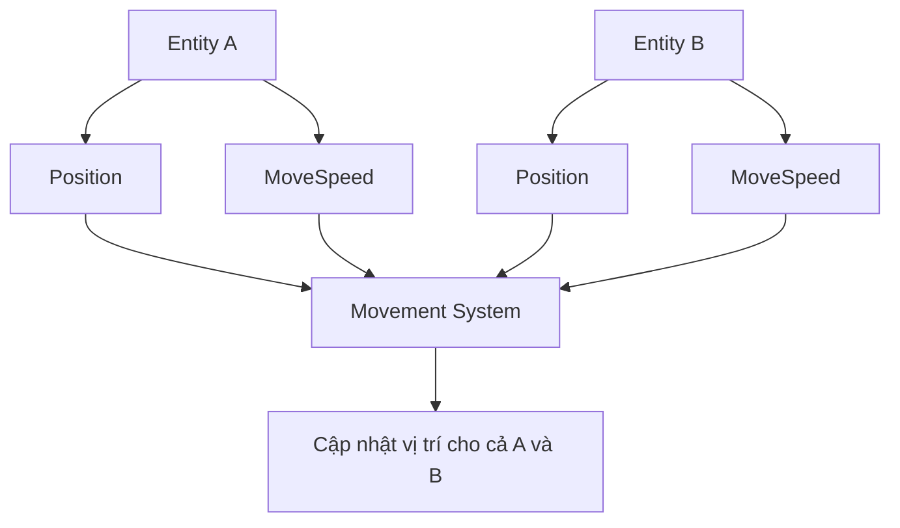
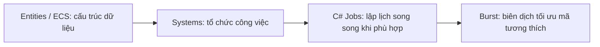

# Bài 05 — ECS Survival Guide: nhập môn Entity Component System trong Unity

> **Lộ trình:** Junior Programmer · **Phạm vi:** Tư duy thiết kế hướng dữ liệu, kiến trúc ECS và cách nhận biết mã dùng Unity Entities · **Mức độ:** Giới thiệu khái niệm, kèm ví dụ đọc hiểu API hiện đại.

## 1. Tóm tắt

**Entity Component System (ECS)** là một mô hình tổ chức dữ liệu và xử lý trong đó **Entity** đại diện cho định danh, **Component** chứa dữ liệu và **System** thực hiện logic trên các nhóm entity có cấu trúc dữ liệu phù hợp. Trong Unity, ECS được triển khai chủ yếu qua package **Entities**, thuộc hệ sinh thái **Data-Oriented Technology Stack (DOTS)**.

ECS khác với mô hình thường gặp của Unity dựa trên `GameObject` và `MonoBehaviour`. Thay vì mỗi đối tượng tự chạy nhiều đoạn mã hành vi, một system có thể xử lý đồng loạt dữ liệu cùng loại. Cách tổ chức này hỗ trợ tối ưu tính cục bộ bộ nhớ (*data locality*), khả năng xử lý theo lô và song song hóa khi bài toán phù hợp. Tuy nhiên, ECS **không tự động nhanh hơn trong mọi trường hợp**; chi phí triển khai, số lượng entity, kiểu dữ liệu và điểm nghẽn hệ thống mới quyết định lợi ích thực tế.

## 2. Mục tiêu học tập

Sau bài học, người học có thể:

- Giải thích vai trò của Entity, Component và System.
- Phân biệt thiết kế hướng đối tượng/component-based với thiết kế hướng dữ liệu.
- Mô tả quan hệ giữa ECS, Unity Entities, Jobs và Burst trong DOTS.
- Nhận biết các dấu hiệu của mã Unity ECS, đồng thời phân biệt ví dụ API cũ và mới.
- Xác định khi nào nên cân nhắc ECS và khi nào nên tiếp tục dùng `MonoBehaviour`.

## 3. Mô hình quen thuộc: GameObject và MonoBehaviour

Trong thiết kế Unity truyền thống, một `GameObject` sở hữu các component như `Transform`, `Rigidbody`, `Collider` và các script kế thừa `MonoBehaviour`. Script thường chứa **trạng thái và hành vi** trong cùng một đối tượng.

```csharp
using UnityEngine;

public class MoveForward : MonoBehaviour
{
    [SerializeField] private float speed = 3f;

    private void Update()
    {
        transform.position += Vector3.forward * (speed * Time.deltaTime);
    }
}
```

Đây là cách tốt cho nhiều trò chơi và nguyên mẫu: dễ nhìn thấy đối tượng trong `Hierarchy`, dễ gắn script và dễ debug. Nhưng nếu scene có rất nhiều thực thể cùng cập nhật logic giống nhau, cấu trúc dữ liệu rải rác và chi phí gọi logic trên nhiều component có thể gây khó khăn khi tối ưu quy mô lớn.

**Lưu ý:** Unity `GameObject` cũng dùng từ “component”, nhưng **component trong GameObject model không đồng nhất với ECS component**. Một `MonoBehaviour` có thể chứa cả logic lẫn dữ liệu và là object được quản lý; `IComponentData` trong ECS thường được dùng chủ yếu để định nghĩa dữ liệu.

## 4. Ba thành phần của ECS

### 4.1. Entity — định danh thực thể

`Entity` là một định danh giúp ECS xác định một thực thể. Bản thân định danh không bắt buộc có tên, mô hình 3D hay hành vi. Một entity được mô tả bởi tập component gắn với nó. Ví dụ, entity `E1` có thể mang `Position`, `MoveSpeed` và `Health`.

### 4.2. Component — dữ liệu

Component lưu những đặc tính cần để system thực hiện công việc, ví dụ vị trí, vận tốc, máu hoặc trạng thái AI. Với Unity Entities, một kiểu dữ liệu thường được khai báo bằng `struct` triển khai `IComponentData`.

### 4.3. System — logic xử lý

System truy vấn các entity có loại component cần thiết, đọc dữ liệu đầu vào và thay đổi dữ liệu đầu ra. Ví dụ `MovementSystem` tìm entity có `Position` và `MoveSpeed`, rồi cập nhật vị trí theo thời gian.



Sơ đồ cho thấy một system xử lý nhiều entity có cấu trúc dữ liệu tương tự, thay vì mỗi entity tự giữ một script xử lý riêng. Đây là **mô hình tư duy**, không phải sơ đồ lớp hay cách bố trí byte trong bộ nhớ thực tế.

## 5. Vì sao thiết kế hướng dữ liệu có thể cải thiện hiệu năng?

CPU xử lý hiệu quả khi dữ liệu cần thiết có vị trí gần nhau trong bộ nhớ và được truy cập tuần tự, dễ dự đoán. Một hệ thống có dữ liệu được nhóm theo loại và mẫu truy vấn có thể giảm việc truy cập bộ nhớ phân tán. Unity Entities tổ chức entity thành **archetype** dựa trên tập loại component; các entity cùng archetype thường được lưu trong các **chunk**.

ECS còn tạo điều kiện chia phần việc thành các job độc lập và dùng Burst compiler trong những điều kiện tương thích. Tuy nhiên, hiệu quả phụ thuộc cấu trúc component, số lần thay đổi archetype, việc đồng bộ dữ liệu, lịch chạy job và chi phí kết nối với các hệ thống GameObject truyền thống.

| Tiêu chí | GameObject / MonoBehaviour | ECS / Entities |
| --- | --- | --- |
| Đơn vị trung tâm | GameObject và component có hành vi | Entity, dữ liệu component, system |
| Nơi đặt logic | Thường nằm trong từng `MonoBehaviour` | Tập trung ở các system |
| Khả năng làm việc với đối tượng trực quan | Dễ tiếp cận trong Editor | Cần quy trình authoring/baking phù hợp |
| Dữ liệu xử lý hàng loạt | Có thể làm nhưng cần tổ chức thêm | Được thiết kế để truy vấn theo component |
| Chi phí học | Thấp hơn đối với người mới | Cao hơn, cần hiểu mô hình dữ liệu và hệ thống |
| Hiệu năng | Có thể rất tốt khi thiết kế hợp lý | Có lợi thế với một số workload lớn, không mặc định tối ưu |

## 6. Nhận diện mã ECS hiện đại

Trong các tài liệu cũ, Unity Learn có thể đề cập `JobComponentSystem` khi minh họa cách nhận biết một script không kế thừa `MonoBehaviour`. Đây là dấu vết của những giai đoạn API DOTS trước đây, **không nên sao chép nguyên sang dự án Entities 1.x hiện đại**.

Đối với Entities 1.x, hai dấu hiệu dễ nhận biết là namespace `Unity.Entities` và các kiểu `IComponentData`, `ISystem`, `SystemBase`, `SystemAPI.Query`.

Ví dụ nhỏ dưới đây định nghĩa một component chứa tốc độ và một system cộng tốc độ vào một giá trị đếm. Ví dụ minh họa **mô hình truy vấn và cập nhật dữ liệu**; để nhìn thấy hành vi cần có entity thực sự được gán các component này bằng quy trình authoring, baking hoặc `EntityManager`.

```csharp
using Unity.Entities;

public struct Progress : IComponentData
{
    public float Value;
}

public struct ProgressSpeed : IComponentData
{
    public float UnitsPerSecond;
}

public partial struct ProgressSystem : ISystem
{
    public void OnUpdate(ref SystemState state)
    {
        float dt = SystemAPI.Time.DeltaTime;

        foreach (var (progress, speed) in
            SystemAPI.Query<RefRW<Progress>, RefRO<ProgressSpeed>>())
        {
            progress.ValueRW.Value += speed.ValueRO.UnitsPerSecond * dt;
        }
    }
}
```

**Giải thích:**

- `IComponentData` khai báo dữ liệu để gắn lên entity.
- `ISystem` định nghĩa system, với phương thức `OnUpdate(ref SystemState state)`.
- `SystemAPI.Query<...>()` truy vấn entity chứa cả `Progress` và `ProgressSpeed`.
- `RefRW` biểu thị quyền đọc/ghi; `RefRO` chỉ đọc, giúp thể hiện ý định truy cập dữ liệu.
- `SystemAPI.Time.DeltaTime` cung cấp thời gian để cập nhật với đơn vị mỗi giây.

Mã này **không cần** có `GameObject.Update()` hay biến `Transform` và không đảm nhiệm hiển thị. Nó cũng không tự tạo entity. Trong ứng dụng thật, việc chuyển dữ liệu thiết kế từ GameObject sang entity thường dùng quy trình **baking** và **SubScene** khi thích hợp.

## 7. ECS, Jobs và Burst có phải cùng một công nghệ?

Không. Chúng liên quan nhưng phục vụ mục đích khác nhau:

- **ECS / Entities** tổ chức dữ liệu và hệ thống xử lý.
- **C# Job System** cho phép lập lịch công việc và phối hợp xử lý song song có kiểm soát.
- **Burst** là compiler tối ưu hóa mã tương thích để thực thi hiệu quả trên CPU.

Một system ECS có thể chạy vòng lặp trên main thread như ví dụ trên; không phải hệ thống ECS nào cũng tự động đa luồng hoặc dùng Burst. Khi muốn tăng tốc, phải thiết kế job, ràng buộc truy cập dữ liệu và đo hiệu năng thực tế.



Đây là sơ đồ quan hệ công nghệ, **không phải pipeline bắt buộc** đối với mọi system ECS.

## 8. Khi nào nên dùng ECS?

Cân nhắc ECS nếu ứng dụng cần xử lý lượng lớn thực thể cùng cấu trúc, có thao tác tính toán lặp trên dữ liệu và gặp điểm nghẽn thực sự khi dùng hướng tiếp cận hiện tại. Ví dụ thường được cân nhắc là mô phỏng đám đông, hệ thống hạt/quần thể riêng, nhiều tác nhân với logic đơn giản hoặc mô phỏng quy mô lớn.

Không nên đổi toàn bộ game sang ECS chỉ vì tin rằng ECS luôn nhanh. Với UI, game nhỏ, hệ thống cần tương tác GameObject trực quan thường xuyên hoặc nhóm chưa có kinh nghiệm, `MonoBehaviour` vẫn là lựa chọn thực tế. Các hệ thống có thể kết hợp nhưng cần xem xét chi phí đồng bộ và bảo trì.

### Bài tập lựa chọn kiến trúc

Phân tích hai tình huống:

1. Một trò chơi giải đố có 15 đối tượng và nhiều tương tác UI riêng biệt.
2. Một mô phỏng có 100.000 tác nhân cùng cập nhật trạng thái và vận tốc đơn giản.

Với mỗi trường hợp, chỉ ra dữ liệu nào được cập nhật thường xuyên, logic nào có thể làm theo lô và điểm nghẽn nào cần đo trước khi thay đổi kiến trúc. Không giả định kết quả benchmark nếu chưa triển khai và đo.

## 9. Lỗi hiểu sai và hạn chế cần nhớ

| Hiểu sai | Giải thích chính xác |
| --- | --- |
| ECS Component giống hệt `MonoBehaviour` | ECS component chủ yếu biểu diễn dữ liệu; logic đặt ở system |
| ECS tự động chạy đa luồng | System có thể chạy main thread; jobs cần được lập lịch rõ ràng |
| Burst hoạt động cho mọi đoạn C# | Chỉ hỗ trợ code và kiểu dữ liệu tương thích với yêu cầu của Burst |
| Dự án Unity nào cũng nên dùng ECS | Chọn kiến trúc dựa vào nhu cầu và phép đo |
| `JobComponentSystem` là cách viết hiện đại chuẩn cho mọi Entities 1.x | Đây là kiểu API thuộc tài liệu/giai đoạn cũ; cần tra cứu API tương ứng đúng phiên bản |
| Cứ có `using Unity.Entities` là hệ thống đã vận hành | Cần entity, component data, system phù hợp và cấu hình world/baking |

## 10. Thực hành nhận diện code

1. Mở `Window > Package Manager` và tìm package **Entities** trong danh sách package khả dụng; chỉ cài phiên bản tương thích với Editor hiện tại khi bạn thực sự muốn thử ECS.
2. Đọc đoạn code ví dụ ở mục 6, đánh dấu dòng khai báo `IComponentData`, `ISystem` và `SystemAPI.Query`.
3. Vẽ bảng gồm ba cột: **Entity cần có**, **Component được đọc/ghi**, **System xử lý**.
4. Viết giả mã một system giảm `Health` của các entity bị trúng đòn, chỉ mô tả dữ liệu và điều kiện lọc.
5. Nếu triển khai project thật, đối chiếu hướng dẫn baking của package đúng phiên bản trước khi tạo entity; không ép ví dụ `MonoBehaviour` thông thường chạy như ECS.

**Tiêu chí hoàn thành:** Có thể giải thích mô hình ECS mà không cần dùng `GameObject` làm đơn vị tổ chức trung tâm, và phân biệt ít nhất ba API hiện đại với dấu vết API cũ.

## 11. Câu hỏi ôn tập

### Câu 1

Trong ECS, thành phần nào chủ yếu mô tả dữ liệu như tốc độ và lượng máu?

A. Entity  
B. Component  
C. System  
D. Scene View

**Đáp án:** B. **Giải thích:** Component mang dữ liệu; system dùng dữ liệu để thực hiện logic.

### Câu 2

Trong ví dụ `ProgressSystem`, `SystemAPI.Query` có tác dụng gì?

A. Tạo Camera mới.  
B. Chỉnh độ phân giải màn hình.  
C. Tự động build trò chơi.  
D. Tìm các entity có tập component phù hợp để xử lý.

**Đáp án:** D. **Giải thích:** Truy vấn ECS chọn thực thể theo thành phần dữ liệu, không theo tên GameObject.

### Câu 3

Nhận định nào đúng về hiệu năng ECS?

A. Có thể có lợi với workload phù hợp nhưng vẫn cần đo thực tế.  
B. Luôn tăng FPS bất kể cấu hình.  
C. Không thể chạy trên CPU.  
D. Không cần dữ liệu component.

**Đáp án:** A. **Giải thích:** Lợi ích phụ thuộc cách bố trí và xử lý dữ liệu, không phải chỉ từ tên kiến trúc.

### Câu 4

Vì sao nên thận trọng với ví dụ `JobComponentSystem` trong hướng dẫn cũ?

A. Vì ECS chỉ có trong Unity 2D.  
B. Vì class đó là `MonoBehaviour`.  
C. Vì API Entities thay đổi qua phiên bản, nên cần tra cứu `ISystem`/`SystemBase` phù hợp.  
D. Vì `using Unity.Entities` bị cấm.

**Đáp án:** C. **Giải thích:** Mã từ các phiên bản DOTS thử nghiệm có thể không còn tương thích với Entities 1.x.

### Câu 5

`RefRO<ProgressSpeed>` thể hiện điều gì?

A. Quyền xóa entity.  
B. Quyền truy cập component theo hướng chỉ đọc.  
C. Bắt buộc chạy Burst.  
D. Camera phải ở chế độ orthographic.

**Đáp án:** B. **Giải thích:** `RefRO` biểu diễn truy cập dữ liệu đọc mà không ghi trong truy vấn.

## 12. Tổng kết

ECS chuyển trọng tâm từ “mỗi đối tượng tự làm gì?” sang “dữ liệu nào cần được xử lý bởi hệ thống nào?”. Nắm được tư duy này giúp hiểu kiến trúc data-oriented và đọc mã Unity Entities hiện đại. Thực hành chuyên sâu ECS đòi hỏi kiến thức về authoring/baking, archetype, job scheduling và profiling, nên cần học từng bước theo phiên bản package cụ thể.

## 13. Tài liệu tham khảo

- [Unity Learn — ECS Survival Guide](https://learn.unity.com/course/next-steps/tutorial/ecs-survival-guide-1?version=6.0) — giới thiệu mô hình ECS, DOTS và cách nhận biết code.
- [Unity Manual — Entities package](https://docs.unity3d.com/6000.0/Documentation/Manual/com.unity.entities.html) — mô tả gói Entities của Unity.
- [Unity Entities 1.3 — Component concepts](https://docs.unity3d.com/Packages/com.unity.entities@1.3/manual/concepts-components.html) — vai trò và mô hình dữ liệu component.
- [Unity Entities 1.3 — ISystem overview](https://docs.unity3d.com/Packages/com.unity.entities@1.3/manual/systems-isystem.html) — vòng đời system.
- [Unity Entities 1.3 — SystemAPI.Query](https://docs.unity3d.com/Packages/com.unity.entities@1.3/manual/systems-systemapi-query.html) — duyệt entity và truy cập dữ liệu.
- [Unity Learn — DOTS Best Practices](https://learn.unity.com/course/dots-best-practices) — tư duy đánh giá hiệu năng dựa trên dữ liệu.

*Lưu ý phiên bản:* Bài ECS của Unity Learn mang tính khái niệm và có nhắc một API cũ. Ví dụ mở rộng ở đây bám nhóm API **Entities 1.x** (đối chiếu trang tài liệu 1.3). Trước khi biên dịch, xem package version thực tế trong `Packages/manifest.json` hoặc Package Manager; không suy đoán một số phiên bản package cụ thể cho Unity 6.3.
