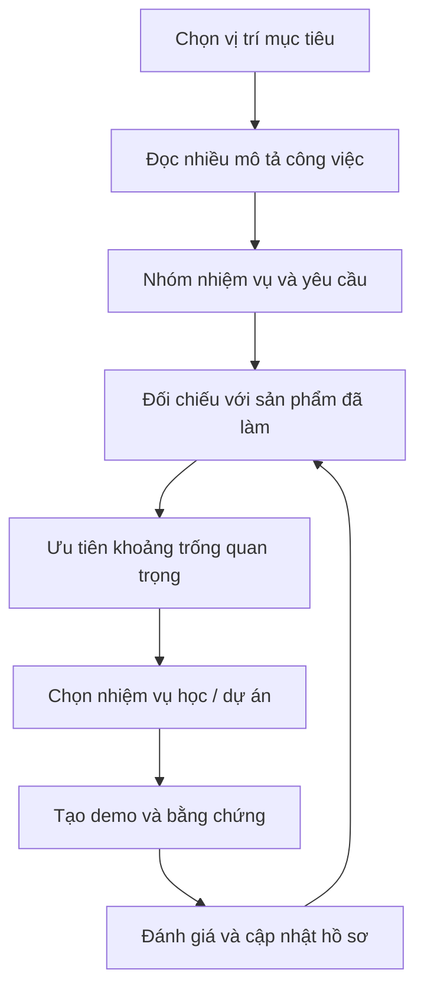

# Bài 06 — Nghiên cứu nghề nghiệp và chuẩn bị ứng tuyển trong lĩnh vực Unity

> **Lộ trình:** Junior Programmer · **Chủ đề:** Career Research and Preparation · **Đối tượng:** Người muốn chuyển kỹ năng Unity và C# thành kế hoạch học tập hoặc hồ sơ ứng tuyển có bằng chứng.

## 1. Tóm tắt

Nghiên cứu nghề nghiệp không chỉ là xem tên vị trí và mức lương. Mục tiêu là xác định **mình muốn giải quyết nhóm vấn đề nào**, công việc đó yêu cầu kỹ năng gì, mình đã có bằng chứng năng lực nào và cần bổ sung gì tiếp theo. Trong lĩnh vực game và sản xuất nội dung thời gian thực (*real-time 3D*), cùng sử dụng Unity nhưng công việc của gameplay programmer, tools engineer, technical artist và XR developer rất khác nhau.

Một kế hoạch ứng tuyển hiệu quả bắt đầu từ **vai trò mục tiêu**, phân tích thông tin tuyển dụng, tự đánh giá dựa trên sản phẩm thật và xây dựng kế hoạch lấp khoảng trống kỹ năng. Chứng chỉ, hoạt động cộng đồng hay game jam có thể là bằng chứng bổ trợ, nhưng không được xem là bảo đảm tuyển dụng.

## 2. Mục tiêu học tập

Sau bài học, người học có thể:

- Phân biệt một số nhóm công việc sử dụng Unity và C# trong ngành real-time development.
- Thu thập, phân loại thông tin từ tin tuyển dụng và hồ sơ nghề nghiệp.
- Lập bảng đối chiếu yêu cầu vị trí với kỹ năng và bằng chứng hiện có.
- Đặt mục tiêu học tập và xây dựng sản phẩm bổ sung theo mức độ ưu tiên.
- Chuẩn bị CV, portfolio, repository và nội dung giới thiệu khi phỏng vấn.
- Nhận diện nguy cơ từ thông tin tuyển dụng cũ, tin thiếu xác minh hoặc thành tích phóng đại.

## 3. Nhận diện những nhóm nghề nghiệp liên quan đến Unity

Unity xuất hiện trong game, XR, đào tạo mô phỏng, visualization và các hệ thống tương tác khác. Vì vậy, cần nghiên cứu **nhiệm vụ thực tế** trước khi chọn một tên chức danh.

| Nhóm vị trí | Công việc trọng tâm | Kỹ năng có thể liên quan |
| --- | --- | --- |
| Gameplay Programmer | Điều khiển, logic game, hệ thống điểm, trạng thái, va chạm | C#, Unity API, debugging, gameplay architecture |
| Unity Developer / Generalist | Xây dựng tính năng, UI, scene, tích hợp hệ thống | C#, UI, asset pipeline, build, testing |
| Tools / Editor Programmer | Tạo công cụ hỗ trợ nhóm phát triển | C#, Editor scripting, automation, serialization |
| XR Developer | Tương tác VR/AR, thiết bị và trải nghiệm 3D | Unity XR, input, performance, interaction design |
| Graphics / Rendering Programmer | Shader, pipeline render, tối ưu hiển thị | Đồ họa máy tính, shader, GPU profiling |
| Technical Artist | Kết nối art pipeline và kỹ thuật | Asset pipeline, shader, animation, optimization, scripting |
| QA / Technical QA | Thiết kế và thực hiện kiểm thử, tái hiện lỗi | Test plan, bug report, platform testing, automation khi phù hợp |

Đây là các nhóm công việc để định hướng, **không phải mô tả việc làm hoặc bộ tiêu chuẩn tuyển dụng cố định**. Cùng một chức danh có thể mang phạm vi trách nhiệm khác nhau tùy công ty, sản phẩm và cấp độ.

## 4. Nghiên cứu thị trường việc làm có phương pháp

### 4.1. Chọn một hoặc hai vị trí mục tiêu

Ví dụ: **Junior Gameplay Programmer** và **Junior Unity Developer**. Dùng từ khóa cụ thể (tiếng Việt và tiếng Anh) thay vì chỉ tìm “làm Unity”, vì kết quả rộng dễ lẫn những vị trí không phù hợp.

Các nguồn khảo sát có thể gồm trang tuyển dụng chính thức của doanh nghiệp, nền tảng việc làm, bài phỏng vấn nhà phát triển và hồ sơ chuyên môn công khai. Đọc cả ngày đăng tin, khu vực, yêu cầu kinh nghiệm và nền tảng thiết bị mục tiêu. Không suy luận rằng một công ty đang tuyển chỉ vì tìm thấy bài đăng cũ.

### 4.2. Chuẩn hóa yêu cầu từ nhiều tin tuyển dụng

Mỗi tin được phân thành bốn nhóm:

1. **Nhiệm vụ:** Ví dụ viết gameplay systems, debug, tích hợp UI.
2. **Bắt buộc:** Ví dụ C#, sử dụng Unity, nền tảng lập trình.
3. **Ưu tiên:** Ví dụ tối ưu hiệu năng, profiling, quy trình làm việc với version control.
4. **Bằng chứng mong muốn:** Ví dụ project cá nhân, Git repository, bản demo, dự án nhóm.

Không tự biến một kỹ năng “nice to have” trong một tin đăng thành yêu cầu phổ quát. Nếu khảo sát nhiều tin, ghi lại kỹ năng nào xuất hiện ở đâu và chỉ so sánh những vị trí tương đương cấp độ.

### 4.3. Tạo bảng nghiên cứu nghề nghiệp

| Trường | Nội dung cần điền |
| --- | --- |
| Vị trí | Tên công việc nguyên văn từ tin đăng |
| Nguồn | Link, doanh nghiệp, ngày truy cập |
| Sản phẩm / nền tảng | Game 2D/3D, mobile, PC, XR, simulation… |
| Nhiệm vụ | Các công việc sẽ làm thường xuyên |
| Kỹ năng bắt buộc | Những yêu cầu được ghi rõ |
| Kỹ năng ưu tiên | Những yêu cầu có lợi nhưng không bắt buộc |
| Công cụ | Unity, C#, Git, Profiler… nếu có ghi |
| Mức độ phù hợp | Lý do có bằng chứng, không chỉ đánh giá cảm tính |
| Khoảng trống | Điều mình chưa có hoặc chưa chứng minh được |
| Hành động | Sản phẩm, bài tập hoặc trải nghiệm cần bổ sung |

Bảng nghiên cứu có thể được cập nhật khi xuất hiện tin mới; tránh dùng mức lương hoặc điều kiện làm việc chưa được kiểm chứng làm tiêu chí chắc chắn.

## 5. Phân tích khoảng trống năng lực (*skill gap analysis*)

Khác biệt quan trọng là **biết một kỹ thuật** và **chứng minh đã vận dụng kỹ thuật đó**. Một CV ghi “C#, Unity, tối ưu hóa” ít thuyết phục hơn khi kèm demo, mã nguồn, mô tả lỗi từng sửa và phép đo trước/sau.

Ví dụ ma trận tự đánh giá:

| Năng lực | Mức độ hiện tại (tự đánh giá) | Bằng chứng phù hợp | Hành động tiếp theo |
| --- | --- | --- | --- |
| C# và OOP | Biết áp dụng | Script có đóng gói và quản lý trạng thái | Refactor, thêm test cho logic quan trọng |
| Unity gameplay | Có prototype | Video và build chạy được | Hoàn thiện vòng chơi, restart, UI |
| Debugging | Đã xử lý lỗi đơn giản | Issue hoặc bug report có bước tái hiện | Thử lỗi cấu hình và runtime khó hơn |
| Optimization | Mới làm quen | Kết quả Unity Profiler | Đo lại bản build, giải thích bottleneck |
| Collaboration | Chưa có nhiều minh chứng | Commit, PR, issue, task board | Làm dự án nhóm nhỏ có phân công |

Đây là **ví dụ cách đánh giá**, không phải kết luận về năng lực của người học. Cần tự điền dựa trên dự án thực tế; không đưa kinh nghiệm chưa có vào CV.

## 6. Chuyển khoảng trống thành kế hoạch học và sản phẩm

Chu trình lặp giúp tránh học lan man: sau khi hoàn thành một sản phẩm, người học cập nhật hồ sơ và xem còn khoảng trống quan trọng nào. Một dự án có thể chứng minh nhiều năng lực cùng lúc nếu được thiết kế và mô tả có chủ đích.

### Kế hoạch 30–60–90 ngày minh họa

- **30 ngày:** Chọn vị trí, phân tích tin tuyển dụng và hoàn thiện một game prototype đủ chơi; xác định tiêu chí chất lượng.
- **60 ngày:** Làm rõ cấu trúc project, sửa lỗi, kiểm thử build, bổ sung README và video giới thiệu; bắt đầu cộng tác hoặc nhận feedback.
- **90 ngày:** Chuẩn bị CV/portfolio, luyện trình bày quyết định kỹ thuật, thử ứng tuyển vị trí phù hợp và điều chỉnh dựa trên phản hồi.

Các mốc chỉ là **khung lập kế hoạch tham khảo**; thời lượng cần được điều chỉnh theo kiến thức và quỹ thời gian, không phải lộ trình bảo đảm tìm được việc.

## 7. Chuẩn bị hồ sơ chuyên môn

### 7.1. CV hướng đến vị trí cụ thể

CV cần giúp người đọc nhanh chóng trả lời: ứng viên muốn đảm nhận vai trò gì, biết công nghệ nào, đã tạo ra kết quả gì và ở mức độ tham gia nào. Ưu tiên kỹ năng liên quan JD; dẫn liên kết đến sản phẩm, code và demo. Với dự án nhóm, ghi rõ **phần việc cá nhân**.

Mô tả dự án nên theo cấu trúc:

**Bài toán → trách nhiệm → giải pháp kỹ thuật → kết quả → bằng chứng.**

Ví dụ minh họa (không phải thành tích cá nhân có sẵn):

> Phát triển hệ thống chuyển camera và kiểm soát game state trong một game Unity; thiết kế test case cho các trạng thái chính, sửa lỗi tham chiếu serialized và phát hành bản Windows để nhóm kiểm thử. Mã nguồn và video minh họa được đính kèm trong portfolio.

Không tự thêm số liệu FPS, số lượng người dùng hoặc thành tích nếu không có phép đo hoặc bằng chứng.

### 7.2. Git repository và portfolio

Repository thể hiện tổ chức mã, khả năng giải thích và tái tạo dự án. Nên có `README`, ảnh gameplay, hướng dẫn mở bằng Unity, danh sách phiên bản/package, license và lịch sử thay đổi có ý nghĩa. Portfolio được biên tập nhằm giúp người khác **hiểu kết quả mà không cần đọc toàn bộ repository**.

### 7.3. Chuẩn bị phỏng vấn

Nên luyện giải thích: vì sao chọn thiết kế này, đã gặp bug nào, cách debug, khi nào dùng `Update`/`FixedUpdate`, vì sao pooling phù hợp hoặc không phù hợp, và cách đánh giá hiệu năng. Người phỏng vấn có thể quan tâm tới khả năng suy luận và trao đổi hơn việc thuộc lòng API.

Dùng mô hình STAR khi kể về kinh nghiệm: **Situation** (bối cảnh), **Task** (nhiệm vụ), **Action** (hành động), **Result** (kết quả). Nếu kết quả định lượng không có, mô tả kết quả kiểm chứng được như “đã loại bỏ exception trong kịch bản X”.

## 8. Chứng chỉ, cộng đồng và kinh nghiệm bổ trợ

Chứng chỉ Unity là một cách hỗ trợ minh chứng kiến thức ở mức năng lực mà chương trình kiểm tra; giá trị thực tế còn phụ thuộc nhu cầu của nhà tuyển dụng và chất lượng dự án. Không ghi “đã có chứng chỉ” nếu mới hoàn thành khóa học hoặc chưa thi đạt.

Tham gia game jam, đóng góp dự án nhóm, chia sẻ giải pháp kỹ thuật và đọc thảo luận cộng đồng có thể cải thiện việc giao tiếp, làm việc cùng người khác và giải quyết vấn đề trong giới hạn thời gian. Hãy tập trung vào những đóng góp có thể mô tả, kiểm chứng và trưng bày hợp lệ.

## 9. Bài thực hành — Hồ sơ nghiên cứu nghề nghiệp

**Nhiệm vụ:** Lập một tài liệu định hướng cho **một** vị trí Unity mà bạn thực sự quan tâm.

1. Chọn tên vị trí và ghi lý do phù hợp.
2. Thu thập một nhóm tin tuyển dụng có thông tin rõ ràng và còn giá trị để tham khảo; ghi ngày truy cập.
3. Trích các yêu cầu và phân loại bắt buộc / ưu tiên.
4. Đối chiếu từng năng lực với dự án, mã nguồn hoặc kinh nghiệm có thể cung cấp.
5. Chọn tối đa ba khoảng trống đáng ưu tiên nhất.
6. Lập kế hoạch tạo bằng chứng mới và cách kiểm chứng kết quả.
7. Soạn đoạn giới thiệu bản thân ngắn dựa trên dự án, không dựa trên lời quảng cáo chủ quan.

**Sản phẩm nộp:** Bảng nghề nghiệp, ma trận năng lực, kế hoạch hành động và bản thảo mục “Dự án” trên CV.

**Tiêu chí hoàn thành:** Mỗi yêu cầu quan trọng đều có link nguồn hoặc chú thích “cần xác minh”; mỗi kỹ năng được tuyên bố trong CV đều có ví dụ cụ thể; mục tiêu học tập có kết quả đo được.

## 10. Sai lầm phổ biến

| Sai lầm | Vì sao gây hại | Giải pháp |
| --- | --- | --- |
| Xem mọi tin tuyển dụng là giống nhau | Bỏ qua khác biệt cấp độ và sản phẩm | Phân nhóm vị trí, so sánh có ngữ cảnh |
| Ghi kỹ năng không có minh chứng | Khó giải thích khi phỏng vấn | Liên kết kỹ năng với demo và đóng góp |
| Chỉ học công cụ theo xu hướng | Không bám vai trò muốn làm | Ưu tiên từ JD và bài toán thực tế |
| Xem chứng chỉ là bảo đảm việc làm | Đánh giá sai tín hiệu tuyển dụng | Kết hợp bằng chứng sản phẩm và kỹ năng |
| Đăng mã hoặc asset không có quyền | Rủi ro pháp lý và riêng tư | Kiểm tra giấy phép, quyền chia sẻ và secrets |

## 11. Câu hỏi ôn tập

### Câu 1

Hai tin cùng ghi “Unity Developer” nhưng một yêu cầu XR, một yêu cầu mobile gameplay. Điều nên làm trước tiên là gì?

A. Xem chúng có yêu cầu giống nhau hay không dựa trên nhiệm vụ và nền tảng.  
B. Gộp tất cả yêu cầu thành chuẩn nghề nghiệp bắt buộc.  
C. Chỉ so sánh tên chức danh.  
D. Bỏ qua cả hai vì tên giống nhau.

**Đáp án:** A. **Giải thích:** Tên vai trò không phản ánh đầy đủ phạm vi kỹ thuật và sản phẩm.

### Câu 2

Minh chứng nào hỗ trợ tốt nhất cho kỹ năng debugging trong CV?

A. Câu “em rất giỏi sửa lỗi”.  
B. Danh sách tất cả phím tắt trong Editor.  
C. Một lỗi có bước tái hiện, phân tích nguyên nhân, giải pháp và kiểm chứng.  
D. Số lượng folder trong project.

**Đáp án:** C. **Giải thích:** Minh chứng cho thấy năng lực giải quyết một vấn đề cụ thể.

### Câu 3

Mục tiêu nào được xác định tốt nhất?

A. Học Unity thật nhiều.  
B. Giỏi mọi công nghệ đồ họa.  
C. Trở thành chuyên gia thật nhanh.  
D. Hoàn thiện một bản build chơi được, README và ba kịch bản kiểm thử chính.

**Đáp án:** D. **Giải thích:** Có sản phẩm và điều kiện kiểm tra rõ ràng.

### Câu 4

Tin đăng nêu một công nghệ trong mục “ưu tiên”. Khi tổng hợp, nên làm gì?

A. Tự nâng thành bắt buộc.  
B. Giữ đúng phân loại và ghi lại ngữ cảnh nguồn.  
C. Xóa khỏi bảng vì không quan trọng.  
D. Ghi rằng mọi doanh nghiệp đều yêu cầu.

**Đáp án:** B. **Giải thích:** Việc chuẩn hóa không được làm sai nghĩa tiêu chí tuyển dụng.

### Câu 5

Chứng chỉ đóng vai trò phù hợp nhất nào trong chuẩn bị nghề nghiệp?

A. Bảo đảm có việc.  
B. Thay thế hoàn toàn dự án và kỹ năng cộng tác.  
C. Bằng chứng bổ trợ cho năng lực được đánh giá, cùng với sản phẩm thực tế.  
D. Chứng minh mọi kỹ năng Unity nâng cao.

**Đáp án:** C. **Giải thích:** Giá trị của chứng chỉ phụ thuộc phạm vi đánh giá, người tuyển dụng và các bằng chứng đi kèm.

## 12. Tổng kết

Chuẩn bị nghề nghiệp có hiệu quả khi được thực hiện như một quá trình nghiên cứu: thu thập thông tin, phân tích yêu cầu, đánh giá bằng chứng, lập kế hoạch và điều chỉnh. Một dự án Unity có mô tả kỹ thuật rõ ràng, chạy được và được kiểm thử thường mang giá trị thuyết phục hơn một danh sách kỹ năng dài nhưng thiếu ví dụ.

## 13. Tài liệu tham khảo

- [Unity Learn — Career Research and Preparation](https://learn.unity.com/tutorial/career-research-and-preparation) — trang bài học định hướng nghề nghiệp (có thể cần đăng nhập hoặc thay đổi giao diện).
- [Unity Learn — Roles and Careers for Real-Time Creators](https://learn.unity.com/course/job-seeker-s-guide-to-learning-unity/tutorial/roles-and-careers-for-real-time-creators) — các nhóm nghề và cách phân biệt vai trò.
- [Unity Learn — Develop Your Learning Plan](https://learn.unity.com/tutorial/develop-your-learning-plan) — thiết lập mục tiêu cụ thể và có thể theo dõi.
- [Unity Learn — Junior Programmer Pathway](https://learn.unity.com/pathway/junior-programmer) — định hướng kỹ năng và các phần thực hành.
- [Unity — Get started / portfolios and career paths](https://unity.com/learn/get-started) — tài nguyên nghề nghiệp và xây dựng portfolio.

*Lưu ý:* Tin tuyển dụng và yêu cầu thị trường thay đổi theo thời gian; các ví dụ nghề nghiệp ở đây là khung phương pháp, không phải một danh sách vị trí tuyển dụng còn mở hay yêu cầu chính thức của mọi doanh nghiệp.
