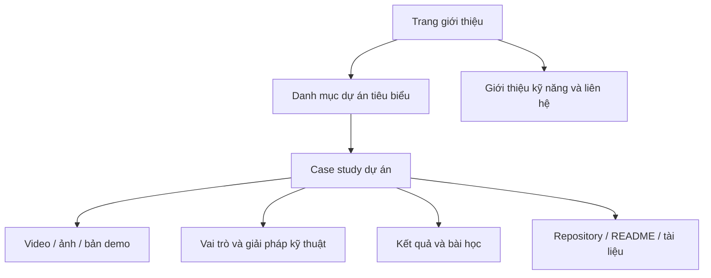
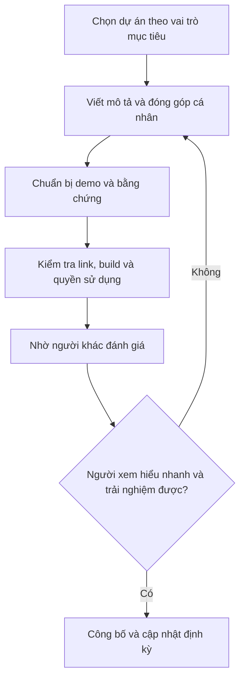

# Bài 07 — Xây dựng portfolio chuyên nghiệp cho dự án Unity

> **Lộ trình:** Junior Programmer · **Chủ đề:** Introduction to Portfolios · **Mục tiêu:** Trình bày sản phẩm, quá trình kỹ thuật và đóng góp cá nhân để người khác dễ đánh giá.

## 1. Tóm tắt

**Portfolio** là tập hợp có chọn lọc các sản phẩm và bằng chứng giúp người xem đánh giá năng lực của người tạo. Đối với lập trình viên Unity, một portfolio tốt không chỉ có ảnh đẹp mà còn cho thấy sản phẩm **chạy được**, vấn đề được giải quyết, phần việc cá nhân, quyết định kỹ thuật và kết quả kiểm chứng. Portfolio có thể phục vụ tuyển dụng, hợp tác dự án, học bổng hoặc giới thiệu năng lực cho khách hàng.

Mục tiêu của portfolio không phải tập hợp tất cả bài tập đã từng làm, mà là chọn và tổ chức các trường hợp tiêu biểu để người xem nhanh chóng hiểu **bạn có thể làm gì và đã chứng minh điều đó như thế nào**.

## 2. Mục tiêu học tập

Sau bài học, người học có thể:

- Phân biệt CV, portfolio, repository mã nguồn, bản demo và case study.
- Chọn các dự án phù hợp với nhóm người đánh giá mục tiêu.
- Xây dựng một case study Unity nêu vấn đề, vai trò, giải pháp, kết quả và bài học.
- Chuẩn bị bản build, video ngắn, ảnh minh họa và README có hướng dẫn sử dụng.
- Xây dựng kiến trúc thông tin cho website hoặc trang portfolio tối giản.
- Kiểm tra tính trung thực, quyền sử dụng tài nguyên, an toàn dữ liệu và tính dễ truy cập.

## 3. Portfolio khác CV và GitHub ở điểm nào?

| Sản phẩm | Chức năng | Nội dung nên ưu tiên |
| --- | --- | --- |
| **CV / résumé** | Tóm lược năng lực và quá trình phù hợp với vị trí | Kỹ năng, dự án, kinh nghiệm, thành tựu xác minh được |
| **Portfolio** | Giải thích và chứng minh chất lượng công việc tiêu biểu | Demo, video, quá trình, vai trò, kết quả, bài học |
| **Git repository** | Chứa mã và lịch sử phát triển | Cấu trúc code, README, phiên bản, license, commits |
| **Playable build** | Cho người khác trực tiếp kiểm thử sản phẩm | Trải nghiệm thực tế, hướng dẫn điều khiển |
| **Case study** | Đi sâu phân tích một dự án | Bài toán, lựa chọn thiết kế, thách thức, kiểm chứng |

Một portfolio có thể dẫn liên kết tới GitHub hoặc bản build, nhưng không nên buộc người xem phải đọc hàng trăm dòng source code để biết dự án thực hiện điều gì.

## 4. Xác định người xem trước khi thiết kế

Một portfolio dành cho **Gameplay Programmer** nên ưu tiên logic tương tác, state management, AI/gameplay mechanics, cách sửa lỗi, hiệu năng và chất lượng code. Portfolio của **Technical Artist** sẽ chú trọng asset pipeline, shader, quy trình dựng nội dung, animation và tối ưu biểu đạt hình ảnh. Với **Unity Generalist**, người xem cần thấy khả năng tích hợp từ scene, script, input và UI đến build.

Từ mục tiêu đó, chọn câu chuyện và bằng chứng tương ứng. Không cần trình bày mọi công cụ đã sử dụng nếu chúng không giúp chứng minh một năng lực liên quan.

**Nguyên tắc lựa chọn:** Một vài dự án có chất lượng trình bày tốt thường dễ được đánh giá hơn nhiều dự án gần như trùng lặp. Tuy nhiên, số lượng phù hợp phụ thuộc vào kinh nghiệm và mục tiêu; không có ngưỡng bắt buộc áp dụng cho tất cả.

## 5. Cấu trúc portfolio dễ đọc



Sơ đồ mô tả hướng điều hướng tối thiểu. Người xem nên có thể truy cập dự án ngay từ trang đầu, nhìn thấy demo và hiểu kết quả trước khi cần đọc phần kỹ thuật sâu.

Một trang dự án tiêu biểu có thể gồm:

1. **Tên và mô tả một câu:** Game hoặc ứng dụng giải quyết điều gì.
2. **Ảnh / video gameplay:** Minh chứng trực quan, quay từ bản chạy thực tế.
3. **Vai trò:** Bạn tự làm phần nào, ai tạo asset, có đồng đội hay không.
4. **Công nghệ:** Unity, C#, nền tảng và các package thực sự dùng.
5. **Bài toán kỹ thuật:** Ví dụ camera jitter, object lifetime, quản lý game state.
6. **Giải pháp:** Cách phân tích, thực hiện, kiểm thử, đánh đổi.
7. **Kết quả:** Bản build chạy được, chức năng đạt tiêu chí, phép đo nếu có.
8. **Giới hạn và hướng cải thiện:** Những điều chưa được giải quyết.
9. **Liên kết:** Demo, repository, tài liệu thiết lập và nguồn asset có liên quan.

## 6. Cách viết case study Unity thuyết phục

### 6.1. Nêu vấn đề và bối cảnh

Thay vì “Tôi làm một game 3D”, hãy nêu điều người dùng cần trải nghiệm và yêu cầu kỹ thuật quan trọng. Ví dụ: “Một trò chơi ném projectile cần tránh việc tăng chi phí tạo/hủy object khi người chơi bắn liên tục”.

### 6.2. Giải thích vai trò và quyết định thiết kế

Phân biệt code tự viết, template có sẵn, asset bên thứ ba và đóng góp nhóm. Với một thay đổi kiến trúc, giải thích **phương án ban đầu**, **vấn đề gặp phải**, **lý do chọn cách mới** và **điều kiện kiểm chứng**. Việc mô tả trade-off thể hiện tư duy kỹ thuật tốt hơn lời khẳng định “đã tối ưu hoàn toàn”.

### 6.3. Đưa bằng chứng có thể xem được

Các minh chứng hữu ích gồm video so sánh hành vi trước/sau, ảnh màn hình từ build, bảng test case, trích code ngắn hoặc ảnh Profiler. Khi đưa biểu đồ hiệu năng, ghi nền tảng, cấu hình và phương pháp đo. **Không ghi “tăng 80% FPS” hoặc bất kỳ con số nào nếu chưa có dữ liệu tương ứng**.

### 6.4. Viết bài học rút ra

Một case study mạnh không nhất thiết là dự án không còn bug. Việc nêu giới hạn và cách sẽ xử lý giúp người xem đánh giá khả năng tự phản biện, lập kế hoạch và ưu tiên kỹ thuật.

## 7. Ví dụ: trang giới thiệu cho một dự án Unity nhỏ

Nội dung sau là **mẫu để tùy biến**, không phải thành tích của người học:

```markdown
# Projectile Arena — Unity Gameplay Prototype

## Giới thiệu
Game nhỏ trong đó người chơi ném vật thể vào mục tiêu và ghi điểm.

## Vai trò
- Lập trình điều khiển và hệ thống tính điểm.
- Xây dựng logic sinh và tái sử dụng projectile.
- Tạo kịch bản kiểm thử chức năng.

## Kỹ thuật
- Unity + C#.
- `MonoBehaviour`, `Rigidbody`, `UnityEngine.Pool`.
- Phân biệt điều khiển, mô phỏng vật lý và camera-follow.

## Thử thách
Khi số lần ném tăng, việc tạo và hủy projectile trở thành điểm
cần kiểm tra. Tôi thử mô hình Object Pooling để tái sử dụng object.

## Kiểm chứng
- Test case: bắn liên tục, projectile biến mất, chơi lại.
- Đính kèm kết quả đo theo cùng điều kiện nếu đã thực hiện.

## Tài liệu và demo
- Video gameplay: [thêm link]
- Repository: [thêm link]
- Bản build: [thêm link]

## Giới hạn
- Chưa hỗ trợ mọi loại input và nền tảng.
- Cần thêm kiểm thử trên thiết bị đích.
```

Mẫu này có thể dùng làm phần nội dung dự án trên website, README mở rộng hoặc hồ sơ PDF. Thay thông tin chung bằng dữ liệu thực tế và xóa mọi mục chưa có bằng chứng.

## 8. Lựa chọn nền tảng trình bày

Không có một công cụ bắt buộc. Tùy mục tiêu, có thể chọn:

| Hình thức | Phù hợp với | Cần lưu ý |
| --- | --- | --- |
| Website cá nhân | Muốn kiểm soát giao diện và điều hướng | Cần bảo trì hosting, liên kết và khả năng hiển thị trên di động |
| Trang portfolio trên nền tảng có sẵn | Muốn xuất bản nhanh, ít hạ tầng | Khả năng tùy biến và chính sách nền tảng |
| GitHub profile + README dự án | Muốn nhấn mạnh bằng chứng kỹ thuật | Cần ảnh/video/demo để người không đọc code vẫn hiểu |
| Tài liệu PDF | Gửi kèm hồ sơ hoặc trình bày ngoại tuyến | Demo tương tác không thể thay bằng liên kết bị hỏng |
| Trang chơi thử dự án | Muốn cho người xem trải nghiệm ngay | Cần kiểm thử hiệu năng, trình duyệt và hướng dẫn input |

Nếu dùng website, giữ trang đầu gọn, tiêu đề rõ, hình ảnh tối ưu dung lượng, tương phản dễ đọc, alt text cho nội dung hình ảnh quan trọng và hỗ trợ điều hướng bằng bàn phím khi có thể.

## 9. Chuẩn bị dự án để người khác có thể mở và chạy

### 9.1. README và cấu trúc mã nguồn

Một repository Unity có thể tổ chức như sau:

```text
MyUnityGame/
├── Assets/
├── Packages/
├── ProjectSettings/
├── README.md
├── LICENSE                 # Nếu có giấy phép công bố mã nguồn
└── .gitignore
```

Không nên đẩy thư mục cache lớn như `Library/` lên Git khi không cần. Thư mục `Packages` và `ProjectSettings` giúp người khác hiểu dependency và cấu hình dự án. Đừng vô tình đưa bản build, dữ liệu cá nhân, license thương mại của bên thứ ba hoặc khóa bí mật vào repo công khai.

README nên ghi:

- Phiên bản Unity sử dụng thực tế và platform đã thử.
- Cách mở project và chạy scene chính.
- Sơ đồ điều khiển, các chức năng cốt lõi.
- Đường dẫn demo/video và hướng dẫn build nếu cần.
- Thành phần của bên thứ ba và điều khoản phân phối.
- Các lỗi hoặc giới hạn còn biết.

### 9.2. Ảnh và video thể hiện chức năng

Chọn cảnh gameplay có ý nghĩa: hiển thị rõ mục tiêu, điều khiển và phản hồi UI. Với video, mở đầu bằng hành vi chính; tránh chỉ trình chiếu màn hình splash hoặc timeline của Editor. Nếu quay màn hình Editor để giải thích kỹ thuật, nên phân biệt rõ đó là phần **hậu trường**, không phải demo bản build.

### 9.3. Chất lượng bản demo

Trước khi công khai bản build, kiểm tra các điểm sau: khởi động không cần thao tác thủ công; điều khiển dễ hiểu; menu và game over hoạt động; không xuất hiện lỗi nghiêm trọng; hỗ trợ đúng nền tảng đã ghi; tài nguyên được phép phân phối.

## 10. Quy trình đánh giá portfolio trước khi công bố



Người đánh giá có thể được hỏi những câu thực tế: “Bạn hiểu game làm gì trong 30 giây đầu không?”, “Bạn tìm thấy nút chơi và link code không?”, “Bạn biết chính xác tôi làm phần nào không?”. Con số 30 giây chỉ là ví dụ về kiểm tra độ rõ ràng, không phải tiêu chuẩn tuyển dụng chính thức.

## 11. Bài tập thực hành — Viết case study đầu tiên

**Đề bài:** Chọn một dự án Unity đã làm và biến nó thành một trang portfolio.

**Yêu cầu:**

1. Viết phần mô tả ngắn về sản phẩm và đối tượng sử dụng.
2. Nêu tối thiểu hai đóng góp thực sự của bản thân.
3. Giải thích một quyết định kỹ thuật cùng phương án thay thế hoặc trade-off.
4. Đính kèm một video hoặc ảnh minh chứng của phiên bản chạy được.
5. Nêu một kết quả đã kiểm chứng và một giới hạn chưa giải quyết.
6. Bổ sung README, link repo/build hợp lệ và credits cho asset bên thứ ba.
7. Nhờ một người chưa xem dự án thử đọc và tìm cách chơi; ghi lại điểm họ chưa hiểu.

**Sản phẩm cần nộp:** Một case study Markdown hoặc website, một bản demo/link tương ứng và checklist kiểm thử đường dẫn.

**Definition of Done:** Người xem xác định được trò chơi làm gì, ai đóng góp phần nào, thử hoặc xem được kết quả và có thể truy cập tài liệu kỹ thuật mà không cần yêu cầu quyền truy cập bất ngờ.

## 12. Những lỗi làm portfolio kém thuyết phục

| Lỗi | Hệ quả | Cách cải thiện |
| --- | --- | --- |
| Chỉ có ảnh đẹp, không nêu gameplay | Người đọc không hiểu năng lực kỹ thuật | Thêm demo và bài toán kỹ thuật |
| Không ghi rõ vai trò nhóm | Khó biết đóng góp cá nhân | Tách trách nhiệm, công cụ và phần kế thừa |
| Link demo hoặc repository hỏng | Không thể kiểm chứng | Mở thử ở cửa sổ ẩn danh, kiểm tra quyền truy cập |
| Nêu kết quả không có phép đo | Mất độ tin cậy | Nêu phương pháp đo, hoặc bỏ số liệu |
| Đăng asset không có quyền | Rủi ro pháp lý | Kiểm tra license và thay asset khi cần |
| Quá nhiều dự án giống nhau | Khó thấy điểm mạnh riêng | Chọn công trình tiêu biểu và mô tả sâu |

## 13. Câu hỏi ôn tập

### Câu 1

Khi làm portfolio cho vị trí Gameplay Programmer, bằng chứng nào nên được ưu tiên?

A. Chỉ hình nền nghệ thuật.  
B. Danh sách những game từng chơi.  
C. Demo cơ chế chơi kèm giải thích code, trách nhiệm và kiểm thử.  
D. Ảnh chụp desktop.

**Đáp án:** C. **Giải thích:** Bằng chứng cần gắn trực tiếp với kỹ năng của vị trí mục tiêu.

### Câu 2

Đâu là điểm khác biệt cơ bản giữa portfolio và repository?

A. Portfolio tổ chức minh chứng và câu chuyện dự án; repository chủ yếu cung cấp mã và lịch sử thay đổi.  
B. Portfolio bắt buộc chứa toàn bộ code nhúng.  
C. Repository không thể chứa README.  
D. Portfolio chỉ là bản CV thứ hai.

**Đáp án:** A. **Giải thích:** Hai hình thức hỗ trợ nhau nhưng giải quyết nhu cầu đánh giá khác nhau.

### Câu 3

Một game nhóm được đưa lên portfolio. Việc nào quan trọng nhất?

A. Ghi toàn bộ game do mình tự làm.  
B. Xóa tên những người đóng góp.  
C. Chỉ nêu tên Unity Editor.  
D. Mô tả đúng vai trò cá nhân và ghi công tài nguyên, thành viên liên quan.

**Đáp án:** D. **Giải thích:** Sự minh bạch giúp người xem đánh giá chính xác năng lực và tôn trọng quyền đóng góp.

### Câu 4

Vì sao cần thử link demo bằng cửa sổ ẩn danh hoặc tài khoản không có đặc quyền?

A. Để tăng chất lượng đồ họa.  
B. Để phát hiện vấn đề quyền truy cập mà tài khoản tác giả không thấy.  
C. Để biên dịch shader.  
D. Để thay thế mọi trường hợp kiểm thử.

**Đáp án:** B. **Giải thích:** Link có thể chạy với chủ sở hữu nhưng bị chặn với người đánh giá bên ngoài.

### Câu 5

Một case study tốt nên xử lý những giới hạn chưa giải quyết như thế nào?

A. Giấu hoàn toàn, kể cả khi ảnh hưởng demo.  
B. Tuyên bố đã tối ưu tuyệt đối.  
C. Nêu trung thực phạm vi đã kiểm thử và kế hoạch cải thiện.  
D. Tự tạo số liệu để lấp khoảng trống.

**Đáp án:** C. **Giải thích:** Trung thực về giới hạn thể hiện nhận thức kỹ thuật và giúp người đánh giá hiểu bối cảnh.

## 14. Tổng kết

Portfolio có sức thuyết phục khi biến sản phẩm đã làm thành một **câu chuyện có bằng chứng**: bối cảnh, mục tiêu, phần việc cá nhân, phương án kỹ thuật, kết quả thực tế và bài học. Hãy thiết kế cho người xem, kiểm tra link và quyền chia sẻ, rồi cập nhật portfolio khi có thêm sản phẩm tốt hơn.

## 15. Tài liệu tham khảo

- [Unity Learn — Introduction to Portfolios](https://learn.unity.com/tutorial/introduction-to-portfolios) — tài nguyên học về mục đích và xây dựng portfolio (trang có thể yêu cầu đăng nhập hoặc chuyển hướng).
- [Unity — Get Started: Introduction to Portfolios](https://unity.com/learn/get-started) — lý do dùng portfolio trong việc làm, hợp tác và học tập.
- [Unity Learn — Junior Programmer Pathway](https://learn.unity.com/pathway/junior-programmer) — các dự án để phát triển minh chứng năng lực.
- [Unity Learn — Develop Your Learning Plan](https://learn.unity.com/tutorial/develop-your-learning-plan) — liên kết mục tiêu nghề nghiệp với kế hoạch làm dự án.
- [Unity — Tips for succeeding at GDC](https://unity.com/blog/games/10-tips-succeeding-at-gdc) — gợi ý chuẩn bị GitHub, portfolio và hồ sơ chuyên môn.

*Lưu ý:* Cấu trúc và ví dụ trong bài mang tính hướng dẫn xây dựng portfolio, không phải một quy định chấm điểm tuyển dụng thống nhất. Mỗi người cần điều chỉnh theo vị trí mục tiêu, năng lực và quyền công bố tài nguyên của mình.
