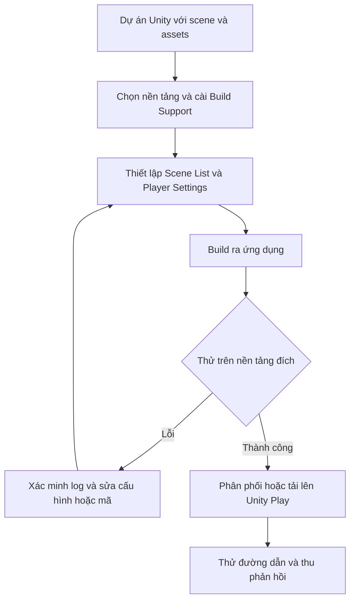

# Bài 04 — Chia sẻ dự án Unity: tạo bản build cho máy tính và trình duyệt

> **Lộ trình:** Junior Programmer · **Bài học:** Lesson 6.3 — Sharing your Projects · **Dạng:** Thực hành · **Môi trường tham khảo:** Unity 6.3, Unity Hub và Unity Play.

## 1. Tổng quan

Một trò chơi chạy được trong **Play Mode** của Unity Editor chưa chắc đã chạy độc lập trên máy của người khác. Editor cung cấp công cụ phát triển, thư viện và trạng thái dự án mà người dùng cuối không có. Quá trình **build** chuyển scene, script, dữ liệu và cấu hình thành một ứng dụng dành cho nền tảng đích. Quá trình **publish** đưa ứng dụng đó đến nơi người chơi có thể truy cập.

Bài thực hành tập trung vào ba việc: cài **Build Support modules**, tạo bản build cho **Windows/macOS** và **Web**, sau đó thử chia sẻ qua **Unity Play** hoặc chuẩn bị minh chứng để người khác kiểm tra. Phải **chạy thử bản build**, không coi thông báo build thành công là bằng chứng ứng dụng hoạt động đúng.

## 2. Mục tiêu học tập

Sau bài này, người học có thể:

- Giải thích sự khác nhau giữa *project*, *build*, *build profile* và *publication*.
- Cài hoặc bổ sung module xuất bản theo phiên bản Unity đang dùng.
- Cấu hình scene đầu vào, chọn nền tảng và build một ứng dụng độc lập.
- Tạo, kiểm thử bản Web và biết cách xuất bản lên Unity Play khi nền tảng hỗ trợ.
- Xác nhận ứng dụng chạy được, chuẩn bị cách chơi, ảnh/video và thông tin bản phát hành.

## 3. Bản chất của quá trình build và chia sẻ

| Khái niệm | Ý nghĩa | Ví dụ |
| --- | --- | --- |
| Unity project | Thư mục chứa scene, assets, scripts, packages, thiết lập | Thư mục có `Assets/`, `Packages/`, `ProjectSettings/` |
| Build support module | Thành phần Editor cần có để xuất sang nền tảng đích | `Web Build Support`, `Windows Build Support` |
| Build Profile | Bộ cấu hình build được dùng cho một nền tảng hoặc mục đích | Cấu hình Web, Windows, Development |
| Player / build | Sản phẩm thực thi sinh ra từ project | `.exe` và dữ liệu đi kèm, hoặc thư mục Web |
| Publishing | Phân phối build để người khác truy cập | Unity Play, website, gói tải xuống |

Một project có thể sinh nhiều bản build. Mỗi bản build cần đúng module và cấu hình tương ứng; không thể đổi tên phần mở rộng của tệp để chuyển từ Windows sang Web.



Sơ đồ phân biệt rõ vòng **build–test–fix** với bước **publish**. Cần kiểm tra cả lần truy cập của người khác, không chỉ thử ngay trên máy phát triển.

## 4. Chuẩn bị môi trường xuất bản

### 4.1. Kiểm tra phiên bản Editor và module

Mở **Unity Hub → Installs**. Tại phiên bản Editor đang dùng cho project, mở tùy chọn quản lý rồi chọn **Add modules**. Cài module phù hợp: **Web Build Support** cho Web; **Windows Build Support**, **Mac Build Support** hoặc module hệ điều hành tương ứng nếu cần. Tên tùy chọn có thể khác đôi chút giữa hệ điều hành và phiên bản Hub.

Một bản Unity Editor trên Windows không đồng nghĩa với việc máy đó có thể build mọi nền tảng. Ví dụ, một số nền tảng yêu cầu công cụ, SDK hoặc hệ điều hành bổ sung; chỉ cài module chưa chắc đủ.

### 4.2. Kiểm tra project trước khi build

- Lưu scene đang làm việc bằng `Ctrl+S` / `Cmd+S`.
- Chạy trong Editor, kiểm tra luồng **bắt đầu → điều khiển → kết quả → chơi lại/kết thúc**.
- Sửa các `error` có thể ảnh hưởng đến biên dịch hoặc hành vi; xem xét `warning` liên quan.
- Kiểm tra các asset và prefab có tham chiếu bị thiếu, đặc biệt các tham chiếu được gán qua `Inspector`.
- Xác định **scene khởi chạy** và các scene chuyển tiếp của trò chơi.
- Đảm bảo không đưa thông tin bí mật, tài nguyên chưa được cấp quyền hay dữ liệu riêng tư vào bản phát hành.

Đối với dự án sử dụng `Input System`, cần thử trực tiếp trên thiết bị hoặc trình duyệt đích: bàn phím, chuột, focus cửa sổ và thao tác chạm có thể không giống trải nghiệm trong Editor.

## 5. Xuất bản build độc lập cho Windows hoặc macOS

### 5.1. Chọn nền tảng và scene

1. Vào **File → Build Profiles**.
2. Chọn platform `Windows` hoặc `macOS`. Nếu chưa có module, quay lại Unity Hub để bổ sung.
3. Kích hoạt nền tảng bằng nút **Switch Platform** hoặc chọn build profile phù hợp rồi **Switch Profile**; cách hiển thị tùy cấu hình hiện có.
4. Mở **Scene List** và sử dụng **Add Open Scenes**, hoặc đưa các scene cần thiết vào danh sách.
5. Sắp xếp thứ tự: scene khởi động phải được đưa lên đầu. Kiểm tra các scene cần tải có được đánh dấu để build.
6. Trong **Player Settings**, rà soát tên ứng dụng, kích thước cửa sổ, biểu tượng, chế độ hiển thị và thông tin nhà phát triển nếu cần.

**Điểm kiểm tra:** scene menu hoặc scene gameplay khởi đầu phải xuất hiện đúng khi khởi chạy ứng dụng, thay vì một màn hình trống hay scene thử nghiệm.

### 5.2. Tạo và thử bản build

Chọn **Build** để xuất file rồi tự mở, hoặc **Build and Run** để tạo và chạy theo cơ chế của nền tảng. Lưu sản phẩm vào thư mục chuyên biệt, ví dụ:

```text
MyUnityProject/
├── Assets/
├── Packages/
├── ProjectSettings/
└── Builds/
    └── Windows/
        ├── MyGame.exe
        ├── MyGame_Data/
        └── ...
```

Đây là sơ đồ minh họa cấu trúc phổ biến của bản Windows, không phải danh sách file bắt buộc cho mọi hệ điều hành và mọi cấu hình. Khi chia sẻ ứng dụng desktop, cần giữ **đủ file và thư mục đi kèm**, không chỉ gửi một mình `.exe`.

Thử nghiệm ít nhất các trường hợp: khởi động lần đầu, thao tác chơi chính, âm thanh, độ phân giải, chuyển scene, thoát ứng dụng. Nếu có thể, chuyển gói build sang một máy khác để phát hiện sự phụ thuộc vào môi trường phát triển.

## 6. Tạo Web build và chia sẻ trực tuyến

### 6.1. Build cho Web

Trong **File → Build Profiles**, chọn nền tảng **Web** (thường được gọi là *WebGL* trong API và một số tài liệu). Chuyển nền tảng, xác nhận `Scene List`, rồi chọn **Build**. Kết quả thông thường gồm trang khởi chạy và các tài nguyên Web, không phải ứng dụng `.exe`.

Không mở trực tiếp `index.html` bằng đường dẫn `file://` để kết luận build bị lỗi: trình duyệt có thể hạn chế tải tài nguyên Web qua giao thức này. Hãy dùng **Build and Run** hoặc máy chủ HTTP phù hợp. Nếu tải lên host riêng, cần cấu hình máy chủ đúng với **compression format** được dùng.

### 6.2. Đưa trò chơi lên Unity Play

Với Editor tương thích, sau khi chuyển sang Web và tạo build, có thể dùng chức năng **Publish to Play** trong Build Profiles. Tùy bản Unity hoặc workflow cài đặt, quá trình phát hành có thể sử dụng công cụ/plugin xuất bản; cần đối chiếu tùy chọn thực tế trong Editor thay vì mặc định mọi phiên bản đều giống nhau.

Sau khi tải lên:

1. Đặt tên và mô tả ngắn gọn.
2. Chọn chế độ hiển thị phù hợp nếu dịch vụ cung cấp (`public`, `private` hoặc `unlisted`).
3. Thêm ảnh thumbnail hoặc video nếu có.
4. Lấy đường dẫn, mở thử ở một phiên trình duyệt khác.
5. Kiểm tra màn hình tải, điều khiển, tốc độ và phần hướng dẫn để người mới có thể chơi.

**Lưu ý về công bố:** một đường dẫn có thể truy cập không có nghĩa là mọi người tự tìm thấy trò chơi; cần kiểm tra chế độ quyền truy cập. Với nội dung học tập, chế độ công khai hay không công khai là quyết định của người tạo sản phẩm.

### 6.3. Điều gì khác nhau giữa Desktop và Web?

| Khía cạnh | Desktop | Web |
| --- | --- | --- |
| Khởi chạy | Thực thi trên hệ điều hành | Tải từ trình duyệt và máy chủ |
| Đóng gói | Ứng dụng và dữ liệu đi kèm | Trang HTML, JavaScript/WebAssembly và dữ liệu |
| Khả năng truy cập | Phụ thuộc hệ điều hành/kiến trúc | Phụ thuộc trình duyệt, thiết bị và cấu hình host |
| Kiểm tra lỗi | Log ứng dụng/Player | Console của trình duyệt, Network và log ứng dụng |
| Phân phối | Gói tải xuống hoặc store | Website hoặc Unity Play |

Không thể suy ra Web hoạt động đúng chỉ vì bản Desktop chạy tốt; một số khả năng nền tảng, bộ nhớ và cách trình duyệt quản lý tài nguyên khác nhau.

## 7. Lỗi thường gặp và quy trình xác minh

| Hiện tượng | Nguyên nhân cần kiểm tra | Cách xác minh |
| --- | --- | --- |
| Build khởi chạy sai scene | Scene List sai thứ tự hoặc chưa đưa scene cần thiết vào | Xem Scene List, build lại và thử khởi động mới |
| Chạy trong Editor nhưng bản build lỗi | Asset thiếu, API chỉ chạy trong Editor, đường dẫn phụ thuộc máy | Đọc log của Player, kiểm tra các `#if UNITY_EDITOR` |
| Nút bấm không phản hồi | Focus, input binding, EventSystem hoặc UI bị che | Thử trên nền tảng đích, kiểm tra input events |
| Trang Web không tải | Build lỗi, HTTP hosting hoặc header nén sai | Mở Developer Tools → Console/Network |
| Web build chạy chậm | Bộ nhớ, đồ họa, số lượng đối tượng hoặc cấu hình build | Đo trên trình duyệt và thiết bị mục tiêu |
| Người nhận không mở được desktop build | Thiếu thư mục dữ liệu hoặc khác hệ điều hành | Thử bản đóng gói đầy đủ trên máy sạch |

Khi debug, ghi lại **kết quả mong đợi**, **kết quả thực tế**, **bước tái hiện**, **môi trường** và **thay đổi đã thử**. Mỗi lần chỉ sửa nhóm nguyên nhân có thể kiểm chứng để tránh làm mờ nguồn lỗi.

## 8. Bài thực hành: công bố một dự án có thể chơi

**Đề bài:** Chọn một dự án Unity đã có, tạo ít nhất **một bản build chạy độc lập** và chuẩn bị minh chứng để người khác trải nghiệm. Nếu phần cứng/phần mềm cho phép, tạo thêm Web build và công bố lên Unity Play.

**Sản phẩm cần nộp:**

- Một bản build hoặc đường dẫn chơi trực tuyến hoạt động.
- Một file `README.md` nêu tên game, hướng dẫn điều khiển, yêu cầu thiết bị và hạn chế hiện có.
- Hai hoặc ba ảnh chụp màn hình hoặc một video ngắn thể hiện gameplay thực tế.
- Bảng ghi tối thiểu ba tình huống thử nghiệm, trong đó có một tình huống tìm thấy lỗi hoặc giới hạn.

**Tiêu chí hoàn thành:**

- [ ] Đã cài đúng build support và chọn platform.
- [ ] Đã đưa scene khởi động và các scene liên quan vào Scene List.
- [ ] Đã build thành công và **chạy được** bản build.
- [ ] Đã kiểm thử điều khiển, chuyển scene và kết thúc phiên chơi.
- [ ] Đã mô tả cách chơi và chuẩn bị ảnh/video hoặc đường dẫn chia sẻ.
- [ ] Đã xác minh giấy phép của asset, nhạc và nội dung công khai.

**Mở rộng:** Tạo thêm bản Web để so sánh khác biệt về thời gian tải, thao tác và cách ghi log; không cần đặt ra số liệu giả định trước khi đo.

## 9. Câu hỏi ôn tập

### Câu 1

Một game hoạt động trong Editor nhưng khi mở bản build thì hiện scene không mong muốn. Nên kiểm tra bước nào đầu tiên?

A. Đổi màu giao diện.  
B. Xóa toàn bộ Prefab.  
C. Kiểm tra `Scene List` và thứ tự scene khởi chạy.  
D. Tăng chất lượng bóng đổ.

**Đáp án:** C. **Giải thích:** Danh sách scene được build và thứ tự của chúng ảnh hưởng trực tiếp đến scene đầu tiên được tải.

### Câu 2

Yêu cầu cơ bản trước khi tạo Web build là gì?

A. Có module `Web Build Support` phù hợp với phiên bản Editor.  
B. Đổi toàn bộ script sang JavaScript.  
C. Đưa mọi asset vào thư mục `Resources`.  
D. Tắt tất cả Camera.

**Đáp án:** A. **Giải thích:** Unity cần module build cho Web; mã C# được xử lý trong pipeline của Unity, không yêu cầu tự viết lại thành JavaScript.

### Câu 3

Vì sao không nên chỉ gửi file `.exe` trong một bản Windows build thông thường?

A. File `.exe` chỉ chạy trong Editor.  
B. Unity luôn yêu cầu mạng.  
C. Game bắt buộc phải là file ZIP.  
D. Build có thể cần dữ liệu và thư viện đi kèm.

**Đáp án:** D. **Giải thích:** Ứng dụng desktop thường gồm nhiều tệp/thư mục phụ thuộc, cần được phân phối cùng nhau.

### Câu 4

Một Web build không tải khi mở `index.html` bằng `file://`. Phương án nào phù hợp nhất?

A. Chỉ thay tên thư mục build.  
B. Thử qua `Build and Run` hoặc máy chủ HTTP cấu hình đúng.  
C. Xóa mọi âm thanh.  
D. Bỏ tất cả scene khác.

**Đáp án:** B. **Giải thích:** Browser có chính sách tải tài nguyên khác nhau giữa `file://` và HTTP; cần kiểm tra qua cách host đúng.

### Câu 5

Dấu hiệu nào chứng minh một bản phát hành đủ tin cậy hơn?

A. Không có bất cứ ảnh chụp nào.  
B. Có nhiều script nhất có thể.  
C. Người khác khởi chạy và hoàn thành được luồng chơi cốt lõi.  
D. Chỉ xuất hiện thông báo build thành công.

**Đáp án:** C. **Giải thích:** Khả năng sử dụng được xác nhận bằng hành vi chạy thực tế trên môi trường người dùng.

## 10. Tổng kết

Quy trình chia sẻ đúng gồm **chuẩn bị project → chọn và cấu hình nền tảng → build → chạy thử → phân phối → kiểm tra phản hồi**. Bản build là sản phẩm thực thi; quyền sử dụng nội dung, tài liệu hướng dẫn và minh chứng vận hành là phần cần thiết để người khác có thể dùng và đánh giá dự án.

### Tài liệu tham khảo

- [Unity Learn — Lesson 6.3: Sharing your Projects](https://learn.unity.com/pathway/junior-programmer/unit/publishing-your-project/tutorial/lesson-6-3-sharing-your-projects?version=6.3)
- [Unity Learn — Publish on Unity Play](https://learn.unity.com/tutorial/publish-on-unity-play)
- [Unity Documentation 6.3 — Introduction to building](https://docs.unity.com/en-us/engine/6000.3/manual/building-and-publishing/building-introduction)
- [Unity Documentation 6.3 — Build Profiles](https://docs.unity.com/en-us/engine/6000.3/manual/building-and-publishing/build-settings/build-profiles-reference)
- [Unity Documentation 6.3 — Web build troubleshooting](https://docs.unity.com/en-us/engine/6000.3/manual/platform-specific/webgl/develop/debugging/web-debugging-troubleshooting)
