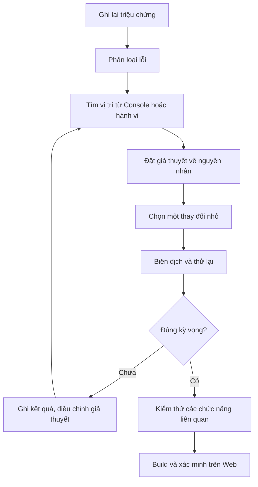

# Bài 08 — Debug the App: điều tra và sửa lỗi ứng dụng Unity

> **Lộ trình:** Junior Programmer · **Dạng:** Bài tập thực hành có project mẫu · **Nền tảng:** Unity 6.x, C#, Editor Console và Web build.

## 1. Tổng quan

Một chương trình có thể không chạy vì **lỗi biên dịch**, hoặc vẫn biên dịch thành công nhưng hành vi sai vì **lỗi logic** hay **lỗi trong lúc chạy**. Kỹ năng debug là khả năng biến triệu chứng quan sát được thành giả thuyết có thể kiểm tra, tìm ra nguyên nhân và chứng minh rằng thay đổi đã giải quyết được vấn đề.

Bài tập sử dụng gói **`ErrorProject.zip`**, bên trong có `ErrorProject.unitypackage`. Nhiệm vụ là nhập một project có lỗi, tìm hiểu mục đích hoạt động, sửa các lỗi cần thiết để ứng dụng chạy như dự kiến, rồi **tạo Web build, công bố lên Unity Play và cung cấp đường dẫn**. Trong project bài tập, sau khi import có **hai thông báo lỗi trong Console** khiến người học chưa thể thử scene; phải xử lý chúng trước khi đi vào kiểm tra chức năng.

## 2. Mục tiêu học tập

Sau bài học, người học có thể:

- Phân biệt lỗi biên dịch, lỗi thời gian chạy, sai logic và sai cấu hình scene.
- Đọc `Console`, `stack trace`, nhận diện file, dòng và ngữ cảnh gây lỗi.
- Dùng phương pháp tái hiện và kiểm tra giả thuyết để sửa lỗi mà không thay đổi tùy tiện nhiều nơi.
- Kiểm tra tính đúng đắn của tham chiếu Inspector, `GameObject` và component liên quan.
- Xác nhận bản sửa hoạt động trong Editor **và bản Web**; chuẩn bị minh chứng để nộp.

## 3. Chuẩn bị bài tập

### 3.1. Nhập gói project

1. Tải `ErrorProject.zip` từ trang [Unity Learn — Debug the App](https://learn.unity.com/tutorial/debug-the-app).
2. **Giải nén** ZIP, sau đó xác nhận có `ErrorProject.unitypackage`.
3. Tạo một project Unity với template **3D** và phiên bản Editor được Unity Learn hỗ trợ.
4. Import gói: dùng lệnh **Assets → Import Package → Custom Package** hoặc thao tác import tương đương được hỗ trợ trong Editor.
5. Mở scene đi kèm, quan sát `Hierarchy`, `Inspector` và `Console`.
6. Tạo một bản commit Git hoặc bản sao project trước khi sửa để có thể đối chiếu trạng thái ban đầu.

Không import trực tiếp file bên trong ZIP khi chưa giải nén. Không xóa toàn bộ project rồi dựng mới: bài tập yêu cầu **debug một hệ thống có sẵn**, không thay thế nó bằng ứng dụng khác.

### 3.2. Quan sát ý định của ứng dụng

Khi project chưa biên dịch được, **Play Mode** có thể không dùng để quan sát hành vi. Hãy đọc scene và script có trên đối tượng **`TextDisplay`**. Để hiểu bài toán, tự trả lời:

- Đối tượng nào hiển thị thông tin cho người dùng?
- Những component và trường dữ liệu nào script cần tham chiếu?
- Dữ liệu được khởi tạo và cập nhật tại đâu?
- Trạng thái thành công cần xuất hiện trong **Game view** là gì?

Mục tiêu của phần này là xây dựng **hành vi kỳ vọng** trước khi sửa mã. Không phải đoán lỗi theo tên file hay sửa đại cho đủ số lượng thông báo.

## 4. Phân loại lỗi và công cụ tương ứng

| Nhóm lỗi | Triệu chứng | Công cụ kiểm tra | Ví dụ khái quát |
| --- | --- | --- | --- |
| Compilation | C# không biên dịch; Unity báo lỗi đỏ | Console và IDE | Sai dấu ngoặc, namespace, kiểu dữ liệu, phương thức |
| Runtime exception | Ứng dụng chạy đến một đoạn mã thì phát sinh ngoại lệ | Stack trace, debugger | Truy cập tham chiếu `null` |
| Logic | Không có exception nhưng kết quả sai | Log, breakpoint, test case | Đếm sai hoặc hiển thị không đổi |
| Inspector / scene | Script hợp lệ nhưng dữ liệu/đối tượng thiếu hoặc bị tắt | Inspector, Hierarchy, prefab | Chưa kéo thả reference |
| Platform-specific | Chạy trong Editor nhưng lỗi ở bản Web | Browser Console, Player logs | Hạn chế trình duyệt hoặc cấu hình build |

**Điểm dễ nhầm:** `NullReferenceException` là kiểu ngoại lệ C# rất phổ biến; `UnassignedReferenceException` thường liên quan đến tham chiếu Unity cần gán nhưng chưa có giá trị. Không nên mặc định cả hai có cùng nguyên nhân trong mọi trường hợp.

### 4.1. Console và stack trace

Mở **Window → General → Console**. Xem biểu tượng lỗi, mô tả, tên script và vị trí dòng code. Nhấp thông báo để mở vị trí liên quan trong IDE. `Stack trace` thường thể hiện chuỗi các lời gọi dẫn đến lỗi, giúp phân biệt nơi ngoại lệ **bộc lộ** với nơi dữ liệu **bị tạo sai**.

Một ví dụ minh họa, không phải lỗi thực tế của package:

```text
NullReferenceException: Object reference not set to an instance of an object
ExampleUI.Refresh () (at Assets/Scripts/ExampleUI.cs:31)
ExampleUI.Start () (at Assets/Scripts/ExampleUI.cs:14)
```

Diễn giải: `Start()` gọi `Refresh()`, và tại dòng 31 của `Refresh()` có thao tác trên một tham chiếu chưa hợp lệ. Bước tiếp theo là đọc biểu thức ở dòng đó và truy ngược đến nơi tham chiếu được gán.

### 4.2. Các thao tác debug hữu ích

`Debug.Log`, `Debug.LogWarning` và `Debug.LogError` giúp đánh dấu luồng thực thi và giá trị trạng thái:

```csharp
using UnityEngine;

public class StateProbe : MonoBehaviour
{
    [SerializeField] private GameObject target;

    private void Start()
    {
        Debug.Log($"StateProbe started; target assigned: {target != null}", this);
    }
}
```

Đây chỉ là script minh họa cách **quan sát** trạng thái. Gán `target` trong Inspector nếu muốn kiểm tra tham chiếu cụ thể. Tham số `this` giúp Unity liên kết thông báo với component tạo log. Không đưa một lượng lớn log vào mọi `Update()` nếu không có nhu cầu: lượng log tăng nhanh có thể gây nhiễu và làm chậm quá trình thử nghiệm.

Khi lỗi khó xác định, gắn **breakpoint** trong Visual Studio/Rider hoặc IDE hỗ trợ, đính kèm debugger vào Unity Editor và theo dõi từng bước của giá trị biến. Khả năng debugging thực tế phụ thuộc phiên bản IDE và cấu hình môi trường.

## 5. Quy trình sửa lỗi có thể kiểm chứng



Mỗi vòng lặp chỉ nên xử lý một nguyên nhân đủ nhỏ để biết thay đổi nào tạo ra hiệu quả. Sau khi hết lỗi biên dịch, vẫn phải quan sát gameplay/UI để phát hiện lỗi logic.

### 5.1. Bước 1 — Xử lý lỗi biên dịch

Đọc **thông báo lỗi đầu tiên có ý nghĩa** trong Console, tìm file và dòng, rồi đọc cả đoạn mã lân cận. Một dấu ngoặc hoặc một namespace thiếu có thể tạo ra nhiều lỗi thứ cấp; vì vậy không nên cố sửa từng thông báo theo thứ tự xuất hiện mà bỏ qua quan hệ nguyên nhân–hậu quả.

Các câu hỏi chẩn đoán:

- Tên type hoặc method có đúng chính tả và đúng API của Unity đang dùng không?
- Script có `using` tương ứng với namespace cần dùng không?
- File và class có tổ chức đúng quy ước của `MonoBehaviour` không?
- Dấu ngoặc, dấu `;` và kiểu dữ liệu có chính xác không?

### 5.2. Bước 2 — Kiểm tra lỗi tham chiếu

Khi Unity biên dịch xong, nhấn **Play**, quan sát `Console` và trạng thái `Game view`. Nếu có ngoại lệ liên quan đến tham chiếu, xác định biến nào được dùng tại dòng lỗi; sau đó đối chiếu với `Inspector` và thứ tự khởi tạo dữ liệu.

Ví dụ kỹ thuật phòng lỗi trong script tự xây dựng:

```csharp
using UnityEngine;

public class ReferenceGuard : MonoBehaviour
{
    [SerializeField] private GameObject requiredObject;

    private void Awake()
    {
        if (requiredObject == null)
        {
            Debug.LogError("Required object has not been assigned.", this);
            enabled = false;
            return;
        }
    }
}
```

Đoạn mã đưa ra một cách **phát hiện thiếu tham chiếu sớm**, không phải lời giải cho `ErrorProject.unitypackage`. Tránh chỉ thêm `if (x == null) return;` vào mọi vị trí để giấu ngoại lệ: lỗi ban đầu có thể biến thành màn hình trống khó chẩn đoán hơn.

### 5.3. Bước 3 — Kiểm thử hành vi thay vì chỉ sửa Console

Sau khi chương trình không còn lỗi ngăn biên dịch, hãy quan sát **kết quả cuối cùng trong Game view**, so với chức năng mà scene và script biểu đạt. Có thể sử dụng bảng sau:

| Tình huống | Kỳ vọng | Kết quả quan sát | Kết luận |
| --- | --- | --- | --- |
| Vào Play Mode | Scene bắt đầu đúng | Ghi sau khi chạy | Đạt / Không đạt |
| Chạy thao tác chính | UI và logic phản hồi đúng | Ghi sau khi chạy | Đạt / Không đạt |
| Lặp lại thao tác | Ứng dụng vẫn ổn định | Ghi sau khi chạy | Đạt / Không đạt |
| Build và mở trên Web | Tương tác chính hoạt động | Ghi sau khi chạy | Đạt / Không đạt |

Theo tiêu chí bài tập, **Console không còn lỗi hoặc cảnh báo**, ứng dụng chạy được trong Editor và được xuất bản lên Unity Play. Dù vậy, trong thực tiễn phát triển phần mềm, một project không có cảnh báo chưa tự động bảo đảm không có bug.

## 6. Kiểm tra bản Web sau khi sửa lỗi

Sau khi ứng dụng hoạt động trong Editor:

1. Lưu scene và những thay đổi cần thiết.
2. Xác nhận cài **Web Build Support** trong Unity Hub.
3. Mở **File → Build Profiles → Web** và kích hoạt nền tảng.
4. Kiểm tra `Scene List`, tạo Web build rồi chạy thử trong trình duyệt.
5. Xuất bản lên **Unity Play** theo công cụ phù hợp với phiên bản Editor.
6. Mở đường dẫn được công bố, lặp lại bài kiểm thử cốt lõi, sau đó sao chép URL để nộp.

Trang học chính thức có thể hướng dẫn cài **WebGL Publisher**; trong một số phiên bản Unity mới, tính năng **Publish to Play** có sẵn trong Build Profiles. Hai hướng dẫn liên quan đến cấu hình phiên bản khác nhau, nên cần xem phương án nào thực sự khả dụng.

Nếu Web không chạy, mở **Developer Tools → Console** của trình duyệt. Trên Web, log `Debug.Log` được chuyển ra JavaScript Console, không hoạt động như một file `Player.log` desktop thông thường. Trên các nền tảng desktop, có thể đọc **Player log** để xác minh lỗi không xuất hiện trong Editor.

## 7. Bài tập và minh chứng phải nộp

**Đề bài:** Khôi phục ứng dụng từ `ErrorProject.unitypackage` để chạy đúng như dự kiến mà không bỏ đi cơ chế cần có. Không dựa vào danh sách lỗi đoán sẵn; phải trình bày được cách phát hiện và chứng minh việc sửa lỗi.

**Đầu ra:**

- Project Unity đã sửa, có scene chạy được.
- Nhật ký ít nhất hai vòng sửa lỗi: *triệu chứng → giả thuyết → thay đổi → kết quả*.
- Ảnh `Console` sau sửa và video/ảnh chứng minh hành vi đúng.
- Web build đã tải lên Unity Play và đường dẫn gửi để kiểm chứng.

**Checklist đánh giá:**

- [ ] Import được `ErrorProject.unitypackage` vào project 3D.
- [ ] Đã đọc `Hierarchy` và script gắn với `TextDisplay` trước khi sửa.
- [ ] Đã xử lý các lỗi biên dịch ngăn Play Mode.
- [ ] Đã kiểm tra tham chiếu và chức năng ở Game view.
- [ ] Không còn lỗi/cảnh báo trong Console theo tiêu chí bài tập.
- [ ] Đã tạo và chạy thử Web build.
- [ ] Đã đăng lên Unity Play và có URL nộp bài.

**Mức nâng cao:** Tái hiện một lỗi khác trong bản sao riêng, viết một bản **bug report** có môi trường, bước tái hiện, kết quả mong đợi và kết quả thực tế. Không làm hỏng bản đã hoàn thành.

## 8. Những sai lầm dễ gặp

- **Sửa ngay khi chưa hiểu hành vi mục tiêu:** Có thể làm ứng dụng biên dịch được nhưng sai yêu cầu.
- **Chỉ xử lý dấu hiệu:** Vô hiệu hóa toàn bộ code hoặc thêm `return` không có căn cứ để loại thông báo lỗi.
- **Bỏ qua Inspector:** Script biên dịch đúng vẫn có thể thiếu tham chiếu.
- **Chỉ thử một lần:** Lỗi có thể xuất hiện sau vài lần thao tác hoặc khi reset scene.
- **Quên thử bản build:** Editor và Web khác về cách chạy, logging và hạn chế môi trường.
- **Xóa Console để kết luận hết lỗi:** Clear Console chỉ xóa lịch sử hiển thị, không sửa mã hay loại bỏ nguyên nhân.

## 9. Câu hỏi ôn tập

### Câu 1

Sau khi import project, Console có lỗi C# và Play Mode bị ngăn. Việc nào nên làm trước?

A. Xóa cả scene.  
B. Tăng hiệu ứng ánh sáng.  
C. Tạo bản release trước.  
D. Đọc thông báo biên dịch, vị trí mã và nguyên nhân liên quan.

**Đáp án:** D. **Giải thích:** Lỗi biên dịch phải được xử lý thì mới đánh giá được hành vi của project trong Play Mode.

### Câu 2

Một script truy cập tham chiếu chưa được gán ở Inspector và phát sinh ngoại lệ. Cách điều tra nào phù hợp nhất?

A. Kiểm tra stack trace, field bị truy cập và cấu hình Inspector.  
B. Xóa toàn bộ `Debug.Log`.  
C. Giảm FPS mục tiêu.  
D. Đổi tên mọi GameObject.

**Đáp án:** A. **Giải thích:** Cần xác định biến gây lỗi và nơi biến đó được gán/khởi tạo.

### Câu 3

Không còn lỗi biên dịch nghĩa là gì?

A. Bản Web chắc chắn hoạt động.  
B. Tất cả logic đã chính xác.  
C. Chương trình đã qua bước biên dịch nhưng vẫn cần kiểm tra lúc chạy và hành vi.  
D. Không cần xem `Game view`.

**Đáp án:** C. **Giải thích:** Compiler không kiểm chứng đầy đủ logic, tham chiếu trong scene hoặc giới hạn nền tảng.

### Câu 4

Ở Web build, tìm log ứng dụng từ `Debug.Log` ở đâu là phù hợp?

A. Luôn trong tệp Windows `Player.log`.  
B. Trong Console của Developer Tools trên trình duyệt.  
C. Bên trong Inspector của scene đã đóng.  
D. Trong file `.unitypackage` đã tải.

**Đáp án:** B. **Giải thích:** Unity Web chuyển thông tin log vào JavaScript Console của browser.

### Câu 5

Khi debug, vì sao nên thay đổi một nhóm nhỏ có thể kiểm chứng mỗi lần?

A. Để tăng số lượng commit.  
B. Vì Unity không hỗ trợ nhiều thay đổi.  
C. Để không cần kiểm tra lại.  
D. Để liên hệ rõ thay đổi với kết quả và không làm lẫn nguyên nhân.

**Đáp án:** D. **Giải thích:** Phương pháp kiểm tra giả thuyết cần giữ các yếu tố khác tương đối ổn định.

## 10. Tổng kết

Debug có thể được hệ thống hóa thành **tái hiện → quan sát → phân loại → giả thuyết → chỉnh sửa có kiểm soát → kiểm thử hồi quy**. Riêng bài tập này, mục tiêu không chỉ là làm cho Console sạch lỗi mà còn khôi phục đúng chức năng của ứng dụng có sẵn, xây dựng Web và chứng minh bản phát hành có thể chạy.

### Tài liệu tham khảo

- [Unity Learn — Debug the App](https://learn.unity.com/tutorial/debug-the-app)
- [Unity Documentation 6.3 — Debugging and diagnostics](https://docs.unity.com/en-us/engine/6000.3/manual/scripting/debugging-and-diagnostics)
- [Unity Documentation 6.3 — Stack trace logging](https://docs.unity.com/en-us/engine/6000.3/manual/scripting/debugging-and-diagnostics/stack-trace)
- [Unity Documentation 6.3 — Console window](https://docs.unity.com/en-us/engine/6000.3/manual/unity-editor/editor-windows-views-reference/console-window)
- [Unity Documentation 6.3 — Debugging Web builds](https://docs.unity.com/en-us/engine/6000.3/manual/platform-specific/webgl/develop/debugging/web-debugging-development)
