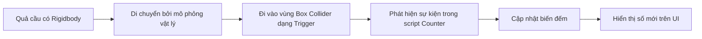
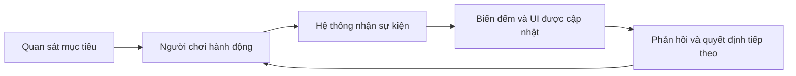

# Bài 09 — Counting Prototype: thiết kế nguyên mẫu trò chơi có bộ đếm trong Unity

> **Lộ trình:** Junior Programmer · **Dạng:** Bài tập thiết kế và xây dựng prototype · **Nền tảng:** Unity 6.x, C#, physics 3D và giao diện người dùng.

## 1. Tổng quan

Một nguyên mẫu (*prototype*) là sản phẩm thử nghiệm giúp kiểm tra một giả thuyết về cơ chế hoặc trải nghiệm trước khi đầu tư vào nhiều nội dung và đồ họa. Với **Counting Prototype**, cơ chế bắt buộc là **đếm một loại sự kiện hoặc đối tượng và hiển thị số lượng bằng giao diện người dùng**. Phần sáng tạo nằm ở việc người học quyết định *đếm cái gì, vì sao cần đếm và người dùng tác động vào bộ đếm như thế nào*.

Bài tập sử dụng gói **`Counter.unitypackage`** làm nền. Scene ban đầu có một hộp, các quả cầu được gắn `Rigidbody`, một **trigger collider** trong lòng hộp và một nhãn UI thể hiện số lượng quả cầu đã rơi vào vùng đếm. Từ ví dụ đó, người học cần thiết kế một ứng dụng mới, viết **tài liệu thiết kế ngắn**, hiện thực và ghi lại video chạy thử.

Đây là bài tập mở. Không có một chủ đề trò chơi duy nhất hoặc một lời giải C# bắt buộc; điều cần chứng minh là sự nhất quán giữa **ý tưởng — cách đếm — phản hồi UI — hành vi chạy được**.

## 2. Mục tiêu học tập

Sau bài học, người học có thể:

- Đọc cấu trúc một prototype Unity có sẵn gồm `GameObject`, `Rigidbody`, `Collider`, script và UI.
- Mô tả vai trò của trigger event và sự khác nhau giữa một lần **đi vào vùng** với việc **đang ở trong vùng**.
- Tạo Game Design Document ngắn với mục tiêu, vòng lặp tương tác và tiêu chí hoàn thành.
- Đề xuất và triển khai một cơ chế đếm mới dựa trên gói mẫu.
- Kiểm thử độ chính xác của bộ đếm và tính đồng bộ giữa logic với UI.
- Ghi video và trình bày kết quả; có thể mở rộng bằng bản Web chạy được.

## 3. Khám phá prototype mẫu

### 3.1. Tải và mở nội dung

1. Tải **`Counter.unitypackage`** ở trang [Unity Learn — Counting Prototype](https://learn.unity.com/tutorial/counting-prototype).
2. Nếu gói được đựng trong ZIP, giải nén trước khi import.
3. Tạo project Unity **3D** theo phiên bản được bài học hỗ trợ.
4. Dùng **Assets → Import Package → Custom Package** để nhập nội dung.
5. Mở scene đi kèm, nhấn **Play** và quan sát sự thay đổi của UI khi các quả cầu rơi.
6. Mở script `Counter.cs` và phân tích các điều kiện cập nhật biến đếm.

Gói mẫu gồm **một script, một scene và hai material**. Hình học trong scene thể hiện hộp nhận và các quả cầu rơi xuống. Hộp có `Box Collider` được thiết lập **Is Trigger**, đặt tương ứng với phần không gian bên trong hộp. Script `Counter.cs` được gắn với đối tượng hộp và có biến công khai để tham chiếu tới UI hiển thị số đếm. Khi tự sửa, cần kiểm tra **kiểu field cụ thể trong gói** thay vì đoán rằng UI chắc chắn sử dụng một hệ thống văn bản nhất định.

### 3.2. Mô hình sự kiện từ vật lý đến giao diện



Sơ đồ mô tả một mạch dữ liệu đơn giản: physics tạo **sự kiện**, logic quyết định **số lượng mới**, và UI tạo **phản hồi quan sát được**. Một bộ đếm đúng cần thống nhất cả ba phần; số hiển thị không nên chỉ là một hình minh họa tách rời khỏi trạng thái game.

| Thành phần | Trách nhiệm | Điều cần kiểm tra |
| --- | --- | --- |
| `Rigidbody` | Cho phép quả cầu được xử lý bởi physics | Vật thể có thật sự rơi và tương tác không? |
| `Collider` của quả cầu | Xác định hình dạng dùng cho physics | Collider có bật và ở đúng vị trí? |
| `Box Collider` + `Is Trigger` | Xác định vùng được theo dõi | Vùng kích hoạt có đúng lòng hộp? |
| `Counter.cs` | Phát hiện và cập nhật số đếm | Mỗi sự kiện hợp lệ được tính bao nhiêu lần? |
| UI text | Trình bày trạng thái | Số hiển thị có khớp biến logic? |

## 4. Cơ chế kỹ thuật cần nắm

### 4.1. Trigger so với va chạm vật lý

`Collider` bình thường có thể tham gia phản hồi va chạm. Khi bật **Is Trigger**, collider chủ yếu dùng để xác định **vùng giao nhau** và phát sự kiện thay vì cản vật thể theo kiểu va chạm thông thường. Trong trường hợp chuẩn với physics 3D, các cặp tương tác phải thỏa điều kiện collider/rigidbody của Unity để trigger callback được gọi.

| API | Khi nào được gọi? | Ví dụ ứng dụng |
| --- | --- | --- |
| `OnTriggerEnter(Collider other)` | Khi bắt đầu đi vào vùng trigger | Tăng số vật thể đã được nhận |
| `OnTriggerStay(Collider other)` | Trong lúc tiếp tục nằm trong vùng, theo lịch physics | Duy trì hiệu ứng trong vùng |
| `OnTriggerExit(Collider other)` | Khi rời khỏi vùng trong điều kiện sự kiện có thể phát | Theo dõi số vật thể đang ở trong vùng |

`OnTriggerStay` **không phù hợp** để cộng bộ đếm sự kiện nhập vùng một lần: nó được gọi nhiều lần khi vật thể tiếp tục ở trong trigger. Ngược lại, `OnTriggerEnter` cũng không tự bảo đảm một vật thể chỉ được tính **một lần trong suốt cả phiên chơi**, vì vật thể có thể rời rồi đi vào lại. Quy tắc đếm phải xuất phát từ thiết kế game.

Để quan sát callback trước khi sửa logic đếm, có thể dùng ví dụ chẩn đoán độc lập:

```csharp
using UnityEngine;

public class TriggerProbe : MonoBehaviour
{
    private void OnTriggerEnter(Collider other)
    {
        Debug.Log($"Entered trigger: {other.name}", this);
    }

    private void OnTriggerExit(Collider other)
    {
        Debug.Log($"Exited trigger: {other.name}", this);
    }
}
```

Gắn script lên đối tượng trigger trong một scene thử nghiệm; cấu hình collider và rigidbody hợp lệ. Script chỉ **ghi nhận sự kiện** và không cung cấp lời giải hoàn chỉnh cho phần đếm. Sau khi xác minh, bỏ script thử hoặc vô hiệu hóa để không tạo log thừa.

### 4.2. Xác định chính xác "đếm một lần"

Trước khi lập trình, hãy chọn **một định nghĩa đếm**:

- **Đếm lượt vào:** một vật thể đi vào lại vẫn được cộng lượt mới.
- **Đếm vật thể duy nhất:** mỗi vật thể chỉ được tính một lần trong cả phiên.
- **Đếm số vật thể đang có:** tăng khi vào và giảm khi ra; phải xử lý trường hợp vật thể bị vô hiệu hóa/hủy ngay trong vùng.
- **Đếm điểm:** mỗi loại vật thể hoặc mỗi vùng mang trọng số khác nhau, không phải mọi lượt đều cộng một.

Sự phân biệt trên quyết định dữ liệu cần lưu. Nếu tính số vật thể duy nhất, cần cơ chế theo dõi đối tượng đã tính; nếu tính số hiện có, cần quản lý thành viên vùng và không nên mặc định `OnTriggerExit` luôn xảy ra khi đối tượng bị xóa/hủy.

## 5. Viết tài liệu thiết kế trước khi xây dựng

### 5.1. Chọn giả thuyết cốt lõi

Ví dụ, giả thuyết: *người chơi có thể hiểu mục tiêu và muốn thử lại nếu trong 30 giây phải điều khiển một thùng hứng bóng, mỗi bóng được hứng làm số đếm tăng rõ ràng*. Thời gian 30 giây chỉ là **một tham số ví dụ tự chọn**, không phải quy định của Unity Learn.

Một vòng lặp gameplay tối thiểu:



Vòng lặp này giúp giới hạn prototype: nếu thao tác không ảnh hưởng đến thứ được đếm, thì game chưa thể hiện được quan hệ **hành động–phản hồi**.

### 5.2. Mẫu Game Design Document ngắn

Sử dụng một trang Markdown hoặc tài liệu văn bản với các trường:

| Mục | Nội dung cần xác định |
| --- | --- |
| Tên prototype | Tên ngắn thể hiện ý tưởng |
| Mục tiêu người dùng | Cần đạt số đếm hoặc trạng thái gì? |
| Đối tượng được đếm | Bóng, vật phẩm, mục tiêu, lượt trúng... |
| Quy tắc đếm | Khi nào tăng, giảm, giữ nguyên hoặc reset? |
| Điều khiển | Người dùng dùng chuột, bàn phím hay thao tác khác? |
| Core loop | Hành động → sự kiện → phản hồi → hành động tiếp |
| UI | Vị trí nhãn đếm, trạng thái và phản hồi phụ |
| Điều kiện hoàn thành | Khi nào hết lượt, hết thời gian hoặc đạt mục tiêu? |
| Phạm vi phiên đầu | Hai đến ba chức năng bắt buộc để thử ý tưởng |
| Cách kiểm thử | Trường hợp hợp lệ, không hợp lệ, biên |

Ví dụ ý tưởng minh họa (không phải đáp án bắt buộc): một **trò hứng bóng** có thùng di chuyển trái/phải. Người chơi điều khiển thùng, bóng rơi vào vùng trigger thì điểm tăng; bóng rơi ra ngoài không tăng. Bộ đếm xuất hiện trên màn hình trong toàn bộ phiên. Có thể thay bằng bóng rổ, pachinko, sắp xếp hàng hóa hoặc công cụ theo dõi số lượng đối tượng trong không gian 3D.

## 6. Phát triển nguyên mẫu theo từng mốc

### 6.1. Mốc 1 — Giữ cho bộ đếm gốc chạy đúng

Trước tiên, không thay đổi quá nhiều. Xác nhận scene mẫu có thể hiển thị **số lượng quả cầu rơi vào hộp**. Ghi lại hành vi và cấu trúc script. Nếu không hoạt động, cần kiểm tra `Console`, vật lý và tham chiếu UI trước khi mở rộng.

### 6.2. Mốc 2 — Thay một cơ chế cốt lõi

Thay đổi **một** trong ba yếu tố để tạo ra trò chơi mới: cách người chơi điều khiển, đối tượng được đếm hoặc quy tắc tính điểm. Cách làm này giúp nhận biết điều gì thực sự tạo ra trải nghiệm khác so với ví dụ.

Đừng vội mua asset, dựng nhân vật phức tạp hoặc thêm hệ thống lưu dữ liệu nếu gameplay chưa chứng minh được cơ chế đếm thú vị và dễ hiểu.

### 6.3. Mốc 3 — Đồng bộ logic và UI

Người học cần lựa chọn **một nguồn dữ liệu đếm** rõ ràng. Mỗi lần dữ liệu đếm thay đổi, UI phải cập nhật từ trạng thái đó. Tránh giữ hai con số riêng biệt, một ở logic và một ở giao diện, bởi chúng dễ mất đồng bộ khi reset hoặc tải lại scene.

Bản phác thảo luồng dữ liệu:

```text
Sự kiện hợp lệ
    ↓
Xác nhận quy tắc đếm
    ↓
Cập nhật giá trị Count
    ↓
Gọi chức năng cập nhật giao diện
    ↓
Nhãn UI hiển thị Count mới
```

Nếu giao diện không thay đổi, hãy xác minh lần lượt: event có xảy ra không, biến đếm có thay đổi không, tham chiếu UI có hợp lệ không và đối tượng UI có đang hiển thị không. Cách điều tra theo chuỗi này nhanh hơn việc thay đổi đồng thời `Collider`, script và Canvas.

### 6.4. Mốc 4 — Kiểm thử với tình huống biên

| Kịch bản | Kỳ vọng đề xuất | Loại lỗi có thể phát hiện |
| --- | --- | --- |
| Vật thể đi vào đúng vùng | Biến đếm cập nhật theo quy tắc | Callback không xảy ra |
| Vật thể rơi ngoài vùng | Không tăng bộ đếm của vùng | Trigger rộng hoặc sai vị trí |
| Một vật thể đi vào lại | Đúng với quy tắc đếm đã chọn | Đếm trùng ngoài ý muốn |
| Nhiều vật thể đi vào gần đồng thời | Tổng phản ánh số sự kiện hợp lệ | Mất đồng bộ hoặc xử lý trùng |
| Reset trò chơi | Giá trị logic và UI cùng trở về trạng thái đầu | UI không được cập nhật |
| Đổi tốc độ/khối lượng/độ cao rơi | Vật lý vẫn hoạt động theo kịch bản | Dựa vào tham số khó kiểm soát |

Các kỳ vọng không được mặc định là chung cho mọi prototype: với bộ đếm lượt, vật thể đi vào lần hai có thể được tính; với bộ đếm vật thể duy nhất thì không.

## 7. Tiêu chí sản phẩm và cách nộp

**Yêu cầu bắt buộc của bài tập:**

- Có **tài liệu thiết kế** mô tả một ứng dụng mới phát triển từ project mẫu.
- Prototype **đếm được một điều gì đó**.
- Có **UI thể hiện rõ giá trị đếm**.
- Ứng dụng thực thi đúng các cơ chế đã mô tả trong tài liệu thiết kế.

**Minh chứng cần nộp:** tài liệu thiết kế và **video** cho thấy prototype đang hoạt động. Tạo Web build, tải lên **Unity Play** và đính kèm đường dẫn là **tùy chọn**, không phải điều kiện bắt buộc của bài này.

**Checklist nghiệm thu:**

- [ ] Đã import `Counter.unitypackage` và chạy được scene ban đầu.
- [ ] Đã đọc `Counter.cs`, xác định trigger và UI tham chiếu.
- [ ] Đã viết tài liệu thiết kế có quy tắc đếm rõ ràng.
- [ ] Đã phát triển cơ chế đủ khác để kiểm tra ý tưởng riêng.
- [ ] Có màn hình hiển thị số đếm thực từ logic.
- [ ] Đã thử các trường hợp hợp lệ, không hợp lệ và reset.
- [ ] Có video thể hiện gameplay, bộ đếm và giao diện.
- [ ] Nếu tạo Web build, đã mở thử và xác nhận nó hoạt động.

## 8. Những sai sót thường gặp

**Biến nguyên mẫu thành sản phẩm lớn quá sớm.** Phạm vi mở rộng có thể làm mất mục tiêu kiểm chứng cơ chế đếm. Ưu tiên nguyên mẫu có thể chơi và đo được.

**Dùng `OnTriggerStay` để tăng một lượt duy nhất.** Callback này có thể chạy nhiều lần trong suốt thời gian vật thể ở trong trigger, làm tăng số sai. Cần chọn callback phù hợp định nghĩa đếm.

**Quên điều kiện vật lý.** Không phải cứ có hai collider là trigger event luôn phát; phải kiểm tra `Is Trigger`, trạng thái `Rigidbody`, Layer Collision Matrix và cách bố trí đối tượng.

**UI không được liên kết với trạng thái thật.** Trường tham chiếu có thể chưa được gán hoặc cập nhật sai thời điểm. Cần quan sát cả biến đếm lẫn hiển thị.

**Không ghi lại điều người chơi làm.** Một video chỉ cho thấy Scene view không đủ chứng minh hệ thống hoạt động; cần cho thấy người dùng thao tác, sự kiện xảy ra và UI thay đổi.

## 9. Câu hỏi ôn tập

### Câu 1

Một nguyên mẫu dùng `OnTriggerStay()` để cộng một điểm khi bóng đi vào hộp. Điều gì dễ xảy ra?

A. Điểm tăng nhiều lần khi bóng vẫn ở trong vùng.  
B. Bóng tự động mất `Rigidbody`.  
C. Collider biến thành mesh.  
D. Unity tự tắt UI.

**Đáp án:** A. **Giải thích:** `OnTriggerStay` là callback lặp theo cập nhật vật lý khi còn overlap, không phải chỉ phát một lần mỗi lượt vào.

### Câu 2

Yêu cầu nào là bắt buộc của Counting Prototype?

A. Phải có multiplayer.  
B. Phải có hệ thống lưu dữ liệu.  
C. Phải xuất bản trên mọi nền tảng.  
D. Phải đếm một thứ gì đó và hiển thị số đếm bằng UI.

**Đáp án:** D. **Giải thích:** Đây là hai điều kiện cốt lõi cho prototype sáng tạo dựa trên bộ đếm được cung cấp.

### Câu 3

Một đối tượng đi vào vùng trigger hai lần. Cách tính nào đúng?

A. Luôn tính hai lần.  
B. Phụ thuộc định nghĩa bộ đếm lượt hay bộ đếm vật thể duy nhất.  
C. Luôn tính một lần.  
D. Không bao giờ tính.

**Đáp án:** B. **Giải thích:** Cơ chế trò chơi quyết định có tính những lần vào lại hay chỉ tính vật thể chưa xuất hiện trước đó.

### Câu 4

Khi điểm logic tăng nhưng UI không thay đổi, thứ tự kiểm tra nào hợp lý nhất?

A. Dựng lại toàn bộ scene.  
B. Đổi chất liệu của bóng.  
C. Kiểm tra mã cập nhật UI, tham chiếu nhãn và trạng thái hiển thị.  
D. Xóa mọi `Rigidbody`.

**Đáp án:** C. **Giải thích:** Logic đã đúng nên cần tập trung vào đường dữ liệu từ biến đếm tới UI.

### Câu 5

Với bài tập này, sản phẩm nào cần nộp theo yêu cầu cốt lõi?

A. Chỉ tệp nhạc trong game.  
B. Tài liệu thiết kế và video cho thấy nguyên mẫu đang chạy.  
C. Chỉ file `.exe` bắt buộc.  
D. Hồ sơ tuyển dụng hoàn chỉnh.

**Đáp án:** B. **Giải thích:** Unity Learn yêu cầu người học mô tả thiết kế và chứng minh bản prototype bằng video; Web build là phần mở rộng tùy chọn.

## 10. Tổng kết

Counting Prototype kết hợp **thiết kế game ở quy mô nhỏ** với **lập trình theo sự kiện trong Unity**. Cần bắt đầu bằng việc hiểu cơ chế mẫu, xác định cách đếm, viết bản thiết kế rõ ràng, kiểm chứng logic và UI, sau đó mới mở rộng đồ họa hoặc tính năng. Giá trị của nguyên mẫu nằm ở giả thuyết được kiểm tra và bằng chứng quan sát được, không nằm ở số lượng asset.

### Tài liệu tham khảo

- [Unity Learn — Counting Prototype](https://learn.unity.com/tutorial/counting-prototype)
- [Unity Documentation 6.3 — OnTrigger events](https://docs.unity.com/en-us/engine/6000.3/manual/physics-section/physics-overview/collision-section/collider-interactions/ontrigger)
- [Unity Documentation 6.3 — Example scripts for collider events](https://docs.unity.com/en-us/engine/6000.3/manual/physics-section/physics-overview/collision-section/collider-interactions/example-scripts)
- [Unity Documentation 6.3 — MonoBehaviour](https://docs.unity.com/en-us/engine/6000.3/script-reference/unityengine/monobehaviour)
- [Unity Learn — Publish on Unity Play (tùy chọn)](https://learn.unity.com/tutorial/publish-on-unity-play)
