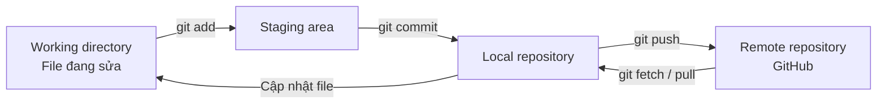
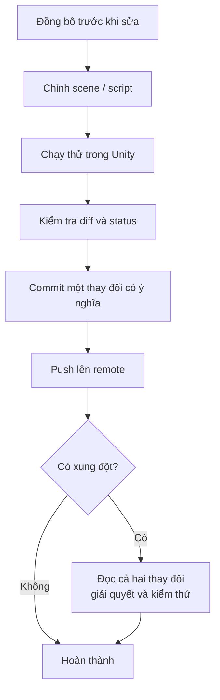

# Bài 01 — Thiết lập quản lý phiên bản cho dự án Unity

**Lộ trình:** Junior Programmer · **Chủ đề:** Manage Scene Flow and Data · **Môi trường thực hành:** Unity 6, Git và GitHub Desktop.

## 1. Tổng quan

Một dự án Unity thường chứa mã C#, scene, prefab, material, texture, âm thanh và các thông số cấu hình. Những thành phần này thay đổi cùng nhau: sửa một script có thể yêu cầu thay đổi scene, hoặc đổi tên một asset có thể ảnh hưởng đến các tham chiếu trong prefab. Nếu chỉ lưu các bản sao có tên như `project_final_2`, việc so sánh, khôi phục và cộng tác sẽ nhanh chóng trở nên khó kiểm soát.

**Version control (quản lý phiên bản)** ghi nhận lịch sử thay đổi có tổ chức, giúp lập trình viên xác định ai đã sửa gì, quay lại trạng thái ổn định và trao đổi thay đổi với người khác. Bài này sử dụng **Git** làm hệ thống quản lý phiên bản, **GitHub** làm nơi lưu trữ repository từ xa và **GitHub Desktop** làm giao diện thao tác.

### Mục tiêu học tập

Sau bài học, người học có thể:

1. Phân biệt Git, GitHub, repository, commit, branch, push và pull.
2. Tạo repository dành cho Unity và cấu hình `.gitignore` thích hợp.
3. Đưa starter project vào Git, tạo commit đầu tiên và xuất bản repository riêng tư.
4. Kiểm tra lịch sử thay đổi, nhận diện file không nên commit và xử lý một lỗi thiết lập thông dụng.

## 2. Mô hình hoạt động của Git

Git là hệ thống quản lý phiên bản phân tán: mỗi bản sao đầy đủ (clone) thường có lịch sử commit riêng. GitHub không phải là Git; đây là dịch vụ lưu trữ và phối hợp công việc xung quanh repository Git. Bạn có thể commit khi không có Internet, rồi đồng bộ sau.



- **Working directory:** cây thư mục đang chỉnh sửa bằng Unity hoặc IDE.
- **Staging area (index):** tập thay đổi được chọn cho commit tiếp theo.
- **Commit:** ảnh chụp logic của trạng thái các file được theo dõi kèm thông điệp và mã định danh; không phải một bản sao ZIP riêng lẻ.
- **Branch:** tên tham chiếu tới nhánh phát triển; nhánh `main` thường là nhánh chính.
- **Push:** đẩy các commit cục bộ lên remote; **fetch:** lấy thông tin và commit mới từ remote; **pull:** thường fetch rồi tích hợp thay đổi vào nhánh hiện tại.
- **Merge conflict:** xung đột cần giải quyết khi Git không thể tự kết hợp một số thay đổi; scene và prefab cũng có thể xung đột.

Git giúp khôi phục phiên bản nhưng **không thay thế hoàn toàn chiến lược sao lưu**: thay đổi chưa commit hoặc chưa push vẫn có nguy cơ mất; một repository duy nhất trên GitHub cũng không phải phương án lưu trữ vô hạn hay bảo đảm chống mọi sự cố.

## 3. Cấu trúc Unity cần đưa vào repository

Đối với dự án Unity thông thường, các thư mục trọng tâm là:

| Thành phần | Có nên theo dõi? | Lý do |
| --- | --- | --- |
| `Assets/` cùng các file `.meta` | Có | Mã nguồn, scene, prefab, tài nguyên và GUID liên kết asset |
| `Packages/manifest.json`, `Packages/packages-lock.json` | Có | Khai báo dependency và phiên bản đã được phân giải |
| `ProjectSettings/` | Có | Thiết lập dự án dùng chung |
| `Library/`, `Temp/`, `Obj/`, `Logs/` | Không | Cache và dữ liệu sinh bởi Unity hoặc công cụ build |
| `Build/`, `Builds/` | Thường không | Đầu ra build, quản lý/phát hành riêng nếu cần |
| `UserSettings/` | Thường không | Thiết lập riêng theo máy/người dùng |

File `.meta` chứa GUID của asset. **Đừng bỏ qua toàn bộ `*.meta`**: mất hoặc tạo lại GUID có thể khiến reference trong scene/prefab không còn trỏ đúng asset. Khi di chuyển asset, nên thao tác trong Unity Editor để giữ metadata tương ứng.

Một `.gitignore` rút gọn để hình dung:

```gitignore
/[Ll]ibrary/
/[Tt]emp/
/[Oo]bj/
/[Ll]ogs/
/[Bb]uild/
/[Bb]uilds/
/[Uu]ser[Ss]ettings/
.vs/
*.csproj
*.sln
```

Đây **không phải bản đầy đủ**. Khi tạo repository, hãy chọn template **Unity** trong GitHub Desktop hoặc lấy mẫu được duy trì tại [github/gitignore — Unity.gitignore](https://github.com/github/gitignore/blob/main/Unity.gitignore). Nếu dự án có asset lớn, cân nhắc Git LFS theo quy định nhóm; việc bật Git LFS không tự động chuyển các file đã commit trước đó.

## 4. Thực hành với GitHub Desktop

### 4.1. Tạo repository

1. Cài [GitHub Desktop](https://desktop.github.com/) và đăng nhập tài khoản GitHub.
2. Chọn **File → New Repository** (hoặc **Create a New Repository on your Hard Drive**).
3. Đặt tên chẳng hạn `junior-programmer-warehouse`, chọn thư mục máy tính, chọn **Git Ignore → Unity**.
4. Nhấn **Create Repository**. Kiểm tra thư mục dự án có `.git/` và `.gitignore`; `.gitattributes` có thể tồn tại tùy thiết lập.

### 4.2. Thêm Unity starter project

1. Truy cập bài [Set up version control — Unity Learn](https://learn.unity.com/tutorial/set-up-version-control) và tải **Junior Programmer Starter Files** đúng với bản Unity bạn sử dụng.
2. Giải nén, sao chép **nội dung** gồm `Assets/`, `Packages/`, `ProjectSettings/` vào **gốc repository** vừa tạo; không lồng thêm một cấp thư mục dự án ngoài ý muốn.
3. Mở **Unity Hub → Add project from disk** và chọn đúng thư mục gốc repository.
4. Mở project; chờ Unity nhập asset và biên dịch. Quay lại GitHub Desktop kiểm tra danh sách file thay đổi.
5. Xác nhận **không có `Library/`, `Temp/`, `Logs/`** trong danh sách commit; đồng thời kiểm tra `.unity`, `.prefab`, `.cs`, `.meta`, file trong `Packages/` và `ProjectSettings/` được theo dõi.

### 4.3. Tạo commit và đưa lên GitHub

1. Kiểm tra tab **Changes** để không commit nhầm token, mật khẩu, khóa API hoặc dữ liệu cá nhân.
2. Nhập Summary `Initial commit: import warehouse starter project`.
3. Chọn **Commit to main**. Lúc này commit chỉ ở **máy cục bộ**.
4. Chọn **Publish repository**, ưu tiên **Keep this code private** nếu chưa định chia sẻ dự án.
5. Truy cập **Repository → View on GitHub** để xác nhận repository từ xa chứa file và commit.

Có thể dùng Git CLI tương đương nếu đã quen terminal:

```bash
git init
git add Assets Packages ProjectSettings .gitignore
git status
git commit -m "Initial commit: import warehouse project"
# Kết nối remote sau khi đã tạo repository trống trên GitHub:
git remote add origin <REMOTE_URL>
git branch -M main
git push -u origin main
```

`<REMOTE_URL>` là placeholder cần thay bằng địa chỉ repository thực tế; không gõ nguyên dấu ngoặc nhọn. Với Git CLI, phải tạo `.gitignore` đúng **trước** khi chạy `git add`.

## 5. Quy trình làm việc hằng ngày



Nên commit theo **đơn vị thay đổi có mục đích**, ví dụ `Add menu scene navigation` thay vì `update`. Với scene, prefab hoặc asset nhị phân, hãy thống nhất phân chia công việc để tránh hai người chỉnh cùng nội dung lớn. Không xóa bừa file `.meta` để 'hết lỗi Git'.

## 6. Lỗi thường gặp và kiểm tra

| Triệu chứng | Nguyên nhân có thể | Cách xử lý |
| --- | --- | --- |
| GitHub Desktop liệt kê hàng nghìn cache | `.gitignore` thiếu hoặc cache đã được theo dõi | Bổ sung mẫu Unity; nếu đã tracked, bỏ khỏi index bằng `git rm -r --cached Library` rồi commit |
| Unity mất tham chiếu prefab/material sau clone | Thiếu `.meta`, GUID đổi hoặc dependency chưa đủ | Khôi phục `.meta` phù hợp và kiểm tra `Packages/` |
| Commit xong không thấy trên GitHub | Chưa push/publish | Kiểm tra lịch sử local, remote và thao tác push |
| Repo quá nặng | Commit file build/cache hoặc asset nhị phân lớn | Kiểm tra file được theo dõi; xem xét Git LFS và chính sách quản lý asset |
| Không thể tự merge scene | Hai nhánh sửa cùng trường dữ liệu | Giải quyết xung đột có kiểm soát, mở lại scene để kiểm thử |

**Bài tập:** sửa một dòng log trong script thử nghiệm, commit với mô tả rõ, xem History, rồi khôi phục bằng một commit mới hoặc chức năng Revert của GitHub Desktop. Trước khi hoàn thành, chạy lại scene để xác nhận project vẫn hoạt động.

## 7. Câu hỏi ôn tập

**Câu 1.** Bạn đã commit thành công nhưng chưa kết nối Internet. Điều nào đúng?

A. Commit chưa tồn tại.  
B. Git bắt buộc có GitHub mới lưu được commit.  
C. Commit có trong repository cục bộ; cần push để xuất hiện trên GitHub.  
D. Git tự tạo bản sao trên GitHub ngay lập tức.

**Đáp án: C.** Commit được tạo tại local repository; push là thao tác đồng bộ riêng.

**Câu 2.** Vì sao cần giữ `.meta` trong repository Unity?

A. Để bảo toàn GUID và tham chiếu asset.  
B. Vì `.meta` là file thực thi.  
C. Để tránh cần `Assets/`.  
D. Vì `.meta` thay thế `Packages/`.

**Đáp án: A.** Unity dựa vào metadata/GUID để nhận diện asset và duy trì liên kết.

**Câu 3.** Thư mục nào thường không cần commit?

A. `ProjectSettings/`  
B. `Assets/Scenes/`  
C. `Packages/`  
D. `Library/`

**Đáp án: D.** `Library/` chủ yếu là dữ liệu import/cache được tạo lại theo môi trường.

**Câu 4.** Khi hai người cùng thay đổi một trường trong scene và Git không thể tự hợp nhất, cần làm gì?

A. Xóa tất cả `.meta`.  
B. Xem diff, giải quyết merge conflict và chạy thử scene.  
C. Commit thư mục `Library/`.  
D. Đổi tên tất cả script.

**Đáp án: B.** Xung đột phải được giải quyết về mặt ngữ nghĩa, sau đó xác minh trong Unity.

**Câu 5.** Thông điệp commit nào thể hiện mục đích rõ nhất?

A. `stuff`  
B. `fix`  
C. `update again`  
D. `Connect Start button to Main scene`

**Đáp án: D.** Thông điệp mô tả thay đổi giúp tra cứu lịch sử và review dễ hơn.

## 8. Tổng kết và tài liệu tham khảo

Quản lý phiên bản là nền tảng an toàn cho thực hành, thử nghiệm và cộng tác. Sau bài học, repository nên có đúng file dự án Unity, một commit gốc rõ ràng và một remote đã kiểm tra. Hãy commit trước khi thực hiện các thay đổi lớn ở scene hoặc cấu trúc mã.

**Tài liệu chính thức:**

- [Unity Learn — Set up version control](https://learn.unity.com/tutorial/set-up-version-control)
- [Unity Learn — Collaborate with GitHub Desktop](https://learn.unity.com/course/collaborate-with-github-desktop)
- [GitHub — Unity.gitignore](https://github.com/github/gitignore/blob/main/Unity.gitignore)
- [Git — Reference Manual](https://git-scm.com/docs)

*Ghi chú: hướng dẫn được biên soạn độc lập, đối chiếu luồng học Unity Learn (trang bài học hiển thị phiên bản Unity 6.0). Các menu có thể hơi khác ở Unity 6.3.*
