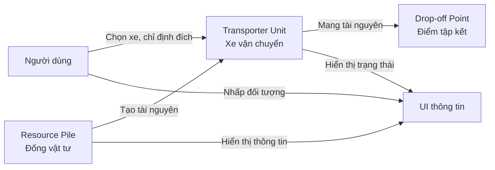
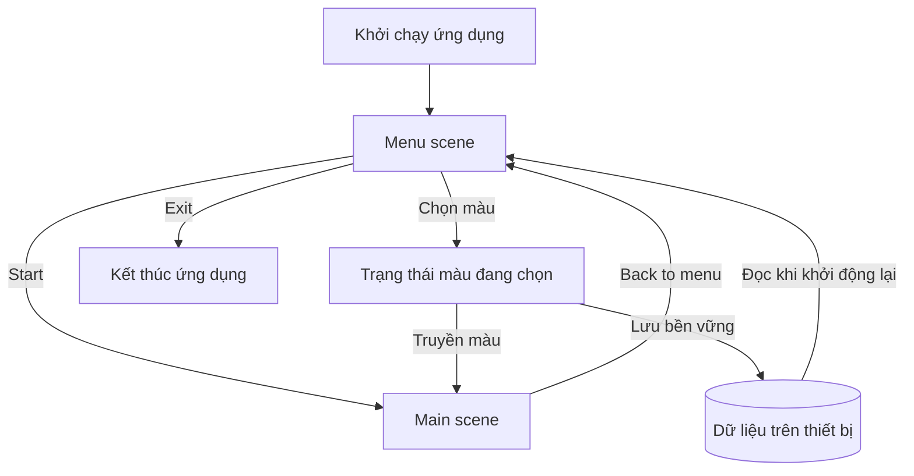

# Bài 02 — Khám phá dự án mô phỏng kho hàng trong Unity

**Lộ trình:** Junior Programmer · **Chủ đề:** Manage Scene Flow and Data · **Dự án thực hành:** mô phỏng quản lý tài nguyên với xe nâng (Transporter Units).

## 1. Tổng quan

Trước khi sửa một hệ thống phần mềm có sẵn, lập trình viên cần hiểu **nó đang làm được gì, người dùng thao tác ra sao và trách nhiệm của từng thành phần nằm ở đâu**. Với Unity, điều này đòi hỏi kết hợp quan sát ở Game view, xem cấu trúc scene trong Hierarchy và đọc code C#.

Dự án thực hành là một **resource management simulation** đặt trong kho hàng. Các đống vật tư tạo ra tài nguyên; những xe nâng vận chuyển vật tư đến một điểm tập kết. Dự án được cung cấp một số chức năng cốt lõi để người học tập trung vào UI, luồng scene, thiết kế hướng đối tượng và lưu trạng thái.

### Mục tiêu học tập

1. Mở starter project đúng cấu trúc và xác định các scene chính.
2. Vận hành mô phỏng, ghi lại mối quan hệ giữa đống tài nguyên, xe vận chuyển và điểm giao hàng.
3. Phân biệt vai trò của Hierarchy, Scene view, Game view, Inspector, Project và Console.
4. Phân tích yêu cầu mở rộng thành các tiêu chí có thể kiểm chứng.

## 2. Kiến trúc chức năng của mô phỏng

Ở bản dự án mẫu được mô tả trên Unity Learn, có **hai loại Resource Pile**, mỗi loại sinh tài nguyên với tốc độ **0,5 đơn vị/giây**, cùng **ba Transporter Units** có khả năng vận chuyển đến vùng giao hàng (khu vực trước xe tải được đánh dấu vòng tròn đỏ). Đây là mô tả cấu hình của starter project, **không phải quy luật bắt buộc** cho mọi project Unity.



Sơ đồ thể hiện **quan hệ nghiệp vụ**: thao tác của người dùng khiến đơn vị vận chuyển thay đổi nhiệm vụ; vật tư được lấy từ nơi sản xuất và đưa về điểm nhận. Nó không khẳng định mọi mũi tên tương ứng trực tiếp với một class hoặc method có tên giống hệt.

| Đối tượng / hệ thống | Vai trò có thể quan sát | Câu hỏi khi đọc code |
| --- | --- | --- |
| Resource Pile | Tạo và chứa tài nguyên | Tốc độ sinh được lưu ở đâu? Có giới hạn sức chứa không? |
| Transporter Unit | Di chuyển và vận chuyển | Ai điều khiển đích đến và trạng thái vận chuyển? |
| Drop-off Point | Nhận tài nguyên | Khi giao hàng, số lượng được cập nhật thế nào? |
| Camera | Quan sát kho hàng | Có script nào đọc WASD/phím mũi tên? |
| UI overlay | Hiển thị thông tin đối tượng | Ai cập nhật giá trị hiển thị khi lựa chọn thay đổi? |

## 3. Khởi động và khảo sát dự án

### 3.1. Chuẩn bị

- Tải starter project từ [Unity Learn — Set up version control](https://learn.unity.com/tutorial/set-up-version-control). Dự án mẫu sử dụng Unity 6 hoặc phiên bản phù hợp được chỉ định tại trang tải.
- Mở project bằng Unity Hub. Đảm bảo thư mục gốc có `Assets/`, `Packages/`, `ProjectSettings/`.
- Chờ hoàn tất import và quan sát cửa sổ Console trước khi Play. Nếu có lỗi compile, cần xử lý trước khi đánh giá hành vi runtime.

### 3.2. Kiểm tra từng tương tác

1. Trong **Project → Assets → Scenes**, mở scene `Main`.
2. Nhấn **Play**. Quan sát hai loại đống vật tư và ba xe nâng trong kho.
3. Nhấp **chuột trái** vào một **Transporter Unit**. Trên xe được chọn xuất hiện dấu mũi tên xanh, và UI hiển thị thông tin liên quan.
4. Nhấp **chuột phải** vào một **Resource Pile** để điều xe đã chọn tới vị trí vật tư. Quan sát quá trình lấy hàng và di chuyển về vùng giao hàng.
5. Nhấp chuột trái vào các đống vật tư hoặc xe khác để so sánh UI; thử chuyển điểm đến khi xe đang hoạt động.
6. Dùng **WASD** hoặc phím mũi tên di chuyển camera, sau đó thoát Play mode.

**Lưu ý:** các thao tác này mô tả starter project của Unity Learn. Nếu đang dùng một mẫu đã chỉnh sửa, hãy xác nhận input mapping và cấu hình scene thực tế, không mặc định chúng còn nguyên.

### 3.3. Đọc cấu trúc dự án

| Cửa sổ Unity | Nên tìm gì? | Lý do |
| --- | --- | --- |
| Hierarchy | Các GameObject đang tồn tại trong scene mở | Xác định thành phần runtime và quan hệ cha–con |
| Inspector | Component, trường serialized, tham chiếu asset | Hiểu hành vi được cấu hình thế nào |
| Project | Scene, script, prefab, material, package | Xác định mã nguồn hoặc mẫu tái sử dụng |
| Scene view | Vị trí, hướng, collider, gizmo | Kiểm tra bố cục và cấu hình vật thể |
| Game view | Kết quả mà người dùng nhìn thấy | Xác minh hành vi khi chạy |
| Console | Exception, error, warning và log | Chẩn đoán khi hành vi không khớp kỳ vọng |

Không cần đọc toàn bộ code theo thứ tự file. Cách khảo sát hiệu quả hơn là **đi từ một hành vi nhìn thấy đến nơi triển khai**: chọn xe → xác định GameObject → tìm Component → mở script → tìm method xử lý input → lần theo những đối tượng được gọi.

## 4. Phân tích yêu cầu của dự án

Mục tiêu mở rộng xuyên suốt phần học này là tạo trải nghiệm có **scene `Menu`**, **scene `Main`** và cơ chế ghi nhớ màu được người dùng chọn cho xe nâng.



Bản thiết kế có **hai yêu cầu độc lập**: màu phải đi cùng người dùng khi chuyển scene trong cùng một lần chạy; và màu phải được phục hồi khi mở ứng dụng lần sau. Trộn lẫn hai yêu cầu sẽ dẫn đến các giải pháp sai, chẳng hạn chỉ dùng biến `static` rồi tưởng rằng dữ liệu đã được lưu ra ổ đĩa.

### Tiêu chí chấp nhận (acceptance criteria)

| Mã | Điều kiện đầu vào | Kết quả cần kiểm chứng |
| --- | --- | --- |
| AC-01 | Chạy bản build mới | Hiện scene `Menu` trước khi vào mô phỏng |
| AC-02 | Tại `Menu`, chọn màu và nhấn Start | Scene `Main` mở và xe nâng dùng màu đã chọn |
| AC-03 | Tại `Main`, nhấn Back to menu | Quay lại `Menu`, không tạo trùng đối tượng quản lý trạng thái |
| AC-04 | Lưu màu, đóng ứng dụng, mở lại | Màu được phục hồi và được đánh dấu trên bộ chọn màu |
| AC-05 | Chưa có file lưu | Ứng dụng vẫn mở bình thường với màu mặc định |
| AC-06 | Nhấn Exit trong build | Ứng dụng kết thúc đúng; trong Editor chỉ thoát Play mode |

Một tiêu chí chấp nhận tốt phải nêu được **đầu vào, hành động và kết quả quan sát**. “Ứng dụng hoạt động tốt” không phải tiêu chí đủ cụ thể để kiểm thử.

## 5. Chiến lược đọc và thay đổi code có sẵn

Khi cần bổ sung chức năng, hãy xác định điểm mở rộng trước khi thêm script:

1. **Xác định chủ sở hữu dữ liệu:** chọn màu thuộc UI tạm thời, `MainManager` trong RAM hay file lưu?
2. **Xác định sự kiện:** ai phát `onColorChanged`, ai nghe và ai cập nhật màu cho xe?
3. **Xác định vòng đời:** `Menu` bị unload thì đối tượng nào bị hủy? `MainManager` có cần tồn tại liên tục không?
4. **Giữ phạm vi chỉnh sửa nhỏ:** mỗi thay đổi nên giải quyết một yêu cầu và có cách test rõ ràng.
5. **Commit trạng thái ổn định:** trước khi thay đổi nhiều file, lưu mốc vào Git.

**Ví dụ phân tích một tương tác:**

```text
Người dùng nhấp chọn xe
    → Script xử lý input nhận sự kiện
    → Hệ thống lưu xe đang được chọn
    → UI hiển thị thông tin xe
    → Một lệnh khác xác định Resource Pile đích
    → Xe di chuyển / thu gom theo logic đã có
```

Đây là mô hình suy luận khi đọc dự án, không phải bản sao chính xác của call graph. Hãy mở script thực tế và đối chiếu để xác nhận.

## 6. Bài thực hành khảo sát

Tạo một ghi chú `project-exploration.md` gồm:

- Sơ đồ ngắn về các vai trò của xe nâng, đống vật tư và điểm tập kết.
- Danh sách các scene và GameObject quan trọng đã xác minh.
- Mô tả ba thao tác: chọn xe, chỉ định vật tư, thay đổi camera.
- Một ảnh Game view và một ảnh Inspector của Component liên quan.
- Bảng AC-01 đến AC-06, ghi rõ chức năng nào đã có và chức năng nào cần triển khai.

Không kết luận rằng một chức năng tồn tại chỉ vì nhìn thấy Button trên giao diện: **UI có thể đã được tạo nhưng chưa được nối sự kiện**.

## 7. Câu hỏi ôn tập

**Câu 1.** Muốn tìm script chịu trách nhiệm khi nhấp chọn một xe, cách tiếp cận nào hiệu quả nhất?

A. Đọc ngẫu nhiên mọi file `.cs`.  
B. Kiểm tra GameObject của xe, các Component và code xử lý sự kiện.  
C. Xóa scene để dự án tự tạo lại.  
D. Chỉ xem material của xe.

**Đáp án: B.** Truy ngược từ hành vi quan sát được giúp khoanh vùng hệ thống nhanh và có căn cứ.

**Câu 2.** Một nút Start đã hiển thị nhưng không chuyển scene. Điều nào cần kiểm tra trước?

A. On Click của Button và thiết lập scene trong Scene List.  
B. Tốc độ di chuyển camera.  
C. Độ phân giải texture sàn.  
D. Thời gian tạo resource.

**Đáp án: A.** Cả liên kết sự kiện lẫn cấu hình scene đều là điều kiện của chuyển cảnh.

**Câu 3.** Vì sao yêu cầu “giữ màu qua hai scene” khác “giữ màu khi tắt ứng dụng”?

A. Vì cả hai luôn chỉ cần một biến local.  
B. Vì PlayerPrefs không thể giữ số.  
C. Vì chuyển scene và đóng tiến trình có vòng đời dữ liệu khác nhau.  
D. Vì scene và file JSON là một loại asset.

**Đáp án: C.** Dữ liệu trong RAM có thể tồn tại khi đổi scene nhưng thường mất sau khi tiến trình kết thúc.

**Câu 4.** Dấu mũi tên xanh sau khi nhấp chọn xe chứng minh điều gì?

A. Xe đã giao xong tài nguyên.  
B. File lưu đã được tạo.  
C. Scene sắp bị unload.  
D. Hệ thống có phản hồi trực quan đối với trạng thái chọn xe.

**Đáp án: D.** Dấu hiệu chọn là phản hồi UI, không phải bằng chứng về vận chuyển hay lưu file.

**Câu 5.** Tiêu chí kiểm thử nào có khả năng xác minh cao nhất?

A. “Menu đẹp và ổn định.”  
B. “Sau khi chọn màu xanh và nhấn Start, xe trong Main hiển thị màu xanh.”  
C. “Không còn bug.”  
D. “Tất cả script đúng.”

**Đáp án: B.** Điều kiện và kết quả đo được được xác định cụ thể.

## 8. Tổng kết và tài liệu tham khảo

Khảo sát dự án không chỉ là mở scene và bấm thử. Kết quả cần đạt là **một mô hình chức năng có thể kiểm chứng** và danh sách thay đổi nhỏ, rõ ràng để triển khai mà không phá hỏng chức năng sẵn có.

- [Unity Learn — Explore the sample project](https://learn.unity.com/tutorial/explore-the-sample-project)
- [Unity Learn — Manage Scene Flow and Data](https://learn.unity.com/pathway/junior-programmer/unit/manage-scene-flow-and-data?version=6.0)
- [Unity Manual — Unity Editor interface](https://docs.unity3d.com/Manual/UsingTheEditor.html)

*Ghi chú: mô tả dự án mẫu dựa trên tutorial Unity Learn dành cho Unity 6.0; hướng dẫn khảo sát và tiêu chí chấp nhận là phần diễn giải/triển khai học tập được bổ sung.*
