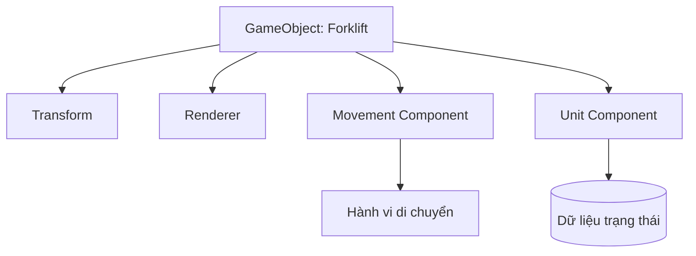
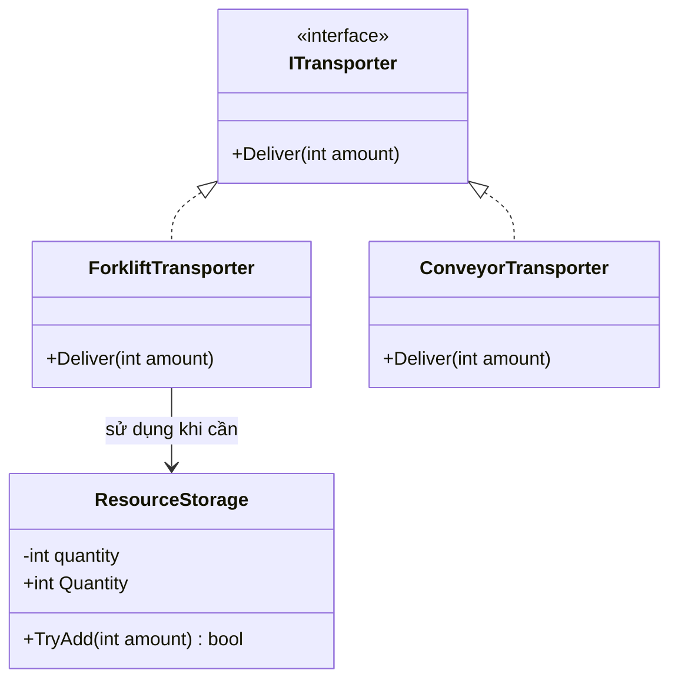

# Bài 03 — Bốn nguyên lý lập trình hướng đối tượng trong C# và Unity

**Lộ trình:** Junior Programmer · **Chủ đề:** Manage Scene Flow and Data · **Ngôn ngữ:** C#.

## 1. Tổng quan

Khi số lượng đối tượng trong game tăng lên, một script lớn có thể trở thành nơi chứa cả logic vận chuyển, UI, lưu dữ liệu và xử lý input. Mọi thay đổi đều có thể ảnh hưởng đến chức năng không liên quan. **Object-oriented programming (OOP)** cung cấp cách tổ chức chương trình quanh các đối tượng có **trạng thái** và **hành vi**, từ đó kiểm soát phụ thuộc, giới hạn truy cập và tái sử dụng logic.

Trong Unity, hầu hết hành vi gắn với GameObject được viết dưới dạng **Component** kế thừa `MonoBehaviour`. Các class C# thông thường, interface và cấu trúc dữ liệu khác vẫn có vai trò quan trọng. Unity thiên về **composition** (ghép nhiều component) hơn là thiết kế một cây kế thừa gameplay quá sâu.

### Mục tiêu học tập

1. Giải thích chính xác abstraction, encapsulation, inheritance và polymorphism.
2. Phân biệt class, object, interface, component, field và property trong C#.
3. Tạo một interface chung cho nhiều đối tượng có hành vi khác nhau.
4. Nhận diện dấu hiệu lạm dụng kế thừa hoặc để lộ trạng thái không kiểm soát.

## 2. Class, object và component

**Class** là bản mô tả kiểu dữ liệu và hành vi; **object** là một thực thể được tạo từ kiểu đó. Ví dụ, có thể có class `TransportTask` biểu diễn nhiệm vụ vận chuyển, trong khi mỗi xe nâng nhận một nhiệm vụ khác nhau. **GameObject** là thực thể nền tảng của Unity; hành vi được kết hợp qua những Component như `Transform`, `Rigidbody` hoặc script kế thừa `MonoBehaviour`.



Quan hệ trong sơ đồ là **has-a**: một GameObject **có** những Component. Quan hệ giữa `Unit` và `MonoBehaviour` là **is-a**: `Unit` **là một** kiểu `MonoBehaviour` thông qua kế thừa. Hai quan hệ này không nên nhầm lẫn.

## 3. Bốn nguyên lý OOP

### 3.1. Abstraction — Trừu tượng hóa

Trừu tượng hóa **công khai điều người dùng cần làm**, ẩn chi tiết về *cách làm*. Ví dụ, nơi điều khiển có thể gọi `Deliver()` mà không cần biết đối tượng đang mang tài nguyên bằng xe nâng, băng chuyền hay robot. Interface xác định hợp đồng hành vi nhưng không bắt buộc các class triển khai cùng một thuật toán.

```csharp
public interface ITransporter
{
    void Deliver(int amount);
}
```

`ITransporter` là hợp đồng: bất kỳ class nào triển khai interface phải cung cấp cách xử lý lời gọi `Deliver(int)`.

### 3.2. Encapsulation — Đóng gói

Đóng gói kết hợp trạng thái và hành vi, đồng thời **kiểm soát cách trạng thái được sửa**. Nếu số hàng còn lại được sửa tự do, code khác có thể đưa nó về số âm. Một method có điều kiện hợp lệ giúp bảo vệ invariant (bất biến của đối tượng).

```csharp
using UnityEngine;

public class ResourceStorage : MonoBehaviour
{
    [SerializeField, Min(0)] private int capacity = 100;
    [SerializeField, Min(0)] private int quantity = 0;

    public int Quantity => quantity; // Chỉ cho phép đọc từ bên ngoài.

    public bool TryAdd(int amount)
    {
        if (amount <= 0 || quantity > capacity - amount)
            return false;

        quantity += amount;
        return true;
    }
}
```

`[SerializeField]` cho phép Unity serialize và hiển thị private field trong Inspector, **không** làm field trở thành `public` trong C#. `[Min(0)]` hỗ trợ nhập liệu trong Inspector nhưng **không** thay thế kiểm tra hợp lệ ở runtime; dữ liệu được load hoặc code khác vẫn cần được xác minh.

### 3.3. Inheritance — Kế thừa

Kế thừa cho phép class con dùng và mở rộng thành phần phù hợp của class cha. Dùng từ khóa `:` trong C#:

```csharp
public class TransportUnit
{
    public virtual string Describe() => "Đơn vị vận chuyển";
}

public class Forklift : TransportUnit
{
    public override string Describe() => "Xe nâng trong kho";
}
```

Cách này hợp lý nếu `Forklift` thật sự là một chuyên biệt của `TransportUnit`. Tuy nhiên, kế thừa gây liên kết chặt; không nên tạo hàng loạt class con chỉ để thay đổi tốc độ hoặc màu. Với biến thể cấu hình, dùng Component, dữ liệu hoặc Strategy thường linh hoạt hơn.

### 3.4. Polymorphism — Đa hình

Đa hình cho phép thao tác qua kiểu chung nhưng thực thi khác nhau tùy đối tượng thực tế. Có thể dùng phương thức `virtual`/`override` hoặc interface:

```csharp
using UnityEngine;

public class ForkliftTransporter : MonoBehaviour, ITransporter
{
    public void Deliver(int amount)
    {
        Debug.Log($"Xe nâng vận chuyển {amount} đơn vị");
    }
}

public class ConveyorTransporter : MonoBehaviour, ITransporter
{
    public void Deliver(int amount)
    {
        Debug.Log($"Băng chuyền vận chuyển {amount} đơn vị");
    }
}
```

Khi một nơi khác giữ tham chiếu `ITransporter transporter`, lời gọi `transporter.Deliver(5)` sẽ chạy đúng implementation của xe nâng hoặc băng chuyền. Đây là **runtime polymorphism**; method overload là một dạng đa hình khác nhưng không cần thiết để minh họa ở bài này.

## 4. Phối hợp các nguyên lý trong Unity



- **Abstraction:** `ITransporter` nêu khả năng giao hàng, không nêu thuật toán.
- **Polymorphism:** nhiều loại transporter nhận cùng lời gọi nhưng xử lý khác nhau.
- **Encapsulation:** `ResourceStorage` bảo vệ số lượng hàng khỏi cập nhật tùy tiện.
- **Inheritance:** cả hai transporter ở ví dụ Unity kế thừa `MonoBehaviour` để hoạt động dưới dạng Component. Ta không cần tạo cha chung cho mọi logic nếu interface đã đủ.

### Thực hành đa hình bằng script đơn giản

Gắn `ForkliftTransporter` lên một GameObject và `ConveyorTransporter` lên GameObject khác. Sau đó gắn script này lên một GameObject điều phối và kéo Component triển khai `ITransporter` vào trường `targets` (vì Inspector không serialize trực tiếp một mảng interface trong cách dùng thông thường, ta dùng `MonoBehaviour[]` và kiểm tra kiểu lúc chạy):

```csharp
using UnityEngine;

public class DeliveryDemo : MonoBehaviour
{
    [SerializeField] private MonoBehaviour[] targets;

    [ContextMenu("Test Deliveries")]
    private void TestDeliveries()
    {
        foreach (MonoBehaviour component in targets)
        {
            if (component is ITransporter transporter)
                transporter.Deliver(5);
            else
                Debug.LogWarning("Component không triển khai ITransporter", component);
        }
    }
}
```

Trong Inspector, chọn component `DeliveryDemo`, mở menu ngữ cảnh của Component và gọi **Test Deliveries** khi project đã có instance hợp lệ. Quan sát Console: các đối tượng cho kết quả khác nhau mặc dù được gọi qua cùng interface.

## 5. So sánh và những nhầm lẫn phổ biến

| Nguyên lý | Câu hỏi thiết kế | Ngộ nhận cần tránh |
| --- | --- | --- |
| Abstraction | Người sử dụng API cần biết điều gì? | “Abstraction chỉ là class abstract.” |
| Encapsulation | Ai được phép thay đổi trạng thái, và theo quy tắc nào? | “Chỉ cần đổi `public` thành `private` là đủ.” |
| Inheritance | Đây thực sự là quan hệ **is-a** không? | “Càng nhiều tầng class càng tái sử dụng tốt.” |
| Polymorphism | Có thể gọi nhiều implementation qua hợp đồng chung không? | “Đa hình chỉ xảy ra khi dùng class cha.” |

Một số lỗi thiết kế thường gặp:

1. **God object:** một `GameManager` đảm nhận toàn bộ gameplay, UI, save và camera. Hãy chia theo trách nhiệm khi độ phức tạp tăng.
2. **Public mutable fields ở mọi nơi:** dễ vi phạm điều kiện hợp lệ; ưu tiên private field, property đọc và method thay đổi có kiểm tra.
3. **Kế thừa sâu:** sửa class cha gây tác động khó lường; ưu tiên composition cho chức năng có thể thay thế.
4. **Lạm dụng Singleton:** tạo phụ thuộc toàn cục khó mock/test; chỉ dùng cho trạng thái thực sự cần một điểm truy cập rõ ràng.
5. **Nhầm `static` với lưu bền vững:** biến static không tự ghi dữ liệu xuống file và không sống mãi sau khi tắt ứng dụng.

## 6. Bài tập củng cố

Tạo thêm một `DroneTransporter` triển khai `ITransporter`, ghi log khác hai loại ở trên. Bổ sung logic từ chối `amount <= 0` trong mỗi implementation hoặc một lớp xử lý chung phù hợp. Giải thích tại sao `DeliveryDemo` không phải sửa khi có đối tượng mới. Sau đó thử đặt một `ResourceStorage` có `quantity` vượt `capacity` bằng cách viết code có chủ ý: xác định điểm cần chuẩn hóa trạng thái khi đọc hoặc sửa dữ liệu.

## 7. Câu hỏi ôn tập

**Câu 1.** Một class cho phép bên ngoài đọc số tài nguyên nhưng chỉ được tăng qua method có kiểm tra. Đây là ví dụ chủ yếu của nguyên lý nào?

A. Inheritance  
B. Polymorphism  
C. Encapsulation  
D. Reflection

**Đáp án: C.** Đóng gói bảo vệ trạng thái và quy định cách sửa hợp lệ.

**Câu 2.** Hai loại xe có phương thức `Deliver(int)` khác nhau nhưng hệ thống gọi qua `ITransporter`. Điều này minh họa gì?

A. Polymorphism thông qua interface.  
B. Chỉ có method overload.  
C. Compile error.  
D. Serialization.

**Đáp án: A.** Kiểu chung che giấu implementation thực tế và điều phối đến hành vi tương ứng.

**Câu 3.** Nếu chỉ cần thêm khả năng phát âm thanh cho một xe nâng trong Unity, giải pháp nào thường linh hoạt hơn việc tạo cây kế thừa nhiều tầng?

A. Thêm các biến global.  
B. Sao chép class hiện tại.  
C. Cho mọi class kế thừa `AudioSource`.  
D. Thêm Component phụ trách âm thanh và cấu hình theo nhu cầu.

**Đáp án: D.** Composition cho phép ghép hành vi mà không làm phức tạp quan hệ kế thừa.

**Câu 4.** Mục đích cốt lõi của abstraction là gì?

A. Ẩn mọi phương thức khỏi người dùng.  
B. Cung cấp hợp đồng/hành vi cần thiết và che giấu chi tiết không liên quan.  
C. Đưa mọi field sang public.  
D. Bắt buộc tạo Singleton.

**Đáp án: B.** Người dùng tập trung vào *what* thay vì phải biết mọi bước *how*.

**Câu 5.** `[SerializeField] private int quantity` có nghĩa gì?

A. Field tự động được công khai cho mọi script.  
B. Field tự động lưu sang JSON trên ổ đĩa.  
C. Unity có thể serialize field private phù hợp, trong khi phạm vi truy cập C# vẫn private.  
D. Field không thể được sửa trong Inspector.

**Đáp án: C.** Serialization và access modifier là hai cơ chế khác nhau.

## 8. Tổng kết và tài liệu tham khảo

Bốn nguyên lý OOP phối hợp để tạo API dễ dùng, trạng thái an toàn hơn và logic có thể mở rộng. Với Unity, hãy hiểu **kế thừa để mô tả bản chất loại đối tượng**, **interface để quy định hành vi**, và **composition để lắp ghép khả năng cho GameObject**.

- [Unity Learn — Principles of object-oriented programming](https://learn.unity.com/tutorial/principles-of-object-oriented-programming)
- [Microsoft Learn — Object-oriented programming in C#](https://learn.microsoft.com/en-us/dotnet/csharp/fundamentals/tutorials/oop)
- [Unity Manual — Creating components with scripts](https://docs.unity3d.com/Manual/CreatingComponents.html)

*Ví dụ C# được biên soạn để học nguyên lý; không phải mã gốc của dự án mô phỏng. Bài Unity Learn tương ứng đang hiển thị phiên bản Unity 6.0.*
