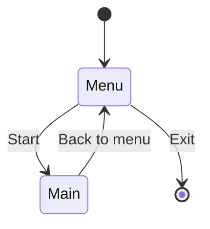
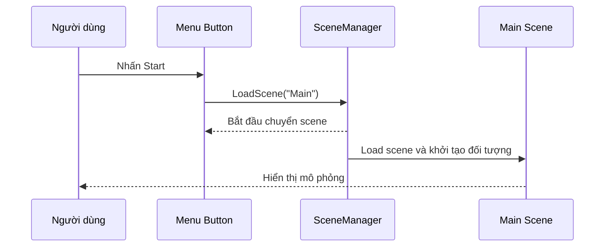

# Bài 04 — Xây dựng luồng chuyển scene và điều khiển menu

**Lộ trình:** Junior Programmer · **Chủ đề:** Manage Scene Flow and Data · **API chính:** `SceneManager`, `Application.Quit`, `EditorApplication.ExitPlaymode`.

## 1. Vấn đề cần giải quyết

Một ứng dụng hoàn chỉnh không nên buộc người dùng vào thẳng màn chơi và chỉ có thể thoát bằng cách tắt cửa sổ. Dự án mô phỏng kho hàng cần một màn hình `Menu` để bắt đầu, chọn màu và kết thúc ứng dụng; màn hình `Main` để tương tác với mô phỏng; và một nút quay lại menu.

Chuyển scene trong Unity là một **thay đổi trạng thái ứng dụng**. Nếu chỉ mở scene thành công nhưng không thiết lập đúng UI event hoặc danh sách scene của bản build, chức năng có thể chỉ chạy trong Editor hoặc báo lỗi khi phân phối.

### Mục tiêu học tập

1. Giải thích sự khác nhau giữa `LoadSceneMode.Single` và `Additive`.
2. Cấu hình `Menu` và `Main` trong Scene List của Build Profiles.
3. Gắn `Button.onClick` với method C# công khai, không nhận tham số.
4. Tạo luồng Start, Back to menu và Exit, xử lý khác nhau giữa Editor và build.

## 2. Thiết kế luồng scene



`Menu` là scene khởi đầu (thường có build index 0), còn `Main` có thể là scene tiếp theo (index 1). Sơ đồ chỉ mô tả chuyển cảnh; **trạng thái cần giữ qua scene** sẽ được xử lý độc lập bằng một đối tượng quản lý dữ liệu.

| Khái niệm/API | Chức năng | Lưu ý |
| --- | --- | --- |
| `SceneManager.LoadScene("Main")` | Chuyển đến scene có tên `Main` | Scene cần nằm trong danh sách cho build hoặc được cung cấp bằng cơ chế load phù hợp |
| `SceneManager.LoadScene(1)` | Chuyển theo build index | Dễ sai khi thứ tự scene bị thay đổi |
| `LoadSceneMode.Single` | Load scene mới và unload những scene đang load thuộc luồng Single | Chế độ mặc định của `LoadScene` |
| `LoadSceneMode.Additive` | Nạp scene mới đồng thời với scene hiện có | Cần chủ động quản lý scene đang active và unload |
| `Application.Quit()` | Yêu cầu đóng ứng dụng chạy dưới dạng player | Không dừng Play mode của Unity Editor |
| `UnityEditor.EditorApplication.ExitPlaymode()` | Thoát Play mode trong Editor | Thuộc assembly chỉ dùng trong Editor |

Với project nhỏ, `LoadScene` đủ để thực hành. Nếu scene nặng và cần tránh khựng khung hình, cân nhắc `SceneManager.LoadSceneAsync` và màn hình loading.

## 3. Kiểm tra cấu trúc scene và UI

Trong starter project, scene `Menu` có `Canvas`, bên dưới là `Container` cùng `StartContainer` và vùng `Exit`; bên trong `StartContainer` có các phần như `StartButton`, `ColorPicker`, `Save` và `Load`. Tên chính xác có thể thay đổi nếu dự án đã được chỉnh sửa.

Mở `Assets/Scenes/Menu`, kiểm tra trong **Hierarchy** và **Inspector**:

1. `StartButton` có Component **Button** và được bật tương tác.
2. `Canvas` có script điều khiển giao diện (trong starter project là `MenuUIHandler`).
3. `ColorPicker` đang có logic khởi tạo lựa chọn màu của dự án mẫu.
4. Scene `Main` có UI và nút **Back to menu**.

Từ menu **File → Build Profiles → Scene List** (Unity 6), thêm `Menu` và `Main` vào danh sách scene của build. Xếp `Menu` ở vị trí đầu, `Main` ở vị trí thứ hai; bảo đảm chúng được **include/enabled**. Nếu build profile có bật **Override Global Scene List**, cần kiểm tra đúng Scene List mà profile đang sử dụng.

## 4. Viết code điều khiển menu

### 4.1. Tạo method điều hướng

Mở script `MenuUIHandler.cs` có sẵn. **Không xóa** các method khởi tạo `ColorPicker` hoặc sự kiện `onColorChanged` của starter project. Bổ sung namespace:

```csharp
using UnityEngine.SceneManagement;
#if UNITY_EDITOR
using UnityEditor;
#endif
```

Sau đó thêm các method sau **vào bên trong class `MenuUIHandler`**:

```csharp
public void StartNew()
{
    SceneManager.LoadScene("Main", LoadSceneMode.Single);
}

public void Exit()
{
#if UNITY_EDITOR
    EditorApplication.ExitPlaymode();
#else
    Application.Quit();
#endif
}
```

Trong tutorial Unity Learn, `SceneManager.LoadScene(1)` được dùng với `Menu` ở index 0, `Main` ở index 1. Biến thể trên dùng tên scene để giảm phụ thuộc vào thứ tự. Cả hai đều đúng khi cấu hình phù hợp. `using UnityEditor` phải được bao trong `#if UNITY_EDITOR`, nếu không mã có nguy cơ không build được dưới dạng player vì namespace này không được cung cấp trong runtime player.

### 4.2. Nối Button với method

1. Trong scene `Menu`, chọn `StartButton` trong Hierarchy.
2. Ở Inspector, tìm Component **Button → On Click ()**, nhấn **+**.
3. Kéo GameObject `Canvas` (đang chứa `MenuUIHandler`) vào ô target.
4. Chọn `MenuUIHandler → StartNew()` trong danh sách method.
5. Thực hiện tương tự với nút `Exit`, chọn `MenuUIHandler → Exit()`.
6. Lưu scene trước khi chạy thử.

Method được gắn qua `On Click()` nên là **public instance method** phù hợp với chữ ký mà UnityEvent hỗ trợ. Chỉ tạo method trong code chưa đủ: Unity cần liên kết sự kiện tới Component cụ thể thông qua Inspector hoặc code.

## 5. Triển khai chuyển từ Main về Menu

Nếu dự án mẫu đã có script UI dành cho scene `Main`, có thể thêm method vào class đó. Nếu không, dùng một script độc lập dưới đây và gắn vào GameObject cùng nhóm với nút Back:

```csharp
using UnityEngine;
using UnityEngine.SceneManagement;

public class MainSceneNavigator : MonoBehaviour
{
    public void BackToMenu()
    {
        SceneManager.LoadScene("Menu", LoadSceneMode.Single);
    }
}
```

Gắn method `BackToMenu` vào `Button.onClick` của nút **Back to menu**. Đừng gắn `MainSceneNavigator` vào GameObject không tồn tại lúc chạy hoặc kéo sai script vào ô target.

## 6. Vòng đời đối tượng khi chuyển scene

Ở chế độ mặc định `Single`, Unity unload các scene đang mở và các GameObject thuộc scene đó được hủy, ngoại trừ các đối tượng được bảo tồn bằng `DontDestroyOnLoad`. Các tham chiếu trỏ tới đối tượng đã bị hủy có thể trở nên không hợp lệ; vì vậy **không giả định UI, camera hoặc xe nâng của `Menu` vẫn tồn tại sau khi load `Main`**.



Lời gọi `LoadScene` không bảo đảm scene mới được nạp hoàn toàn ngay tại dòng tiếp theo. Đừng truy cập GameObject của scene mới ngay sau `LoadScene` và giả định chúng đã sẵn sàng. Nếu cần xử lý sau nạp, hãy dùng lifecycle method phù hợp hoặc sự kiện `SceneManager.sceneLoaded` (đăng ký/hủy đăng ký đúng cách).

## 7. Kiểm thử và sửa lỗi

| Kịch bản | Kết quả mong đợi | Nếu thất bại, kiểm tra |
| --- | --- | --- |
| Chạy từ `Menu`, nhấn Start | Vào `Main` | `On Click`, scene name, Scene List, Console |
| Tại `Main`, nhấn Back | Trở về `Menu` | Target của Button và method điều hướng |
| Nhấn Exit khi đang Play trong Editor | Thoát Play mode | `#if UNITY_EDITOR`, `UnityEditor`, On Click |
| Nhấn Exit trong bản build desktop | Kết thúc ứng dụng | Build có chứa code đúng, thao tác Quit được gọi |
| Đổi thứ tự build scene | Load theo tên vẫn đi đúng scene | Có tên scene trùng/thiếu hay không |

**Lỗi cần phân biệt:** `The name 'SceneManager' does not exist in the current context` thường do thiếu `using UnityEngine.SceneManagement;`; còn lỗi kiểu scene không thể load thường do danh sách build hoặc tên scene không khớp. Đừng sửa hai loại lỗi bằng cùng một cách.

**Lưu ý vận hành:** `Application.Quit()` có hành vi phụ thuộc nền tảng; ví dụ trên chủ yếu dành cho player độc lập. Việc chuyển scene không tự lưu dữ liệu người dùng xuống đĩa.

## 8. Câu hỏi ôn tập

**Câu 1.** Đã có method `StartNew()` nhưng nhấn Button không có tác dụng. Việc cần kiểm tra phù hợp nhất là gì?

A. Có `Button.onClick` trỏ đúng Component và method không?  
B. Camera có bật HDR không?  
C. Resource Pile có đủ vật tư không?  
D. Material có texture không?

**Đáp án: A.** Unity UI cần sự kiện được nối tới method cụ thể.

**Câu 2.** Trong Unity 6, nơi thường cấu hình scene được đưa vào build là đâu?

A. File `.gitignore`.  
B. Console.  
C. File → Build Profiles → Scene List.  
D. Transform Inspector.

**Đáp án: C.** Scene List quy định scene của bản build và chỉ số tương ứng.

**Câu 3.** Vì sao cần `#if UNITY_EDITOR` quanh `using UnityEditor` trong script runtime?

A. Để scene load nhanh hơn.  
B. Vì `UnityEditor` chỉ có trong môi trường Editor, không có trong player build.  
C. Để bắt buộc nạp scene additive.  
D. Vì chỉ UnityEditor mới gọi được `Application.Quit`.

**Đáp án: B.** Conditional compilation loại bỏ nhánh chỉ dành cho Editor khi build player.

**Câu 4.** Điều gì thường xảy ra với GameObject bình thường thuộc scene cũ khi `LoadScene` dùng `Single`?

A. Tự được lưu sang file JSON.  
B. Tự chuyển sang scene mới.  
C. Tự thành object static.  
D. Bị hủy cùng scene cũ, trừ các object đã được bảo tồn theo cơ chế phù hợp.

**Đáp án: D.** `Single` unload scene cũ; `DontDestroyOnLoad` là một ngoại lệ cho GameObject được đánh dấu.

**Câu 5.** Khi nào nên cân nhắc `LoadSceneAsync` thay cho `LoadScene`?

A. Khi cần giảm gián đoạn khung hình và có tiến trình tải scene đáng kể.  
B. Khi muốn bảo mật mật khẩu.  
C. Khi muốn commit scene lên Git.  
D. Khi muốn đổi màu material.

**Đáp án: A.** Nạp bất đồng bộ thích hợp cho scene nặng và cho phép thiết kế UI loading.

## 9. Tổng kết và tài liệu tham khảo

Một luồng scene đúng phải kết hợp **sơ đồ trạng thái, scene có trong build, script điều hướng và Button event được nối đúng**. Sau khi kiểm tra Start, Back và Exit, hãy dùng đối tượng quản lý dữ liệu riêng để bảo tồn màu qua scene; không đặt trách nhiệm đó vào `SceneManager`.

- [Unity Learn — Create a scene flow](https://learn.unity.com/tutorial/create-a-scene-flow)
- [Unity Scripting API — SceneManager.LoadScene](https://docs.unity3d.com/ScriptReference/SceneManagement.SceneManager.LoadScene.html)
- [Unity Manual — Manage scenes in a build](https://docs.unity3d.com/Manual/build-profile-scene-list.html)
- [Unity Scripting API — Application.Quit](https://docs.unity3d.com/ScriptReference/Application.Quit.html)

*Các tên `Menu`, `Main`, `MenuUIHandler`, `StartNew` và `Exit` dựa trên luồng bài học Unity Learn. Ví dụ gọi scene bằng tên là biến thể tự biên soạn. Tài liệu Unity Learn đang hiển thị bản 6.0; ở Unity 6.3 hãy kiểm tra UI Build Profiles.*
