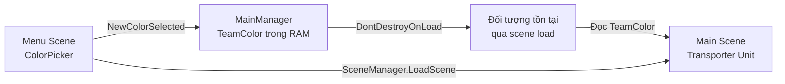
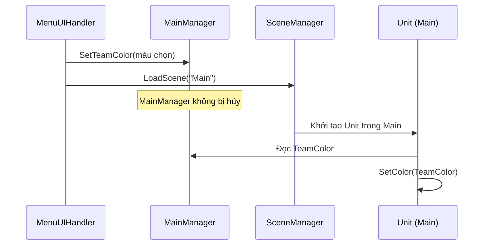

# Bài 05 — Duy trì dữ liệu khi chuyển scene trong Unity

**Lộ trình:** Junior Programmer · **Chủ đề:** Manage Scene Flow and Data · **API chính:** `DontDestroyOnLoad`, `Awake`, `static`, `MonoBehaviour`.

## 1. Bài toán

Người dùng mở scene `Menu`, chọn màu xanh cho đội xe nâng, rồi nhấn Start để vào scene `Main`. Khi chuyển scene, các GameObject trong menu thông thường bị hủy. Nếu giá trị màu chỉ nằm trong một Component của menu, scene `Main` không còn nơi đáng tin cậy để đọc giá trị đó.

**Duy trì dữ liệu giữa các scene (in-session persistence)** là duy trì trạng thái khi ứng dụng vẫn đang chạy nhưng scene thay đổi. Nó khác hoàn toàn với lưu qua nhiều lần mở ứng dụng: dữ liệu trong bộ nhớ **không tự động tồn tại sau khi tiến trình kết thúc**.

### Mục tiêu học tập

1. Giải thích vòng đời GameObject qua thao tác `SceneManager.LoadScene`.
2. Tạo một `MainManager` giữ `TeamColor` nhờ `DontDestroyOnLoad`.
3. Ngăn nhiều instance của manager bằng mẫu Singleton đơn giản.
4. Truyền lựa chọn màu từ UI ở `Menu` sang đối tượng vận chuyển trong `Main`.
5. Kiểm thử hành vi chuyển qua lại và trường hợp mở trực tiếp scene `Main`.

## 2. Cơ chế duy trì trạng thái



`DontDestroyOnLoad(gameObject)` yêu cầu Unity không hủy một **root GameObject** khi nạp scene mới; các đối tượng con trong cây Transform của nó cũng được bảo tồn. Lời gọi này không đồng nghĩa với ghi ra ổ đĩa, và không phù hợp với mọi GameObject. Cũng không nên nhét các scene object như camera, Canvas hoặc đối tượng gameplay ngẫu nhiên vào manager chỉ vì muốn giữ một biến nhỏ.

Có ba cơ chế thường được nhắc đến:

| Cơ chế | Giữ trạng thái khi chuyển scene? | Tồn tại sau khi tắt app? | Điểm cần lưu ý |
| --- | --- | --- | --- |
| Biến `static` | Có thể, trong cùng vòng đời managed runtime | Không | Không gắn với instance cụ thể; cần quản lý/reset hợp lý |
| Singleton `MonoBehaviour` + `DontDestroyOnLoad` | Có | Không | Có vòng đời Unity và tham chiếu Component, nhưng dễ bị tạo trùng |
| File hoặc PlayerPrefs | Có thể đọc lại ở scene khác | Có | Phải chủ động lưu và tải, chủ yếu dành cho dữ liệu bền vững |

Trong Unity Editor, đặc biệt khi cấu hình **Enter Play Mode Options** thay đổi domain reload, trạng thái static có thể giữ lại ngoài kỳ vọng. Vì vậy khi thử nghiệm cần kiểm tra từ một phiên khởi chạy sạch, không dựa vào việc static tự động reset trong mọi cấu hình.

## 3. Tạo MainManager

Trong `Assets/Scripts`, tạo script `MainManager.cs` và một **empty root GameObject** tên `MainManager` ở scene `Menu`, sau đó gắn script vào GameObject này.

```csharp
using UnityEngine;

public class MainManager : MonoBehaviour
{
    public static MainManager Instance { get; private set; }

    public Color TeamColor { get; private set; } = Color.white;

    private void Awake()
    {
        if (Instance != null && Instance != this)
        {
            Destroy(gameObject);
            return;
        }

        Instance = this;
        DontDestroyOnLoad(gameObject);
    }

    public void SetTeamColor(Color color)
    {
        TeamColor = color;
    }
}
```

### Giải thích từng thành phần

- `Instance`: thuộc tính `static` giúp code khác tìm được instance đang hoạt động; setter `private` giới hạn nơi được thay đổi tham chiếu.
- `Awake()`: Unity gọi trong giai đoạn khởi tạo Component; thích hợp để thiết lập instance trước khi phần lớn script phụ thuộc bắt đầu làm việc trong `Start()`.
- Điều kiện `Instance != null && Instance != this`: khi người dùng trở về scene `Menu`, một `MainManager` mới có thể được tạo theo scene. Nếu đã có manager cũ, ta hủy bản trùng.
- `DontDestroyOnLoad(gameObject)`: bảo tồn instance đã được chọn và trạng thái `TeamColor` khi chuyển scene.
- `SetTeamColor`: method cập nhật rõ ràng, tránh cho nơi khác tùy tiện gán field toàn cục.

Với bài tập nhập môn, một Singleton đơn giản là đủ. Trong hệ thống lớn, việc sử dụng **bootstrap scene**, dependency injection hoặc service có vòng đời xác định thường giúp kiểm thử và quản lý phụ thuộc tốt hơn.

## 4. Nối Menu với MainManager

Trong starter project, `MenuUIHandler` có callback `NewColorSelected(Color color)` được gọi khi người dùng bấm một nút màu. Giữ nguyên code khởi tạo `ColorPicker` và cập nhật callback:

```csharp
public void NewColorSelected(Color color)
{
    if (MainManager.Instance == null)
    {
        Debug.LogError("MainManager chưa được khởi tạo.");
        return;
    }

    MainManager.Instance.SetTeamColor(color);
}
```

Đoạn mã trên **thêm vào class `MenuUIHandler` hiện có**, không phải file độc lập. Nếu UI chưa subscribe sự kiện thay đổi màu, cần bảo đảm phần khởi tạo dự án có nội dung tương đương:

```csharp
ColorPicker.Init();
ColorPicker.onColorChanged += NewColorSelected;
```

Không tự thêm nhiều lần đăng ký cho cùng một sự kiện trong mỗi lần mở/bật UI mà không có bước hủy đăng ký tương ứng. Cách quản lý event phải theo đúng vòng đời Component và API `ColorPicker` thực tế của starter project.

## 5. Áp dụng màu trong scene Main

Trong script `Unit.cs` có sẵn của starter project, Unity Learn sử dụng method `SetColor(Color)` để đổi màu đơn vị vận chuyển. Nếu script đã có `Start()`, chỉ **chèn logic vào method đó**, không tạo hai method `Start()` trùng chữ ký:

```csharp
private void Start()
{
    if (MainManager.Instance != null)
    {
        SetColor(MainManager.Instance.TeamColor);
    }
}
```

`SetColor` ở đây là **method thuộc script `Unit` của starter project**, không phải API chung mặc định trên mọi GameObject. Nếu tạo project riêng, hãy viết hàm đổi màu tương ứng với Renderer và material của bạn; tránh sửa `sharedMaterial` trực tiếp khi muốn thay màu cho từng instance riêng lẻ.

### Dòng thời gian thực thi



Điểm cốt lõi là **lưu trạng thái màu vào manager trước khi gọi chuyển scene**, sau đó chỉ đọc manager khi `Unit` trong scene mới đã được khởi tạo.

## 6. Kiểm thử tính đúng đắn

### 6.1. Các kịch bản chính

1. Chạy từ `Menu`, chọn một màu khác trắng, nhấn Start. Xe nâng ở `Main` phải hiển thị màu đã chọn.
2. Nhấn Back to menu, kiểm tra Hierarchy khi chạy: không xuất hiện hai manager đang hoạt động lâu dài.
3. Chọn màu mới rồi Start một lần nữa; không được tiếp tục dùng màu của lượt trước.
4. Thử mở scene `Main` trực tiếp trong Editor; `Unit` không được ném `NullReferenceException` chỉ vì manager chưa được tạo. Nếu không có manager, game nên dùng cấu hình mặc định.
5. Thoát ứng dụng rồi mở lại mà **chưa triển khai lưu file**. Dữ liệu không được kỳ vọng tự khôi phục.

### 6.2. Lỗi và cách chẩn đoán

| Lỗi | Nguyên nhân phổ biến | Hướng giải quyết |
| --- | --- | --- |
| `NullReferenceException` khi chọn màu | Không tạo `MainManager` trước khi UI gọi | Kiểm tra scene khởi động, script attached, thứ tự khởi tạo |
| Có hai `MainManager` sau khi quay về | Bỏ qua nhánh hủy duplicate | Xác minh logic `Awake` và số instance |
| Xe luôn màu trắng | Event chọn màu không ghi vào manager, hoặc `Unit` đọc sai thời điểm | Log màu trước/ sau scene load và xem `SetColor` |
| Màu cũ xuất hiện khi chạy lại Play mode | Static state được giữ vì thiết lập Editor | Kiểm tra Enter Play Mode Options; thử bản build sạch |
| `DontDestroyOnLoad` không hoạt động như kỳ vọng | Manager không phải root GameObject | Đặt manager ở gốc Hierarchy, không làm con của Canvas |

Dùng `Debug.Log` ngắn gọn tại **thời điểm cập nhật** và **thời điểm đọc** là cách nhanh để phát hiện dữ liệu bị mất ở mắt xích nào.

## 7. Bài thực hành mở rộng

Tạo lựa chọn **tên đội xe** (`string TeamName`) bên cạnh `TeamColor`. Bổ sung `SetTeamName(string)` để loại bỏ tên rỗng hoặc chỉ có khoảng trắng. Hiển thị tên đội tại scene `Main`; khi quay lại menu rồi vào `Main` lần nữa, tên và màu phải khớp lựa chọn gần nhất. Không sử dụng file, `PlayerPrefs` hoặc JSON ở bài thực hành này; mục tiêu là giữ trạng thái **trong cùng một phiên chạy**.

## 8. Câu hỏi ôn tập

**Câu 1.** Chức năng cốt lõi của `DontDestroyOnLoad` là gì?

A. Ghi GameObject thành JSON.  
B. Bảo tồn một root GameObject và cây con của nó qua chuyển scene.  
C. Tạo Prefab mới.  
D. Tự đồng bộ qua Internet.

**Đáp án: B.** Đây là cơ chế quản lý vòng đời GameObject trong bộ nhớ, không phải save system.

**Câu 2.** Vì sao Singleton thường kiểm tra instance đã tồn tại trong `Awake()`?

A. Để dùng ít texture hơn.  
B. Để tất cả scene cùng giữ bản sao manager.  
C. Để tránh có nhiều instance khi scene chứa manager được nạp trở lại.  
D. Để tự động đổi build index.

**Đáp án: C.** Hủy instance mới giúp tránh quản lý trạng thái bởi nhiều manager đồng thời.

**Câu 3.** Đã chọn màu đỏ, chuyển scene vẫn đỏ, nhưng tắt rồi mở ứng dụng trở về trắng. Vì sao?

A. Màu chỉ được giữ trong RAM, chưa được lưu bền vững.  
B. `DontDestroyOnLoad` chỉ dùng cho màu trắng.  
C. Mọi PlayerPrefs tự bị xóa khi chuyển scene.  
D. Cần đổi tên scene thành `Color`.

**Đáp án: A.** Bộ nhớ trong phiên chạy không thay thế lưu trữ qua các lần mở ứng dụng.

**Câu 4.** Vì sao cần kiểm tra `MainManager.Instance != null` trong script của Unit?

A. Vì mọi method `Start` đều phải có if.  
B. Vì `Color` có thể null.  
C. Vì scene `Main` không có Camera.  
D. Vì developer có thể mở trực tiếp scene `Main` mà chưa đi qua `Menu`.

**Đáp án: D.** Guard tránh lỗi khi đường đi khởi tạo khác luồng ứng dụng đầy đủ.

**Câu 5.** Mã nào cần chạy trước khi chuyển sang `Main`?

A. `File.Delete(savePath)`  
B. `MainManager.Instance.SetTeamColor(selectedColor)`  
C. `Destroy(MainManager.Instance.gameObject)`  
D. `Application.Quit()`

**Đáp án: B.** Trạng thái phải được ghi vào nơi tồn tại qua scene trước khi scene cũ bị unload.

## 9. Tổng kết và tài liệu tham khảo

Một đối tượng `MainManager` đơn lẻ có thể duy trì thông tin cần thiết khi thay đổi scene. Phần quan trọng nhất không phải cú pháp `static`, mà là xác định **ai sở hữu trạng thái, vòng đời của trạng thái và ai được phép cập nhật nó**. Để tiếp tục giữ màu khi đóng và mở ứng dụng, phải bổ sung cơ chế serialize và lưu file.

- [Unity Learn — Implement data persistence between scenes](https://learn.unity.com/tutorial/implement-data-persistence-between-scenes)
- [Unity Scripting API — Object.DontDestroyOnLoad](https://docs.unity3d.com/ScriptReference/Object.DontDestroyOnLoad.html)
- [Unity Manual — Enter Play Mode settings](https://docs.unity3d.com/Manual/ConfigurableEnterPlayMode.html)

*API `NewColorSelected`, `Unit.SetColor` và yêu cầu chọn màu xe nâng bám theo starter project. `MainManager` dùng property/private setter là biến thể an toàn hơn của ví dụ nhập môn trên Unity Learn.*
