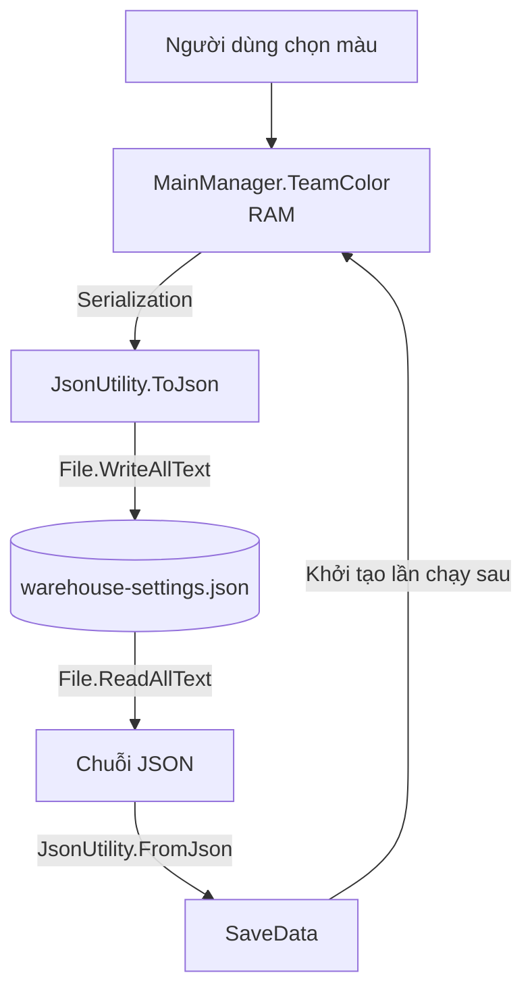

# Bài 06 — Lưu và khôi phục dữ liệu giữa các lần chạy ứng dụng

**Lộ trình:** Junior Programmer · **Chủ đề:** Manage Scene Flow and Data · **API chính:** `JsonUtility`, `Application.persistentDataPath`, `System.IO`, `PlayerPrefs`.

## 1. Tổng quan

Người dùng chọn màu đỏ cho đội xe nâng, chuyển từ `Menu` sang `Main` và quay lại mà màu không mất. Tuy nhiên, sau khi tắt ứng dụng rồi mở lại, màu trở về giá trị mặc định. Nguyên nhân là `MainManager` chỉ giữ màu **trong RAM**; khi tiến trình kết thúc, dữ liệu runtime không còn được duy trì.

Để dữ liệu tồn tại **giữa các phiên chạy (cross-session persistence)**, ta cần chuyển trạng thái thành một biểu diễn có thể lưu trữ, ghi nó vào nơi lưu bền vững và phục hồi trong lần khởi chạy sau. Với một đối tượng cấu hình nhỏ, file **JSON** là lựa chọn dễ đọc, dễ kiểm thử và được Unity hỗ trợ qua `JsonUtility`.

### Mục tiêu học tập

1. Giải thích serialization, deserialization và cấu trúc JSON hợp lệ.
2. Phân biệt file JSON và `PlayerPrefs`, xác định trường hợp thích hợp cho mỗi loại.
3. Xây dựng lớp `SaveData` chỉ chứa thông tin cần lưu.
4. Sử dụng `Application.persistentDataPath` kết hợp `Path.Combine` để ghi/đọc file.
5. Xử lý tình huống chưa có file lưu hoặc dữ liệu lưu không đọc được.
6. Kiểm tra việc khôi phục màu qua ít nhất hai lần khởi động ứng dụng.

## 2. Chu trình lưu và khôi phục

**Serialization** là quá trình biến dữ liệu trong bộ nhớ thành một dạng có thể lưu hoặc truyền, chẳng hạn chuỗi JSON. **Deserialization** làm ngược lại, đọc dạng lưu trữ và tái tạo dữ liệu trong cấu trúc chương trình.



Điểm khác biệt với `DontDestroyOnLoad`: manager vẫn cần được tạo lại khi khởi động ứng dụng; **thông tin màu** được đọc từ file và đặt trở lại thuộc tính của manager mới.

Một file dữ liệu ví dụ có cấu trúc:

```json
{
  "version": 1,
  "teamColor": {
    "r": 1.0,
    "g": 0.25,
    "b": 0.0,
    "a": 1.0
  }
}
```

JSON lưu các cặp **key–value**. Giá trị có thể là chuỗi, số, boolean, array, object lồng nhau hoặc `null`. JSON không tự chứa thông tin class C# mà nó thuộc về; khi đọc lại, chương trình phải biết kiểu dữ liệu đích và quy tắc tương ứng.

## 3. `JsonUtility` và quy tắc serialize trong Unity

`JsonUtility.ToJson(data)` chuyển **các field được Unity hỗ trợ serialize** thành JSON. `JsonUtility.FromJson<T>(json)` tạo đối tượng mới kiểu `T` từ dữ liệu JSON. Đối với một class dữ liệu thông thường do bạn định nghĩa, cần đánh dấu `[System.Serializable]`.

```csharp
[System.Serializable]
public class SaveData
{
    public int version = 1;
    public Color teamColor = Color.white;
}
```

> Đoạn code trên cần `using UnityEngine;` ở đầu file nếu đặt trong file C# độc lập.

`Color` là kiểu dữ liệu Unity có thể serialize. Trái lại, `JsonUtility` không trực tiếp serialize `Dictionary<TKey,TValue>` theo quy tắc serializer mặc định. Nó cũng không phải thư viện JSON đa dụng cho mọi object C#: các **property thông thường** như `public Color TeamColor { get; set; }` không tự động được lưu giống một public serializable field. Đừng chuyển thẳng toàn bộ `MainManager` sang JSON; hãy tạo **data transfer object** nhỏ chỉ chứa phần cần lưu.

| Phương án | Phù hợp với | Hạn chế cần chú ý |
| --- | --- | --- |
| `PlayerPrefs` | Cài đặt đơn giản dạng `int`, `float`, `string` | Không mã hóa; không dùng cho dữ liệu bí mật hoặc dữ liệu lưu phức tạp |
| `JsonUtility` + file | Nhóm field có cấu trúc tương đối đơn giản, cần xem/chuyển đổi thành JSON | Tuân theo Unity serialization; không hỗ trợ tùy ý dictionary/property |
| Giải pháp save system chuyên biệt | Nhiều bản lưu, migration, versioning, backup, dữ liệu lớn | Cần thiết kế thêm bảo toàn dữ liệu, lỗi và bảo mật |

Đối với một giá trị âm lượng đơn giản, `PlayerPrefs.SetFloat("music_volume", value)` là đủ. Với nhóm dữ liệu bao gồm màu, tên và tùy chọn khác, file JSON có cấu trúc sẽ rõ ràng hơn. **Không phương án nào mặc định tạo ra cơ chế chống chỉnh sửa hoặc mã hóa bí mật.**

## 4. Triển khai MainManager có khả năng Save/Load

Dưới đây là **phiên bản `MainManager.cs` đầy đủ thay thế phiên bản học tập ở Bài 05**. Chỉ để **một định nghĩa `MainManager`** trong project; nếu đang có class cùng tên, cập nhật class đó thay vì tạo file chứa định nghĩa trùng.

```csharp
using System;
using System.IO;
using UnityEngine;

public class MainManager : MonoBehaviour
{
    public static MainManager Instance { get; private set; }

    public Color TeamColor { get; private set; } = Color.white;

    private const string FileName = "warehouse-settings.json";

    [Serializable]
    private class SaveData
    {
        public int version = 1;
        public Color teamColor = Color.white;
    }

    private string SavePath => Path.Combine(
        Application.persistentDataPath, FileName);

    private void Awake()
    {
        if (Instance != null && Instance != this)
        {
            Destroy(gameObject);
            return;
        }

        Instance = this;
        DontDestroyOnLoad(gameObject);
        LoadColor();
    }

    public void SetTeamColor(Color color)
    {
        TeamColor = color;
    }

    public void SaveColor()
    {
        var data = new SaveData { teamColor = TeamColor };
        string json = JsonUtility.ToJson(data, true);

        try
        {
            Directory.CreateDirectory(Application.persistentDataPath);
            File.WriteAllText(SavePath, json);
            Debug.Log($"Đã lưu màu tại: {SavePath}");
        }
        catch (Exception exception)
        {
            Debug.LogError($"Không thể lưu màu: {exception.Message}");
        }
    }

    public void LoadColor()
    {
        if (!File.Exists(SavePath))
        {
            Debug.Log("Chưa có dữ liệu lưu: dùng màu mặc định.");
            return;
        }

        try
        {
            string json = File.ReadAllText(SavePath);
            SaveData data = JsonUtility.FromJson<SaveData>(json);

            if (data == null || data.version != 1)
            {
                Debug.LogWarning("Dữ liệu lưu không hợp lệ hoặc khác phiên bản.");
                return;
            }

            TeamColor = data.teamColor;
        }
        catch (Exception exception)
        {
            Debug.LogWarning($"Không thể đọc file lưu: {exception.Message}");
        }
    }
}
```

### Tại sao tổ chức như vậy?

- **Chỉ một instance:** `Awake()` hủy manager trùng khi quay lại scene chứa manager ban đầu.
- **Chỉ load khi instance hợp lệ:** nếu manager trùng bị hủy, nó không được ghi đè trạng thái của instance đang sống.
- **`Application.persistentDataPath`:** lấy đường dẫn lưu trữ dành cho ứng dụng theo nền tảng. Đây không phải đường dẫn cố định trong thư mục `Assets/`.
- **`Path.Combine`:** ghép thành phần đường dẫn theo quy ước nền tảng, thay vì nối chuỗi thủ công.
- **`version`:** là trường phiên bản định dạng do ta tự định nghĩa, giúp phát hiện thay đổi cấu trúc về sau; đây **chưa phải** một hệ thống migration hoàn chỉnh.
- **Xử lý lỗi:** file không tồn tại hoặc lỗi I/O không nên làm ứng dụng chết ngay từ màn hình menu.

Bản code này phù hợp **bài học nhập môn** nhưng chưa triển khai ghi file theo kiểu atomic, backup hoặc kiểm tra mọi giá trị float bất thường. Với ứng dụng quan trọng, nên ghi file tạm rồi thay thế có kiểm soát, xác minh schema, xem xét khả năng mất điện/gián đoạn ghi, đồng thời kiểm thử riêng từng nền tảng.

## 5. Kết nối dữ liệu lưu với giao diện

Trong `MenuUIHandler` của starter project, sau khi `ColorPicker.Init()` và khi `MainManager.Instance` đã có, thiết lập màu chọn trên giao diện:

```csharp
private void Start()
{
    ColorPicker.Init();
    ColorPicker.onColorChanged += NewColorSelected;

    if (MainManager.Instance != null)
        ColorPicker.SelectColor(MainManager.Instance.TeamColor);
}
```

Lưu ý: đây là phiên bản minh họa của `Start()` trong `MenuUIHandler` — hãy **tích hợp với những dòng khác đang có** thay vì ghi đè toàn bộ method đã được starter project cung cấp.

Bổ sung các callback để nối vào nút **Save** và **Load** trong Inspector:

```csharp
public void SaveColorClicked()
{
    if (MainManager.Instance != null)
        MainManager.Instance.SaveColor();
}

public void LoadColorClicked()
{
    if (MainManager.Instance == null)
        return;

    MainManager.Instance.LoadColor();
    ColorPicker.SelectColor(MainManager.Instance.TeamColor);
}
```

Cuối cùng, nếu có nút **Exit**, hãy gọi `MainManager.Instance?.SaveColor();` **trước** code thoát ứng dụng. Trong demo này, việc lưu bằng nút Save/Exit tương ứng cách thực hành Unity Learn. Với game thực tế, **không nên chỉ dựa vào sự kiện Quit** vì ứng dụng có thể bị kill/crash hoặc bị hệ điều hành chấm dứt mà không qua luồng thoát bình thường. Với tùy chọn ít thay đổi như màu đội xe, có thể chủ động gọi `SaveColor()` sau thao tác chọn màu hoặc lưu ở các checkpoint thích hợp.

Nếu `ColorPicker.SelectColor()` phát ra callback thay đổi màu, hãy kiểm tra thứ tự khởi tạo và hạn chế hiệu ứng ghi file không cần thiết do callback; hành vi này phụ thuộc implementation `ColorPicker` trong project.

## 6. Quy trình kiểm thử lưu và tải

### 6.1. Kiểm thử hành vi

| Tình huống | Các bước | Kỳ vọng |
| --- | --- | --- |
| Chưa có file | Xóa file demo của app khi đã đóng ứng dụng, rồi chạy | Màu mặc định, không lỗi |
| Save thủ công | Chọn màu khác → Save | File JSON được tạo ở `persistentDataPath` |
| Load thủ công | Chọn màu A → Save → chọn màu B → Load | Trở lại màu A |
| Giữa các phiên | Chọn màu → Save → đóng app → mở lại | Bộ chọn màu và xe sử dụng màu đã lưu |
| Trở về menu | Chọn màu → Start → Back | Không tạo manager trùng, không mất trạng thái |
| File bị sửa hỏng | Thử nội dung JSON không hợp lệ | Ứng dụng ghi warning và vẫn chạy bằng trạng thái hiện có/mặc định |

### 6.2. Quan sát và xác minh file

Để tìm vị trí file trên thiết bị thử nghiệm, log `Application.persistentDataPath` tại runtime. Đường dẫn thực tế khác nhau giữa Windows, macOS, Android, iOS và WebGL; trên WebGL, cơ chế lưu trữ được ánh xạ theo môi trường trình duyệt chứ không phải thư mục hệ thống có thể mở giống desktop.

**Quan trọng:** hành vi khi gỡ/cài lại ứng dụng, xóa dữ liệu ứng dụng, chạy dưới private browsing hoặc thay đổi định danh ứng dụng phụ thuộc nền tảng. Không coi `persistentDataPath` là bảo đảm dữ liệu tồn tại vĩnh viễn trong mọi hoàn cảnh.

Kiểm thử cả trường hợp chưa có file lẫn trường hợp có file **trên bản build thực tế**, bởi quyền truy cập file và đường dẫn trong Editor có thể khác môi trường triển khai.

## 7. Lỗi thường gặp và giới hạn thiết kế

| Hiện tượng | Khả năng cao | Cách kiểm tra |
| --- | --- | --- |
| Dữ liệu không được phục hồi | Chưa gọi `LoadColor()` khi khởi tạo manager | Log trong `Awake()` và kiểm tra đường dẫn file |
| File có dữ liệu nhưng không hiện trên UI | `TeamColor` được đọc, `ColorPicker` không được đồng bộ | Gọi `SelectColor()` sau khi UI khởi tạo |
| Một số trường mất khi serialize | Dùng property/dictionary hoặc kiểu không hỗ trợ | Kiểm tra quy tắc Unity serialization và class SaveData |
| Nút Save không tác dụng | Chưa gắn `On Click()` hoặc code không có instance | Kiểm tra target Button, Console và `MainManager.Instance` |
| Màu vẫn mất khi ứng dụng crash | Chỉ gọi Save tại Exit | Lưu khi đổi tùy chọn hoặc ở checkpoint |
| Một thiết bị đọc file lỗi | Quyền truy cập hoặc đặc điểm nền tảng | Dùng `persistentDataPath`, bắt exception, test trên thiết bị đích |

## 8. Bài thực hành mở rộng

Bổ sung `string teamName` vào `SaveData`, thuộc tính và setter thích hợp trong `MainManager`, sau đó sửa `SaveColor`/`LoadColor` để ghi cả tên và màu. Đổi tên method thành `SaveSettings`/`LoadSettings` nếu nhiệm vụ không còn chỉ là lưu màu. Cập nhật UI của `Menu` để người dùng nhập tên và hiển thị tên ở `Main`.

**Tiêu chí hoàn thành:** khởi chạy mới mà chưa có file không lỗi; tên và màu khôi phục sau khi mở lại; file JSON không chứa dữ liệu ngoài yêu cầu; code ghi và đọc sử dụng cùng phiên bản schema.

## 9. Câu hỏi ôn tập

**Câu 1.** Sự khác nhau cơ bản giữa `DontDestroyOnLoad` và file JSON là gì?

A. Cả hai đều tự lưu dữ liệu lên GitHub.  
B. `DontDestroyOnLoad` giữ GameObject trong phiên; file JSON cho phép phục hồi dữ liệu ở phiên sau.  
C. JSON chỉ chạy khi có scene additive.  
D. `DontDestroyOnLoad` mã hóa dữ liệu.

**Đáp án: B.** Một cơ chế quản lý vòng đời RAM, một cơ chế lưu và đọc trạng thái bền vững.

**Câu 2.** Mục đích của `[Serializable]` với class dữ liệu thường dùng trong `JsonUtility` là gì?

A. Cho biết class có thể được Unity serialize theo các quy tắc tương ứng.  
B. Tự gửi object lên Internet.  
C. Biến mọi property thành public field.  
D. Tự tạo file JSON ở thư mục `Assets`.

**Đáp án: A.** Attribute cho phép Unity serializer xử lý class tùy chỉnh phù hợp; không có nghĩa mọi member đều được serialize.

**Câu 3.** Cách xây đường dẫn lưu file nào phù hợp nhất với nhiều nền tảng Unity?

A. `"C:\\game\\save.json"`  
B. `"Assets/save.json"`  
C. `Path.Combine(Application.persistentDataPath, "save.json")`  
D. `"../Library/save.json"`

**Đáp án: C.** Dùng thư mục lưu ứng dụng theo platform thay vì đường dẫn riêng máy phát triển.

**Câu 4.** Người dùng chọn màu và ứng dụng bị chấm dứt bất thường trước khi bấm Exit. Giải pháp nào giảm nguy cơ mất lựa chọn mới?

A. Chỉ tăng số manager.  
B. Luôn dùng biến `static` thay vì file.  
C. Tắt `ColorPicker`.  
D. Lưu tại thời điểm thay đổi hoặc tại checkpoint thích hợp.

**Đáp án: D.** Không phải mọi lần kết thúc đều đi qua nút Exit hoặc callback Quit.

**Câu 5.** Khi `JsonUtility` không lưu một thuộc tính `public string Name { get; set; }`, nguyên nhân có thể là gì?

A. Chuỗi không được phép có trong JSON.  
B. Unity serializer chủ yếu làm việc với field được hỗ trợ, không tự serialize property thường.  
C. JSON không hỗ trợ nhiều key.  
D. `Application.persistentDataPath` chỉ ghi số nguyên.

**Đáp án: B.** Cần thiết kế lớp dữ liệu có các serializable field phù hợp với quy tắc Unity.

## 10. Tổng kết và tài liệu tham khảo

Một chức năng lưu trạng thái đúng gồm **mô hình dữ liệu → serialize → ghi bền vững → đọc → deserialize → đồng bộ UI và gameplay**. Dữ liệu lưu nên nhỏ gọn, có phiên bản khi cần và được kiểm thử trong cả đường đi bình thường lẫn những trường hợp thiếu/hỏng file.

- [Unity Learn — Implement data persistence between sessions](https://learn.unity.com/tutorial/implement-data-persistence-between-sessions)
- [Unity Scripting API — JsonUtility](https://docs.unity3d.com/ScriptReference/JsonUtility.html)
- [Unity Manual — JSON Serialization](https://docs.unity3d.com/Manual/JSONSerialization.html)
- [Unity Scripting API — Application.persistentDataPath](https://docs.unity3d.com/ScriptReference/Application-persistentDataPath.html)
- [Unity Scripting API — PlayerPrefs](https://docs.unity3d.com/ScriptReference/PlayerPrefs.html)

*Ví dụ là phiên bản thực hành mở rộng dựa trên chức năng màu xe nâng của Unity Learn. Những cơ chế xử lý lỗi, đường dẫn chuẩn hóa, trường `version` và lưu tại checkpoint là phần bổ sung để học đúng kỹ thuật; chưa phải save system production-ready.*
