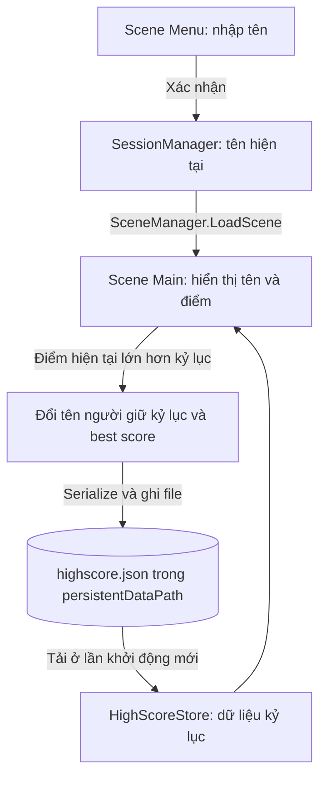

# Bài 07 — Bài tập dự án: Lưu dữ liệu trong game và nộp repository mới

**Lộ trình:** Unity Junior Programmer · **Chủ đề:** Manage Scene Flow and Data · **Hình thức:** Bài tập dự án (submission) · **Môi trường tham chiếu:** Unity 6.3.

> **Nhiệm vụ:** Xây dựng hoặc hoàn thiện một game tính điểm, truyền **tên người chơi giữa các scene**, lưu **kỷ lục điểm và người lập kỷ lục giữa các lần chạy**, rồi nộp dự án qua một repository Git có lịch sử commit rõ ràng.
>
> Đây là bài tập thực hành tự biên soạn dựa trên mục tiêu của Unity Learn, **không phải bản chép nguyên văn hướng dẫn hay một lời giải mẫu hoàn chỉnh**. Các đề xuất về kiến trúc, trường hợp kiểm thử và tiêu chí chấm bổ sung nhằm giúp tự triển khai và đánh giá sản phẩm.

## 1. Bài toán và kết quả cần đạt

Một game kiểu **Breakout** có thể đếm điểm trong lúc chơi, nhưng khi bổ sung menu và tính năng lưu kỷ lục, phát sinh hai vấn đề khác nhau:

- **Chuyển scene:** Tên do người chơi nhập ở `Menu` phải xuất hiện trong `Main` mà không bị mất khi nạp scene mới.
- **Đóng và mở ứng dụng:** Tên người giữ kỷ lục và điểm cao nhất phải được khôi phục từ dữ liệu đã lưu, kể cả khi tiến trình game trước đó đã kết thúc.

Ở bài tập này, có thể dùng starter project dạng Breakout của Unity Learn hoặc một game nhỏ khác có khả năng tăng và hiển thị điểm. Starter project có ba thư mục chính `Assets`, `Packages`, `ProjectSettings`; scene `Main` chơi được với **Space** để phóng bóng và **phím mũi tên trái/phải** để di chuyển thanh đỡ. Phần `Best Score` là chức năng người học cần hoàn thiện.

### Mục tiêu có thể kiểm chứng

Sau khi hoàn thành, bạn cần:

1. Tạo một **repository mới** và cấu hình `.gitignore` phù hợp với dự án Unity.
2. Thực hiện **initial commit** trước khi thay đổi gameplay; tạo thêm các commit có ý nghĩa trong quá trình làm.
3. Tạo một scene bắt đầu cho phép nhập và xác nhận tên người chơi.
4. Hiển thị đúng tên đã nhập ở scene gameplay.
5. Cập nhật kỷ lục **chỉ khi điểm hiện tại vượt điểm cao nhất**; hiển thị điểm và tên người lập kỷ lục.
6. Lưu/khôi phục kỷ lục sau khi đóng hoàn toàn và chạy lại ứng dụng.
7. Đưa repository và bằng chứng kiểm thử vào một bản nộp dễ xem xét.

## 2. Phạm vi và yêu cầu chức năng

### 2.1. Yêu cầu bắt buộc

| Mã | Tính năng | Cách nghiệm thu |
| --- | --- | --- |
| F01 | Có menu bắt đầu với ô nhập tên và nút Start | Nhập `An`, bấm Start và vào scene gameplay |
| F02 | Tên người chơi được duy trì giữa các scene | Ở gameplay hiển thị `An` cạnh điểm hiện tại |
| F03 | Theo dõi điểm hiện tại và kỷ lục | Khi điểm tăng, cả điểm hiện tại và best score hiển thị đúng |
| F04 | Lưu tên người lập kỷ lục cùng điểm cao nhất | Khi vượt kỷ lục, cả tên và điểm phải thay đổi đồng thời |
| F05 | Lưu dữ liệu giữa hai lần chạy | Đóng hẳn ứng dụng, mở lại và thấy kỷ lục cũ |
| F06 | Repository mới, nhiều commit | Có initial commit và các commit thể hiện những thay đổi sau đó |
| F07 | Bằng chứng chạy thử | Có ảnh/video và hướng dẫn tái hiện dễ làm theo |

**Không bắt buộc:** bảng xếp hạng nhiều người, tài khoản mạng, cloud save, mã hóa save game hoặc backend. Chỉ mở rộng khi phần bắt buộc đã ổn định.

### 2.2. Phân biệt ba vòng đời dữ liệu

| Loại trạng thái | Ví dụ | Khi nào có thể mất? | Giải pháp thường dùng |
| --- | --- | --- | --- |
| Trạng thái của một scene | Bóng, gạch còn lại, điểm trong ván | Khi scene được unload hoặc đối tượng bị hủy | Component đang tồn tại trong scene |
| Trạng thái giữa các scene | Tên người chơi vừa nhập | Khi đối tượng quản lý cũng bị hủy | Manager duy trì qua scene, hoặc truyền dữ liệu có kiểm soát |
| Trạng thái giữa các lần chạy | Best score + tên giữ kỷ lục | Khi ứng dụng thoát nếu chỉ giữ trong RAM | Lưu vào tệp hoặc cơ chế lưu bền vững |

`DontDestroyOnLoad` chỉ giúp một đối tượng tiếp tục tồn tại **trong cùng một lần chạy**; bản thân API này không ghi dữ liệu xuống đĩa. Tương tự, `static` không phải hệ thống lưu dữ liệu lâu dài.

## 3. Chuẩn bị dự án và repository

### 3.1. Phần mềm và dữ liệu

- Unity Hub và phiên bản Unity tương thích với starter project.
- Git và một cách quản lý Git, chẳng hạn **GitHub Desktop** hoặc terminal.
- Tài khoản GitHub nếu muốn publish repository và nộp liên kết.
- Starter project do Unity cung cấp hoặc game mẫu tự xây dựng có điểm số.

**Lưu ý về phiên bản:** Trang bài tập Unity 6.3 ghi starter project cần **Unity 6000.0 LTS**. Hãy mở đúng phiên bản được đề xuất hoặc kiểm tra khả năng nâng cấp trên **một bản sao** của dự án trước khi đổi phiên bản; tránh để Unity tự chuyển đổi bản duy nhất mà không có dự phòng.

**Tài nguyên:** [Trang bài tập chính thức và liên kết starter files](https://learn.unity.com/pathway/junior-programmer/unit/manage-scene-flow-and-data/tutorial/submission-data-persistence-in-a-new-repo?version=6.3).

### 3.2. Cấu trúc repository

Thư mục repository nên đồng thời là **thư mục gốc dự án Unity**:

```text
Data-Persistence-Project/
├── .git/                     # Git quản lý; không tự chỉnh nội dung
├── .gitignore
├── README.md
├── Assets/                    # Script, scene, prefab, asset và file .meta
├── Packages/                  # manifest và danh sách package được khóa
└── ProjectSettings/           # Thiết lập của dự án
```

`Library/`, `Temp/`, `Logs/` và các file cache được tạo lại trong môi trường làm việc thường không cần commit. **Đừng bỏ qua toàn bộ `*.meta`**: các file này chứa định danh tài nguyên (GUID), rất quan trọng để Unity giữ tham chiếu giữa scene, prefab và asset. Sử dụng mẫu [.gitignore cho Unity của GitHub](https://github.com/github/gitignore/blob/main/Unity.gitignore) thay vì tự đoán toàn bộ danh sách bỏ qua.

### 3.3. Khởi tạo và tạo bản lưu đầu tiên

Có thể sử dụng GitHub Desktop: **File → New repository** → chọn mẫu ignore Unity → tạo repository tại thư mục dự án → đưa ba thư mục Unity vào → mở từ Unity Hub → chạy thử → `initial commit`.

Nếu dùng dòng lệnh, hãy chạy trong **thư mục gốc của dự án** sau khi đặt `.gitignore` và các thư mục Unity vào đúng vị trí:

```bash
git init
git branch -M main
git status
git add .gitignore Assets Packages ProjectSettings README.md
git commit -m "chore: import Unity starter project"
```

Nếu cần publish, tạo **remote repository rỗng** trên GitHub (không khởi tạo trước với README hoặc `.gitignore` để tránh lịch sử khác nhau), sau đó:

```bash
git remote add origin https://github.com/USERNAME/Data-Persistence-Project.git
git push -u origin main
```

Thay URL giả bằng địa chỉ thực tế. Nếu `origin` đã tồn tại, chạy `git remote -v` để xem và dùng `git remote set-url origin <URL>` khi thực sự cần đổi địa chỉ; không thêm `origin` trùng. Có thể tiếp tục commit cục bộ trước khi publish.

> **Checkpoint A:** Clone thử repository vào thư mục khác, hoặc xác nhận `git status` sạch và repository có đủ `Assets`, `Packages`, `ProjectSettings`, các `.meta` quan trọng. Tránh commit mật khẩu, token hay dữ liệu cá nhân vào repository công khai.

## 4. Thiết kế trạng thái và luồng dữ liệu

### 4.1. Kiến trúc gợi ý



Có thể dùng một manager duy trì qua scene cho `playerName` và một lớp riêng để đọc/ghi `highScore`. Không nhất thiết buộc cả hai vào một singleton; quan trọng là ranh giới rõ ràng giữa **trạng thái trong RAM** và **dữ liệu bền vững**.

### 4.2. Mô hình dữ liệu tối thiểu

Một bản lưu kỷ lục cần **ít nhất hai giá trị đi cùng nhau**:

```json
{
  "version": 1,
  "bestPlayerName": "An",
  "bestScore": 120
}
```

Trường `version` là gợi ý mở rộng để nhận diện định dạng về sau; không bắt buộc với game nhỏ. Nếu dùng Unity `JsonUtility`, hãy dùng class DTO đánh dấu `[System.Serializable]` với các field được Unity hỗ trợ serialize. Đường dẫn lưu cần được tạo từ `Application.persistentDataPath` và `Path.Combine`, thay vì ghi trực tiếp vào `Assets/`.

### 4.3. Quy tắc cập nhật kỷ lục

Tại một thời điểm có thể xem trạng thái gồm `currentScore`, `bestScore`, `currentPlayerName`, `bestPlayerName`. Một lần ghi kỷ lục chỉ xảy ra khi:

```text
Nếu currentScore > bestScore:
    bestScore ← currentScore
    bestPlayerName ← currentPlayerName
    cập nhật giao diện best score
    yêu cầu lưu dữ liệu mới
Ngược lại:
    giữ nguyên bestScore và bestPlayerName
```

Khi bằng điểm kỷ lục (`currentScore == bestScore`), không đổi tên người giữ kỷ lục nếu quy ước của dự án là **chỉ thay khi vượt**. Điểm trong ván có thể trở về 0 khi chơi mới, nhưng dữ liệu kỷ lục vẫn được giữ.

## 5. Quy trình triển khai theo mốc

### 5.1. Mốc 1 — Chạy được starter project

1. Tải starter project từ trang bài tập; giải nén.
2. Đặt `Assets`, `Packages`, `ProjectSettings` trong thư mục repository; không đặt lồng thêm một thư mục gốc dự án không cần thiết.
3. Thêm thư mục bằng **Unity Hub → Projects → Add project from disk** hoặc chức năng tương ứng theo phiên bản Hub.
4. Mở `Assets/Scenes/Main` và thử điều khiển bằng Space, mũi tên trái/phải.
5. Kiểm tra Console và ghi nhận điểm hiện tại hoạt động ra sao.
6. Commit bản khởi đầu khi các file đã ổn định.

**Checkpoint:** Chơi được ván cơ bản; mô tả được nơi điểm hiện tại được tính và nơi UI hiển thị điểm.

### 5.2. Mốc 2 — Tạo menu và truyền tên người chơi

1. Tạo scene `Menu`, thêm ô nhập (`TMP_InputField` nếu dự án đang dùng TextMeshPro), nhãn hướng dẫn và Button **Start**.
2. Định nghĩa một quy tắc cho tên rỗng, tên chỉ có khoảng trắng và độ dài tối đa; thông báo cho người chơi khi nhập không hợp lệ.
3. Xây cơ chế lưu tạm tên qua scene: ví dụ manager đặt ở root GameObject và gọi `DontDestroyOnLoad(gameObject)` ở `Awake`.
4. Xử lý tạo trùng manager khi trở lại `Menu`; chỉ giữ một instance hợp lệ.
5. Sau khi tên được xác nhận, chuyển sang `Main` bằng `SceneManager.LoadScene("Main")`.
6. Hiển thị tên cạnh điểm hiện tại và thử quay về menu rồi chơi lại.

**Checkpoint:** Nhập tên A rồi chơi; vào scene `Main` vẫn thấy A. Đổi sang tên B cho ván tiếp theo thì hiện B, không bị nhân bản manager.

### 5.3. Mốc 3 — Kỷ lục điểm số trong một lần chạy

1. Xác định sự kiện tăng điểm đang có trong gameplay.
2. Chọn điểm duy nhất để thực hiện so sánh kỷ lục (tránh logic cập nhật phân tán trên nhiều UI script).
3. Khi có kỷ lục mới, thay đồng thời **điểm cao nhất** và **tên người lập kỷ lục**.
4. Cập nhật UI khi mở scene và sau mỗi lần phá kỷ lục; không chỉ cập nhật khi có sự kiện ghi điểm.
5. Kiểm thử hai người chơi, kỷ lục bằng nhau và trường hợp không phá kỷ lục.

**Checkpoint:** Trong cùng một lần chạy, người đạt điểm thấp hơn không thể ghi đè tên và điểm của người giữ kỷ lục.

### 5.4. Mốc 4 — Lưu và khôi phục giữa các lần chạy

1. Thiết kế một kiểu dữ liệu lưu chỉ gồm các trường cần thiết; không serialize toàn bộ `MonoBehaviour` hay toàn scene.
2. Dùng `JsonUtility.ToJson` và tệp bên trong `Application.persistentDataPath`, hoặc một cơ chế lưu tương đương có thể kiểm chứng.
3. Khi khởi động, nếu chưa tồn tại file, khởi tạo giá trị mặc định (`bestScore = 0`, tên trống hoặc tên hiển thị mặc định).
4. Nếu đọc thất bại do file hỏng hoặc truy cập bị từ chối, giữ chương trình chạy an toàn, cảnh báo trong Console và không làm hỏng trạng thái gameplay.
5. Khi kỷ lục mới được xác nhận, lưu lại ở thời điểm phù hợp. Không cần ghi file liên tục ở mọi `Update()`.
6. **Đóng hẳn game rồi mở lại** để xác nhận dữ liệu không chỉ được giữ trong RAM.

**Checkpoint:** Có thể ghi kỷ lục với người A, thoát ứng dụng, mở lại và vẫn đọc được người A cùng số điểm; người B chỉ thay thế khi vượt kỷ lục.

### 5.5. Mốc 5 — Dọn dự án, commit và chuẩn bị nộp

1. Đặt tên script và scene nhất quán; loại các GameObject dùng thử không còn cần thiết.
2. Bảo đảm hai scene được đưa vào danh sách scene của build (**File → Build Profiles → Scene List** với Unity 6, chú ý profile có thể override danh sách toàn cục).
3. Chạy thử bản build nếu có thể, vì hành vi giữa Editor và bản build đôi khi khác nhau.
4. Kiểm tra Git changes, loại bỏ file sinh tự động hoặc dữ liệu cá nhân.
5. Commit các mốc có ý nghĩa, ví dụ:

```text
chore: import starter project
feat: add player name menu
feat: persist high score as JSON
fix: prevent duplicate session managers
docs: add test instructions and screenshots
```

6. Publish và điền README theo hướng dẫn ở Mục 8.

## 6. Ma trận kiểm thử bắt buộc

| ID | Tình huống | Kết quả mong đợi |
| --- | --- | --- |
| T01 | Chạy lần đầu, chưa có file save | Game vào được, kỷ lục mặc định hợp lệ |
| T02 | Menu nhập tên `An`, bấm Start | `Main` hiển thị tên `An` |
| T03 | Đạt điểm 100 khi kỷ lục ban đầu là 0 | Best score 100 và tên `An` |
| T04 | Ván mới, người `Binh` đạt 80 | Best score vẫn 100 và tên `An` |
| T05 | Người `Binh` đạt đúng 100 | Kỷ lục giữ nguyên theo quy tắc chỉ thay khi vượt |
| T06 | Người `Binh` đạt 120 | Best score 120, tên `Binh` |
| T07 | Đóng hoàn toàn và mở lại | Best score 120, tên `Binh` vẫn tồn tại |
| T08 | Đi từ `Main` về `Menu` rồi chơi tiếp | Không tạo nhiều manager, tên mới hiển thị đúng |
| T09 | Xóa/đổi tên file save trong môi trường kiểm thử | Có giá trị mặc định; không crash |
| T10 | Sửa file save thành JSON không hợp lệ (trên bản sao) | Có xử lý lỗi và cảnh báo; game tiếp tục chạy |
| T11 | Clone repository ở thư mục khác | Unity có thể nhập project lại từ các file đã commit |

`T09` và `T10` là kiểm thử lỗi; **sao lưu dữ liệu trước khi làm**. Không thao tác trực tiếp trên save quan trọng của người khác. Lưu ý một số lỗi JSON vẫn có thể cho ra đối tượng thiếu field: cần kiểm tra ràng buộc dữ liệu sau khi đọc, không chỉ dựa vào việc parser có ném exception hay không.

## 7. Lỗi phổ biến và cách xử lý

| Hiện tượng | Khả năng gây lỗi | Hướng kiểm tra |
| --- | --- | --- |
| Tên mất khi mở `Main` | Manager thuộc scene cũ và bị hủy | Kiểm tra `DontDestroyOnLoad`, vị trí root, thời điểm khởi tạo |
| Có hai manager khi quay lại menu | Mỗi scene đều tạo manager mới | Kiểm tra singleton và logic hủy instance trùng |
| Kỷ lục còn khi chuyển scene nhưng mất khi khởi động lại | Chưa thực sự ghi file hoặc không gọi load | In đường dẫn lưu, kiểm tra file và luồng load ở lần chạy mới |
| Điểm cũ bị ghi đè bởi điểm thấp hơn | Dùng `>=` hoặc cập nhật vô điều kiện | Kiểm tra điều kiện `currentScore > bestScore` |
| Hiển thị điểm mới nhưng tên cũ | Lưu/hiển thị riêng rẽ hai trường | Cập nhật cùng một bản ghi kỷ lục và refresh UI |
| Game báo không tìm thấy scene | Scene chưa được include trong Scene List | Kiểm tra tên scene, Build Profiles, profile đang active |
| Clone xong mất tham chiếu asset | File `.meta` không được commit hoặc asset bị đổi ngoài Unity | Kiểm tra `.meta` và lịch sử thay đổi |
| `git push` bị từ chối | Remote đã có commit mới hoặc chưa xác thực | Kiểm tra remote, branch, quyền truy cập và trạng thái đồng bộ; không `push --force` tùy tiện |

Trong Unity Editor, nếu muốn kiểm thử khởi động sạch, hãy xem xét thiết lập **Enter Play Mode Options**: khi tắt domain reload, một số biến `static` có thể còn giá trị trong các phiên Play mode, làm phép thử dựa vào RAM trở nên sai lệch. Bài kiểm thử chắc chắn hơn là chạy bản build như một tiến trình mới.

## 8. Sản phẩm nộp và tiêu chí đánh giá

### 8.1. Cấu trúc README gợi ý

```text
# Data Persistence Project

## Giới thiệu
Game tính điểm, có menu nhập tên, hiển thị và lưu kỷ lục.

## Yêu cầu môi trường
Unity version, nền tảng, những package cần thiết.

## Cách chạy
1. Clone repository.
2. Mở thư mục bằng Unity Hub.
3. Mở scene Menu và nhấn Play (hoặc chạy bản build).
4. Nhập tên, bắt đầu, điều khiển game.

## Tính năng
- Giữ tên qua scene.
- Giữ best score và tên người lập qua lần chạy.

## Kiểm thử
Các bước tái hiện T01–T11, ảnh hoặc video kết quả.

## Kiến trúc
Nơi quản lý trạng thái tạm thời và nơi lưu dữ liệu bền vững.
```

### 8.2. Yêu cầu bản nộp

- [ ] Có **link GitHub repository** truy cập được với người chấm (công khai nếu nộp bằng liên kết công khai và bạn có quyền chia sẻ nội dung).
- [ ] Có **nhiều commit** với commit message diễn tả từng thay đổi, không chỉ một lần upload cuối.
- [ ] Có **bằng chứng tên người chơi qua scene**.
- [ ] Có **bằng chứng kỷ lục qua lần chạy**.
- [ ] Có ảnh hoặc video ngắn minh họa, cộng với hướng dẫn mở chạy.
- [ ] Không đẩy file cache, secrets, file save chứa dữ liệu cá nhân hoặc asset không có quyền phân phối.

### 8.3. Thang tự đánh giá đề xuất (không phải rubric chính thức)

| Hạng mục | Điểm |
| --- | ---: |
| Chuyển scene và truyền tên hợp lệ | 20 |
| Điểm và cập nhật kỷ lục nhất quán | 20 |
| Lưu/khôi phục kỷ lục giữa các lần chạy | 25 |
| Kiểm thử tình huống bình thường và bất thường | 15 |
| Repository, nhiều commit, `.gitignore`, README | 15 |
| Minh chứng nộp rõ ràng | 5 |
| **Tổng** | **100** |

Tiêu chí quan trọng nhất không phải lượng code, mà là **hành vi có thể tái hiện và kiểm chứng**.

## 9. Câu hỏi ôn tập

### Câu 1

Một người chơi nhập tên ở `Menu`, sau đó vào `Main`; dữ liệu nào có thể chỉ cần giữ trong RAM của manager đang tồn tại?

A. Kỷ lục phải tồn tại sau khi tắt game.  
B. Tên người chơi của ván hiện tại.  
C. Bản sao lưu trên cloud.  
D. File save trên đĩa.

**Đáp án: B.** Tên người chơi hiện tại chỉ cần qua scene; kỷ lục qua lần chạy đòi hỏi cơ chế lưu bền vững.

### Câu 2

Tệp nào có vai trò quan trọng đối với tham chiếu GUID của asset Unity khi đưa dự án lên Git?

A. File `.meta` đi kèm asset.  
B. File cache trong `Library/`.  
C. Log Editor.  
D. Build đã xuất.

**Đáp án: A.** Unity dùng dữ liệu metadata để liên kết các asset; bỏ `.meta` có thể làm mất tham chiếu.

### Câu 3

Kỷ lục hiện tại là 120 do An lập. Bình đạt đúng 120. Theo quy tắc chỉ cập nhật khi vượt, hành vi nào đúng?

A. Chuyển tên giữ kỷ lục sang Bình.  
B. Đặt kỷ lục về 0.  
C. Giữ 120 và tên An.  
D. Xóa file save.

**Đáp án: C.** `currentScore == bestScore` không thỏa điều kiện vượt kỷ lục.

### Câu 4

Vì sao test chuyển qua hai scene không chứng minh được dữ liệu sẽ còn sau khi tắt game?

A. Vì scene không chứa GameObject.  
B. Vì mọi biến trong Unity đều được ghi đĩa.  
C. Vì `SceneManager` tự xóa file JSON.  
D. Vì dữ liệu có thể vẫn đang nằm trong RAM của tiến trình.

**Đáp án: D.** Cần chạy phiên ứng dụng mới và đọc dữ liệu từ nơi lưu bền vững.

### Câu 5

Repository đã có `Assets/`, `Packages/`, `ProjectSettings/` và file `.gitignore` chuẩn. Cách kiểm chứng tốt nhất trước khi nộp là gì?

A. Chỉ xem ảnh chụp game.  
B. Clone sang thư mục mới, mở bằng Unity Hub, chạy các test chính.  
C. Xóa mọi `.meta` để giảm kích thước.  
D. Commit toàn bộ `Library/` để bảo đảm mở được.

**Đáp án: B.** Kiểm thử từ bản clone phát hiện thiếu file hoặc vấn đề tái tạo dự án mà máy phát triển hiện tại che giấu.

## 10. Tổng kết và tài liệu tham khảo

Kết quả hoàn thành bài tập là **một game có trạng thái hợp lý, dữ liệu bền vững, kiểm thử rõ ràng và lịch sử Git có thể xem lại**. Người đánh giá phải có thể đọc README, lấy dự án từ repository, chạy thử và tự xác minh hai khả năng lưu dữ liệu.

**Tài liệu đối chiếu:**

1. [Unity Learn — Submission: Data persistence in a new repo](https://learn.unity.com/pathway/junior-programmer/unit/manage-scene-flow-and-data/tutorial/submission-data-persistence-in-a-new-repo?version=6.3) — mục tiêu, starter project và yêu cầu nộp.
2. [Unity Learn — Manage Scene Flow and Data](https://learn.unity.com/pathway/junior-programmer/unit/manage-scene-flow-and-data?version=6.3) — vị trí bài học trong lộ trình.
3. [Unity Scripting API — Object.DontDestroyOnLoad](https://docs.unity3d.com/ScriptReference/Object.DontDestroyOnLoad.html) — duy trì đối tượng khi đổi scene.
4. [Unity Scripting API — Application.persistentDataPath](https://docs.unity3d.com/ScriptReference/Application-persistentDataPath.html) — nơi lưu dữ liệu giữa các lần chạy.
5. [GitHub — Unity.gitignore](https://github.com/github/gitignore/blob/main/Unity.gitignore) — file bỏ qua chuẩn cho repository Unity.
6. [GitHub Docs — Managing remote repositories](https://docs.github.com/en/get-started/git-basics/managing-remote-repositories) — liên kết và quản lý remote Git.
