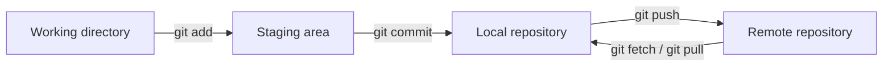

# Bài 08 — Kiểm tra tổng hợp: Quản lý scene, dữ liệu và phiên bản dự án

**Lộ trình:** Unity Junior Programmer · **Chủ đề:** Manage Scene Flow and Data · **Hình thức:** Bài đánh giá kiến thức (assessment) · **Môi trường tham chiếu:** Unity 6.3, C#, Git/GitHub.

> **Định hướng:** Đánh giá năng lực lựa chọn và giải thích giải pháp, không chỉ nhớ lệnh hoặc thuật ngữ. Bộ **24 câu hỏi dưới đây được biên soạn mới để tự học**, không phải bản dịch hoặc bản sao 10 câu hỏi của Unity. Bài quiz Unity Learn công khai có **10 câu và ngưỡng đạt 8/10**; ngưỡng tự luyện trong tài liệu này là đề xuất riêng.

## 1. Hướng dẫn làm bài

Chọn **một phương án đúng nhất** cho mỗi câu. Hãy làm hết trước khi xem đáp án ở Mục 5. Các câu hỏi được chia theo các nhóm năng lực: quản lý phiên bản, chuyển scene, vòng đời đối tượng, lưu trữ dài hạn và nguyên lý OOP.

- **Phần A (8 câu):** Git, repository, commit, branch và collaboration.
- **Phần B (4 câu):** `SceneManager` và cấu hình scene.
- **Phần C (4 câu):** `DontDestroyOnLoad`, `static`, Singleton và `PlayerPrefs`.
- **Phần D (4 câu):** JSON, file save và kỷ lục.
- **Phần E (4 câu):** Encapsulation, Polymorphism, Abstraction và Inheritance.

**Gợi ý tự chấm:** mỗi câu 1 điểm, tối đa 24 điểm; mốc tự đặt **19/24** để xem là đạt (xấp xỉ 79%). Đây **không phải điểm chuẩn do Unity quy định**. Các bài tập tình huống ở Mục 4 dùng để tự giải thích và kiểm chứng thêm, không tính vào 24 điểm.

## 2. Ôn nhanh kiến thức nền trước khi làm bài

### 2.1. Dòng công việc Git

`git add` đưa thay đổi vào vùng staging; `git commit` tạo bản ghi mới trong **repository cục bộ**; `git push` đẩy commit lên remote. `git pull` kết hợp lấy thông tin từ remote với bước tích hợp vào nhánh hiện hành (thường là fetch rồi merge hoặc rebase tùy cấu hình). Không được đồng nhất `commit` và `push`.

### 2.2. Ba kiểu duy trì trạng thái

| Cơ chế | Chuyển scene trong cùng phiên | Đóng rồi mở lại ứng dụng | Ví dụ |
| --- | --- | --- | --- |
| Field của Component bình thường trong scene | Không bảo đảm | Không | Điểm trong ván của scene vừa unload |
| `static` hoặc đối tượng `DontDestroyOnLoad` | Có thể, trong điều kiện phù hợp | Không | Tên người chơi của phiên hiện tại |
| `PlayerPrefs` hoặc file JSON ở nơi lưu bền vững | Có thể nạp lại | Có | Âm lượng, best score và tên người giữ kỷ lục |

`DontDestroyOnLoad` chỉ bảo vệ đối tượng khỏi bị hủy khi scene thay đổi; `static` gắn với kiểu dữ liệu trong tiến trình (và còn chịu ảnh hưởng của thiết lập domain reload trong Editor); `PlayerPrefs` và file JSON là các cơ chế lưu dữ liệu giữa lần chạy.

### 2.3. Tình huống xuyên suốt

Một game có `Menu` để nhập tên và `Main` để chơi. Chương trình cần hiển thị tên cạnh điểm hiện tại, cập nhật best score khi lập kỷ lục, và khôi phục best score sau khi khởi động lại. Với mô hình này, người học phải biết **dữ liệu nào chỉ cần ở RAM và dữ liệu nào phải ghi xuống nơi lưu trữ**.

## 3. Bộ 24 câu hỏi trắc nghiệm

### 3.1. Phần A — Git và quản lý phiên bản

**Câu 1.** Nhóm công cụ nào giải quyết trực tiếp nhu cầu lưu lại lịch sử thay đổi mã nguồn và phối hợp phát triển trên các nhánh?

A. Unity Profiler.  
B. Git kết hợp với một dịch vụ lưu repository như GitHub.  
C. Unity Package Manager.  
D. Unity Analytics.

**Câu 2.** Khi đưa dự án Unity vào Git, thư mục nào thường nên loại khỏi repository vì chủ yếu chứa dữ liệu cache có thể sinh lại?

A. `Assets/`.  
B. `Packages/`.  
C. `Library/`.  
D. `ProjectSettings/`.

**Câu 3.** Một prefab mất các liên kết asset sau khi bạn đồng bộ dự án sang máy khác. Nguyên nhân nào là đáng kiểm tra nhất trước tiên?

A. Các file `.meta` tương ứng bị bỏ qua hoặc thay đổi sai.  
B. Repository có nhiều hơn một commit.  
C. README chứa tiếng Việt.  
D. Tên branch là `main`.

**Câu 4.** Sau `git add .`, thao tác nào tạo một bản ghi lịch sử mới **trên máy hiện tại**?

A. `git push`.  
B. `git status`.  
C. `git remote -v`.  
D. `git commit -m "feat: add menu"`.

**Câu 5.** Hai thành viên sửa khác nhau cùng đoạn mã trên hai nhánh; khi tích hợp Git không tự xác định được nội dung cuối. Đây là trường hợp nào?

A. Build profile không hợp lệ.  
B. Package dependency chưa tải.  
C. Merge conflict.  
D. Runtime exception.

**Câu 6.** Khi thực hiện `git switch feature/save-system`, Git thường làm gì với working directory nếu việc chuyển nhánh có thể thực hiện an toàn?

A. Xóa nhánh `feature/save-system` khỏi remote.  
B. Chuyển nhánh đang làm việc sang `feature/save-system` và cập nhật file theo nhánh đó.  
C. Tự động đẩy mọi commit lên GitHub.  
D. Tạo hai bản giống hệt nhau của mọi file.

**Câu 7.** Một lập trình viên vừa clone dự án và cần làm một tính năng độc lập. Thứ tự nào hợp lý nhất?

A. Tạo/chuyển nhánh tính năng → sửa code → `git add` → `git commit` → `git push`.  
B. `git push` → sửa code → `git add` → tạo nhánh.  
C. `git commit` → `git clone` → sửa code → `git add`.  
D. Tạo nhánh → xóa `.git` → sửa code → `git push`.

**Câu 8.** Trong repository cục bộ, tên `origin` trong lệnh `git remote add origin URL` có ý nghĩa gì?

A. Là tên file cấu hình Unity.  
B. Là tên branch phải là `main`.  
C. Là chỉ dẫn ép Git ghi đè remote.  
D. Là tên định danh một remote, thường dùng cho repository nguồn trên máy chủ.

### 3.2. Phần B — Luồng scene và giao diện

**Câu 9.** Khi `Main` đã được include trong Scene List, lệnh C# nào phù hợp để chuyển từ `Menu` sang `Main` và thay scene đang được nạp theo chế độ `Single`?

A. `SceneManager.LoadScene(LoadSceneMode.Single);`  
B. `SceneManager.LoadScene("Main", LoadSceneMode.Single);`  
C. `SceneManager.LoadScene("Main", "Single");`  
D. `SceneManager.LoadScene(0, "Main");`

**Câu 10.** Khi gọi `SceneManager.LoadScene("Overlay", LoadSceneMode.Additive)`, đặc trưng chính của chế độ `Additive` là gì?

A. Nạp scene mới mà không tự động dỡ bỏ toàn bộ scene đang nạp theo cách của `Single`.  
B. Chỉ nạp các GameObject đang active và hủy mọi object inactive.  
C. Tự động ghi dữ liệu hiện có thành JSON.  
D. Luôn chuyển cảnh đồng bộ mà không mất khung hình.

**Câu 11.** `SceneManager.LoadScene("Main")` chạy từ menu nhưng báo không tải được scene trong bản build. Kiểm tra nào có giá trị cao nhất?

A. Đổi tên biến điểm hiện tại.  
B. Xóa toàn bộ C# scripts rồi import lại.  
C. Xác nhận `Main` đúng tên và có mặt, được bật trong Scene List/Build Profile đang dùng.  
D. Bật `DontDestroyOnLoad` cho tất cả GameObject.

**Câu 12.** Game có các scene `Menu` và `Main`; bạn muốn tên người chơi nhập tại menu được hiển thị ở `Main`. Phương án nào hợp lý nhất đối với một project nhỏ?

A. Chỉ đặt tên trong một field của UI `Menu`, sau đó hủy scene.  
B. Ghi tên vào Console rồi đọc lại từ Console khi vào `Main`.  
C. Luôn dùng `FindObjectOfType` để tìm UI đã bị unload.  
D. Lưu tên trong một manager duy trì qua scene, rồi cho UI `Main` đọc khi khởi tạo.

### 3.3. Phần C — Vòng đời đối tượng và lưu cấu hình

**Câu 13.** Nhận định nào đúng nhất về `DontDestroyOnLoad`?

A. Nó giúp giữ một root GameObject (hoặc component trên root đó) và các đối tượng con của nó khi tải scene khác; không tự lưu sang phiên ứng dụng sau.  
B. Nó ngăn mọi lệnh `Destroy` được gọi trong toàn bộ ứng dụng.  
C. Nó serialize tất cả biến thành file save ngay khi thoát.  
D. Nó bảo đảm mọi singleton tự tồn tại mà không cần đặt đối tượng trong scene.

**Câu 14.** Một `static int reloadCount` tăng mỗi khi scene được nạp lại trong cùng một lần chạy. Phát biểu nào đúng?

A. Giá trị luôn trở về 0 ngay khi gọi `LoadScene`.  
B. Giá trị `static` thông thường tồn tại qua lần nạp lại scene trong cùng tiến trình, nhưng không phải cách lưu dữ liệu giữa các lần khởi động.  
C. Nó tự ghi xuống `persistentDataPath`.  
D. Nó giống hệt một field instance của GameObject bị hủy.

**Câu 15.** Trong `Awake`, một manager thấy `Instance` đã tham chiếu đến một instance khác đang tồn tại. Xử lý nào phù hợp với mẫu Singleton dựa trên GameObject?

A. Giữ cả hai manager để dự phòng, luôn tăng số lượng.  
B. Đặt lại `Instance = null` ở cả hai manager.  
C. Hủy manager mới bị trùng và chỉ giữ một instance hợp lệ.  
D. Đặt biến `Instance` thành `const`.

**Câu 16.** Cần lưu một giá trị âm lượng dạng `float` cho lần mở game sau. Phương án nào phù hợp với dữ liệu cấu hình đơn giản?

A. Chỉ dùng field của `MenuUI`.  
B. Chỉ dùng `DontDestroyOnLoad`.  
C. Dùng `Debug.Log` để lưu giá trị.  
D. Dùng `PlayerPrefs.SetFloat` và đọc lại với `PlayerPrefs.GetFloat`.

### 3.4. Phần D — Lưu dữ liệu lâu dài và kỷ lục

**Câu 17.** Bạn muốn dùng `JsonUtility` để ghi thông tin `bestScore` và `bestPlayerName`. Cách thiết kế nào phù hợp với quy tắc serialize thường dùng của Unity?

A. Tạo một class `[System.Serializable]` có các field dữ liệu phù hợp rồi gọi `JsonUtility.ToJson`.  
B. Chỉ sử dụng property tự động có `get; set;`, không cần field hoặc wrapper.  
C. Truyền `Dictionary<string, object>` bất kỳ vào `JsonUtility` và giả định nó lưu đủ.  
D. Chuyển mọi component trong scene sang chuỗi bằng `ToString()` rồi lưu.

**Câu 18.** Để lưu file JSON cho người chơi trên máy của họ qua nhiều phiên, đường dẫn nào thích hợp trong Unity?

A. Đường dẫn trỏ đến `Assets/` trong bản build.  
B. Đường dẫn tạo từ `Application.persistentDataPath` và tên file, ví dụ với `Path.Combine`.  
C. Chỉ đường dẫn đến `Library/` của Editor.  
D. Một đường dẫn ổ cứng tuyệt đối chỉ có trên máy lập trình viên.

**Câu 19.** Kỷ lục hiện tại là 300 với người lập là An. Bình kết thúc ván được 250. Luật game chỉ thay kỷ lục khi vượt điểm cũ. Cách xử lý nào đúng?

A. Đổi tên thành Bình nhưng giữ điểm 300.  
B. Đặt best score về 250.  
C. Giữ nguyên điểm 300 và người lập kỷ lục An.  
D. Xóa file save để tránh xung đột.

**Câu 20.** Ở lần chạy đầu tiên chưa có file save, hoặc file bị sai cấu trúc. Thiết kế nào có khả năng chịu lỗi tốt nhất?

A. Luôn yêu cầu người chơi xóa dự án Unity và tạo mới.  
B. Luôn dừng ứng dụng ngay khi không có file.  
C. Mặc định dữ liệu đọc được luôn hợp lệ, không kiểm tra gì.  
D. Sử dụng dữ liệu mặc định, kiểm tra tính hợp lệ, ghi cảnh báo phù hợp và tiếp tục chạy khi có thể.

### 3.5. Phần E — Nguyên lý lập trình hướng đối tượng

**Câu 21.** Trong class quản lý điểm, bạn không muốn các script khác tự ý gán số âm cho `Score`. Cách nào thể hiện rõ **encapsulation**?

A. Giữ field điểm ở phạm vi không công khai, đưa ra method/property kiểm soát thay đổi và bảo toàn ràng buộc.  
B. Đặt mọi field là `public` để sửa được từ mọi nơi.  
C. Dùng một biến toàn cục không kiểm tra đầu vào.  
D. Tạo nhiều bản sao điểm không có quy tắc đồng bộ.

**Câu 22.** `Enemy` và `BreakableCrate` cùng có thể bị tấn công nhưng phản ứng khác nhau. Sử dụng `IDamageable.TakeDamage()` để gọi đúng triển khai của mỗi loại minh họa tốt nhất cho nguyên lý nào?

A. Chỉ có inheritance, không cần kiểu chung.  
B. Serialization.  
C. Polymorphism thông qua interface.  
D. Scene loading.

**Câu 23.** Một hệ thống save cung cấp method `SaveScore(score)` nhưng không bắt UI biết nó ghi JSON, PlayerPrefs hay cơ sở dữ liệu. Nguyên lý thiết kế nào được thể hiện trực tiếp nhất?

A. Làm lộ toàn bộ chi tiết lưu file.  
B. Abstraction: cung cấp thao tác cần thiết và ẩn chi tiết cài đặt.  
C. Bắt mọi class đều kế thừa `MonoBehaviour`.  
D. Đặt tất cả logic trong một method `Update()`.

**Câu 24.** `FlyingEnemy : Enemy` dùng lại các trường và hành vi cơ bản của `Enemy`, đồng thời thêm khả năng bay. Quan hệ nào đang được dùng?

A. Composition bắt buộc.  
B. Serialization.  
C. Dependency injection tự động.  
D. Inheritance.

## 4. Bài đánh giá tình huống thực hành

### 4.1. Tình huống 1 — Chuyển scene làm mất tên

Một dự án có `Menu` và `Main`. Bạn nhập `Lan`, nhấn Start và thấy `Main`, nhưng text hiển thị tên rỗng. Hãy viết một kế hoạch debug **tối đa 6 bước**; nêu vị trí lưu tên, thời điểm đọc tên và cách loại trừ nguyên nhân manager bị hủy.

**Tiêu chí tự kiểm tra:** Kế hoạch cần tái hiện được lỗi, kiểm tra thứ tự khởi tạo, tham chiếu đến manager, chuyển scene và bước kiểm chứng sau khi sửa.

### 4.2. Tình huống 2 — Best score chỉ tồn tại trong Editor

Một game hiển thị kỷ lục sau khi qua lại nhiều scene, nhưng đóng ứng dụng rồi mở lại thì về 0. Hãy giải thích **vì sao phép thử ban đầu chưa đủ** và thiết kế một test để phân biệt `static`/`DontDestroyOnLoad` với dữ liệu được ghi bền vững.

**Tiêu chí tự kiểm tra:** Phải kiểm tra bằng tiến trình mới, xác nhận file/PlayerPrefs được ghi đúng và có bước nạp dữ liệu.

### 4.3. Tình huống 3 — Project clone thiếu asset

Trên máy tác giả, scene chạy bình thường; trên máy người chấm, một prefab mất tham chiếu dù file tài nguyên vẫn có. Hãy nêu **ba hạng mục Git/Unity cần kiểm tra** và giải thích vì sao chạy được trên máy tác giả chưa đủ để chứng minh repository hoàn chỉnh.

**Tiêu chí tự kiểm tra:** Đề cập `.meta`/GUID, `.gitignore`, trạng thái commit và thử clone sạch; phân biệt file được version control với cache cục bộ.

## 5. Đáp án và giải thích

### 5.1. Bảng đáp án nhanh

| Câu | Đáp án | Câu | Đáp án | Câu | Đáp án | Câu | Đáp án |
| ---: | :---: | ---: | :---: | ---: | :---: | ---: | :---: |
| 1 | B | 7 | A | 13 | A | 19 | C |
| 2 | C | 8 | D | 14 | B | 20 | D |
| 3 | A | 9 | B | 15 | C | 21 | A |
| 4 | D | 10 | A | 16 | D | 22 | C |
| 5 | C | 11 | C | 17 | A | 23 | B |
| 6 | B | 12 | D | 18 | B | 24 | D |

### 5.2. Giải thích từng câu

1. **B — Git/GitHub:** Git quản lý lịch sử và branch; GitHub là dịch vụ lưu trữ và hợp tác quanh repository. Các công cụ còn lại không trực tiếp thay thế Git.
2. **C — `Library/`:** đây chủ yếu là cache/import artifacts do Unity tạo và có thể dựng lại; `Assets`, `Packages`, `ProjectSettings` chứa dữ liệu cần tái tạo dự án.
3. **A — `.meta`:** GUID trong file metadata được các asset tham chiếu; đổi hoặc mất `.meta` có thể làm đứt liên kết.
4. **D — `git commit`:** tạo commit cục bộ từ staging area. `git push` chỉ đồng bộ các commit lên remote.
5. **C — Merge conflict:** Git không tự hợp nhất an toàn các chỉnh sửa xung đột; người phát triển cần quyết định nội dung cuối.
6. **B — Chuyển branch:** `git switch` thay nhánh đang làm việc và cập nhật working tree nếu không có xung đột với thay đổi cục bộ.
7. **A — Tạo nhánh, sửa, add, commit, push:** thứ tự phổ biến giúp tách tính năng và lưu lịch sử trước khi gửi đi.
8. **D — Tên remote:** `origin` là bí danh thường dùng của một địa chỉ remote; không phải tên cố định bắt buộc.
9. **B — `LoadScene` đúng chữ ký:** hàm nhận `string sceneName` cùng `LoadSceneMode`. Các đáp án khác có kiểu hoặc thứ tự tham số sai.
10. **A — Additive:** scene mới được nạp thêm bên cạnh những scene đang có; game cần chủ động quản lý việc unload và active scene khi cần.
11. **C — Kiểm tra Build Profile:** một scene không được include hoặc bị sai tên có thể load được trong Editor theo cách nào đó nhưng không có trong bản build.
12. **D — Manager giữ tên:** UI ở scene đã unload không thể là nơi duy nhất nắm giữ dữ liệu cần dùng tiếp trong scene mới.
13. **A — `DontDestroyOnLoad`:** giữ đối tượng root hợp lệ và các con của nó khi đổi scene; không phải công cụ save game lâu dài.
14. **B — `static` sống qua scene:** trong cùng tiến trình và điều kiện runtime thông thường, field static không gắn với một instance của scene; trạng thái không tự tồn tại sau khi ứng dụng đóng.
15. **C — Ngăn instance trùng:** Singleton cần một instance tham chiếu được; để nhiều instance cùng chạy dễ gây side effect hoặc ghi dữ liệu hai lần.
16. **D — `PlayerPrefs`:** API hỗ trợ lưu trực tiếp số nguyên, số thực, chuỗi; không mã hóa, không dành cho bí mật.
17. **A — DTO serializable:** `JsonUtility` tuân thủ quy tắc serialize của Unity, ưu tiên field phù hợp trong class `[Serializable]`; không tự hỗ trợ tùy ý dictionary hoặc mọi property.
18. **B — `persistentDataPath`:** Unity cung cấp vùng dữ liệu phù hợp với nền tảng để lưu giữa lần chạy; đường dẫn assets hoặc cache không thay thế nó.
19. **C — Kỷ lục không đổi:** 250 nhỏ hơn 300, không được ghi đè tên hay điểm của người lập kỷ lục.
20. **D — Fallback hợp lệ:** lúc chưa có file save hoặc dữ liệu sai, nên dùng giá trị mặc định và xử lý lỗi có kiểm soát thay vì crash.
21. **A — Encapsulation:** lớp bảo vệ trạng thái nội bộ và chỉ mở ra những thao tác đáp ứng ràng buộc nghiệp vụ.
22. **C — Polymorphism:** lời gọi qua `IDamageable` có thể được xử lý khác nhau bởi nhiều đối tượng thực thi interface đó.
23. **B — Abstraction:** thành phần sử dụng chỉ biết *làm gì* (`SaveScore`), không cần biết *làm thế nào* bên trong.
24. **D — Inheritance:** `FlyingEnemy` là một kiểu chuyên biệt của `Enemy`, kế thừa thành viên có thể kế thừa của lớp cha.

### 5.3. Đánh giá năng lực sau bài kiểm tra

| Điểm tự luyện | Gợi ý học lại |
| --- | --- |
| 0–11 | Xem lại khái niệm Git, scene, vòng đời dữ liệu và C# cơ bản |
| 12–18 | Tập trung vào những nhóm sai, chạy thử API thật trong project nhỏ |
| 19–21 | Nắm được phần lớn kiến thức; luyện thêm các tình huống thực hành |
| 22–24 | Có thể tự triển khai bài tập tích hợp và giải thích lựa chọn thiết kế |

Nếu sai nhiều câu ở Phần C/D, hãy thử tự làm game có `Menu`, `Main` và best score. Đây là phép kiểm chứng tốt hơn việc chỉ học thuộc định nghĩa.

## 6. Tổng kết và tài liệu tham khảo

Để hoàn thành chủ đề **Manage Scene Flow and Data**, cần phân biệt rõ: **Git quản lý lịch sử dự án**, **SceneManager quản lý luồng màn hình**, **đối tượng tồn tại trong RAM quản lý trạng thái của phiên hiện tại**, và **file/PlayerPrefs lưu trạng thái cần dùng qua những lần khởi động**. OOP giúp các trách nhiệm đó được tổ chức thành các thành phần có thể kiểm soát, mở rộng và kiểm thử.

**Tài liệu đọc thêm:**

1. [Unity Learn — Quiz: Manage scene flow and data (bài chính thức)](https://learn.unity.com/pathway/junior-programmer/unit/manage-scene-flow-and-data/quiz/quiz-manage-scene-flow-and-data?version=6.3) — phạm vi câu hỏi, cách đánh giá chính thức.
2. [Unity Learn — Manage Scene Flow and Data](https://learn.unity.com/pathway/junior-programmer/unit/manage-scene-flow-and-data?version=6.3) — mục tiêu năng lực của chủ đề.
3. [Unity Scripting API — SceneManager.LoadScene](https://docs.unity3d.com/ScriptReference/SceneManagement.SceneManager.LoadScene.html) — chữ ký method và chế độ load scene.
4. [Unity Scripting API — Object.DontDestroyOnLoad](https://docs.unity3d.com/ScriptReference/Object.DontDestroyOnLoad.html) — quy tắc đối tượng tồn tại qua scene.
5. [Unity Scripting API — PlayerPrefs](https://docs.unity3d.com/ScriptReference/PlayerPrefs.html) — lưu tùy chọn đơn giản.
6. [Unity Scripting API — JsonUtility](https://docs.unity3d.com/ScriptReference/JsonUtility.html) — serialize JSON theo hệ thống Unity.
7. [GitHub Docs — About Git](https://docs.github.com/en/get-started/using-git/about-git) — khái niệm commit, branch và remote.
8. [GitHub — Unity.gitignore](https://github.com/github/gitignore/blob/main/Unity.gitignore) — file ignore dùng với dự án Unity.
