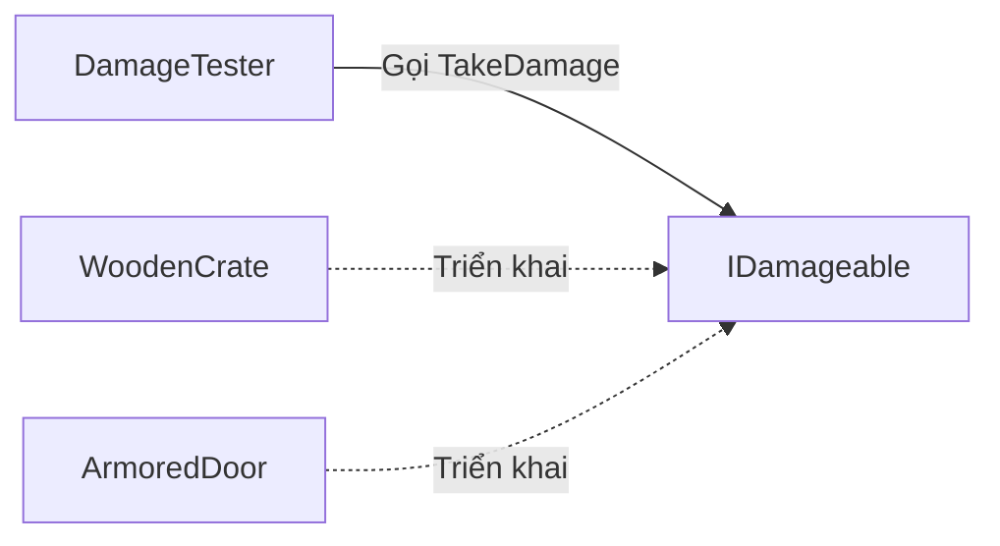

# Bài 01 — Trừu tượng hóa trong lập trình hướng đối tượng (Abstraction)

> **Lộ trình:** Unity Learn — Junior Programmer  
> **Chủ đề:** Apply Object-Oriented Principles  
> **Môi trường tham chiếu:** Unity 6.3 và C#  
> **Hình thức:** Bài học lý thuyết kết hợp thực hành

## 1. Tóm tắt

Trong trò chơi, người chơi có thể tấn công một thùng gỗ, phá một cánh cửa hoặc gây sát thương cho đối thủ. Các đối tượng này khác nhau về dữ liệu, hiệu ứng và cách phản ứng, nhưng đều có thể tiếp nhận lệnh **nhận sát thương**. Nếu mã điều khiển người chơi phải biết mọi chi tiết bên trong từng loại đối tượng, mỗi lần thêm một loại mới sẽ phải sửa mã cũ.

**Trừu tượng hóa (abstraction)** giải quyết vấn đề đó bằng cách mô hình hóa những đặc điểm và hành vi *cần thiết*, đồng thời không buộc bên sử dụng phải phụ thuộc vào những chi tiết triển khai không liên quan. Trong C#, có thể diễn đạt sự trừu tượng qua class, interface và abstract class; tuy nhiên, không phải cứ sử dụng `abstract` mới là trừu tượng hóa.

Sau bài này, bạn sẽ thiết kế giao ước `IDamageable`, triển khai nó trên các `MonoBehaviour` khác nhau và gọi cùng một thao tác mà không cần biết đối tượng cụ thể thuộc loại nào.

## 2. Mục tiêu học tập

Hoàn thành bài học, bạn có thể:

1. Giải thích vì sao trừu tượng hóa giúp giảm sự phụ thuộc giữa các thành phần của trò chơi.
2. Phân biệt **trừu tượng hóa** với **đóng gói**, và phân biệt `interface` với `abstract class`.
3. Xây dựng giao ước `IDamageable` và áp dụng nó cho hai đối tượng trong Unity.
4. Quan sát lời gọi đến các hiện thực khác nhau thông qua một kiểu chung.
5. Chẩn đoán các lỗi thường gặp khi tham chiếu Component và sử dụng interface trong Inspector.

## 3. Vấn đề thiết kế: phụ thuộc vào lớp cụ thể

Giả sử một công cụ tấn công có hai biến kiểu `WoodenCrate` và `LockedDoor`. Nếu mỗi loại đối tượng phải được xử lý bằng một nhánh `if` riêng, mã sẽ phình to khi trò chơi có thêm kẻ địch, công trình hoặc vật thể tương tác.

```csharp
// Minh họa thiết kế phụ thuộc vào từng kiểu cụ thể.
if (crate != null)
{
    crate.ReduceDurability(10);
}
else if (door != null)
{
    door.DamageDoor(10);
}
```

Vấn đề không nằm ở bản thân `if`, mà ở việc **mã tấn công biết quá nhiều chi tiết về từng loại mục tiêu**. Ta muốn tách hai câu hỏi:

- **Mục tiêu có khả năng gì?** — Có thể nhận sát thương.
- **Mục tiêu thực hiện điều đó như thế nào?** — Thùng giảm độ bền; cửa trừ độ bền sau khi tính giáp.



`DamageTester` chỉ phụ thuộc vào giao ước `IDamageable`. Hai đối tượng cụ thể triển khai giao ước và quyết định cách xử lý sát thương. Sơ đồ mô tả **sự phụ thuộc ở cấp thiết kế**, không có nghĩa interface được tạo như một GameObject trong scene.

## 4. Kiến thức cốt lõi

### 4.1. Trừu tượng hóa là gì?

Trừu tượng hóa là quá trình lựa chọn những thuộc tính và hành vi quan trọng của một thực thể để xây dựng mô hình phù hợp với mục tiêu phần mềm. Một đối tượng trong game không cần biểu diễn toàn bộ thế giới thực: `Door` có thể chỉ cần trạng thái khóa, độ bền và hành vi mở hoặc nhận sát thương.

Một **giao diện sử dụng** có thể ổn định ngay cả khi cách triển khai thay đổi. Chẳng hạn, bổ sung hiệu ứng âm thanh khi cửa bị phá không nên đòi hỏi sửa `DamageTester`.

### 4.2. `interface` — giao ước về khả năng

Một interface mô tả các thành viên mà kiểu triển khai phải cung cấp:

```csharp
public interface IDamageable
{
    void TakeDamage(int amount);
}
```

Đây là *giao ước*: bất kỳ lớp nào triển khai `IDamageable` đều phải cung cấp hành vi tương ứng. Interface không nhất thiết mô tả quan hệ phân loại “là một” (*is-a*); nó có thể thể hiện “có khả năng” (*can-do*).

C# hiện đại hỗ trợ một số hiện thực mặc định trong interface. Tuy vậy, đối với bài thực hành cơ bản và mã Unity có khả năng tái sử dụng cao, ta dùng interface chỉ gồm chữ ký phương thức để giữ giao ước rõ ràng.

### 4.3. `abstract class` — khung chung có thể chứa mã dùng lại

Khi nhiều lớp có **cùng bản chất** và cần chia sẻ trạng thái hoặc logic, một lớp trừu tượng có thể phù hợp:

```csharp
public abstract class DamageableEntity
{
    public abstract void TakeDamage(int amount);

    public virtual bool CanTakeDamage() => true;
}
```

`abstract` ngăn việc tạo trực tiếp một đối tượng `DamageableEntity`, đồng thời buộc lớp con cụ thể triển khai `TakeDamage`. `virtual` cho phép lớp con thay đổi hành vi nhưng không bắt buộc.

Đoạn ví dụ này là **C# thuần**, không phải một Component để kéo thả vào GameObject. Trong Unity, một `abstract class` kế thừa `MonoBehaviour` cũng không thể gắn trực tiếp như Component; bạn phải gắn lớp dẫn xuất cụ thể.

| Tiêu chí | `interface` | `abstract class` |
|---|---|---|
| Câu hỏi thiết kế | Đối tượng **làm được gì**? | Các đối tượng **cùng loại và chia sẻ gì**? |
| Chia sẻ trạng thái instance qua field | Không | Có |
| Kế thừa/triển khai | Một class có thể triển khai nhiều interface | Một class C# chỉ có một base class trực tiếp |
| Thích hợp trong Unity | Giao ước giữa Component không cùng họ | Cơ chế chung của một họ Component |

### 4.4. Phân biệt trừu tượng hóa và đóng gói

- **Trừu tượng hóa:** xác định *những gì bên ngoài cần biết và có thể làm*.
- **Đóng gói (encapsulation):** bảo vệ *trạng thái và quy tắc thay đổi trạng thái* bên trong đối tượng.

Ví dụ, `IDamageable` trừu tượng hóa thao tác nhận sát thương. Bên trong `WoodenCrate`, field độ bền là `private` và được thay đổi qua `TakeDamage`; đó là đóng gói. Hai nguyên lý bổ trợ cho nhau nhưng không đồng nghĩa.

## 5. Thực hành: hai mục tiêu, một lời gọi

### 5.1. Chuẩn bị scene

1. Tạo một dự án Unity C# hoặc mở dự án đang học.
2. Tạo scene mới và lưu với tên `AbstractionDemo`.
3. Tạo hai GameObject 3D: `Crate` (Cube) và `Door` (Cube); đổi kích thước để dễ phân biệt.
4. Tạo một Empty GameObject tên `DamageTester`.
5. Trong `Assets/Scripts`, tạo **bốn file C# riêng biệt** theo các ví dụ dưới đây.

### 5.2. File `IDamageable.cs`

```csharp
public interface IDamageable
{
    void TakeDamage(int amount);
}
```

Interface thuần C# không kế thừa `MonoBehaviour` và không thể kéo trực tiếp vào Inspector như một Component.

### 5.3. File `WoodenCrate.cs`

```csharp
using UnityEngine;

public class WoodenCrate : MonoBehaviour, IDamageable
{
    [SerializeField, Min(1)] private int durability = 30;

    public void TakeDamage(int amount)
    {
        if (amount <= 0 || durability <= 0) return;

        durability = Mathf.Max(0, durability - amount);
        Debug.Log($"Crate: độ bền còn {durability}", this);

        if (durability == 0)
        {
            Debug.Log("Crate đã bị phá hủy (minh họa).", this);
        }
    }
}
```

Thùng gỗ giảm độ bền bằng đúng lượng sát thương hợp lệ. Ví dụ chỉ ghi log khi độ bền bằng 0; **không thực sự xóa GameObject** để người học có thể thử nhiều lần và kiểm tra trạng thái.

### 5.4. File `ArmoredDoor.cs`

```csharp
using UnityEngine;

public class ArmoredDoor : MonoBehaviour, IDamageable
{
    [SerializeField, Min(1)] private int durability = 30;
    [SerializeField, Min(0)] private int armor = 4;

    public void TakeDamage(int amount)
    {
        if (amount <= 0 || durability <= 0) return;

        int effectiveDamage = Mathf.Max(0, amount - armor);
        durability = Mathf.Max(0, durability - effectiveDamage);

        Debug.Log(
            $"Door: sát thương thực nhận {effectiveDamage}, còn {durability}",
            this
        );
    }
}
```

Cùng gọi `TakeDamage(10)`, cửa có giáp 4 chỉ mất 6 điểm độ bền. Đây là **quy tắc gameplay minh họa**, không phải công thức sát thương mặc định của Unity.

### 5.5. File `DamageTester.cs`

```csharp
using UnityEngine;

public class DamageTester : MonoBehaviour
{
    [SerializeField] private GameObject target;
    [SerializeField, Min(0)] private int damage = 10;

    [ContextMenu("Test Hit")]
    private void TestHit()
    {
        if (target == null)
        {
            Debug.LogWarning("Chưa gán Target trong Inspector.", this);
            return;
        }

        IDamageable damageable = target.GetComponent<IDamageable>();
        if (damageable == null)
        {
            Debug.LogWarning("Target không có IDamageable.", target);
            return;
        }

        damageable.TakeDamage(damage);
    }
}
```

Ở đây, `target` là `GameObject` để kéo thả dễ dàng trong Inspector. `GetComponent<IDamageable>()` tìm Component trên **chính GameObject được gán** có triển khai giao ước. Nếu logic nằm trên object con, cần chủ động dùng phương pháp tìm thích hợp như `GetComponentInChildren<T>()` và xác định rõ phạm vi tìm kiếm.

### 5.6. Kết nối và kiểm chứng

1. Gắn `WoodenCrate` vào `Crate`; gắn `ArmoredDoor` vào `Door`; gắn `DamageTester` vào object thử nghiệm.
2. Kéo `Crate` vào field **Target** của `DamageTester`.
3. Vào Play mode. Trong menu ngữ cảnh của Component `DamageTester` (dấu ba chấm/biểu tượng menu), chọn **Test Hit**.
4. Mở `Window > General > Console`, kiểm tra thông báo. Nếu chọn giáp/các giá trị mặc định như code, thùng giảm từ 30 còn 20.
5. Đổi Target sang `Door` và thực hiện lại: cửa giảm từ 30 còn 24 (10 − 4 = 6).
6. Gắn Target vào một GameObject không có Component triển khai `IDamageable` để quan sát cảnh báo.

**Lưu ý:** Giá trị đổi trong Play mode thường chỉ mang tính tạm thời; không dựa vào thay đổi đó để lưu cấu hình scene. Muốn khởi động lại kết quả chuẩn, thoát Play mode rồi vào lại.

## 6. Lỗi thường gặp và nguyên nhân

| Hiện tượng | Nguyên nhân có thể | Cách kiểm tra |
|---|---|---|
| `Target` không gán được `IDamageable` | Inspector thường không serialize trực tiếp field interface theo cách thông dụng | Giữ `GameObject` làm tham chiếu và tra cứu Component khi chạy |
| Thông báo `Target không có IDamageable` | Chưa gắn script, gắn nhầm GameObject hoặc script bị lỗi biên dịch | Kiểm tra Hierarchy, Inspector và Console |
| Không thấy thông báo sau `Test Hit` | Component chưa gắn hoặc chưa chạy thao tác | Kiểm tra đúng menu Component và bộ lọc Console |
| Cửa mất lượng máu bằng thùng | Đã thay `armor`, gán nhầm script hoặc nhầm Target | Quan sát field `Armor` và đối tượng được gán |
| Sửa một class làm hỏng nhiều đối tượng | Mã sử dụng còn phụ thuộc kiểu cụ thể | Thay bằng giao ước ổn định ở ranh giới cần thiết |

Không nên tạo interface cho **mọi** class. Hãy dùng khi thực sự có nhiều triển khai, cần giảm phụ thuộc, dễ kiểm thử hoặc cần thay thế triển khai độc lập.

## 7. Bài tập vận dụng

**Cơ bản:** Thêm `StoneWall : MonoBehaviour, IDamageable`, nhận một nửa sát thương (quy tắc do bạn định nghĩa), nhưng **không chỉnh sửa** `DamageTester`.

**Vận dụng:** Mở rộng `IDamageable` thêm thuộc tính chỉ đọc `bool IsDestroyed { get; }`; cập nhật toàn bộ lớp triển khai. Thảo luận vì sao sửa giao ước có thể kéo theo thay đổi ở nhiều lớp.

**Mở rộng:** Tách `damage` thành một thành phần riêng có khả năng truyền dữ liệu sát thương; cân nhắc liệu có thực sự cần thêm lớp này trong trò chơi nhỏ hay không.

**Tiêu chí hoàn thành:** Ba loại mục tiêu có thể nhận sát thương qua cùng giao ước; mã của `DamageTester` không cần nhánh theo `WoodenCrate`/`ArmoredDoor`/`StoneWall`; kết quả được ghi lại qua Console.

## 8. Tổng kết

Trừu tượng hóa giúp thiết kế hệ thống xoay quanh **hợp đồng hành vi** thay vì chi tiết của đối tượng cụ thể. Interface thường phù hợp khi nhiều Component có một khả năng chung; abstract class hữu ích khi một họ đối tượng cần khung logic và trạng thái dùng chung. Tính trừu tượng làm mã dễ mở rộng hơn khi được đặt đúng ranh giới, nhưng không tự động bảo đảm một kiến trúc tốt nếu số lượng lớp và giao ước trở nên không cần thiết.

## 9. Tài liệu tham khảo và đọc thêm

- [Unity Learn — Junior Programmer: Apply object-oriented principles](https://learn.unity.com/mission/source-control-and-optimization): vị trí và mục tiêu của mission trong lộ trình.
- [Microsoft Learn — Object-oriented programming (C#)](https://learn.microsoft.com/en-us/dotnet/csharp/fundamentals/tutorials/oop): bốn nguyên lý OOP.
- [Microsoft Learn — Inheritance](https://learn.microsoft.com/en-us/dotnet/csharp/fundamentals/object-oriented/inheritance): phân biệt abstract class, interface và hành vi kế thừa.
- [Unity 6.3 — Serialization rules](https://docs.unity.com/en-us/engine/6000.3/manual/scripting/compilation-and-code-reload/script-serialization/rules): giới hạn serialize của field/property trong Unity.

> **Phạm vi:** Bài học này là nội dung tự biên soạn để thực hành cùng Unity; ví dụ `Crate`/`Door` không được trình bày như mã mẫu chính thức của Unity Learn.

## 10. Câu hỏi ôn tập trắc nghiệm

### Câu 1

Khi thêm một loại vật thể nhận sát thương mới, cách nào giảm nhu cầu sửa mã tấn công?

A. Tạo thêm `if` theo tên của mọi lớp.  
B. Chuyển toàn bộ field thành `public`.  
C. Cho lớp mới triển khai `IDamageable` và gọi qua giao ước.  
D. Bắt tất cả đối tượng kế thừa trực tiếp cùng một lớp hình học.

**Đáp án: C.** **Giải thích:** Phía tấn công chỉ cần biết `TakeDamage`, không phụ thuộc vào lớp cụ thể.

### Câu 2

Sự khác biệt đúng giữa abstraction và encapsulation là gì?

A. Abstraction chọn giao diện cần bộc lộ; encapsulation kiểm soát trạng thái nội bộ.  
B. Abstraction chỉ dùng với `private`; encapsulation chỉ dùng với interface.  
C. Hai thuật ngữ hoàn toàn đồng nghĩa.  
D. Encapsulation bắt buộc dùng kế thừa nhiều lớp.

**Đáp án: A.** **Giải thích:** Hai nguyên lý hỗ trợ nhau nhưng giải quyết hai mối quan tâm khác nhau.

### Câu 3

Một lớp C# cần triển khai `IDamageable` và `IInteractable`. Phát biểu nào đúng?

A. Không thể triển khai hai interface.  
B. Chỉ được triển khai interface nếu class là `abstract`.  
C. Phải tạo hai GameObject khác nhau.  
D. Một class có thể triển khai cả hai interface.

**Đáp án: D.** **Giải thích:** C# cho phép một class triển khai nhiều interface, dù chỉ có một base class trực tiếp.

### Câu 4

Vì sao bài thực hành sử dụng field `GameObject target` trong Inspector?

A. Vì interface luôn là `GameObject`.  
B. Vì có thể kéo thả GameObject rồi tra Component triển khai giao ước khi chạy.  
C. Vì `GetComponent` chỉ nhận GameObject.  
D. Vì cách này khiến Unity tự thêm `IDamageable`.

**Đáp án: B.** **Giải thích:** GameObject là tham chiếu serialize được; phương thức kiểm tra Component thực sự hỗ trợ giao ước hay không.

### Câu 5

Lời gọi `target.GetComponent<IDamageable>()` trả về `null`. Nhận định hợp lý nhất là gì?

A. Không có Component phù hợp trên chính GameObject được truy vấn.  
B. Interface không được phép có phương thức.  
C. GameObject chắc chắn đã bị xóa khỏi project.  
D. Mọi lớp triển khai interface đều phải có `Update()`.

**Đáp án: A.** **Giải thích:** Cần kiểm tra việc gắn Component và phạm vi tìm; Component trên object con không tự được tìm bằng cách này.
