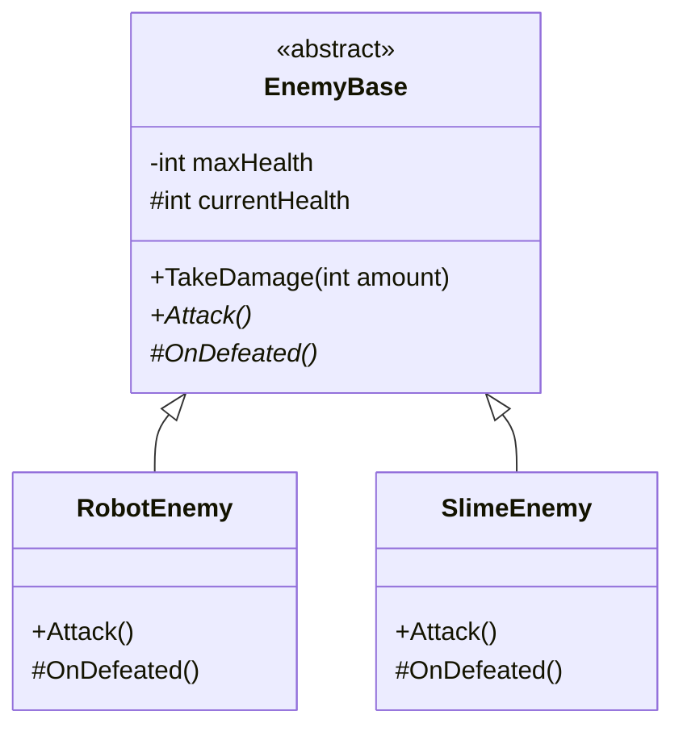
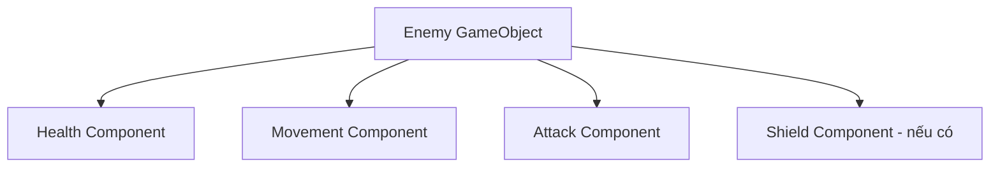

# Bài 02 — Kế thừa và đa hình trong lập trình hướng đối tượng

> **Lộ trình:** Unity Learn — Junior Programmer  
> **Chủ đề:** Apply Object-Oriented Principles  
> **Môi trường tham chiếu:** Unity 6.3, C#  
> **Hình thức:** Bài học lý thuyết và thực hành

## 1. Tóm tắt

Một trò chơi có thể có nhiều loại kẻ địch: robot bắn xa, quái vật đánh gần hoặc sinh vật có hành vi đặc biệt. Chúng đều có những quy tắc chung như nhận sát thương, kiểm tra đã bị hạ hay chưa; đồng thời, mỗi loại có cách tấn công khác nhau.

**Kế thừa (inheritance)** cho phép một lớp chuyên biệt tái sử dụng và mở rộng hành vi từ lớp cơ sở. **Đa hình (polymorphism)** cho phép gọi cùng một thao tác thông qua kiểu chung nhưng thực thi đúng hành vi của đối tượng thực tế. Hai nguyên lý thường được sử dụng cùng nhau, nhưng không đồng nghĩa.

Bài học hướng đến việc tạo một họ `EnemyBase` trong Unity, kiểm chứng cơ chế `abstract`/`override` và đánh giá khi nào nên dùng kế thừa thay vì cấu thành đối tượng (*composition*).

## 2. Mục tiêu học tập

1. Xác định được quan hệ **is-a** hợp lệ giữa lớp cơ sở và lớp dẫn xuất.
2. Phân biệt `virtual`, `abstract`, `override`, `new`, `base` và `sealed` ở mức sử dụng thiết thực.
3. Triển khai hai lớp `MonoBehaviour` kế thừa từ một lớp cơ sở trừu tượng.
4. Dùng mảng kiểu `EnemyBase[]` để kích hoạt hành vi đa hình.
5. Phát hiện sai sót do che khuất phương thức và cây kế thừa không phù hợp.

## 3. Hai nguyên lý và mối quan hệ

### 3.1. Kế thừa — chia sẻ một mô hình cơ sở

Khi khai báo `class RobotEnemy : EnemyBase`, `RobotEnemy` là lớp dẫn xuất (*derived class*) của `EnemyBase`. Lớp con kế thừa các thành viên của lớp cha theo quy tắc truy cập của C#. Hàm khởi tạo không được kế thừa theo cùng cách với phương thức; một lớp chỉ có **một base class trực tiếp** nhưng có thể triển khai nhiều interface.

Quan hệ hợp lý: `RobotEnemy` **là một** `EnemyBase`. Quan hệ không hợp lý: `Player` kế thừa `Weapon` chỉ vì người chơi **có một** vũ khí. Trường hợp thứ hai phù hợp hơn với composition.

### 3.2. Đa hình — một kiểu chung, nhiều hiện thực

Giả sử có hai đối tượng `RobotEnemy` và `SlimeEnemy`, đều được giữ dưới dạng tham chiếu `EnemyBase`. Lời gọi `enemy.Attack()` sẽ chạy phiên bản phương thức được `override` tương ứng với **kiểu thực tế lúc chạy**, không chỉ dựa vào kiểu khai báo của biến.



Dấu `*` chỉ các phương thức trừu tượng trong sơ đồ. `EnemyBase` kiểm soát vòng đời cơ bản; hai lớp con bổ sung hành vi phù hợp với loại kẻ địch.

### 3.3. Các từ khóa quan trọng

| Từ khóa | Ý nghĩa | Điểm cần nhớ |
|---|---|---|
| `abstract class` | Lớp không thể khởi tạo trực tiếp | Có thể chứa field và phương thức đã triển khai |
| `abstract` (method) | Phương thức chưa có thân hàm | Lớp con cụ thể phải triển khai |
| `virtual` | Cho phép lớp con ghi đè | Lớp con không bắt buộc phải ghi đè |
| `override` | Ghi đè phương thức ảo/trừu tượng | Tham gia cơ chế dispatch đa hình |
| `base` | Truy cập thành viên của lớp cơ sở | Hữu ích khi cần giữ lại logic cha |
| `new` (member) | Che khuất thành viên cùng tên của lớp cơ sở | **Không** tương đương `override` |
| `sealed` | Chặn lớp con kế thừa lớp hoặc ghi đè thêm | Dùng khi muốn giữ bất biến thiết kế |

`private` giới hạn truy cập bên trong lớp; `protected` cho lớp đó và lớp dẫn xuất quyền truy cập. Không nên biến mọi field thành `protected`: bảo vệ invariant bằng phương thức thường tốt hơn việc cho nhiều lớp con chỉnh sửa trực tiếp trạng thái.

## 4. Thực hành: hệ thống kẻ địch có hành vi chung

### 4.1. Chuẩn bị

Tạo một scene tên `InheritanceDemo`, hai GameObject `Robot` và `Slime`, một Empty GameObject `EnemyArena`. Tạo **bốn script riêng** trong `Assets/Scripts`. Các script sử dụng `Debug.Log` để quan sát đa hình mà không cần animator, vật lý hay bộ điều khiển input.

### 4.2. File `EnemyBase.cs`

```csharp
using UnityEngine;

public abstract class EnemyBase : MonoBehaviour
{
    [SerializeField, Min(1)] private int maxHealth = 100;
    private int currentHealth;

    public int CurrentHealth => currentHealth;

    protected virtual void Awake()
    {
        currentHealth = Mathf.Max(1, maxHealth);
    }

    public void TakeDamage(int amount)
    {
        if (amount <= 0 || currentHealth == 0) return;

        currentHealth = Mathf.Max(0, currentHealth - amount);
        Debug.Log($"{name}: còn {currentHealth} HP", this);

        if (currentHealth == 0)
        {
            OnDefeated();
        }
    }

    public abstract void Attack();
    protected abstract void OnDefeated();
}
```

`EnemyBase` giữ logic giảm HP ở một nơi duy nhất. `Attack()` và `OnDefeated()` là điểm mở rộng do lớp con hiện thực. `Awake()` được gọi bởi vòng đời Unity khi Component được khởi tạo thích hợp; không tự gọi `new EnemyBase()` để tạo một Component.

### 4.3. File `RobotEnemy.cs`

```csharp
using UnityEngine;

public class RobotEnemy : EnemyBase
{
    public override void Attack()
    {
        Debug.Log($"{name}: bắn tia năng lượng!", this);
    }

    protected override void OnDefeated()
    {
        Debug.Log($"{name}: robot ngừng hoạt động.", this);
    }
}
```

### 4.4. File `SlimeEnemy.cs`

```csharp
using UnityEngine;

public class SlimeEnemy : EnemyBase
{
    public override void Attack()
    {
        Debug.Log($"{name}: tấn công bằng cách nhảy!", this);
    }

    protected override void OnDefeated()
    {
        Debug.Log($"{name}: slime tan biến (minh họa).", this);
    }
}
```

Hai lớp con không viết lại logic giảm máu. Trong ví dụ, bị hạ chỉ được thể hiện bằng thông báo; khi tạo trò chơi thật, có thể kích hoạt animation, phần thưởng hoặc quy trình despawn phù hợp.

### 4.5. File `EnemyArenaDemo.cs`

```csharp
using UnityEngine;

public class EnemyArenaDemo : MonoBehaviour
{
    [SerializeField] private EnemyBase[] enemies;

    [ContextMenu("Run Polymorphism Test")]
    private void RunTest()
    {
        if (enemies == null || enemies.Length == 0)
        {
            Debug.LogWarning("Chưa gán danh sách Enemies.", this);
            return;
        }

        foreach (EnemyBase enemy in enemies)
        {
            if (enemy == null) continue;

            enemy.Attack();
            enemy.TakeDamage(30);
        }
    }
}
```

Từng phần tử trong mảng có kiểu khai báo `EnemyBase`, nhưng `Attack()` được chuyển đến `RobotEnemy` hoặc `SlimeEnemy` tùy đối tượng thực tế.

### 4.6. Kiểm tra trong Unity Editor

1. Gắn `RobotEnemy` lên `Robot` và `SlimeEnemy` lên `Slime`. Không thử gắn `EnemyBase` trực tiếp vì đó là lớp trừu tượng.
2. Gắn `EnemyArenaDemo` lên `EnemyArena`.
3. Ở Inspector, đặt kích thước mảng `Enemies` là `2`, kéo hai GameObject có Component tương ứng vào hai phần tử.
4. Vào Play mode và chạy **Run Polymorphism Test** qua menu ngữ cảnh của Component.
5. Quan sát Console: Robot báo tấn công bằng tia năng lượng; Slime báo tấn công bằng cách nhảy; cả hai đều giảm HP theo quy tắc chung.
6. Thực hiện thêm vài lần để quan sát thông báo `OnDefeated()` khi HP về 0.

**Kết quả mong đợi:** Logic chung (`TakeDamage`) được dùng lại, trong khi lời gọi `Attack()` và `OnDefeated()` thực thi riêng theo mỗi lớp con.

## 5. `override` khác `new` như thế nào?

Xem ví dụ C# thuần dưới đây:

```csharp
public class BaseSpeaker
{
    public virtual string Speak() => "Base";
    public string Label() => "Base label";
}

public class ChildSpeaker : BaseSpeaker
{
    public override string Speak() => "Child";
    public new string Label() => "Child label";
}

BaseSpeaker speaker = new ChildSpeaker();
// speaker.Speak() -> "Child" (override, chọn theo kiểu thực tế)
// speaker.Label() -> "Base label" (new, chọn theo kiểu tham chiếu)
```

`new` không phải công cụ mặc định để tùy biến hành vi theo lớp con. Trong cơ chế đa hình cần có ý định rõ ràng, ưu tiên `abstract`/`virtual` ở lớp cơ sở và `override` ở lớp dẫn xuất. Đoạn trên dùng để phân tích C#; nó không phải script hoàn chỉnh để gắn trực tiếp lên GameObject.

## 6. Kế thừa hay composition?

Kế thừa hợp lý khi mọi lớp con thực sự thỏa **hợp đồng hành vi** của lớp cha. Không nên tạo cây kế thừa sâu chỉ để chia sẻ vài dòng code.

Ví dụ thiết kế khó mở rộng:

```text
Enemy
  -> FlyingEnemy
      -> FlyingFireEnemy
          -> FlyingFireBossEnemy
```

Nếu một enemy vừa bay, vừa dùng phép, vừa có khiên, số lớp kết hợp dễ tăng lên. Một thiết kế Component có thể hợp lý hơn:



Trong Unity, **composition** thường tương ứng với việc gắn nhiều Component có trách nhiệm rõ ràng lên GameObject. Cần chọn cách thiết kế theo dữ liệu và quy mô dự án; không có quy tắc rằng composition luôn tốt hơn kế thừa trong mọi tình huống.

## 7. Lỗi thường gặp và phương pháp sửa

| Lỗi | Giải thích | Cách sửa |
|---|---|---|
| `does not implement inherited abstract member` | Lớp con không triển khai đủ thành viên trừu tượng | Thêm đúng chữ ký phương thức với `override` |
| `cannot override ... because it is not marked virtual, abstract, or override` | Đang ghi đè thành viên không hỗ trợ override | Kiểm tra thiết kế lớp cha; thêm `virtual` nếu phù hợp |
| Hành vi lớp cha chạy thay vì lớp con | Dùng `new` thay cho `override`, hoặc phương thức không ảo | Kiểm tra kiểu biến và từ khóa |
| Không thêm được `EnemyBase` vào GameObject | Lớp trừu tượng không phải Component cụ thể | Gắn `RobotEnemy` hoặc `SlimeEnemy` |
| Lỗi `NullReferenceException` khi kiểm tra | Mảng chứa phần tử chưa gán | Gán đủ tham chiếu hoặc kiểm tra `null` |
| `Awake()` ở lớp con phá khởi tạo HP | Lớp con ghi đè mà không gọi `base.Awake()` | Gọi `base.Awake()` khi cần giữ logic của cha |

Nếu lớp con được tạo chỉ để sửa một thuộc tính cấu hình, hãy cân nhắc `SerializeField`, dữ liệu cấu hình hoặc Component khác thay vì lập thêm class.

## 8. Bài tập vận dụng

**Cơ bản:** Viết `TurretEnemy : EnemyBase` với thông báo tấn công riêng; đưa vào mảng `enemies` mà không sửa `EnemyArenaDemo`.

**Vận dụng:** Thêm phương thức `public virtual void Celebrate()` vào `EnemyBase`, sau đó chỉ ghi đè trong `RobotEnemy`. Dự đoán và kiểm chứng hành vi khi gọi bằng biến kiểu `EnemyBase`.

**Mở rộng:** Refactor `EnemyBase` để logic tấn công không bắt buộc nằm trong cây kế thừa, mà được ủy quyền sang một Component phụ trách khả năng tấn công. Mô tả lợi ích và chi phí tăng thêm của phương án mới.

**Tiêu chí hoàn thành:** Có tối thiểu ba loại enemy được xử lý trong cùng mảng, không cần `if` theo từng kiểu enemy, và ghi lại ít nhất một lỗi `override` có thể tái hiện rồi sửa.

## 9. Tổng kết

- **Inheritance** tổ chức các lớp theo quan hệ kế thừa, tái sử dụng và chuyên biệt hóa hành vi.
- **Polymorphism** cho phép sử dụng một kiểu chung để kích hoạt nhiều cách thực thi, thường thông qua `virtual`/`override`, `abstract`/`override` hoặc interface.
- **Composition** là lựa chọn quan trọng trong kiến trúc Component của Unity, đặc biệt khi các khả năng có thể kết hợp độc lập.

Không đánh giá thiết kế chỉ bằng số dòng code được tái sử dụng. Cần quan tâm cả **tính đúng đắn của quan hệ lớp**, khả năng mở rộng, kiểm thử và độ phức tạp của hệ thống.

## 10. Tài liệu tham khảo và đọc thêm

- [Unity Learn — Apply object-oriented principles](https://learn.unity.com/mission/source-control-and-optimization).
- [Microsoft Learn — Inheritance](https://learn.microsoft.com/en-us/dotnet/csharp/fundamentals/object-oriented/inheritance).
- [Microsoft Learn — Polymorphism](https://learn.microsoft.com/en-us/dotnet/csharp/fundamentals/object-oriented/polymorphism).
- [Microsoft Learn — Access modifiers](https://learn.microsoft.com/en-us/dotnet/csharp/programming-guide/classes-and-structs/access-modifiers).

> **Phạm vi:** Hệ thống `EnemyBase` là bài tập tự biên soạn để giải thích nguyên lý; không phải mã chính thức trong project mẫu của Unity Learn.

## 11. Câu hỏi ôn tập trắc nghiệm

### Câu 1

Khi biến `EnemyBase enemy` tham chiếu tới một Component `RobotEnemy`, lời gọi `enemy.Attack()` chạy bản `override` nào?

A. Luôn chạy bản lớp cha.  
B. Chạy bản phù hợp với kiểu thực tế của đối tượng.  
C. Chạy ngẫu nhiên một bản.  
D. Không thể gọi phương thức qua kiểu cơ sở.

**Đáp án: B.** **Giải thích:** Dispatch đa hình của phương thức ảo/trừu tượng dựa vào kiểu thực tế tại runtime.

### Câu 2

Điều gì phân biệt một `abstract` method và `virtual` method thông thường?

A. `abstract` phải có thân hàm.  
B. `virtual` không thể bị ghi đè.  
C. `abstract` chỉ dành cho struct.  
D. `abstract` không có triển khai trong lớp khai báo và yêu cầu lớp con cụ thể triển khai.

**Đáp án: D.** **Giải thích:** Phương thức trừu tượng biểu diễn một hành vi bắt buộc được lớp con định nghĩa.

### Câu 3

Một nhân vật **có** vũ khí có thể thay đổi giữa kiếm và cung. Thiết kế khởi đầu hợp lý hơn là gì?

A. Nhân vật chứa hoặc tham chiếu thành phần vũ khí (composition).  
B. `Player` kế thừa `Sword`, rồi `Bow`.  
C. Ghi đè mọi phương thức bằng từ khóa `new`.  
D. Đưa tất cả logic vũ khí vào `Awake()`.

**Đáp án: A.** **Giải thích:** “Có vũ khí” là quan hệ has-a, không phải is-a.

### Câu 4

Khi viết `public new void Attack()` để che một method không ảo, điều gì cần lưu ý?

A. Đây chính là `override`.  
B. Mọi lời gọi luôn đi tới lớp con.  
C. Thành viên được chọn có thể phụ thuộc kiểu tham chiếu lúc biên dịch.  
D. Nó tự biến lớp cha thành interface.

**Đáp án: C.** **Giải thích:** `new` che thành viên, không tham gia cùng cơ chế dispatch như `override`.

### Câu 5

Vì sao `EnemyBase` trong bài thực hành không được gắn trực tiếp vào GameObject?

A. Vì Unity không hỗ trợ `MonoBehaviour`.  
B. Vì lớp được khai báo `abstract`.  
C. Vì mọi Component phải có `Update()`.  
D. Vì chỉ những class có interface mới được gắn.

**Đáp án: B.** **Giải thích:** Unity cần một Component thuộc lớp cụ thể có thể khởi tạo, như `RobotEnemy`.
