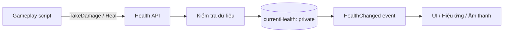

# Bài 03 — Đóng gói trong lập trình hướng đối tượng (Encapsulation)

> **Lộ trình:** Unity Learn — Junior Programmer  
> **Chủ đề:** Apply Object-Oriented Principles  
> **Môi trường tham chiếu:** Unity 6.3, C#  
> **Hình thức:** Bài học lý thuyết và thực hành

## 1. Tóm tắt

Một nhân vật có 100 HP không nên đột nhiên có −50 HP chỉ vì một script khác gán `health = -50`. Nếu hàng chục Component đều có quyền sửa trực tiếp HP, việc xác định lỗi trở nên khó khăn; mỗi nơi có thể áp dụng một quy tắc khác nhau.

**Đóng gói (encapsulation)** kết hợp trạng thái và hành vi thành một đơn vị, đồng thời kiểm soát việc truy cập và thay đổi trạng thái. Nguyên tắc quan trọng không chỉ là “đặt field thành `private`”, mà còn là **bảo vệ các điều kiện phải luôn đúng** (*invariants*) thông qua một API công khai có chủ đích.

Bài này xây dựng Component `Health` với trạng thái nội bộ, property chỉ đọc, phương thức `TakeDamage`/`Heal` và sự kiện thông báo thay đổi HP; đồng thời chỉ ra những đặc điểm riêng của Inspector và hệ thống serialization trong Unity.

## 2. Mục tiêu học tập

1. Phát hiện rủi ro của việc công khai trạng thái bằng field `public` có thể ghi tùy ý.
2. Sử dụng `private`, property chỉ đọc và phương thức kiểm soát thay đổi dữ liệu.
3. Phân biệt **quyền truy cập của C#** với **khả năng serialize/hiển thị trong Unity Inspector**.
4. Thiết kế quy tắc HP luôn nằm trong khoảng hợp lệ.
5. Kiểm tra sự kiện thay đổi trạng thái và các trường hợp biên.

## 3. Vì sao cần đóng gói?

### 3.1. Thiết kế dễ gây lỗi

```csharp
// Ví dụ minh họa cách thiết kế không kiểm soát trạng thái.
public class UnsafeHealth
{
    public int health = 100;
}
```

Mã khác có thể gọi `target.health = -999;` hoặc `target.health = 1000000;` mà không đi qua cơ chế kiểm tra, hiệu ứng hoặc thông báo. Mỗi thay đổi dữ liệu có nguy cơ phá vỡ quy tắc gameplay.

### 3.2. Thiết kế có hợp đồng rõ ràng

Một Component sức khỏe tốt cần xác định trước điều kiện:

- `maxHealth` luôn lớn hơn hoặc bằng 1.
- `currentHealth` luôn nằm trong khoảng từ 0 đến `maxHealth` trong quá trình chơi, với giả thiết `maxHealth` không bị sửa trực tiếp giữa lượt chạy.
- Sát thương âm/0 không làm thay đổi sức khỏe.
- Hồi máu không đưa HP vượt quá giới hạn.
- Đối tượng khác **đọc** HP qua property, nhưng **chỉnh** qua phương thức có quy tắc.



Mũi tên thể hiện đường đi thiết kế: code bên ngoài yêu cầu thay đổi trạng thái qua API; Component xác nhận điều kiện rồi phát thông báo. Sự kiện chỉ phát khi HP thực sự thay đổi.

## 4. Cơ chế trong C# và Unity

### 4.1. Access modifier

| Từ khóa | Quyền truy cập thường gặp | Tình huống phù hợp |
|---|---|---|
| `private` | Nội bộ lớp | Trạng thái không được sửa tùy tiện |
| `public` | Mã sử dụng có thể truy cập, trong giới hạn của kiểu bao | Phương thức và property thuộc API công khai |
| `protected` | Lớp hiện tại và lớp dẫn xuất | Điểm mở rộng có chủ đích cho kế thừa |
| `internal` | Cùng assembly | Thành phần chỉ dùng trong một module |

Không có quy tắc mọi field phải `private` trong tất cả hoàn cảnh. Mục tiêu là **cấp quyền tối thiểu đủ dùng**, dễ duy trì invariant và tránh rò rỉ chi tiết triển khai.

### 4.2. Property không giống field

```csharp
private int currentHealth;
public int CurrentHealth => currentHealth;
```

`CurrentHealth` chỉ có getter công khai; code khác không thể `CurrentHealth = 999`. Trong C#, property cũng có thể có setter riêng (`private set`) hoặc setter có kiểm tra. Việc chọn cách nào tùy vào API muốn công bố.

### 4.3. `[SerializeField] private` trong Unity

Unity thường serialize các field thuộc kiểu được hỗ trợ nếu chúng là `public` hoặc được đánh dấu `[SerializeField]`. Ví dụ:

```csharp
[SerializeField, Min(1)] private int maxHealth = 100;
```

`maxHealth` vẫn `private` đối với mã C# bên ngoài, nhưng có thể xuất hiện và được chỉnh trong Inspector. Đây là **hai cơ chế khác nhau**:

- **C# access control** xác định code nào được đọc/ghi trực tiếp.
- **Unity serialization/Inspector** quyết định dữ liệu nào được lưu và chỉnh trong Editor.

Cần đặc biệt lưu ý: **Inspector không phải lời gọi vào setter của C# property thông thường**. Việc thay đổi field trong Inspector có thể không đi qua logic setter; các attribute như `[Min]` hỗ trợ thao tác Inspector nhưng không thay thế hoàn toàn kiểm tra giá trị trong code khi chạy.

## 5. Thực hành: Component `Health` an toàn

### 5.1. Chuẩn bị

Tạo một GameObject `Player` và một Empty GameObject `HealthTester` trong scene `EncapsulationDemo`. Tạo ba file C# độc lập trong `Assets/Scripts`.

### 5.2. File `Health.cs`

```csharp
using System;
using UnityEngine;

public class Health : MonoBehaviour
{
    [SerializeField, Min(1)] private int maxHealth = 100;
    private int currentHealth;

    public int MaxHealth => maxHealth;
    public int CurrentHealth => currentHealth;
    public bool IsDead => currentHealth == 0;

    public event Action<int> HealthChanged;

    private void Awake()
    {
        maxHealth = Mathf.Max(1, maxHealth);
        currentHealth = maxHealth;
    }

    public void TakeDamage(int amount)
    {
        if (amount <= 0 || IsDead) return;

        int nextHealth = Mathf.Max(0, currentHealth - amount);
        SetCurrentHealth(nextHealth);
    }

    public void Heal(int amount)
    {
        if (amount <= 0 || IsDead) return;

        int nextHealth = (int)Math.Min(
            (long)maxHealth,
            (long)currentHealth + amount
        );
        SetCurrentHealth(nextHealth);
    }

    private void SetCurrentHealth(int value)
    {
        int clamped = Mathf.Clamp(value, 0, maxHealth);
        if (clamped == currentHealth) return;

        currentHealth = clamped;
        HealthChanged?.Invoke(currentHealth);
    }

    private void OnValidate()
    {
        maxHealth = Mathf.Max(1, maxHealth);
    }
}
```

**Giải thích các quyết định:**

- `maxHealth` là cấu hình được expose trong Inspector nhưng không public về mặt C#.
- `currentHealth` là trạng thái runtime và không serialize; được khởi tạo trong `Awake()`.
- `SetCurrentHealth()` là điểm duy nhất ghi HP sau khi khởi tạo; giúp thống nhất clamp và sự kiện.
- `HealthChanged` chỉ được phát khi HP thực sự đổi. Dùng `event` để bên ngoài đăng ký/hủy đăng ký handler nhưng không tự ý phát sự kiện.
- `OnValidate()` chỉ phục vụ kiểm tra khi chạy trong Editor; logic runtime vẫn tự kiểm tra ở `Awake()` và khi cập nhật HP.
- Bài thực hành quy định **đã chết thì không hồi máu**. Game thật có thể dùng `Revive()` riêng nếu cần hệ thống hồi sinh.

**Lưu ý tính an toàn số học:** Ví dụ sử dụng phép cộng kiểu `long` trước khi giới hạn để tránh tràn số khi `amount` rất lớn. Kiểu chuyển về `int` chỉ diễn ra sau khi kết quả đã bị giới hạn bởi `maxHealth`.

### 5.3. File `HealthLogger.cs`

```csharp
using UnityEngine;

public class HealthLogger : MonoBehaviour
{
    [SerializeField] private Health observedHealth;

    private void OnEnable()
    {
        if (observedHealth != null)
        {
            observedHealth.HealthChanged += OnHealthChanged;
        }
    }

    private void OnDisable()
    {
        if (observedHealth != null)
        {
            observedHealth.HealthChanged -= OnHealthChanged;
        }
    }

    private void OnHealthChanged(int newHealth)
    {
        Debug.Log($"UI nhận thông báo HP = {newHealth}", this);
    }
}
```

Việc hủy đăng ký trong `OnDisable()` giúp tránh duy trì listener ngoài ý muốn. Khi đổi `observedHealth` trong lúc Component đang hoạt động, phải hủy đăng ký từ đối tượng cũ và đăng ký lại với đối tượng mới; ví dụ giả định tham chiếu được cấu hình trước Play mode và không đổi ở runtime.

### 5.4. File `HealthTester.cs`

```csharp
using UnityEngine;

public class HealthTester : MonoBehaviour
{
    [SerializeField] private Health target;

    [ContextMenu("Apply 35 Damage")]
    private void ApplyDamage()
    {
        if (target != null) target.TakeDamage(35);
    }

    [ContextMenu("Heal 20")]
    private void ApplyHeal()
    {
        if (target != null) target.Heal(20);
    }
}
```

### 5.5. Quy trình kiểm chứng

1. Gắn `Health` và `HealthLogger` vào `Player`.
2. Kéo Component `Health` của `Player` vào `Observed Health` của `HealthLogger`.
3. Gắn `HealthTester` vào `HealthTester`, kéo `Health` của Player vào `Target`.
4. Vào Play mode, chọn **Apply 35 Damage** trong menu Component thử nghiệm. `CurrentHealth` chuyển từ 100 về 65; Console có log của listener.
5. Chọn **Heal 20**: HP tăng lên 85.
6. Thử gây sát thương đến khi HP bằng 0; sau đó gọi `Heal` để kiểm chứng quy tắc không hồi sinh.
7. Thay `maxHealth` trong Inspector khi **không** Play để kiểm tra ảnh hưởng đến trạng thái khởi tạo ở lượt chạy sau.

**Điểm cần ghi nhớ:** `currentHealth` không hiển thị như một field serialize thông thường. Hãy xem log hoặc dùng debugger để theo dõi giá trị runtime; property không tự xuất hiện như field chỉnh sửa trong Inspector mặc định.

## 6. Các bẫy thiết kế phổ biến

### 6.1. Dùng `[SerializeField]` không đồng nghĩa public API

`[SerializeField] private` thường là giải pháp tốt cho cấu hình nội bộ có thể điều chỉnh trong Editor. Nhưng field có thể được sửa qua Inspector mà không đi qua logic setter; vì vậy không coi giá trị cấu hình là đầu vào đã được kiểm tra tuyệt đối.

### 6.2. Tạo property `public set` cho mọi trạng thái

```csharp
public int CurrentHealth { get; set; }
```

Nếu không kiểm tra, đoạn code này chỉ thay đổi **cú pháp truy cập**, chưa bảo vệ invariant. Khi logic trạng thái có ý nghĩa, dùng phương thức như `TakeDamage()` và `Heal()` diễn đạt mục đích rõ hơn.

### 6.3. Sự kiện được phát sai thời điểm

Một UI cần biết **HP đã thay đổi**, không nhất thiết cần biết mỗi lần có ai đó gọi `TakeDamage()`. Bởi vậy `HealthChanged` được gọi khi `nextHealth` thực sự khác `currentHealth`, không phát khi nhận sát thương 0 hoặc đã hết HP.

### 6.4. Thay đổi `maxHealth` lúc đang chạy

Trong ví dụ, `maxHealth` được thiết kế là cấu hình tĩnh trong mỗi lượt chơi. Nếu muốn nâng cấp HP tối đa ở runtime, hãy tạo phương thức riêng xác định rõ quy tắc cập nhật `currentHealth`, tránh tự sửa field bằng nhiều mã ở nhiều nơi.

## 7. Bài tập vận dụng

**Cơ bản:** Thêm property `HealthRatio` trả về tỷ lệ HP trong khoảng 0–1. Giải thích tại sao không nên cho phép gán trực tiếp tỷ lệ này.

**Vận dụng:** Viết phương thức `RestoreFullHealth()` có quy tắc rõ ràng về đối tượng đã chết. Kiểm tra sự kiện chỉ được phát khi giá trị thay đổi.

**Mở rộng:** Tạo một UI hiển thị thanh máu dựa trên `HealthChanged`. Chỉ UI biết cách vẽ; `Health` không tham chiếu trực tiếp đến đối tượng hiển thị.

**Tiêu chí hoàn thành:** Không thể gán trực tiếp `CurrentHealth` từ mã khác; giá trị luôn trong phạm vi hợp lệ; UI hoặc logger chỉ nhận thông báo thay đổi thực tế.

## 8. Tổng kết

Đóng gói nhằm **giữ quyền kiểm soát dữ liệu và hành vi**, không chỉ che các field bằng `private`. API công khai nên biểu diễn hành động có nghĩa trong nghiệp vụ; các điều kiện hợp lệ phải được duy trì bất kể đối tượng được gọi từ Component nào. Trong Unity, phải phân biệt quyền truy cập C# với serialization và quy trình thay đổi giá trị trong Inspector.

## 9. Tài liệu tham khảo và đọc thêm

- [Unity Learn — Apply object-oriented principles](https://learn.unity.com/mission/source-control-and-optimization).
- [Microsoft Learn — Object-oriented programming](https://learn.microsoft.com/en-us/dotnet/csharp/fundamentals/tutorials/oop).
- [Microsoft Learn — Access modifiers](https://learn.microsoft.com/en-us/dotnet/csharp/programming-guide/classes-and-structs/access-modifiers).
- [Unity 6.3 — How Unity uses serialization](https://docs.unity.com/en-us/engine/6000.3/manual/programming-environment/code-reload-serialization/script-serialization/how-unity-uses).
- [Unity 6.3 — Serialization rules](https://docs.unity.com/en-us/engine/6000.3/manual/scripting/compilation-and-code-reload/script-serialization/rules).

> **Phạm vi:** `Health` là ví dụ giáo trình tự biên soạn; không phải API hoặc Component tích hợp sẵn trong Unity.

## 10. Câu hỏi ôn tập trắc nghiệm

### Câu 1

Vì sao chỉ đổi một field `public int health` thành property `public int Health { get; set; }` chưa chắc thực hiện tốt đóng gói?

A. Property không thể giữ số nguyên.  
B. Unity không có C#.  
C. Property luôn bị xóa khi chạy.  
D. Setter công khai vẫn có thể nhận mọi giá trị nếu không kiểm tra.

**Đáp án: D.** **Giải thích:** Đóng gói cần bảo vệ quy tắc trạng thái, không chỉ thay đổi cú pháp.

### Câu 2

`[SerializeField] private int maxHealth` mang ý nghĩa nào đúng nhất?

A. Field có thể được Unity serialize và hiển thị trong Inspector, nhưng vẫn `private` với code C#.  
B. Field tự động có setter `public`.  
C. Field không được lưu trong scene.  
D. Field trở thành `static`.

**Đáp án: A.** **Giải thích:** Serialization của Unity và access control của C# là hai cơ chế độc lập.

### Câu 3

Khi gọi `Heal(20)` cho đối tượng đã đạt `maxHealth`, sự kiện `HealthChanged` trong bài sẽ thế nào?

A. Phát hai lần.  
B. Không phát vì HP không đổi.  
C. Phát và cho HP vượt `maxHealth`.  
D. Phát với giá trị `-1`.

**Đáp án: B.** **Giải thích:** Setter nội bộ kiểm tra giá trị cũ và mới trước khi phát sự kiện.

### Câu 4

Điều gì đúng về property setter thông thường và Inspector?

A. Mọi thao tác Inspector đều gọi `set` của property tương ứng.  
B. Inspector chỉ hiển thị các phương thức public.  
C. Unity cập nhật dữ liệu serialize của field; không thể giả định setter C# thông thường được gọi.  
D. Inspector chỉ hoạt động với class `abstract`.

**Đáp án: C.** **Giải thích:** Serialization xử lý field, cần validation độc lập với giả định setter được gọi.

### Câu 5

Thiết kế nào thể hiện API rõ nghĩa hơn để nhận sát thương?

A. Cho mọi script tự gán `currentHealth` tùy ý.  
B. Dùng `TakeDamage(amount)` để thống nhất kiểm tra và cập nhật HP.  
C. Đặt mọi biến thành `static`.  
D. Bắt buộc mỗi đối tượng tự có một `Update()` riêng.

**Đáp án: B.** **Giải thích:** Một phương thức diễn đạt mục đích giúp giữ invariant và gom logic ở một nơi.
