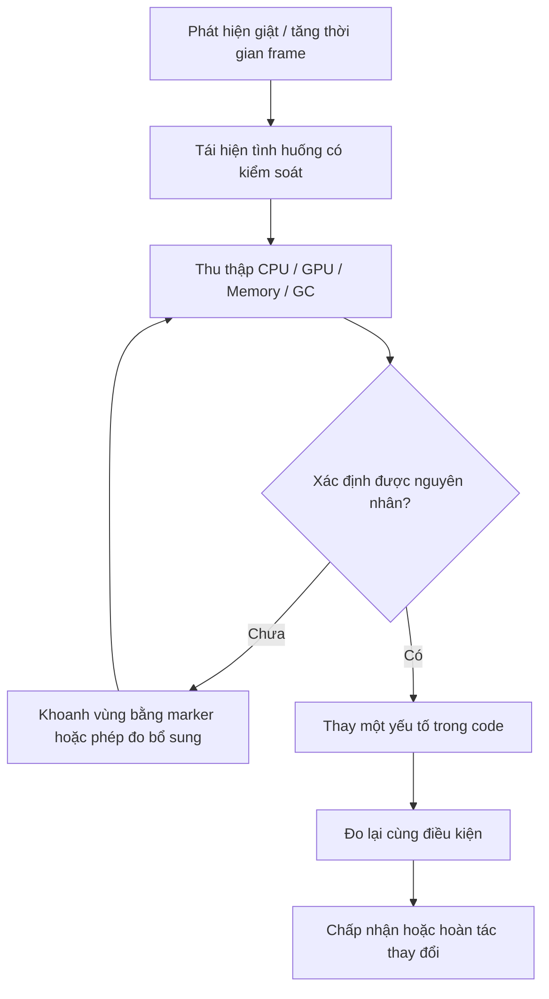

# Bài 04 — Đo hiệu năng mã nguồn và xác định vấn đề bằng Unity Profiler

> **Lộ trình:** Unity Learn — Junior Programmer  
> **Chủ đề:** Apply Object-Oriented Principles  
> **Môi trường tham chiếu:** Unity 6.3  
> **Hình thức:** Lab phân tích hiệu năng

## 1. Tổng quan

Một trò chơi có thể chạy mượt trong một cảnh đơn giản nhưng bị giật khi số lượng vật thể tăng, khi mở giao diện tồn kho hoặc khi chạy trên điện thoại. Nếu chỉ nhìn FPS rồi kết luận “mã C# đang chậm”, ta rất dễ tối ưu nhầm: nguyên nhân thực tế có thể là CPU, GPU, cấp phát bộ nhớ, vật lý, render, đồng bộ hoặc các yếu tố ngoài vùng code đang quan sát.

**Profiling** là quá trình thu thập và phân tích dữ liệu về chi phí thực thi. **Debugging** nhằm tìm nguyên nhân hành vi sai; **profiling** nhằm tìm nguyên nhân tiêu hao tài nguyên hoặc thời gian. Hai hoạt động liên quan nhưng không thay thế nhau.

Lab này hướng dẫn đọc Unity Profiler, tìm chi phí cấp phát trên managed heap qua `GC.Alloc`, tạo thí nghiệm so sánh hai cách viết code và ghi kết quả trong điều kiện đo nhất quán.

## 2. Mục tiêu thực hành

1. Phân biệt các chỉ số FPS, frame time, CPU time, GPU time, bộ nhớ và `GC.Alloc`.
2. Mở Unity Profiler, chọn frame có bất thường và tìm hàm liên quan trong `CPU Usage`.
3. Thêm `ProfilerMarker` để phân biệt vùng mã muốn theo dõi.
4. Thực hiện một phép thử **trước/sau** với cùng tình huống, cùng nền tảng và cùng cấu hình đo.
5. Mô tả kết quả có căn cứ, không khẳng định tối ưu thành công chỉ vì FPS hiển thị thay đổi.

## 3. Lý thuyết cần nắm

### 3.1. Frame time và FPS

**FPS** là số khung hình hiển thị mỗi giây; **frame time** là thời gian hoàn thành một khung hình. Với giả thiết các frame có cùng thời lượng, mối quan hệ gần đúng là:

```text
FPS ≈ 1000 / FrameTime(ms)
```

| Mức khung hình tham khảo | Ngân sách mỗi frame |
|---|---|
| 30 FPS | Khoảng 33,33 ms |
| 60 FPS | Khoảng 16,67 ms |
| 120 FPS | Khoảng 8,33 ms |

Đây là **quy đổi toán học**, không phải kết quả benchmark. FPS trung bình có thể che giấu một vài frame giật rất dài; do đó cần xem phân bố frame time, các đỉnh bất thường và tính ổn định theo thời gian. VSync, giới hạn FPS và chờ GPU cũng có thể ảnh hưởng tới số đo.

### 3.2. Các nhóm chỉ số trong Unity Profiler

| Nhóm/module | Dùng để quan sát | Cách diễn giải thận trọng |
|---|---|---|
| `CPU Usage` | Thời gian các vùng hoạt động trên CPU | Tìm script, engine systems và các lệnh chờ |
| `GPU Usage` | Công việc GPU, khi thiết bị/API hỗ trợ số liệu tương ứng | Không suy từ CPU thấp rằng GPU chắc chắn đang là điểm nghẽn |
| `Memory` | Xu hướng dùng bộ nhớ | Dùng thêm Memory Profiler package khi cần chụp snapshot chi tiết |
| `Rendering` | Một số thống kê liên quan render | Chỉ một chỉ số draw call cao chưa đủ kết luận |
| `Physics` | Hoạt động hệ thống vật lý | Xem cùng CPU timeline và số Collider/Rigidbody |
| `GC.Alloc` trong CPU Usage | Số byte managed memory cấp phát trong phạm vi đang xem | Không đồng nghĩa lượng bộ nhớ còn giữ lại hoặc kích thước heap |

Điểm khác biệt quan trọng: **cấp phát** (*allocation*) là tạo dữ liệu trên heap; **thu gom rác** (*garbage collection*) là hoạt động quản lý và giải phóng đối tượng không còn tham chiếu. Việc cấp phát lặp lại thường xuyên có thể dẫn đến áp lực GC, nhưng một frame có `GC.Alloc` không có nghĩa GC sẽ chạy ngay ở frame đó.

### 3.3. Nguyên tắc phân tích có căn cứ



Sơ đồ là quy trình thực nghiệm: **quan sát → giả thuyết → phép đo → can thiệp → kiểm chứng**. Tối ưu không đồng nghĩa luôn giảm mọi chỉ số: một thay đổi có thể giảm GC nhưng tăng RAM hoặc độ phức tạp code.

## 4. Chuẩn bị công cụ và điều kiện đo

1. Mở dự án Unity 6.3. Trong `Window > Analysis > Profiler`, mở Profiler.
2. Kích hoạt module `CPU Usage`; bật thêm `Memory` khi cần.
3. Để thăm dò nhanh, chọn Editor/Play mode và ghi dữ liệu ở cùng một scene, cùng điều kiện.
4. Để đánh giá có ý nghĩa cho sản phẩm, tạo **Development Build** và đo trên nền tảng, thiết bị đích hoặc máy có cấu hình đại diện. Khi dùng Build Profiles trong Unity 6.3, chọn profile thích hợp rồi bật các tùy chọn phát triển và kết nối Profiler có sẵn cho nền tảng đó.
5. Đảm bảo tình huống đo có thể lặp lại: số object, độ phân giải, chất lượng, thời gian chạy, trạng thái cửa sổ và tải nền tương đương.

**Giới hạn của phép đo:** Unity Editor tự dùng CPU/RAM, nên kết quả đo trong Editor không đại diện tuyệt đối cho Player build. Bật **Deep Profiling** có thể tạo overhead đáng kể, làm kết quả không còn tương đương với cách chạy thông thường; chỉ dùng khi cần xác định một hàm chưa đủ thông tin, rồi đo lại khi tắt nó.

## 5. Lab: nhận diện allocation lặp lại trong `Update()`

### 5.1. Ý tưởng thí nghiệm

Tạo hai chế độ thực hiện cùng một công việc giả lập: ghi dữ liệu vào mảng và tính tổng. Chế độ A cấp phát một mảng mới ở mỗi frame. Chế độ B tái sử dụng mảng đã cấp phát trong `Awake()`.

Mục đích là **quan sát sự khác nhau về cấp phát**, không phải chứng minh mọi trường hợp tái sử dụng mảng đều làm tăng FPS. Với lượng công việc quá nhỏ, bạn có thể thấy chênh lệch thời gian khó nhận biết dù `GC.Alloc` thay đổi.

### 5.2. File `AllocationComparison.cs`

```csharp
using Unity.Profiling;
using UnityEngine;

public class AllocationComparison : MonoBehaviour
{
    [SerializeField, Min(1)] private int elementCount = 1000;
    [SerializeField] private bool reuseBuffer = false;

    private int[] buffer;
    private long checksum;

    private static readonly ProfilerMarker WorkMarker =
        new ProfilerMarker("AllocationComparison.Process");

    public long Checksum => checksum;

    private void Awake()
    {
        elementCount = Mathf.Max(1, elementCount);
        buffer = new int[elementCount];
    }

    private void Update()
    {
        using (WorkMarker.Auto())
        {
            int[] values = reuseBuffer
                ? buffer
                : new int[elementCount];

            long sum = 0;
            for (int i = 0; i < values.Length; i++)
            {
                values[i] = i;
                sum += values[i];
            }

            checksum = sum;
        }
    }
}
```

**Phân tích:**

- `reuseBuffer = false`: `new int[elementCount]` trong `Update()` tạo mảng mới mỗi frame.
- `reuseBuffer = true`: mảng được tạo một lần trong `Awake()` và tái sử dụng.
- `ProfilerMarker` giúp xác định vùng thực thi mang tên `AllocationComparison.Process` trong Profiler.
- Việc cập nhật `checksum` khiến kết quả tính toán được giữ lại để tiện đối chiếu; **không tự động bảo đảm mọi cơ chế tối ưu của runtime sẽ giữ nguyên từng chỉ thị CPU**.
- Cả hai nhánh thực hiện cùng công việc ở mỗi frame và không dùng `Debug.Log` liên tục — tránh đưa chi phí ghi Console vào phép đo.

**Giới hạn ví dụ:** `elementCount` được xem là cấu hình cố định sau `Awake()`. Nếu bạn đổi field đó trong Inspector khi đang Play, độ dài mảng đã tạo ở chế độ tái sử dụng sẽ không tự thay đổi; để thực hiện phép thử công bằng, hãy thoát Play mode, sửa cấu hình rồi chạy lại.

### 5.3. Tiến hành đo

1. Tạo scene `ProfilerLab`; thêm một Empty GameObject và gắn `AllocationComparison`.
2. Đặt `Element Count = 1000`, `Reuse Buffer = false`; lưu scene.
3. Bật Play mode, chờ qua giai đoạn khởi tạo và thu nhiều frame ở trạng thái ổn định.
4. Trong Profiler, chọn `CPU Usage` → `Hierarchy` hoặc `Timeline`. Tìm marker `AllocationComparison.Process`; xem cột `GC.Alloc` và thời gian tương ứng. Có thể bật call stacks của allocation để xem nguồn cấp phát.
5. Ghi số liệu theo bảng bên dưới. Sau đó thoát Play mode.
6. Đổi `Reuse Buffer = true` trong Inspector, chạy lại cùng cảnh và thu dữ liệu tương ứng.
7. So sánh nhiều frame bình thường (không chỉ một đỉnh), ghi số liệu định lượng cùng mọi khác biệt về điều kiện đo.

| Điều kiện | Cấp phát trong vùng thử | Thời gian vùng thử | Ghi chú |
|---|---|---|---|
| Cấp phát mới mỗi frame | *Điền số đo thực tế* | *Điền số đo* | Có `new int[]` trong `Update()` |
| Tái sử dụng buffer | *Điền số đo thực tế* | *Điền số đo* | Không tạo lại mảng trong nhánh này |

**Không điền kết quả giả định:** Thiết bị, backend, cách đo và cấu hình Profiler có thể ảnh hưởng số liệu. Kết luận chỉ nên dựa vào kết quả bạn thực sự thu được.

### 5.4. Kiểm tra giả thuyết

Dự đoán được phép kiểm chứng: khi `reuseBuffer = true`, chi phí **cấp phát mảng mới của riêng nhánh mã thử nghiệm** sẽ biến mất khỏi đường thực thi lặp lại. Tuy nhiên, Profiler vẫn có thể hiển thị `GC.Alloc` từ vùng khác, hệ thống Editor hoặc cơ chế runtime.

Nếu thời gian frame toàn cảnh không cải thiện rõ, điều đó **không bác bỏ** kết quả giảm allocation; nó chỉ cho thấy allocation trong ví dụ chưa chắc là nút thắt chi phối frame time. Phải phân biệt **đã tối ưu một nguồn chi phí** với **đã cải thiện hiệu năng toàn trò chơi**.

## 6. Đọc kết quả và tìm điểm nghẽn thực tế

### 6.1. Chọn frame có dấu hiệu bất thường

Trong biểu đồ, quan sát những frame có thời gian cao so với phần lớn frame khác. Xem `Timeline` để đánh giá vùng chạy của main thread, render thread và công việc liên quan. `Hierarchy` thuận tiện để tổng hợp chi phí theo marker/hàm.

Đừng chỉ nhìn tổng `CPU Usage` rồi kết luận một script cụ thể có lỗi: thời gian lớn có thể nằm ở hoạt động chờ hoặc ở phần engine, vật lý hay tải tài nguyên. Một số phép đo phụ thuộc nền tảng và profiler module được hỗ trợ.

### 6.2. Đo trên bản build

Unity 6.3 sử dụng **Build Profiles** thay cho cách mô tả `File > Build Settings` ở nhiều tài liệu cũ. Để đo Player:

1. Mở `File > Build Profiles` và chọn nền tảng.
2. Cấu hình profile và tạo **Development Build** có hỗ trợ Profiler.
3. Dùng tùy chọn kết nối tự động, nếu khả dụng, hoặc chọn Player qua danh sách kết nối trong Profiler.
4. Chạy lại tình huống và đối chiếu trên thiết bị mục tiêu.
5. Ghi rõ phiên bản Unity, thiết bị, cấu hình build và tùy chọn profiler khi báo cáo.

### 6.3. Chọn cách tối ưu phù hợp sau khi đã đo

| Dấu hiệu có chứng cứ | Hướng điều tra | Không nên vội kết luận |
|---|---|---|
| GC allocation lặp lại | Mảng/list tạm, chuỗi, closure, boxing, API tạo mảng | Mọi allocation đều gây giật ngay |
| CPU scripting cao | Vòng lặp, số lần gọi, thuật toán, cache kết quả hợp lý | Cứ tăng số lượng class là chậm |
| Render/GPU nặng | Shader, fill-rate, texture, batching, số vật thể | Giảm số method C# sẽ giải quyết GPU |
| Physics cao | Collider, Rigidbody, tần suất truy vấn, số contact | Luôn phải tắt toàn bộ vật lý |
| Spike khi tải scene | Tải asset, khởi tạo, đồng bộ hóa, cấp phát đột biến | Phải tối ưu `Update()` trước tiên |

Khi cân nhắc dùng object pooling, lưu ý pooling giúp giảm tạo/hủy đối tượng lặp lại nhưng làm tăng số đối tượng được giữ lại và chi phí quản lý pool. Chỉ áp dụng khi phù hợp với phép đo và mô hình gameplay.

## 7. Các lỗi phương pháp luận thường gặp

- **Đo trong Editor rồi áp dụng kết luận cho mobile:** tải nền, phần cứng và cơ chế runtime khác nhau.
- **Chỉ nhìn FPS:** FPS có thể bị giới hạn; frame time và nguyên nhân nghẽn mới là dữ liệu cần phân tích.
- **Bật Deep Profiling suốt quá trình so sánh:** overhead làm sai lệch chi phí thông thường.
- **Tối ưu nhiều thứ một lúc:** mất khả năng xác định yếu tố nào tạo cải thiện.
- **Dùng log trong vòng lặp đo:** chi phí Console có thể lấn át vấn đề thật.
- **Bỏ qua độ đúng của gameplay:** không được đánh đổi tính chính xác của chức năng chỉ để giảm thời gian đo.

## 8. Deliverable và tiêu chí hoàn thành

Gói báo cáo lab nên có:

- Ảnh chụp `CPU Usage` trước/sau, xác định được `AllocationComparison.Process`.
- Bảng số liệu với cùng kịch bản, kèm cấu hình máy và build.
- Nhận định **chỉ** về những gì dữ liệu hỗ trợ: allocation giảm hay không, thời gian có biến động hay không.
- Một đoạn giải thích giới hạn và các nguồn nhiễu của phép đo.
- File C# đã thử nghiệm với giải thích sự khác biệt của hai nhánh.

**Tiêu chí đạt:** Có giả thuyết, phép đo có thể tái hiện, can thiệp độc lập, kết quả đối chiếu và kết luận không vượt quá dữ liệu.

## 9. Bài tập củng cố

**Cơ bản:** Trong một scene ít vật thể, dùng Profiler tìm một marker liên quan tới script và ghi thông tin tên marker, frame và chi phí.

**Vận dụng:** Cố ý tạo một danh sách mới mỗi frame, rồi chuyển sang reuse collection. Kiểm tra không phát sinh lỗi dữ liệu khi clear/reset danh sách.

**Mở rộng:** So sánh cùng tình huống trong Play mode và Development Build, mô tả nguyên nhân hai số đo có thể khác nhau; không suy diễn rằng một trong hai phải luôn nhanh hơn.

## 10. Tổng kết

Unity Profiler là công cụ đo, không phải nút “tối ưu tự động”. Mục tiêu của một quy trình hiệu năng tốt là xác định **điểm nghẽn thật**, đưa ra giả thuyết có thể kiểm chứng, thay một yếu tố tại một thời điểm rồi đo lại trên nền tảng có ý nghĩa với người chơi. Những số liệu về `GC.Alloc`, CPU, GPU và bộ nhớ cần được đọc trong đúng ngữ cảnh, không thay thế cho nhau.

## 11. Tài liệu tham khảo và đọc thêm

- [Unity Learn — Apply object-oriented principles](https://learn.unity.com/mission/source-control-and-optimization).
- [Unity 6.3 — CPU Usage Profiler](https://docs.unity.com/en-us/engine/6000.3/manual/analysis/profiler/visualizing-data/cpu/introduction).
- [Unity 6.3 — Tracking garbage collection allocations](https://docs.unity.com/en-us/engine/6000.3/manual/analysis/performance-memory/managed-memory/track-garbage-collection).
- [Unity 6.3 — Profiler API](https://docs.unity.com/en-us/engine/6000.3/script-reference/unityengine/profiling/profiler).
- [Unity — ProfilerMarker.Auto](https://docs.unity.cn/6000.0/Documentation/ScriptReference/Unity.Profiling.ProfilerMarker.Auto.html).
- [Unity — Garbage collection best practices](https://docs.unity.cn/Manual/performance-garbage-collection-best-practices.html).

> **Phạm vi:** `AllocationComparison` là thí nghiệm biên soạn riêng; không có bất kỳ số đo benchmark nào được tuyên bố là kết quả thực nghiệm đã chạy.

## 12. Câu hỏi ôn tập trắc nghiệm

### Câu 1

Trong một dự án bị giật, vì sao không thể chỉ dựa vào FPS thấp để kết luận script C# là nguyên nhân?

A. FPS không liên quan thời gian frame.  
B. GPU luôn nhanh hơn CPU.  
C. Nhiều nguyên nhân (CPU, GPU, chờ, bộ nhớ...) có thể ảnh hưởng FPS.  
D. Profiler không hiển thị script.

**Đáp án: C.** **Giải thích:** FPS là biểu hiện tổng quát, cần đo để phân biệt nguồn chi phí.

### Câu 2

Điều nào mô tả `GC.Alloc` chính xác hơn?

A. Thông tin về các cấp phát trên managed heap trong phạm vi đang đo.  
B. Tổng dung lượng GPU đang sử dụng.  
C. Thời gian chạy shader.  
D. Chắc chắn một lần GC sẽ diễn ra ngay tại frame đó.

**Đáp án: A.** **Giải thích:** Allocation và lần thực thi garbage collector là hai hiện tượng khác nhau.

### Câu 3

Lợi ích của đo lại trên Development Build hoặc thiết bị đích là gì?

A. Có thể bỏ qua các biến kiểm soát.  
B. Mọi kết quả sẽ bằng 0.  
C. Tự động tăng FPS.  
D. Tránh phụ thuộc hoàn toàn vào điều kiện và overhead của Editor.

**Đáp án: D.** **Giải thích:** Player build cho phép đánh giá điều kiện gần môi trường triển khai thực tế hơn.

### Câu 4

Vì sao nên hạn chế Deep Profiling trong phép so sánh trước/sau?

A. Deep Profiling không hỗ trợ C#.  
B. Vì nó có thể tạo overhead đáng kể và làm thay đổi kết quả đo.  
C. Nó tự sửa dữ liệu gameplay.  
D. Nó chỉ hoạt động trên GPU.

**Đáp án: B.** **Giải thích:** Khi chế độ đo can thiệp mạnh vào thực thi, số đo không còn phản ánh cách chạy thông thường.

### Câu 5

Sau khi giảm allocation nhưng frame time không đổi rõ rệt, kết luận nào có căn cứ nhất?

A. Mã mới chắc chắn tệ hơn.  
B. Không cần đo thêm vì GC đã bị tắt.  
C. Nguồn allocation đã có thể giảm, nhưng chưa chứng minh được cải thiện hiệu năng toàn cảnh.  
D. Unity Profiler cho kết quả ngẫu nhiên hoàn toàn.

**Đáp án: C.** **Giải thích:** Cần phân biệt cải thiện cục bộ và thay đổi hiệu năng đầu cuối.
