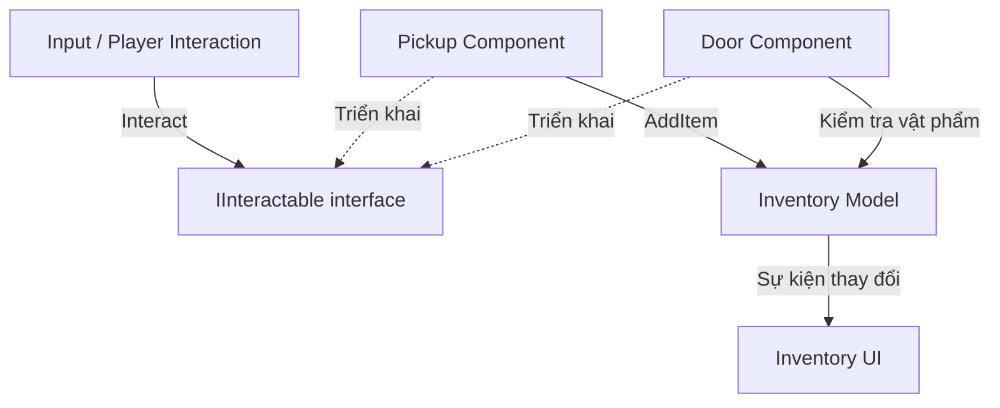
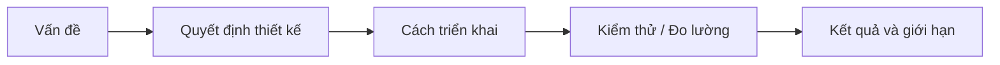

# Bài 05 — Chuẩn bị nghề nghiệp cho Junior Programmer

> **Lộ trình:** Unity Learn — Junior Programmer  
> **Chủ đề:** Apply Object-Oriented Principles  
> **Môi trường tham chiếu:** Unity 6.3, C#, Git  
> **Hình thức:** Bài thực hành định hướng sản phẩm và portfolio

## 1. Tổng quan

Biết cú pháp C# và tạo được trò chơi chạy trong Unity Editor là một bước khởi đầu, nhưng một Junior Programmer còn cần **chứng minh được cách giải quyết vấn đề**: thiết kế mã có trách nhiệm rõ ràng, quản lý mã nguồn, tái hiện và sửa lỗi, kiểm tra hiệu năng, tạo bản build có thể chạy và trình bày phần việc đã thực hiện.

Một portfolio tốt không cần nhiều dự án lớn. Một dự án nhỏ nhưng hoàn chỉnh, có mã dễ đọc, cách chơi rõ ràng, bản chạy được và giải thích thuyết phục về các quyết định kỹ thuật thường có giá trị hơn một bộ sưu tập ảnh chụp Editor thiếu bối cảnh.

Bài này hướng dẫn xây dựng **hồ sơ minh chứng năng lực** cho một dự án Unity nhỏ, từ lựa chọn phạm vi đến repository, build, kiểm thử, README và chuẩn bị trao đổi kỹ thuật khi ứng tuyển. Không có một mẫu portfolio duy nhất phù hợp cho mọi công ty; cần đối chiếu yêu cầu của từng vị trí cụ thể.

## 2. Mục tiêu thực hành

1. Xác định một dự án ngắn gọn có thể chứng minh năng lực C# và Unity phù hợp cấp Junior.
2. Tổ chức repository, tài liệu và lịch sử thay đổi đủ rõ để người khác có thể chạy hoặc đánh giá.
3. Tạo bản build thực tế và kiểm tra luồng sử dụng từ mở trò chơi tới hoàn thành một lượt chơi.
4. Viết README phản ánh đúng tính năng, phần việc cá nhân và những giới hạn còn tồn tại.
5. Chuẩn bị các ví dụ cụ thể để giải thích quyết định OOP, xử lý lỗi và cách sử dụng Profiler.

## 3. Năng lực nên chứng minh bằng sản phẩm

| Năng lực | Bằng chứng có thể kiểm tra | Lỗi trình bày thường gặp |
|---|---|---|
| Lập trình C# | Class, method, property, xử lý trạng thái hợp lý | Chỉ liệt kê “biết OOP” mà không có ví dụ |
| Kiến trúc Unity | GameObject/Component, scene flow, tham chiếu rõ | Script gắn nhiều trách nhiệm và tham chiếu rối |
| Đóng gói, trừu tượng, đa hình | API nhỏ, ít phụ thuộc, có lý do thiết kế | Dựng cây kế thừa sâu chỉ để trình diễn lý thuyết |
| Kiểm thử và debug | Các bước tái hiện lỗi, kết quả sửa, giới hạn biết trước | Tuyên bố “không có bug” mà không có kiểm tra |
| Profiling | Capture Profiler và giải thích phép đo | Tự tuyên bố “tối ưu 200%” không có số liệu |
| Phát hành sản phẩm | Bản build chạy trên nền tảng được nêu | Chỉ có ảnh trong Unity Editor |
| Làm việc với mã nguồn | Commit hợp lý, README và cấu trúc rõ | Đưa toàn bộ thư mục cache vào repository |

Các yêu cầu trên là tiêu chí thực hành để đánh giá portfolio, **không phải danh sách tuyển dụng bắt buộc của mọi công ty**. Hãy điều chỉnh theo JD của vị trí ứng tuyển.

## 4. Chọn một dự án có phạm vi kiểm soát được

### 4.1. Gợi ý: Inventory Interaction Demo

**Bài toán:** Người chơi di chuyển trong một khu vực nhỏ, nhặt một số vật phẩm, xem số lượng vật phẩm đang có và tương tác với vật thể có thể nhận sát thương hoặc mở khóa.

Một bản tối thiểu có thể bao gồm:

- Một scene gameplay và giao diện hiển thị hướng dẫn.
- Hành động nhặt vật phẩm và cập nhật trạng thái inventory.
- Hai loại đối tượng có khả năng tương tác chung, nhưng xử lý khác nhau.
- Trạng thái inventory được kiểm soát qua API, tránh mã khác tự sửa nội bộ.
- Thao tác thoát/chơi lại hoặc kết thúc một lượt demo.

**Độ phức tạp nên tránh khi bắt đầu:** multiplayer, hệ thống nhiệm vụ lớn, AI phức tạp, procedural generation hay công cụ Editor riêng nếu chúng không phục vụ năng lực cần chứng minh.

### 4.2. Đề xuất kiến trúc Component



Sơ đồ mô tả một phương án thiết kế, không phải cấu trúc bắt buộc của Unity. Lớp điều khiển tương tác không cần hiểu cách từng loại vật thể hoạt động; inventory chỉ cho phép thay đổi có quy tắc; UI nhận dữ liệu thay đổi và hiển thị, tránh phải biết các chi tiết nội bộ của từng vật phẩm.

### 4.3. Lập tiêu chí hoàn thành

Một dự án demo nhỏ nên có **Definition of Done** rõ ràng:

1. Người dùng có thể bắt đầu, thao tác và kết thúc một lượt demo.
2. Chức năng chính không phụ thuộc vào các tham chiếu đang thiếu hoặc lỗi biên dịch.
3. Code phân chia trách nhiệm hợp lý, có giải thích ngắn cho quyết định kỹ thuật chính.
4. Bản build chạy được trên nền tảng công bố và có hướng dẫn mở.
5. Repository thể hiện mã nguồn, cấu hình cần thiết và giấy phép tài nguyên.
6. README nêu đúng giới hạn hiện tại, không quảng cáo chức năng chưa có.

Không cần đưa tất cả tính năng có thể nghĩ ra vào một dự án. Khả năng **hoàn thiện sản phẩm trong phạm vi đã chọn** là một tín hiệu quan trọng.

## 5. Quản lý repository và cấu trúc dự án

### 5.1. Cấu trúc tham khảo

```text
InventoryInteractionDemo/
├── Assets/
│   ├── Scenes/
│   ├── Scripts/
│   │   ├── Interaction/
│   │   ├── Inventory/
│   │   └── UI/
│   ├── Prefabs/
│   └── Art/
├── Packages/
├── ProjectSettings/
├── README.md
├── LICENSES.md
└── .gitignore
```

Đây là cấu trúc gợi ý. Những thư mục như `Assets`, `Packages`, `ProjectSettings` thường là dữ liệu quan trọng để mở lại dự án Unity. Các thư mục cache/tạo lại như `Library` và `Temp` thường không nên commit; nên dùng mẫu `.gitignore` dành cho Unity được kiểm tra lại với dự án đang dùng.

Tùy vào cách nhóm làm việc và asset cụ thể, cần giữ tệp `.meta` đi cùng asset để bảo toàn liên kết GUID. Với tài nguyên nhị phân lớn, có thể xem xét Git LFS và chính sách lưu trữ của repository.

### 5.2. Thực hành Git tối thiểu

```bash
git status
git add Assets Packages ProjectSettings README.md .gitignore
git commit -m "Add initial inventory interaction demo"
```

Các lệnh trên **giả định repository đã được khởi tạo** và các đường dẫn tương ứng tồn tại. Cần kiểm tra `git status` và `.gitignore` trước khi commit, đặc biệt để tránh đưa file cache, bí mật, tệp cá nhân hoặc asset không được phép phân phối vào repository.

Một lịch sử commit hữu ích mô tả thay đổi theo đơn vị công việc: tạo logic inventory, thêm tương tác, sửa lỗi trùng vật phẩm, bổ sung kiểm thử, cải thiện tài liệu. Tránh commit một lần toàn bộ mà không có dấu vết phát triển nếu dự án còn đang thực hiện.

## 6. Build và kiểm thử sản phẩm trong Unity 6.3

### 6.1. Kiểm tra Scene List

Trong Unity 6.3, quản lý bản build thông qua `File > Build Profiles`. Vào profile nền tảng cần build, kiểm tra **Scene List** và bảo đảm tất cả scene cần thiết đã được đưa vào, bật và sắp xếp theo đúng thứ tự. Với một số build profile, Scene List riêng có thể cần được thêm qua **Add Settings > Scene List**; nếu không override, profile có thể dùng danh sách scene toàn cục.

Đừng giả định scene đang mở trong Editor chắc chắn có trong bản build. Một scene không được đưa vào build có thể gây lỗi ở luồng chuyển scene dù mọi thứ hoạt động khi Play trong Editor.

### 6.2. Kiểm tra Player build

1. Lưu scene và mọi thay đổi cần thiết.
2. Chọn đúng nền tảng và Build Profile; kiểm tra các thiết lập đầu vào, chất lượng và tính năng hỗ trợ.
3. Tạo build và chạy từ thư mục xuất ra (hoặc chạy trên thiết bị đích).
4. Kiểm tra luồng: mở ứng dụng → tương tác → nhận vật phẩm → cập nhật UI → hoàn thành → đóng/mở lại nếu yêu cầu.
5. Ghi lại bug phát sinh chỉ ở bản build, đường dẫn log hoặc điều kiện tái hiện.
6. Với phép đo hiệu năng, sử dụng Development Build có Profiler, sau đó tạo bản phát hành phù hợp để phân phối demo nếu cần.

Tùy nền tảng và thiết lập, cơ chế input, quyền truy cập tệp, chất lượng đồ họa hoặc tài nguyên có thể khác Editor. Vì thế, bản build có thể chạy được là minh chứng riêng, không thay thế được bằng ảnh Play mode.

### 6.3. Ma trận kiểm thử cơ bản

| Ca kiểm thử | Kết quả mong đợi | Trạng thái |
|---|---|---|
| Khởi chạy | Màn hình/scene đầu tiên hoạt động | *Chưa kiểm thử / Đạt / Không đạt* |
| Nhặt vật phẩm | Số lượng trong inventory được cập nhật đúng | *Điền thực tế* |
| Nhặt lặp vật phẩm đã dùng | Không nhân đôi ngoài ý muốn | *Điền thực tế* |
| Tương tác khi thiếu điều kiện | Hiển thị phản hồi hợp lý, không exception | *Điền thực tế* |
| Chuyển scene | Scene đích có trong bản build và tải thành công | *Điền thực tế* |
| Thoát/chạy lại | Ứng dụng không bị khóa hoặc mất điều khiển | *Điền thực tế* |

Bảng là **mẫu cần điền**. Không đánh dấu “Đạt” nếu chưa kiểm thử trên bản thực tế.

## 7. Viết README để người khác đánh giá được dự án

Một README ngắn nhưng đủ thông tin cần trả lời: Đây là sản phẩm gì? Người dùng chạy thế nào? Bạn thực hiện phần nào? Đã kiểm thử ở đâu? Những hạn chế hiện tại là gì?

### 7.1. Mẫu nội dung README

```text
# Inventory Interaction Demo

## Giới thiệu
Demo nhỏ về tương tác vật phẩm, kiểm soát inventory và kiến trúc Component trong Unity.

## Tính năng
- Nhặt vật phẩm và cập nhật inventory.
- Tương tác với các đối tượng bằng một giao ước chung.
- Giao diện hiển thị trạng thái vật phẩm.

## Công nghệ
- Unity: [điền phiên bản thực tế]
- C#
- [gói bổ sung nếu có]

## Cách chạy
1. Tải bản build tương ứng với hệ điều hành.
2. Giải nén và chạy chương trình.
3. Làm theo hướng dẫn điều khiển trong game.

## Phần việc của tôi
[Mô tả cụ thể những gì cá nhân đã thiết kế/triển khai/kiểm thử.]

## Kiểm thử
[Nền tảng đã thử, cấu hình, những chức năng đã xác minh.]

## Giới hạn đã biết
[Những lỗi hoặc hạn chế còn tồn tại.]

## Nguồn và giấy phép asset
[Liệt kê tác giả, giấy phép, link asset/âm thanh sử dụng.]
```

Thay các đoạn trong dấu `[]` bằng thông tin thật trước khi công khai. Nên kèm ảnh hoặc video gameplay minh họa chức năng, sơ đồ kiến trúc đơn giản và đường dẫn tới bản build có thể chạy (nếu bạn có quyền phân phối).

### 7.2. Diễn đạt kết quả có căn cứ

Ví dụ mô tả phù hợp:

> “Thiết kế giao ước tương tác để các object mới có thể triển khai hành vi riêng mà không phải sửa lớp điều khiển; kiểm thử trên hai loại đối tượng trong scene demo.”

Tránh tuyên bố không có nguồn như “tăng hiệu năng 80%”, “không có bug” hoặc “chuẩn AAA”. Nếu có benchmark, ghi rõ môi trường, cách đo, cỡ mẫu và chỉ số so sánh trước/sau.

## 8. Chuẩn bị trao đổi kỹ thuật và phỏng vấn

### 8.1. Giới thiệu dự án bằng một mạch có thể kiểm chứng

Có thể trình bày theo trình tự:



Ví dụ, thay vì chỉ nói “dự án dùng OOP”, hãy giải thích:

- **Vấn đề:** Script điều khiển phải phân biệt nhiều loại object bằng những nhánh riêng.
- **Quyết định:** Tạo interface nhỏ cho khả năng tương tác.
- **Triển khai:** Mỗi Component cung cấp cách thực hiện riêng; inventory kiểm soát trạng thái.
- **Kiểm chứng:** Thêm object thứ ba mà không sửa script điều khiển, chạy thử cả bản build.
- **Giới hạn:** Mới kiểm thử các loại tương tác đã liệt kê; chưa có kiểm thử tự động toàn hệ thống.

### 8.2. Những câu hỏi nên tự chuẩn bị

**“Tại sao dùng interface thay vì inheritance?”** — Khi các đối tượng cần chia sẻ một khả năng nhưng không có quan hệ is-a phù hợp, interface mô tả hợp đồng mà không ép chia sẻ cùng cây lớp.

**“Tại sao dùng `[SerializeField] private`?”** — Để có thể cấu hình trong Inspector nhưng không mở quyền ghi trực tiếp từ script khác; vẫn cần kiểm tra invariant ở runtime.

**“Bạn đã tối ưu hiệu năng thế nào?”** — Mô tả một phép đo thực tế bằng Profiler: tình huống, marker, dữ liệu trước/sau, thay đổi mã, giới hạn phép đo. Nếu chưa đo, hãy nói rõ chưa có số liệu thay vì tạo con số.

**“Bạn xử lý một bug khó ra sao?”** — Nêu cách tái hiện, giả thuyết, quan sát Console/Profiler, thay đổi đơn lẻ, kiểm thử hồi quy và kết quả.

**“Phần nào trong dự án là của bạn?”** — Phân biệt rõ code tự viết, phần cộng tác, asset nguồn mở, template và nội dung tạo bởi công cụ khác.

## 9. Bản quyền, quyền riêng tư và công bố dự án

Trước khi đưa repository hoặc bản build lên mạng:

- Kiểm tra điều kiện sử dụng của model, texture, nhạc, font, plugin và mã bên thứ ba.
- Không mặc định asset tải miễn phí đồng nghĩa có quyền tái phân phối trong repository hoặc bản build.
- Tránh commit access token, mật khẩu, khóa dịch vụ, dữ liệu cá nhân, địa chỉ máy hoặc file cấu hình nhạy cảm.
- Ghi nguồn/giấy phép theo quy định tương ứng; khi chưa có quyền rõ ràng, thay thế tài nguyên trước khi công khai.
- Kiểm tra build tải xuống có kèm đúng file cần chạy và không phụ thuộc đường dẫn cục bộ của máy phát triển.

Đây là nguyên tắc kiểm tra cơ bản, không thay thế tư vấn pháp lý trong trường hợp giấy phép phức tạp.

## 10. Sản phẩm cần nộp và tiêu chí đánh giá

**Deliverables** đề xuất cho một portfolio demo:

1. Repository mã nguồn có hướng dẫn mở bằng Unity đúng phiên bản.
2. Bản build có thể chạy trên nền tảng công bố.
3. README thể hiện mục tiêu, tính năng, công nghệ, cách chạy, phần việc và hạn chế.
4. Một video hoặc ảnh gameplay chứng minh luồng sử dụng.
5. Một sơ đồ hệ thống ở mức phù hợp, giải thích cách áp dụng OOP.
6. Một bản ghi kiểm thử và, nếu có tối ưu, dữ liệu Profiler có thể đối chiếu.

### Bảng tự đánh giá

| Tiêu chí | Chưa làm | Đang làm | Đạt |
|---|:---:|:---:|:---:|
| Dự án có phạm vi và mục tiêu rõ ràng | ☐ | ☐ | ☐ |
| Mã có trách nhiệm rõ và không phụ thuộc vòng tròn | ☐ | ☐ | ☐ |
| Có bản build đã chạy thử | ☐ | ☐ | ☐ |
| README có cách chạy và phần việc cá nhân | ☐ | ☐ | ☐ |
| Đã kiểm tra giấy phép tài nguyên | ☐ | ☐ | ☐ |
| Có bằng chứng xử lý ít nhất một vấn đề thực tế | ☐ | ☐ | ☐ |

## 11. Tổng kết

Đối với Junior Programmer, portfolio là **bằng chứng của tư duy và quy trình làm việc**, không phải bảng liệt kê công nghệ. Một dự án nhỏ nhưng rõ ràng về mục tiêu, có mã có thể đọc, kiểm thử thật, build thực tế và phần trình bày minh bạch sẽ giúp người khác đánh giá năng lực chính xác hơn. Nên tiếp tục cải thiện sản phẩm dựa trên phản hồi thực tế và yêu cầu của những vị trí bạn muốn ứng tuyển.

## 12. Tài liệu tham khảo và đọc thêm

- [Unity Learn — Junior Programmer: Apply object-oriented principles](https://learn.unity.com/mission/source-control-and-optimization): mục tiêu tổng thể của mission cuối trong lộ trình.
- [Unity 6.3 — Manage scenes in a build](https://docs.unity.com/en-us/engine/6000.3/manual/building-and-publishing/build-settings/build-profile-scene-list): quản lý Scene List theo Build Profiles.
- [Unity 6.3 — CPU Usage Profiler](https://docs.unity.com/en-us/engine/6000.3/manual/analysis/profiler/visualizing-data/cpu/introduction): bằng chứng đo hiệu năng.
- [Microsoft Learn — Object-oriented programming](https://learn.microsoft.com/en-us/dotnet/csharp/fundamentals/tutorials/oop): nguyên lý OOP để mô tả quyết định kiến trúc.
- [GitHub — gitignore template cho Unity](https://github.com/github/gitignore/blob/main/Unity.gitignore): tham khảo quy tắc loại trừ tệp khi quản lý mã nguồn.

> **Phạm vi:** Dự án `Inventory Interaction Demo`, sơ đồ và rubric trong bài là gợi ý thực hành để xây dựng portfolio, không phải đề thi hoặc chuẩn tuyển dụng chính thức của Unity.

## 13. Câu hỏi ôn tập trắc nghiệm

### Câu 1

Yếu tố nào chứng minh một bản demo Unity có thể phân phối đáng tin cậy hơn ảnh chụp Editor?

A. Tên repository thật dài.  
B. Có bản build chạy được và hướng dẫn tái hiện chức năng.  
C. Dùng càng nhiều asset càng tốt.  
D. Có nhiều class kế thừa sâu.

**Đáp án: B.** **Giải thích:** Bản build và cách chạy cho phép người khác kiểm chứng ngoài môi trường Editor của tác giả.

### Câu 2

Khi khai báo “đã cải thiện 40% hiệu năng” trong portfolio, cách nào hợp lý nhất?

A. Không cần đo vì kết quả nghe thuyết phục.  
B. Chỉ đưa ảnh màn hình Console.  
C. Làm tròn theo cảm giác chơi.  
D. Đưa phương pháp, điều kiện và số liệu thực tế trước/sau.

**Đáp án: D.** **Giải thích:** Con số về hiệu năng cần có phép đo đủ thông tin để đánh giá.

### Câu 3

Vì sao nên kiểm tra Scene List trong Build Profiles?

A. Scene chạy trong Editor không mặc nhiên bảo đảm được đưa vào bản build.  
B. Vì build luôn chứa mọi scene trong ổ cứng.  
C. Scene List chỉ dùng để đổi màu GameObject.  
D. Vì Unity không cho phép chuyển scene.

**Đáp án: A.** **Giải thích:** Danh sách scene quyết định những scene được đưa vào bản build và thứ tự của chúng.

### Câu 4

Một asset ghi “free download”. Khi đưa dự án công khai, bạn nên làm gì?

A. Mặc định được phép phân phối lại dưới mọi hình thức.  
B. Xóa tên tác giả để tránh chú ý.  
C. Kiểm tra giấy phép và quyền phân phối, ghi nguồn theo yêu cầu.  
D. Chỉ cần đổi tên file asset.

**Đáp án: C.** **Giải thích:** Tải miễn phí không đồng nghĩa có quyền tái phân phối tùy ý.

### Câu 5

Mô tả nào tốt nhất về phần việc cá nhân trong dự án nhóm?

A. Nhận toàn bộ công lao của nhóm.  
B. Nêu chính xác module do mình thiết kế, triển khai và kiểm thử.  
C. Không nhắc tới sự cộng tác.  
D. Chỉ nói “mọi người làm rất tốt”.

**Đáp án: B.** **Giải thích:** Vai trò rõ ràng giúp người tuyển dụng đánh giá đúng năng lực và mức độ chịu trách nhiệm của người ứng tuyển.
