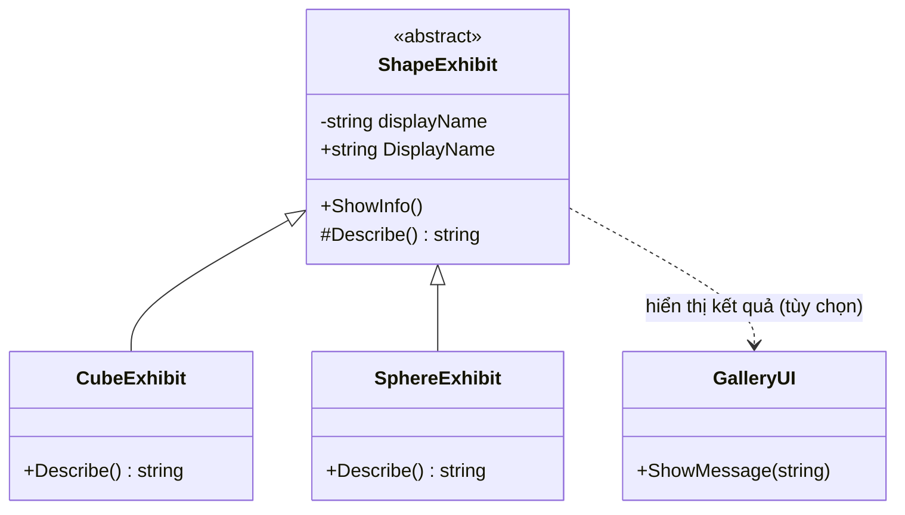
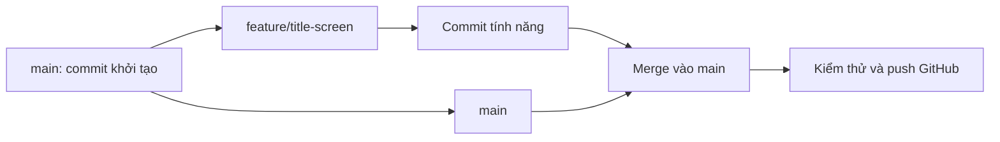

# Bài 07 — Bài nộp: Vận dụng lý thuyết lập trình vào dự án Unity

> **Lộ trình:** Unity Learn — Junior Programmer  
> **Chủ đề:** Apply Object-Oriented Principles  
> **Môi trường tham chiếu:** Unity 6.3, C#, Git và GitHub  
> **Hình thức:** Bài tập dự án và nộp minh chứng

## 1. Bài toán và sản phẩm cần xây dựng

Một ứng dụng nhỏ vẫn có thể bộc lộ các vấn đề thiết kế thường gặp: sao chép mã giữa các đối tượng tương tự, cho phép lớp khác sửa dữ liệu không kiểm soát, dùng chuỗi `if` dài để phân biệt kiểu và trộn quá nhiều trách nhiệm vào một script. **Lập trình hướng đối tượng (OOP)** cung cấp công cụ để thiết kế những chương trình có hành vi rõ ràng, có thể mở rộng và dễ kiểm chứng hơn.

Trong bài tập này, bạn sẽ **tự tạo một Unity project**, chủ động thiết kế các lớp và triển khai một tương tác quan sát được để chứng minh cả bốn nguyên lý:

- **Abstraction:** Ẩn bớt chi tiết không cần thiết sau các thao tác mức cao.
- **Encapsulation:** Đóng gói trạng thái, cung cấp cách đọc và sửa dữ liệu có kiểm soát.
- **Inheritance:** Tạo quan hệ lớp cha – lớp con có ý nghĩa.
- **Polymorphism:** Cho phép những kiểu con thể hiện hành vi khác nhau qua phương thức chung, bằng `override` hoặc một hình thức đa hình phù hợp.

Đồng thời, dự án cần có **lịch sử Git có nhiều commit, tối thiểu hai nhánh và một lần merge tính năng**. Mục tiêu chính không phải đồ họa phức tạp: một prototype dùng các primitive 3D hoặc chỉ giao diện và log cũng đủ nếu các đặc điểm thiết kế được chứng minh rõ ràng.

**Đề bài này là bài thực hành:** các ví dụ dưới đây chỉ minh họa kiến trúc, thao tác và cách kiểm tra. Chúng **không phải mã nguồn hoàn chỉnh** để nộp thay cho sản phẩm tự xây dựng.

## 2. Mục tiêu và tiêu chí hoàn thành

Sau khi làm bài, bạn có thể:

1. Viết bản thiết kế ngắn mô tả đối tượng, hành vi và quan hệ giữa các lớp.
2. Áp dụng đủ bốn nguyên lý OOP vào hành vi thật, không chỉ gắn các comment vào mã không liên quan.
3. Dùng Git để tách một tính năng sang nhánh riêng, commit, merge và đẩy lịch sử lên GitHub.
4. Tạo một bản prototype chạy được, kiểm tra cả trường hợp bình thường và tình huống dữ liệu/thiết lập sai.
5. Chuẩn bị README, ảnh/video minh chứng và đường dẫn repository để người khác đánh giá được dự án.

### 2.1. Yêu cầu bắt buộc theo phạm vi bài nộp Unity

| Thành phần | Minh chứng cần có |
|---|---|
| **GitHub repository** | Liên kết repo chứa Unity project, lịch sử **nhiều commit có thông điệp rõ ràng** và **ít nhất hai nhánh** |
| **Kế thừa** | Mã có lớp cha/lớp con và chỉ rõ chỗ sử dụng bằng comment `// INHERITANCE` |
| **Đa hình** | Hành vi `override` hoặc `overload` với tác dụng cụ thể; đánh dấu `// POLYMORPHISM` |
| **Đóng gói** | Dữ liệu được quản lý qua getter/setter hoặc property có ý nghĩa; đánh dấu `// ENCAPSULATION` |
| **Trừu tượng hóa** | Phương thức mức cao che chi tiết triển khai hoặc giao ước hợp lý; đánh dấu `// ABSTRACTION` |
| **Trình bày kết quả** | Ảnh chụp hoặc video ngắn cho thấy dự án và hành vi đang chạy, kèm phần chia sẻ để người khác xem được |

Các yêu cầu này được diễn giải từ [Unity Learn — Submission: Programming theory in action](https://learn.unity.com/pathway/junior-programmer/unit/apply-object-oriented-principles/tutorial/submission-programming-theory-in-action?version=6.3). Unity cũng hướng dẫn **tạo nhánh cho title screen (hoặc tính năng tương đương) và merge trở lại nhánh chính**. Các phần rubric, mẫu project và kịch bản kiểm thử phía dưới là hướng dẫn luyện tập bổ sung; **không phải tiêu chí chấm chính thức mới của Unity**.

### 2.2. Những điều không bắt buộc

Không cần mô hình 3D cầu kỳ, hệ thống chiến đấu hoàn chỉnh, thế giới nhiều scene hoặc thư viện plugin phức tạp. Bạn có thể dùng Cube, Sphere, Capsule, nút UI và Console. Build độc lập và báo cáo Profiler là **điểm cộng tự luyện**, không nên đánh đồng với yêu cầu nộp tối thiểu ở mục 2.1.

## 3. Thiết kế dự án trước khi lập trình

### 3.1. Đề xuất chủ đề: Phòng trưng bày hình khối tương tác

Tạo một ứng dụng nhỏ tên `Shape Gallery` gồm màn hình bắt đầu và khu trưng bày chứa ít nhất hai loại hình khối. Khi chọn từng hình, ứng dụng phản hồi bằng một dòng mô tả hoặc văn bản UI. Người học có thể chọn chủ đề khác, miễn nó thể hiện được cả bốn nguyên lý một cách tự nhiên.

**Quy tắc gameplay tối thiểu:**

1. Mở ứng dụng và thấy màn hình bắt đầu với nút `Play`.
2. Nhấn `Play` để chuyển tới scene trưng bày.
3. Chọn `Cube` hoặc `Sphere` bằng một nút UI/đối tượng tương tác.
4. Kết quả hiển thị loại hình và mô tả hành vi tương ứng; hai hình cho kết quả khác nhau.
5. Thử thay đổi tên hiển thị qua API của lớp để kiểm chứng ràng buộc dữ liệu đã thiết kế.

### 3.2. Sơ đồ kiến trúc tham khảo



`ShapeExhibit` là lớp cha mô tả các đặc điểm chung và có thể khai báo một phương thức `abstract` cho kết quả cụ thể. `CubeExhibit` và `SphereExhibit` kế thừa lớp cha, nhưng cung cấp mô tả riêng. UI hoặc lớp điều phối chỉ cần kích hoạt một thao tác mức cao, chẳng hạn `ShowInfo()`, thay vì phụ thuộc trực tiếp vào các chi tiết ở mỗi lớp con. **Quan hệ với `GalleryUI` là gợi ý mở rộng, không bắt buộc phải tạo lớp này.**

### 3.3. Bảng quy chiếu bốn nguyên lý

| Nguyên lý | Vị trí dự kiến | Điều cần chứng minh khi chạy |
|---|---|---|
| Inheritance | `ShapeExhibit` → `CubeExhibit`, `SphereExhibit` | Lớp con tái sử dụng hành vi/trạng thái chung |
| Polymorphism | `Describe()` được các lớp con `override` | Cùng một lời gọi tạo mô tả phù hợp với kiểu đối tượng runtime |
| Encapsulation | Field tên/trạng thái không cho sửa tùy tiện; property quản lý truy cập | Thao tác sửa dữ liệu đi qua API được quy định |
| Abstraction | `ShowInfo()` hoặc `IInteractable.Interact()` | Bên sử dụng không cần biết các bước tạo kết quả cụ thể |

Không nên cố nhồi mọi nguyên lý vào một class duy nhất. Mỗi quyết định thiết kế cần có lý do: tránh mã trùng, giữ bất biến, định nghĩa quan hệ kiểu hoặc giảm phụ thuộc.

### 3.4. Mẫu bản thiết kế ngắn

Tạo `DESIGN.md` với các mục: **Ý tưởng trò chơi**, **cách điều khiển**, **ít nhất hai đối tượng**, **quan hệ lớp**, **bảng bốn nguyên lý**, **tương tác chính**, **bài kiểm thử dự kiến** và **phạm vi không làm**. Mô tả đủ cụ thể để người khác biết phải xây dựng gì, không cần viết hàng chục trang.

## 4. Tổ chức repository và nhánh Git

### 4.1. Tạo project có thể quản lý bằng Git

Trong Unity Hub, tạo dự án 3D mới rồi khởi tạo repo tại **thư mục gốc của Unity project** (nơi có `Assets`, `Packages`, `ProjectSettings`). Nếu đã có repo từ trước, không chạy `git init` lần thứ hai.

Sử dụng mẫu [GitHub — Unity.gitignore](https://github.com/github/gitignore/blob/main/Unity.gitignore), đặt file `.gitignore` tại gốc project trước lần `git add` đầu tiên. Kiểm tra các thư mục sinh tự động như `Library`, `Temp`, `Obj`, `Logs`, `Build` không bị đưa vào commit. Ngược lại, các file `.meta` trong `Assets` thường **phải được theo dõi** cùng tài nguyên tương ứng để giữ tham chiếu Unity ổn định.

Ví dụ các lệnh cơ bản trong terminal khi project chưa là Git repo:

```bash
git init -b main
git add .
git commit -m "chore: create Unity project and gitignore"
git status
```

Nếu `git status` cho thấy hàng nghìn file cache trong `Library`, hãy xem lại `.gitignore` trước khi commit tiếp. Dùng `.gitignore` đúng cách không xóa các file đã từng bị Git theo dõi; trong trường hợp đó cần bỏ theo dõi cache một cách chủ động.

### 4.2. Tạo repository GitHub

Tạo repo trống trên GitHub, rồi kết nối repo local với địa chỉ thật của bạn. Thay URL minh họa sau bằng URL repo đã tạo; không chạy nguyên ví dụ khi chưa thay thông tin.

```bash
git remote add origin https://github.com/USERNAME/Programming-Theory-Repo.git
git push -u origin main
```

Nếu dùng GitHub Desktop, bạn có thể thực hiện các thao tác tương đương qua giao diện. Đích đến của bài tập là **lịch sử thay đổi có thể kiểm chứng**, không phải bắt buộc dùng command line.

### 4.3. Làm tính năng trên một nhánh riêng

Tạo nhánh phát triển màn hình bắt đầu:

```bash
git switch -c feature/title-screen
```

Trong Unity, tạo scene `TitleScreen` và một nút `Play` (hoặc tính năng độc lập khác nếu ứng dụng không cần màn hình bắt đầu). Khi tính năng chạy được:

```bash
git add Assets Packages ProjectSettings
git commit -m "feat: add title screen and play action"
git push -u origin feature/title-screen
```

Lệnh `git add` ở đây minh họa các thư mục quan trọng của Unity. Nếu có thay đổi cần commit ở thư mục gốc như `README.md` hay file cài đặt khác, hãy kiểm tra `git status` và thêm chúng tương ứng.

### 4.4. Merge nhánh vào `main`

Đảm bảo công việc trên nhánh tính năng đã commit, sau đó thực hiện:

```bash
git switch main
git merge --no-ff feature/title-screen -m "merge: integrate title screen"
git push origin main
```

Tùy phiên bản Git và chính sách repo, bạn cũng có thể merge bằng Pull Request trên GitHub. **Để chứng minh có ít nhất hai nhánh**, giữ nhánh `feature/title-screen` hiện diện trên GitHub đến khi nộp; merge xong không cần xóa ngay. Nếu có merge conflict, kiểm tra chênh lệch từng file, sửa xung đột, mở Unity xác minh scene và commit hoàn tất merge.



Mỗi bước có một đối tượng kiểm chứng: commit đầu tiên, commit của nhánh tính năng, merge commit (khi dùng `--no-ff`), và `main` chứa tính năng đã ghép.

## 5. Triển khai prototype trong Unity

### 5.1. Chuẩn bị scene và đối tượng

1. Tạo thư mục `Assets/Scenes` và lưu hai scene `TitleScreen` và `Gallery`.
2. Trong `TitleScreen`, tạo `Canvas`, thêm `Button` có nhãn `Play`, sau đó viết logic chuyển sang `Gallery` bằng `UnityEngine.SceneManagement.SceneManager.LoadScene` hoặc cơ chế chuyển scene đã sử dụng trong dự án của bạn.
3. Trong `Gallery`, đặt Cube và Sphere làm đối tượng trưng bày. Thêm ánh sáng và camera ở vị trí nhìn thấy cả hai đối tượng.
4. Tạo `Canvas` với hai nút chọn hình, hoặc một cơ chế nhấp đối tượng 3D đã được kiểm thử.
5. Tạo folder `Assets/Scripts` và triển khai những lớp đã xác định trong `DESIGN.md`.
6. Để thử bản build nếu cần, mở **File > Build Profiles > Scene List** và bảo đảm các scene cần chạy có trong danh sách theo thứ tự hợp lý.

Một giải pháp đơn giản là dùng **Unity UI Button** để gọi `ShowInfo()` trên Component của từng hình. Cách này tập trung vào OOP, không bắt buộc phải viết raycast hoặc hệ thống nhập liệu riêng.

### 5.2. Đoạn khung minh họa: lớp cơ sở

Đây là **mã gợi ý một lớp**, không phải lời giải đầy đủ. Tạo file `ShapeExhibit.cs`:

```csharp
using UnityEngine;

public abstract class ShapeExhibit : MonoBehaviour
{
    [SerializeField] private string displayName = "Shape";

    // ENCAPSULATION: field private, thay đổi qua API công khai.
    public string DisplayName
    {
        get => displayName;
        set => displayName = string.IsNullOrWhiteSpace(value)
            ? "Shape"
            : value.Trim();
    }

    // ABSTRACTION: cung cấp một thao tác mức cao cho bên gọi.
    public void ShowInfo()
    {
        Debug.Log($"{DisplayName}: {Describe()}");
    }

    protected abstract string Describe();
}
```

**Giải thích thiết kế:**

- `ShapeExhibit` là `abstract class`, nên **không gắn trực tiếp** lớp này làm Component; hãy tạo và gắn các lớp dẫn xuất không trừu tượng.
- `DisplayName` cung cấp getter và setter. Khi được gán bằng code, setter chuẩn hóa chuỗi rỗng; những lớp khác không cần biết tên đang được lưu vào field nào.
- `ShowInfo()` là thao tác mức cao, giấu chi tiết việc ghép và ghi thông tin.
- `Describe()` là điểm mở rộng để các lớp con cài đặt hành vi khác nhau. Bạn cần tự tạo `CubeExhibit` và `SphereExhibit` với `protected override string Describe()` thích hợp.
- Vì `[SerializeField]` được áp lên field, **sửa `displayName` trong Inspector không gọi setter của property**. Nếu việc chuẩn hóa dữ liệu phải đúng ngay trong Editor, hãy xây dựng cách kiểm tra hợp lý, chẳng hạn `OnValidate()`, và kiểm thử nó riêng.

Các comment về inheritance và polymorphism **phải được đặt trong chính mã bạn tự hoàn thiện**, tại quan hệ lớp con và phương thức ghi đè, không chỉ ghi trong README. Mẫu gợi ý về vị trí:

```csharp
// INHERITANCE: lớp hình cụ thể kế thừa ShapeExhibit.
// POLYMORPHISM: lớp hình cụ thể override Describe().
```

### 5.3. Tự triển khai lớp con và lời gọi chung

Hoàn thành phần code còn lại theo các nhiệm vụ sau:

1. Tạo hai class `CubeExhibit` và `SphereExhibit` kế thừa `ShapeExhibit`, lưu trong **hai file C# riêng**. Mỗi class hiện thực `Describe()` khác nhau.
2. Gắn `CubeExhibit` lên Cube, `SphereExhibit` lên Sphere.
3. Liên kết mỗi nút UI với `ShowInfo()` của Component tương ứng trong phần **On Click ()** của `Button`.
4. Chạy scene, chọn mỗi nút và kiểm tra hai thông báo có khác nhau trong Console hay không.
5. Tạo một đoạn code hoặc cách tương tác riêng để gán `DisplayName` qua property, sau đó kiểm tra cả tên hợp lệ và tên rỗng.
6. Tự đánh dấu `// INHERITANCE`, `// POLYMORPHISM`, `// ENCAPSULATION`, `// ABSTRACTION` tại những nơi có minh chứng thực sự.

Nếu muốn nâng cao: thay `Debug.Log` bằng TextMeshPro, sử dụng interface để mở rộng tương tác cho đối tượng không thuộc họ hình khối, hoặc bổ sung một loại hình mới mà **không phải sửa logic điều phối chung**.

### 5.4. Điểm kiểm tra quan trọng

Một ứng dụng xuất hiện hai thông báo **khác nhau** chưa đủ để chứng minh đa hình. Nếu mã điều phối có dạng `if (isCube) ... else if (isSphere) ...` và không dùng một cơ chế hành vi chung, bạn chưa chứng minh tốt ý nghĩa của đa hình. Tương tự, chỉ khai báo field `private` nhưng cho các phương thức khác gán giá trị bất hợp lệ không phải đóng gói có chất lượng.

Hãy tự kiểm tra bốn câu hỏi:

- Có thể thêm hình mới bằng cách tạo lớp con và cài đặt `Describe()` mà ít sửa mã gọi không?
- Khi truy cập qua kiểu cha, `Describe()` có chạy bản triển khai của lớp con không?
- Dữ liệu nào được bảo vệ, và quy tắc xác thực được áp dụng ở đâu?
- Một thao tác mức cao nào thực sự giúp bên gọi không cần biết các bước xử lý nội bộ?

## 6. Kiểm thử và xử lý lỗi

### 6.1. Bảng kiểm thử hành vi

| Mã | Tình huống | Kết quả mong đợi | Minh chứng nên lưu |
|---|---|---|---|
| TC-01 | Mở `TitleScreen`, nhấn `Play` | Chuyển sang `Gallery` | Ảnh/video hai scene |
| TC-02 | Chọn Cube | Hiển thị mô tả của Cube | Console hoặc UI |
| TC-03 | Chọn Sphere | Hiển thị mô tả khác Cube | Console hoặc UI |
| TC-04 | Gán tên hợp lệ qua `DisplayName` | Đọc lại tên phù hợp | Log hoặc kiểm thử C# |
| TC-05 | Gán tên rỗng qua property | Quy tắc mặc định được áp dụng | Log hoặc kiểm thử C# |
| TC-06 | Tạo đối tượng trưng bày mới thuộc cùng họ | Có thể gọi thao tác chung mà không sửa lời gọi chuyên biệt cho từng kiểu | Video hoặc mã liên quan |
| TC-07 | Mở repo GitHub | Nhìn thấy các commit, hai nhánh và nội dung đã merge | Ảnh giao diện GitHub |

Bảng chỉ nêu **kết quả mong đợi**. Không ghi “đã đạt” trước khi chạy chương trình hoặc kiểm tra repo thực tế.

### 6.2. Những lỗi thường gặp

| Triệu chứng | Nguyên nhân có thể | Cách kiểm tra |
|---|---|---|
| Không gắn được script `ShapeExhibit` | Đây là `abstract class` | Gắn `CubeExhibit` hoặc `SphereExhibit` cụ thể |
| Script không hiển thị hoặc không compile | Tên class/file sai, lỗi cú pháp hoặc lỗi project khác | Mở Console, xử lý compilation errors trước |
| Nút bấm không phản hồi | Chưa gán `On Click ()`, tham chiếu sai, EventSystem/UI chưa cấu hình | Kiểm tra Inspector và thử nhấn Play mode |
| `NullReferenceException` | Tham chiếu Component/UI chưa được khởi tạo hoặc đã bị hủy | Đọc stack trace, kiểm tra object được gán |
| Dữ liệu sửa trong Inspector bỏ qua validation của property | Unity serialize field trực tiếp | Kiểm tra `OnValidate`, `Awake` hoặc chiến lược xác thực thích hợp |
| Chỉ thấy một scene khi build | Scene chưa được thêm/bật trong Scene List | Kiểm tra Build Profiles và thử chạy bản build |
| Mất thay đổi sau khi chuyển nhánh Git | Tính năng chưa được commit, hoặc đang xem nhánh cũ | `git status`, `git log --oneline --graph --all` |
| GitHub chỉ hiển thị một branch | Nhánh tính năng chưa push hoặc đã xóa | `git branch -a` và trang Branches trên GitHub |

**Quy trình gỡ lỗi:** Tái hiện lỗi → ghi kỳ vọng và thực tế → đọc Console/stack trace → kiểm tra đối tượng, tham chiếu và cấu hình → thử một cách sửa có kiểm soát → chạy lại toàn bộ kiểm thử bị ảnh hưởng.

### 6.3. Kiểm tra nhanh bằng Profiler (mở rộng)

Nếu muốn chứng minh thêm kỹ năng tối ưu từ mission, mở **Window > Analysis > Profiler**, quan sát CPU Usage trong cùng một tình huống gameplay và nhận diện các nhóm hoạt động thuộc `PlayerLoop`. Với bản build có tính năng profiling được bật khi phù hợp, phép đo thường đại diện cho thiết bị đích tốt hơn số đo Play mode của Editor.

Không cần cố thêm một thuật toán nặng để tạo ra số liệu cải thiện. Chỉ viết **“đã tối ưu X%”** nếu bạn có trước/sau, phương pháp đo và điều kiện test nhất quán. Nếu dự án quá nhỏ để có điểm nghẽn đáng kể, ghi rõ “không phát hiện vấn đề hiệu năng có ý nghĩa trong phạm vi kiểm tra”.

## 7. Tổ chức tài liệu và sản phẩm bàn giao

### 7.1. Cấu trúc repository đề xuất

```text
Programming-Theory-Repo/
├── .gitignore
├── README.md
├── DESIGN.md
├── Assets/
│   ├── Scenes/
│   │   ├── TitleScreen.unity
│   │   └── Gallery.unity
│   ├── Scripts/
│   │   ├── ShapeExhibit.cs
│   │   ├── CubeExhibit.cs
│   │   └── SphereExhibit.cs
│   └── ...
├── Packages/
├── ProjectSettings/
└── Docs/
    ├── screenshots/
    └── test-notes.md
```

Các file `.meta` của Unity được lược bỏ khỏi sơ đồ cho gọn nhưng **cần được commit** cùng các asset tương ứng. `Library`, `Temp`, `Obj`, `Logs` và các thư mục build sinh tự động thường không được đưa vào repo thông thường. Cấu trúc có thể được điều chỉnh theo project thực tế.

### 7.2. README cần trả lời những gì?

Một README ngắn nhưng có ích cần giúp người chấm hoặc nhà tuyển dụng hiểu được dự án mà không phải đọc toàn bộ source code. Tối thiểu nên có:

1. **Tên và mục tiêu:** ứng dụng làm gì, người dùng tương tác như thế nào.
2. **Công nghệ:** phiên bản Unity thực tế sử dụng, C#, nền tảng chạy nếu có build.
3. **Cách chạy:** mở project trong Unity Hub, scene khởi đầu, các thao tác.
4. **Minh chứng bốn nguyên lý:** class/file/method nào minh họa từng nguyên lý và *vì sao*.
5. **Quy trình Git:** nhánh tính năng, merge và các commit tiêu biểu.
6. **Kiểm thử:** một số case đã chạy, kết quả, lỗi còn biết.
7. **Tài nguyên:** quyền sử dụng các asset ngoài tự tạo, nếu có.

Không nên viết “tối ưu hoàn toàn” hoặc “không có bug” nếu không thể chứng minh. Có thể chỉ ra giới hạn thực tế của prototype.

### 7.3. Gói minh chứng gửi bài

Chuẩn bị bộ thông tin sau trước khi chia sẻ bài nộp trên Unity Learn:

- **URL GitHub:** repo có nội dung project, commit history và các branch theo yêu cầu.
- **Ảnh/video:** thể hiện screen đầu, tương tác và phản hồi thực tế.
- **Mô tả ngắn:** giới thiệu project và liệt kê nơi thực hiện bốn nguyên lý.
- **Đường dẫn minh chứng:** trỏ đến các file/class chứa comment theo yêu cầu, ưu tiên trong README.

Quy trình chính thức là chia sẻ dự án từ trang bài tập Unity Learn; việc tải project lên GitHub **không tự động** đồng nghĩa đã hoàn thành thao tác nộp trên Unity Learn.

## 8. Rubric tự đánh giá dự án

Bảng dưới đây chỉ là **thang tự luyện đề xuất**, không phải thang điểm chính thức của Unity Learn. Trước khi chấm, hãy xác nhận mọi yêu cầu ở mục 2.1 đã được đáp ứng.

| Tiêu chí tự đánh giá | Điểm tối đa | Biểu hiện đạt |
|---|---:|---|
| Thiết kế và giải thích 4 nguyên lý OOP | 40 | Mỗi nguyên lý có mã thực thi, comment xác định và một giải thích đúng bản chất |
| Hành vi ứng dụng | 20 | Có tương tác, phản hồi quan sát được, luồng scene hợp lệ |
| Git và GitHub | 20 | Repo có nhiều commit có ý nghĩa, ít nhất hai branch và minh chứng merge |
| Kiểm thử và xử lý lỗi | 10 | Có test case, log hoặc video chứng minh và báo cáo vấn đề tìm được |
| Tài liệu và minh chứng | 10 | README, mô tả cách chạy, ảnh/video và liên kết mã rõ ràng |
| **Tổng** | **100** | |

Một phương án đạt điểm tổng cao nhưng không chứng minh được một trong bốn nguyên lý vẫn **chưa đạt mục tiêu cốt lõi** của bài tập. Tránh dùng rubric như lý do để thêm tính năng không cần thiết.

## 9. Câu hỏi ôn tập trước khi nộp

### 9.1. Câu 1 — Minh chứng kế thừa

Trong dự án gallery, minh chứng nào tốt nhất cho inheritance?

A. Hai GameObject có màu khác nhau nhưng dùng chung một script không có quan hệ lớp.  
B. `CubeExhibit` và `SphereExhibit` kế thừa một lớp `ShapeExhibit` có nhiệm vụ chung rõ ràng.  
C. Đặt mọi mã trong `GameManager`.  
D. Đổi tên hai scene cho giống tên hai lớp.

**Đáp án: B.** **Giải thích:** Kế thừa là quan hệ giữa **kiểu**, không phải chỉ là nhiều đối tượng trong scene hay trùng tên.

### 9.2. Câu 2 — Minh chứng đa hình

Bạn gọi cùng phương thức `Describe()` qua tham chiếu kiểu `ShapeExhibit`, nhưng mỗi lớp con trả về mô tả tương ứng. Điều này thể hiện nguyên lý nào trực tiếp nhất?

A. Polymorphism.  
B. Serialization.  
C. Build pipeline.  
D. Garbage collection.

**Đáp án: A.** **Giải thích:** Phương thức ảo được hiện thực khác nhau và được phân giải phù hợp với kiểu thực tế của đối tượng.

### 9.3. Câu 3 — Property và Inspector

Vì sao không thể mặc định rằng `DisplayName` setter sẽ chạy khi bạn sửa field `displayName` trong Inspector?

A. Vì mọi property luôn là `static`.  
B. Vì C# không hỗ trợ getter.  
C. Vì mọi `MonoBehaviour` đều bị Unity khóa dữ liệu.  
D. Vì Unity serialize và chỉnh field trực tiếp, không nhất thiết đi qua property setter.

**Đáp án: D.** **Giải thích:** Validation qua setter bảo vệ các lời gọi setter, nhưng Inspector có đường chỉnh dữ liệu khác cần được kiểm tra riêng.

### 9.4. Câu 4 — Quản lý nhánh Git

Sau khi commit tính năng màn hình bắt đầu trên `feature/title-screen`, bước nào phù hợp với workflow đã học?

A. Xóa toàn bộ thư mục `Assets` rồi tạo lại dự án.  
B. Merge nhánh tính năng vào `main`, kiểm thử và push lịch sử lên GitHub.  
C. Xóa các commit để repo chỉ còn một commit.  
D. Xóa nhánh tính năng ở cả local và GitHub trước khi nộp dù cần minh chứng ít nhất hai nhánh.

**Đáp án: B.** **Giải thích:** Git giúp phát triển tính năng có kiểm soát và tích hợp thay đổi; bài tập còn yêu cầu người chấm kiểm tra được lịch sử nhiều nhánh.

### 9.5. Câu 5 — Chất lượng minh chứng

Bằng chứng nào đáng tin cậy nhất để xác nhận bản prototype đáp ứng yêu cầu?

A. Một ảnh chụp mã không cho thấy chương trình chạy.  
B. Mô tả “tôi làm đủ bốn nguyên lý” nhưng không có repo.  
C. Repo với mã và commit rõ ràng, kết quả kiểm thử, ảnh/video chạy và phần giải thích từng nguyên lý.  
D. Chỉ cần một logo đẹp trên màn hình bắt đầu.

**Đáp án: C.** **Giải thích:** Người đánh giá cần có khả năng đối chiếu giữa lời mô tả, mã nguồn, lịch sử làm việc và hành vi thực tế.

## 10. Checklist nộp bài

### 10.1. Nội dung kỹ thuật

- [ ] Có Unity project mở được trong Unity Hub, với phiên bản thực tế được ghi trong README.
- [ ] Ứng dụng có tương tác và phản hồi dễ quan sát.
- [ ] Có lớp cha/lớp con hợp lý, comment `// INHERITANCE` đặt đúng vị trí.
- [ ] Có hành vi đa hình hoạt động, comment `// POLYMORPHISM` đặt đúng vị trí.
- [ ] Có getter/setter hoặc property kiểm soát trạng thái, comment `// ENCAPSULATION`.
- [ ] Có phương thức mức cao che giấu chi tiết, comment `// ABSTRACTION`.
- [ ] Không có lỗi biên dịch ngăn Play mode; đã kiểm tra reference còn thiếu.

### 10.2. Quản lý phiên bản và trình bày

- [ ] `.gitignore` phù hợp Unity; không commit các thư mục cache được sinh tự động.
- [ ] File `.meta` cần thiết đã được theo dõi cùng asset.
- [ ] Có nhiều commit với thông điệp mô tả được thay đổi.
- [ ] Có ít nhất hai nhánh kiểm chứng được trên GitHub.
- [ ] Đã commit và merge một tính năng từ nhánh riêng vào nhánh chính.
- [ ] README giải thích cách chạy và nơi có mã minh họa từng nguyên lý.
- [ ] Có ảnh hoặc video chạy thử; đường dẫn repo truy cập được theo cách bạn dự định chia sẻ.
- [ ] Đã xem lại nội dung công khai, bản quyền asset và thông tin nhạy cảm trước khi push.
- [ ] Đã đi tới trang bài tập Unity Learn và hoàn thành thao tác gửi bài theo giao diện đang dùng.

## 11. Tài liệu tham khảo

1. [Unity Learn — Submission: Programming theory in action](https://learn.unity.com/pathway/junior-programmer/unit/apply-object-oriented-principles/tutorial/submission-programming-theory-in-action?version=6.3) — mục tiêu, thứ tự thực hiện, yêu cầu Git và minh chứng của bài thực hành.
2. [Unity Learn — Apply Object-Oriented Principles](https://learn.unity.com/pathway/junior-programmer/unit/apply-object-oriented-principles?version=6.3) — phạm vi tổng thể của mission.
3. [Microsoft Learn — Object-oriented programming (C#)](https://learn.microsoft.com/en-us/dotnet/csharp/fundamentals/tutorials/oop) — cách hiểu abstraction, encapsulation, inheritance, polymorphism.
4. [Microsoft Learn — Polymorphism](https://learn.microsoft.com/en-us/dotnet/csharp/fundamentals/object-oriented/polymorphism) — `virtual`, `override` và cơ chế gọi phương thức.
5. [GitHub — Unity.gitignore](https://github.com/github/gitignore/blob/main/Unity.gitignore) — mẫu loại trừ cache Unity.
6. [GitHub Docs — About Git Large File Storage](https://docs.github.com/en/repositories/working-with-files/managing-large-files/about-git-large-file-storage) — tham khảo khi cần quản lý asset dung lượng lớn.
7. [Unity Scripting API — SerializeField](https://docs.unity3d.com/6000.3/Documentation/ScriptReference/SerializeField.html) và [Unity Manual — Script serialization](https://docs.unity3d.com/6000.3/Documentation/Manual/script-serialization.html).
8. [Unity Manual — Manage scenes in builds](https://docs.unity3d.com/6000.3/Documentation/Manual/build-profile-scene-list.html) — Scene List trong Build Profiles.
9. [Unity Manual — Profiling your application](https://docs.unity3d.com/6000.3/Documentation/Manual/profiler-profiling-applications.html) — kiểm chứng hiệu năng.

> **Nguyên tắc hoàn thành:** Một bài nộp tốt phải cho thấy **quyết định thiết kế, mã có thể chạy, lịch sử phát triển và bằng chứng kiểm thử**. Giá trị của OOP nằm ở cách các nguyên lý giải quyết bài toán cụ thể, không nằm ở việc ghi tên nguyên lý lên những đoạn mã bất kỳ.
