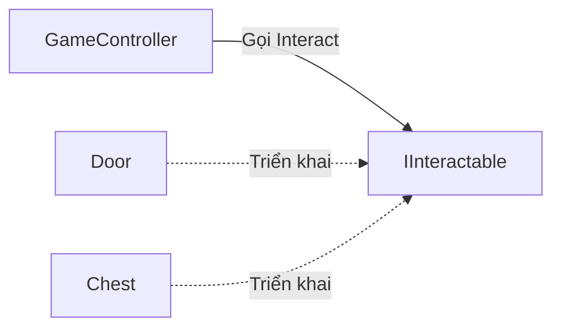

# Bài 06 — Kiểm tra kiến thức: Áp dụng các nguyên lý lập trình hướng đối tượng

> **Lộ trình:** Unity Learn — Junior Programmer  
> **Chủ đề:** Apply Object-Oriented Principles  
> **Môi trường tham chiếu:** Unity 6.3, C#  
> **Hình thức:** Kiểm tra tự luyện và giải thích đáp án

## 1. Mục tiêu đánh giá

Bài kiểm tra đánh giá khả năng **đọc và phân tích mã C#**, lựa chọn nguyên lý OOP phù hợp, phân biệt phạm vi truy cập, phát hiện thiết kế khó bảo trì và xác định nơi cần đo hiệu năng trong Unity. Mục đích không chỉ là ghi nhớ các định nghĩa mà còn là dự đoán hành vi chương trình và biện luận vì sao một thiết kế tốt hơn thiết kế khác.

Sau khi hoàn thành, bạn cần có khả năng:

1. Phân biệt abstraction, encapsulation, inheritance và polymorphism qua các tình huống gameplay.
2. Giải thích `public`, `private`, `protected`, biến cục bộ, property, `virtual` và `override`.
3. Nhận diện cách sử dụng extension method, refactoring, early return và trách nhiệm đơn nhất của lớp.
4. Phân biệt dữ liệu được Unity hiển thị bằng Inspector với quy tắc truy cập của C#.
5. Chọn cách kiểm tra vấn đề CPU hoặc physics thông qua Unity Profiler thay vì suy đoán từ FPS.

**Lưu ý:** Bộ câu hỏi dưới đây được **tự biên soạn** theo phạm vi kiến thức của mission. Đây **không phải** bản sao câu hỏi, đáp án hoặc bài thi chính thức của Unity. Bạn có thể làm quiz gốc tại [Unity Learn — Quiz: Apply object-oriented principles](https://learn.unity.com/pathway/junior-programmer/unit/apply-object-oriented-principles/quiz/quiz-apply-object-oriented-principles).

## 2. Hướng dẫn thực hiện

- Trả lời **16 câu trắc nghiệm**, mỗi câu chọn đúng **một** phương án A, B, C hoặc D.
- Đọc đoạn mã với giả định các khai báo cần thiết khác đã hợp lệ, trừ khi câu hỏi yêu cầu chỉ ra lỗi.
- Làm bài trước khi xem **Mục 5 — Đáp án và giải thích**.
- Tự chấm mỗi câu đúng 1 điểm. Mốc **12/16** được dùng làm mục tiêu luyện tập đề xuất, **không phải** ngưỡng đạt chính thức của Unity Learn.
- Nếu trả lời sai, hãy mô tả nguyên nhân bằng ngôn ngữ của mình và kiểm chứng những câu liên quan đến code trong một dự án C# hoặc Unity nhỏ.

## 3. Ôn tập kiến thức thiết yếu

### 3.1. Bốn nguyên lý OOP và phạm vi sử dụng

| Nguyên lý | Bài toán giải quyết | Ví dụ trong Unity |
|---|---|---|
| **Abstraction** (trừu tượng hóa) | Chỉ bộc lộ những thao tác cần thiết, không buộc nơi gọi biết chi tiết bên trong | Bộ điều khiển gọi `Interact()` mà không biết từng đối tượng xử lý ra sao |
| **Encapsulation** (đóng gói) | Kiểm soát cách đọc/sửa trạng thái, bảo vệ các bất biến của đối tượng | `Health` chỉ giảm qua `TakeDamage()`; không cho âm ngoài ý muốn |
| **Inheritance** (kế thừa) | Tái sử dụng đặc điểm/hành vi giữa các kiểu có quan hệ cha–con hợp lý | `Enemy` là lớp cha của `FlyingEnemy` |
| **Polymorphism** (đa hình) | Dùng một kiểu hoặc giao ước chung để gọi những triển khai khác nhau | Gọi `Attack()` trên `Enemy`, thực thi bản `override` phù hợp |

Bốn nguyên lý **bổ trợ chứ không thay thế** nhau. `interface` là một cách diễn tả giao ước trừu tượng; `private` không tự động khiến thiết kế trở nên tốt; kế thừa không phải cách duy nhất để tái sử dụng mã.



Sơ đồ diễn tả sự phụ thuộc của `GameController` vào **giao ước** `IInteractable`. `Door` và `Chest` thực thi tương tác theo cách khác nhau; bên gọi không cần kiểm tra từng lớp cụ thể.

### 3.2. Truy cập và đa hình trong C#

- `private`: chỉ được truy cập trực tiếp trong kiểu khai báo nó; lớp con không được tự ý truy cập field `private` của lớp cha.
- `protected`: cho phép lớp khai báo và các lớp dẫn xuất truy cập theo quy tắc của C#.
- `public`: thành viên có thể truy cập từ mã bên ngoài khi kiểu chứa nó cũng khả dụng.
- `virtual`: cung cấp triển khai có thể bị ghi đè; `override`: thay đổi triển khai ảo trong lớp con.
- `new` khi khai báo thành viên trùng tên: **che khuất** thành viên của lớp cha, không tương đương `override`.
- Biến **local** chỉ có phạm vi trong khối khai báo, không tự động trở thành dữ liệu của toàn bộ đối tượng.

### 3.3. Property không đồng nghĩa với bảo vệ dữ liệu

Trong C#:

```csharp
public int Score { get; set; }
```

Đây là một **auto-property** hợp lệ, nhưng mã khác vẫn có thể đặt `Score = -999`. Khi cần ràng buộc, thiết kế có thể dùng setter `private`, phương thức có kiểm tra, hoặc setter tự xác thực dữ liệu.

```csharp
private int score;

public int Score
{
    get => score;
    set => score = Mathf.Max(0, value);
}
```

Đoạn thứ hai là ví dụ **trong Unity C#** và dùng `Mathf` thuộc `UnityEngine`. Với Unity Inspector, một field được hỗ trợ serialization có thể xuất hiện khi nó là `public` hoặc được đánh dấu `[SerializeField]` dù là `private`. Unity mặc định không serialize property thông thường như serialize field; sửa giá trị field ngay trong Inspector cũng **không** gọi setter của property bao quanh field đó. Vì thế, kiểm tra dữ liệu runtime không nên chỉ dựa vào setter nếu Inspector có thể thay đổi field liên quan.

### 3.4. Tối ưu hiệu năng là quy trình đo lường

Đọc Console để xử lý exception, nhưng **Profiler** mới là công cụ phù hợp để tìm phần việc tiêu tốn thời gian CPU, gây cấp phát bộ nhớ hay hoạt động physics quá lớn. Trong Profiler, `PlayerLoop` bao quát các mẫu liên quan tới vòng lặp chính của ứng dụng, còn `EditorLoop` liên quan tới hoạt động của Editor; khi phân tích script gameplay cần chú ý các mẫu tương ứng trong `PlayerLoop`. Phép đo Editor là dữ liệu tham khảo, nên kiểm chứng trên build và thiết bị đích khi đánh giá hiệu năng thực tế.

## 4. Bộ câu hỏi trắc nghiệm

### 4.1. Câu 1 — Trách nhiệm đơn nhất

Lớp `PlayerController` vừa xử lý di chuyển, lưu file dữ liệu, tạo hóa đơn mua vật phẩm và phát nhạc. Cách tổ chức nào giúp dễ bảo trì nhất?

A. Chuyển mọi phương thức thành `static` trong `PlayerController`.  
B. Đổi tên lớp thành `GameManager`, giữ nguyên toàn bộ logic.  
C. Tách các trách nhiệm lưu dữ liệu, giao dịch và âm thanh sang thành phần thích hợp.  
D. Đặt tất cả field thành `public` để lớp khác dễ sửa.

### 4.2. Câu 2 — Nhận diện trừu tượng hóa

Một hệ thống gọi `Interact()` qua interface `IInteractable`, còn cửa mở và rương phát phần thưởng theo cách riêng. Lợi ích thiết kế trực tiếp nhất là gì?

A. Hệ thống tương tác giảm phụ thuộc vào chi tiết của từng kiểu đối tượng.  
B. Unity tự động bảo đảm tất cả đối tượng có Collider.  
C. Interface giúp mọi field được serialize.  
D. Mọi lớp triển khai interface phải kế thừa cùng một lớp cha cụ thể.

### 4.3. Câu 3 — Quan hệ kế thừa

Giả sử `EliteEnemy : Enemy` và `Enemy : Character`. Khẳng định nào đúng?

A. `EliteEnemy` chỉ nhận thành viên khai báo trong `Enemy`, không liên quan `Character`.  
B. C# cho phép `EliteEnemy` kế thừa trực tiếp nhiều lớp cha.  
C. `EliteEnemy` có thể truy cập trực tiếp mọi field `private` của `Character`.  
D. Kế thừa có tính bắc cầu: `EliteEnemy` cũng nhận các thành viên được kế thừa từ `Character`, tùy phạm vi truy cập.

### 4.4. Câu 4 — Quyền truy cập trong lớp con

Lớp cha có field `protected int speed;`. Trong phương thức của lớp con, thao tác nào phù hợp?

A. Không thể truy cập vì hai lớp khác file `.cs`.  
B. Có thể đọc/ghi `speed` trong lớp con theo quy tắc truy cập `protected`.  
C. Chỉ truy cập được khi field chuyển sang `private`.  
D. Chỉ truy cập được sau khi field chuyển thành `static`.

### 4.5. Câu 5 — `virtual` và `override`

Xét đoạn C# sau:

```csharp
class Enemy
{
    public virtual string Attack() => "Đòn thường";
}

class Boss : Enemy
{
    public override string Attack() => "Đòn đặc biệt";
}

Enemy target = new Boss();
string result = target.Attack();
```

Giá trị `result` là gì?

A. `"Đòn thường"` vì biến có kiểu `Enemy`.  
B. Chuỗi rỗng vì `Boss` chưa có constructor.  
C. `"Đòn đặc biệt"` vì lời gọi ảo chọn `override` theo kiểu đối tượng tại runtime.  
D. Lỗi biên dịch vì C# không cho gán `Boss` vào biến `Enemy`.

### 4.6. Câu 6 — Che khuất khác ghi đè

Một lớp con khai báo `public new void Show()` trùng phương thức không ảo `Show()` trong lớp cha. Nhận xét nào chính xác?

A. Đây là che khuất (*method hiding*); lời gọi có thể phụ thuộc kiểu tĩnh của biến tham chiếu.  
B. `new` tạo đa hình runtime giống hệt `override`.  
C. `new` sẽ tự động gọi cả hai phương thức.  
D. Mọi phương thức có `new` đều là extension method.

### 4.7. Câu 7 — Đóng gói trạng thái

Một đối tượng `PlayerHealth` không được để máu giảm xuống dưới 0. Thiết kế nào phù hợp nhất?

A. `public int health;` để mọi script có thể chỉnh bất kỳ lúc nào.  
B. Đặt field `health` là `static`, không cần kiểm tra giá trị.  
C. Chỉ đổi tên `health` thành `hp`.  
D. Giữ trạng thái được kiểm soát và cung cấp `TakeDamage()`/property phù hợp có xác thực giá trị.

### 4.8. Câu 8 — Auto-property và validation

Điều nào đúng về `public int Points { get; set; }`?

A. Setter tự động ngăn giá trị âm.  
B. Property này cho phép đọc/ghi công khai nhưng **không tự có** logic xác thực giá trị.  
C. Unity chắc chắn hiển thị property này trong Inspector như một field.  
D. Property chỉ dùng được trong lớp trừu tượng.

### 4.9. Câu 9 — Dữ liệu Inspector

Trong `MonoBehaviour`, bạn muốn một field `maxHealth` được chỉnh ở Inspector nhưng không trở thành API public. Khai báo nào thường dùng?

A. `private static int maxHealth = 100;`  
B. `private const int maxHealth = 100;`  
C. `[SerializeField] private int maxHealth = 100;`  
D. `public int MaxHealth { get; set; } = 100;`

### 4.10. Câu 10 — Extension method

Lựa chọn nào mô tả đúng extension method C# dùng cú pháp truyền thống?

A. Một phương thức `static` bên trong lớp `static`, có `this` ở tham số đầu để mở rộng cú pháp gọi trên một kiểu có sẵn.  
B. Một phương thức bắt buộc phải dùng `override` trên lớp con.  
C. Một field `public` được định nghĩa ở namespace.  
D. Một phương thức chỉ được Unity gọi trong `Update()`.

### 4.11. Câu 11 — Refactoring để tái sử dụng

Một hàm dài lặp lại cùng ba nhóm xử lý: định dạng tên, địa chỉ và số điện thoại; các màn hình khác cũng cần sử dụng những nhóm xử lý này. Cải tiến nào có ý nghĩa nhất?

A. Đổi tên các biến thành `a`, `b`, `c` để viết ngắn hơn.  
B. Copy toàn bộ hàm sang từng màn hình.  
C. Chuyển mọi phép xử lý thành các dòng `Debug.Log()` riêng lẻ.  
D. Tách các nhóm thành phương thức có trách nhiệm rõ ràng, truyền tham số phù hợp và gọi lại khi cần.

### 4.12. Câu 12 — Giảm lồng điều kiện

Đoạn mã nào thể hiện rõ nhất quy tắc: khi `hasKey` đúng trả 2, nếu không nhưng `isAdmin` đúng trả 1, còn lại trả 0?

A.

```csharp
if (isAdmin) return 2;
if (hasKey) return 1;
return 0;
```

B.

```csharp
if (hasKey) return 2;
if (isAdmin) return 1;
return 0;
```

C.

```csharp
if (hasKey && isAdmin) return 2;
return 1;
```

D.

```csharp
if (hasKey) return 2;
return 0;
```

### 4.13. Câu 13 — Biến cục bộ và field

Xét lớp:

```csharp
class Counter
{
    private int total;

    public void Add()
    {
        int increment = 1;
        total += increment;
    }
}
```

Khẳng định nào chính xác?

A. `increment` có thể truy cập trực tiếp từ mọi phương thức trong `Counter`.  
B. `total` chỉ tồn tại khi `Add()` đang chạy.  
C. `increment` là biến cục bộ trong `Add()`, còn `total` là field của đối tượng `Counter`.  
D. Cả hai đều là field vì nằm trong khai báo lớp `Counter`.

### 4.14. Câu 14 — Đọc dữ liệu CPU Profiler

Trong Unity Editor đang chạy Play mode, bạn muốn khảo sát thời gian xử lý gameplay của ứng dụng. Nhóm mẫu nào phù hợp để bắt đầu truy vết?

A. `EditorLoop` vì chỉ có Unity Editor mới chạy code gameplay.  
B. `PlayerLoop` và các mẫu liên quan tới script chạy trong vòng lặp ứng dụng.  
C. Tên bất kỳ trong Console, không cần dùng Profiler.  
D. `AssetImport` vì tất cả thời gian CPU đều thuộc nhập asset.

### 4.15. Câu 15 — Đánh giá tối ưu hóa

Bạn thay đổi cách cập nhật của 500 đối tượng và thấy FPS trong Editor tăng. Kết luận nào đáng tin cậy nhất?

A. Cải thiện đã được chứng minh trên mọi thiết bị.  
B. Không cần đo vì FPS tăng luôn chứng minh script là điểm nghẽn.  
C. Chỉ cần xem một frame có FPS cao nhất.  
D. Cần ghi lại phép đo trước/sau trong điều kiện tương đương và kiểm chứng trên build/thiết bị đích.

### 4.16. Câu 16 — Physics và chi phí tính toán

Thiết kế nào **đáng được kiểm tra kỹ bằng Profiler** vì có nguy cơ tạo chi phí physics đáng kể?

A. Một cơ cấu gồm nhiều `Rigidbody` nối bằng `Joint` và nhiều Collider đang tiếp xúc/va chạm đồng thời.  
B. Hai đối tượng tĩnh ở hai góc xa nhau của scene, không tương tác.  
C. Một GameObject trống không có Component vật lý.  
D. Một hằng số `const int MaxItems = 10`.

## 5. Đáp án và giải thích

| Câu | Đáp án | Kiến thức |
|---|:---:|---|
| 1 | C | Phân tách trách nhiệm |
| 2 | A | Abstraction, giao ước chung |
| 3 | D | Kế thừa bắc cầu |
| 4 | B | `protected` |
| 5 | C | Dispatch động với `override` |
| 6 | A | Method hiding với `new` |
| 7 | D | Encapsulation, bảo toàn trạng thái |
| 8 | B | Auto-property và validation |
| 9 | C | `[SerializeField]` |
| 10 | A | Extension method |
| 11 | D | Refactoring và tái sử dụng |
| 12 | B | Thứ tự điều kiện và early return |
| 13 | C | Local variable so với field |
| 14 | B | Profiler, `PlayerLoop` |
| 15 | D | Phép đo có đối chứng |
| 16 | A | Chi phí mô phỏng physics |

### 5.1. Giải thích các câu 1–4

- **Câu 1 — C:** Tách chức năng có lý do thay đổi khác nhau giúp mã ít phụ thuộc lẫn nhau, dễ kiểm thử. Một lớp lớn chứa nhiều việc không trở nên đúng thiết kế chỉ nhờ đổi tên hoặc thêm `static`.
- **Câu 2 — A:** Giao ước tách *khả năng tương tác* khỏi cách triển khai của từng đối tượng. Interface không làm Collider tự xuất hiện và không tạo quan hệ kế thừa lớp cha duy nhất.
- **Câu 3 — D:** Trong C#, một lớp chỉ có một lớp cha trực tiếp, nhưng kế thừa có tính bắc cầu. Việc có thành viên được kế thừa không đồng nghĩa thành viên `private` của lớp tổ tiên có thể truy cập trực tiếp.
- **Câu 4 — B:** `protected` có mục đích phục vụ nội bộ lớp và lớp dẫn xuất. Ranh giới file `.cs` không quyết định quyền truy cập này.

### 5.2. Giải thích các câu 5–8

- **Câu 5 — C:** `target` tham chiếu đến một đối tượng thực tế kiểu `Boss`; gọi phương thức ảo dẫn tới `Boss.Attack()`. Nếu phương thức được khai báo không ảo và che khuất bằng `new`, quy tắc sẽ khác.
- **Câu 6 — A:** `new` khai báo rằng thành viên lớp con **che** thành viên lớp cha; cách phân giải thường dựa vào kiểu tĩnh của biểu thức. Nó không tạo cơ chế ghi đè ảo.
- **Câu 7 — D:** Bảo vệ field và cung cấp các thao tác hợp lệ giúp tránh trạng thái vô nghĩa như máu âm. Chỉ dùng field `private` chưa đủ nếu phương thức cập nhật vẫn cho phép dữ liệu sai.
- **Câu 8 — B:** Auto-property công khai đơn thuần tạo quyền đọc/ghi. Nếu cần giá trị không âm, phải bổ sung validation hoặc giới hạn quyền sửa.

### 5.3. Giải thích các câu 9–12

- **Câu 9 — C:** `[SerializeField]` cho Unity serialize một field `private` hợp lệ và hiển thị nó trong Inspector. Field `static`/`const` không thuộc nhóm field instance được serialize theo quy tắc thông thường.
- **Câu 10 — A:** Extension method cú pháp truyền thống nằm trong lớp `static` và có tham số nhận kiểu mở rộng bắt đầu bằng `this`. Đây là cú pháp mở rộng cách **gọi** mà không cần sửa mã của kiểu gốc hay tạo lớp kế thừa.
- **Câu 11 — D:** Chia logic theo nhóm có ý nghĩa giúp tái sử dụng, kiểm thử và đặt tên rõ ràng hơn. Không phải mọi đoạn mã dài đều phải chia nhỏ; nên tách khi có trách nhiệm hoặc logic lặp hợp lý.
- **Câu 12 — B:** Ưu tiên `hasKey` trước rồi mới xét `isAdmin`, vì điều kiện đầu tiên đúng sẽ trả ngay. Cách viết early return giảm lồng cấp mà vẫn giữ đúng thứ tự ưu tiên.

### 5.4. Giải thích các câu 13–16

- **Câu 13 — C:** `increment` là biến cục bộ có phạm vi trong thân `Add()`, còn `total` là field của mỗi instance `Counter`. Hai biến khác nhau về phạm vi và thời gian tồn tại.
- **Câu 14 — B:** `PlayerLoop` là nơi thích hợp để lần theo hoạt động gameplay trong CPU Profiler. Khi đo Editor còn có chi phí riêng của công cụ, nên tránh đồng nhất `EditorLoop` với hiệu năng người chơi nhận được trên build.
- **Câu 15 — D:** Một khác biệt FPS chỉ là tín hiệu ban đầu. Điều kiện test, số frame quan sát, platform và tác động của Editor phải được kiểm soát khi so sánh.
- **Câu 16 — A:** Nhiều thân động lực học, khớp và va chạm đồng thời có thể tạo nhiều công việc cho hệ thống physics; mức độ thực tế phụ thuộc cấu hình và hiện trường, nên phải đo thay vì tuyên bố chắc chắn một số FPS cụ thể.

## 6. Bài kiểm chứng ngắn trong Unity

Bốn câu sau phù hợp để kiểm chứng thực tế nếu bạn làm sai hoặc còn phân vân:

1. **Câu 5:** Tạo class cha có phương thức `virtual`, class con có `override`, gọi qua biến kiểu cha và quan sát kết quả trong Console.
2. **Câu 8–9:** Thử một auto-property và một field `[SerializeField] private int ...` trên `MonoBehaviour`; quan sát những gì xuất hiện trong Inspector. Nếu dùng setter để kiểm tra dữ liệu, kiểm tra thêm việc sửa **field** trong Inspector có gọi setter không.
3. **Câu 12:** Chạy cả bốn tổ hợp giá trị boolean `hasKey` và `isAdmin`, lập bảng kết quả rồi đối chiếu thứ tự điều kiện.
4. **Câu 14:** Mở **Window > Analysis > Profiler**; chạy Play mode, chọn CPU Usage, lần theo mẫu trong `PlayerLoop`. Không lấy một lần đo ngẫu nhiên làm bằng chứng tối ưu hóa toàn dự án.

## 7. Tự đánh giá và kế hoạch ôn tập

- **14–16 câu đúng:** Nắm khá chắc nội dung; nên chuyển sang bài nộp thực hành.
- **12–13 câu đúng:** Đạt mục tiêu tự luyện; xem lại các câu sai và tái hiện ít nhất một ví dụ mã.
- **Dưới 12 câu đúng:** Ôn theo nhóm sai nhiều nhất: OOP, truy cập/trạng thái hoặc profiling/refactoring, sau đó làm lại bài với thứ tự câu ngẫu nhiên.

Đánh giá này phục vụ việc tự học, không phải kết quả do Unity Learn cấp.

## 8. Tài liệu tham khảo

1. [Unity Learn — Apply Object-Oriented Principles](https://learn.unity.com/pathway/junior-programmer/unit/apply-object-oriented-principles?version=6.3).
2. [Unity Learn — Quiz: Apply object-oriented principles](https://learn.unity.com/pathway/junior-programmer/unit/apply-object-oriented-principles/quiz/quiz-apply-object-oriented-principles) — phạm vi đánh giá chính thức (bộ câu hỏi trong tài liệu này là tự luyện).
3. [Microsoft Learn — Object-oriented programming (C#)](https://learn.microsoft.com/en-us/dotnet/csharp/fundamentals/tutorials/oop).
4. [Microsoft Learn — Inheritance](https://learn.microsoft.com/en-us/dotnet/csharp/fundamentals/object-oriented/inheritance) và [Polymorphism](https://learn.microsoft.com/en-us/dotnet/csharp/fundamentals/object-oriented/polymorphism).
5. [Microsoft Learn — Extension members / extension methods](https://learn.microsoft.com/en-us/dotnet/csharp/programming-guide/classes-and-structs/extension-methods).
6. [Unity Scripting API — SerializeField](https://docs.unity3d.com/6000.3/Documentation/ScriptReference/SerializeField.html) và [Unity Manual — Script serialization](https://docs.unity3d.com/6000.3/Documentation/Manual/script-serialization.html).
7. [Unity Manual — Profiling your application](https://docs.unity3d.com/6000.3/Documentation/Manual/profiler-profiling-applications.html).

> Ghi chú: Unity, phiên bản C# đi kèm và giao diện công cụ có thể thay đổi. Các ví dụ ở đây ưu tiên cú pháp phổ biến và phạm vi cơ bản của Unity 6.x.
