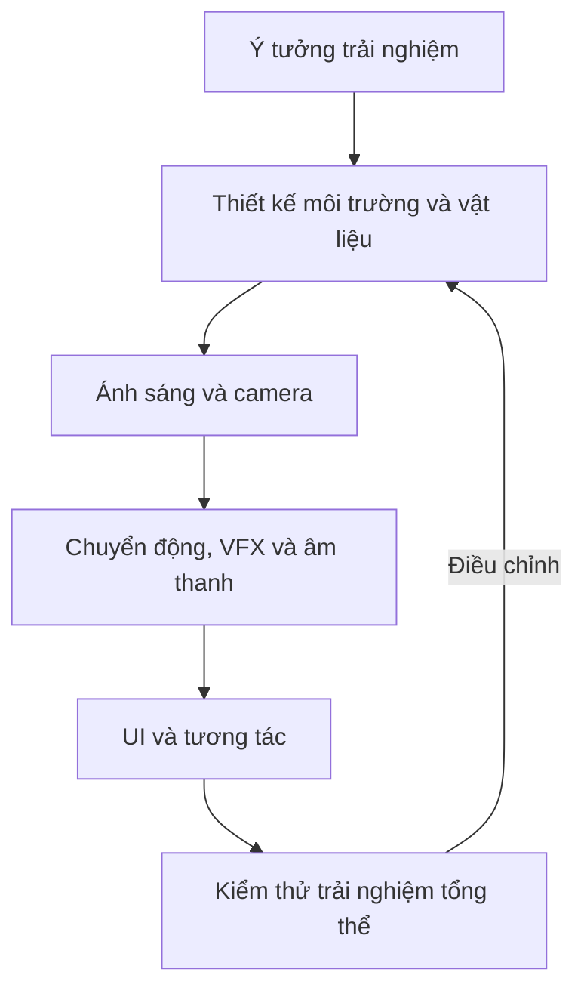

# Bài 01 — Giới thiệu lộ trình Creative Core

> **Khóa học:** Unity Learn — Creative Core  
> **Học phần:** Introduction to Creative Core · **Mức độ:** Cơ bản (đã biết thao tác Editor)  
> **Trọng tâm:** Hiểu hệ sinh thái kỹ năng sáng tạo 3D thời gian thực và cách học theo dự án.

## 1. Tổng quan

Một trải nghiệm 3D hấp dẫn không chỉ hình thành từ mô hình 3D. Người thiết kế còn phải quyết định bề mặt trông ra sao, ánh sáng dẫn hướng mắt người xem thế nào, camera kể chuyện bằng góc nhìn nào và âm thanh phản hồi hành động ra sao. **Creative Core** là lộ trình phát triển các kỹ năng sáng tạo cốt lõi trong **Unity Editor**, với các bài thực hành không yêu cầu phải lập trình.

Lộ trình dành cho người muốn xây dựng môi trường 3D tương tác: họa sĩ 3D, nhà thiết kế game, người làm diễn họa kiến trúc, người tạo nội dung AR/VR, lập trình viên muốn hiểu pipeline mỹ thuật và cả người học theo sở thích. Cần biết những thao tác nền tảng như mở project, điều hướng Scene view, chọn GameObject và thay đổi thuộc tính trong Inspector. Người hoàn toàn mới nên học **Unity Essentials** trước.

## 2. Mục tiêu học tập

Sau bài học, người học có thể:

- Giải thích vai trò của ít nhất sáu lĩnh vực sáng tạo trong một môi trường 3D thời gian thực.
- Phân biệt **core mission**, **guided project**, **independent project** và **creator skills**.
- Phân tích một cảnh 3D thành các thành phần cần được thiết kế và đánh giá.
- Lập kế hoạch lưu kết quả thực hành để xây dựng portfolio.

## 3. Những lĩnh vực sáng tạo cốt lõi

| Lĩnh vực | Câu hỏi thiết kế cần giải quyết | Sản phẩm thử nghiệm |
|---|---|---|
| **Shaders & Materials** | Bề mặt phản xạ ánh sáng và biểu đạt chất liệu thế nào? | Kim loại, gỗ, kính có cảm nhận khác nhau |
| **Lighting** | Ánh sáng hướng sự chú ý, thiết lập thời điểm và cảm xúc ra sao? | Hai phương án chiếu sáng cho cùng một cảnh |
| **Animation** | Đối tượng hoặc nhân vật thay đổi theo thời gian thế nào? | Cửa mở, bóng nảy, nhân vật cử động |
| **VFX** | Diễn tả những hiện tượng như lửa, khói, thời tiết ra sao? | Hiệu ứng hạt hoặc hiệu ứng trực quan |
| **Cameras** | Người xem nhìn thấy gì, ở đâu, bằng góc nhìn nào? | Bố cục từ camera tĩnh và camera động |
| **Post-processing** | Điều chỉnh hình ảnh cuối cùng để đạt phong cách mong muốn ra sao? | Hiệu chỉnh màu và tương phản |
| **Audio** | Âm thanh cung cấp không khí và phản hồi sự kiện thế nào? | Âm môi trường và âm hiệu ứng |
| **UI** | Người dùng điều khiển và đọc thông tin bằng gì? | Menu, nút bấm, thanh điều chỉnh |

**Không được nhầm:** `Material` mô tả các tham số bề mặt sử dụng `Shader`; `Lighting` xác định cách ánh sáng tác động lên cảnh; `Post-processing` xử lý hình ảnh sau những bước dựng hình liên quan. Ba công việc này có quan hệ chặt chẽ nhưng không thể thay thế nhau.

**Tư duy tích hợp**

Ví dụ, một cửa hàng ngoài hành tinh có thể dùng vật liệu phát sáng trên biển hiệu; nguồn sáng hỗ trợ làm nổi bật lối vào; animation khiến cửa tự mở; VFX tạo tia lửa; âm thanh báo khi khách đến; camera dẫn mắt vào quầy; UI hướng dẫn tương tác. Nếu từng phần được thiết kế riêng lẻ mà không kiểm thử chung, cảnh có thể đẹp nhưng thiếu tính nhất quán.

Sơ đồ biểu diễn một vòng lặp thiết kế, **không phải** thứ tự cứng: nhiều hạng mục có thể được triển khai song song, nhưng kết quả cuối cần được đánh giá khi kết hợp.

## 4. Cấu trúc học theo dự án

**Core missions** là những học phần luyện kỹ năng riêng, có thực hành và bước kiểm tra. **Guided project** là dự án tích hợp xuyên suốt lộ trình: người học chọn một concept, đọc **design document** và dần đáp ứng các yêu cầu theo từng lĩnh vực. **Independent project** là dự án cuối, do người học chủ động đề xuất ý tưởng và phát triển prototype. Ngoài kỹ thuật, **creator skills** bao gồm tôn trọng bản quyền, đọc tài liệu kỹ thuật và đánh giá thông tin có phê phán.

Ba concept được cung cấp cho guided project gồm: **Alien Video Game Shop** (cửa hàng game của người ngoài hành tinh, phong cách hoạt hình), **Beachside Town** (thị trấn ven biển cách điệu) và **Architectural Rendering** (diễn họa kiến trúc hiện thực). Mỗi concept có điểm mạnh riêng về hình khối, chất liệu, bố cục và ánh sáng.

Khi xây portfolio, nên lưu **ảnh trước–sau**, mục tiêu của mỗi thay đổi, thành phần đã thực hiện và giới hạn còn tồn tại; chỉ đăng một ảnh đẹp cuối cùng sẽ khó chứng minh quá trình giải quyết vấn đề.

## 5. Thực hành: phân tích một cảnh 3D

1. Mở bất kỳ Scene 3D nào do bạn sở hữu hoặc có quyền sử dụng trong Unity.
2. Chụp một ảnh từ Game view; mô tả cảm giác thị giác của cảnh bằng ba tính từ cụ thể.
3. Ghi lại ít nhất **sáu** thành phần: vật liệu, ánh sáng, camera, chuyển động, VFX, âm thanh hoặc UI. Thành phần nào chưa có thì ghi **chưa triển khai**.
4. Đề xuất **một** thay đổi quan sát được, chẳng hạn tăng độ tương phản giữa cửa ra vào và tường, thay vì nhận xét chung chung “làm đẹp hơn”.
5. Tạo bảng so sánh *vấn đề → thay đổi → cách kiểm chứng*; sau đó thử lại trong Game view.

**Đầu ra:** một ảnh chụp cảnh và một bảng nêu tối thiểu ba đề xuất cải tiến có cơ sở.

## 6. Lỗi tư duy thường gặp

- **Đồng nhất Creative Core với lập trình game:** Trọng tâm là kỹ năng hình ảnh và trải nghiệm; code có thể hữu ích nhưng không phải điều kiện bắt buộc để học lộ trình này.
- **Tối ưu từng hiệu ứng mà quên mục tiêu chung:** Tăng cường Bloom có thể đẹp riêng lẻ nhưng khiến người xem không đọc được chữ UI.
- **Học thụ động:** Xem video không thay thế được việc thay đổi tham số, quan sát và giải thích kết quả trong Editor.

## 7. Câu hỏi ôn tập

**Câu 1.** Một cảnh có vật liệu đẹp nhưng không rõ điểm nhấn. Kỹ năng nào cần phối hợp trước tiên?  
A. Lighting và Cameras · B. Chỉ sửa tên GameObject · C. Chỉ tăng kích thước file · D. Chỉ chỉnh âm lượng  
**Đáp án: A.** Ánh sáng và góc camera ảnh hưởng trực tiếp đến sự chú ý của người xem.

**Câu 2.** Guided project khác independent project ở điểm nào?  
A. Luôn không cần asset · B. Guided project sử dụng thiết kế và yêu cầu có sẵn · C. Independent project không cần đánh giá · D. Guided project chỉ dùng code  
**Đáp án: B.** Guided project được dẫn dắt bởi design document; independent project cho phép tự xây dựng concept.

**Câu 3.** Vì sao một thay đổi vật liệu có thể cần kiểm tra lại ánh sáng?  
A. Hai thứ không liên quan · B. Ánh sáng chỉ ảnh hưởng âm thanh · C. Cảm nhận chất liệu phụ thuộc điều kiện chiếu sáng · D. Material chỉ xuất hiện khi build  
**Đáp án: C.** Shading của bề mặt và ánh sáng cùng quyết định hình ảnh cuối.

**Câu 4.** Ai phù hợp với Creative Core?  
A. Chỉ lập trình viên C# · B. Chỉ nghệ sĩ 2D · C. Chỉ chuyên gia rendering · D. Nhiều vai trò sáng tạo có kiến thức Editor cơ bản  
**Đáp án: D.** Lộ trình hướng đến các nhà sáng tạo 3D và người muốn hiểu workflow liên ngành.

**Câu 5.** Minh chứng portfolio nào có giá trị học tập nhất?  
A. Chỉ tên project · B. Ảnh kết quả, mục tiêu và giải thích các quyết định thiết kế · C. Chỉ số lượng asset · D. Chỉ ảnh menu Hub  
**Đáp án: B.** Minh chứng cho thấy cả sản phẩm lẫn quá trình giải quyết vấn đề.

## 8. Tổng kết

Creative Core phát triển tư duy thiết kế **liên ngành**: các kỹ năng khác nhau hỗ trợ nhau để hình thành một trải nghiệm thống nhất. Học có hiệu quả khi quan sát, thử nghiệm, giải thích và lưu lại kết quả; guided project là nơi liên kết kiến thức vào một sản phẩm có yêu cầu rõ ràng.

## 9. Tài liệu học thêm

- [Unity Learn — Welcome to the Creative Core Pathway](https://learn.unity.com/pathway/creative-core/unit/introduction-to-creative-core/tutorial/welcome-to-the-creative-core-pathway?version=6.3)
- [Unity Learn — Creative Core Pathway](https://learn.unity.com/pathway/creative-core)
- [Unity Learn — Unity Essentials](https://learn.unity.com/pathway/unity-essentials)
