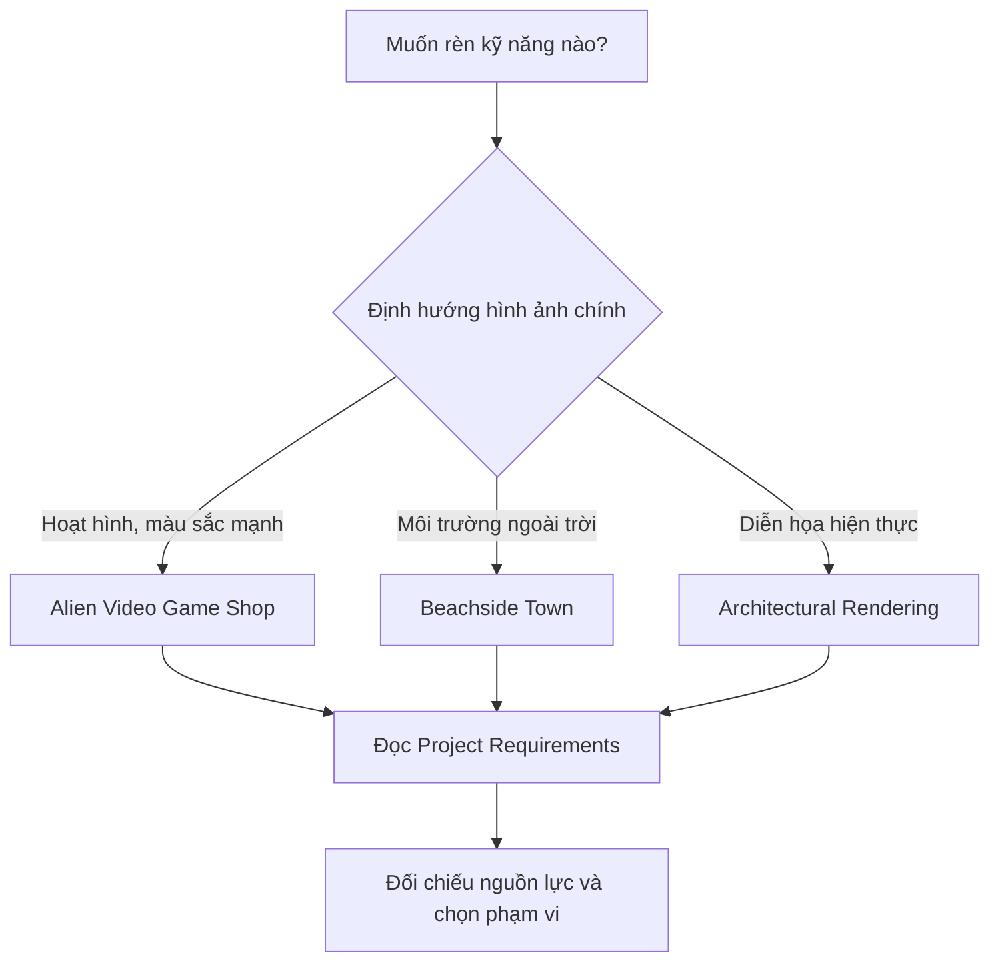

# Bài 03 — Lựa chọn dự án có hướng dẫn (Guided Project)

> **Khóa học:** Creative Core · **Học phần:** Introduction to Creative Core  
> **Loại bài:** Lập kế hoạch dự án · **Trọng tâm:** Đọc design document, so sánh concept và lựa chọn phạm vi.

## 1. Bài toán

Trong một dự án 3D, yêu cầu “tạo một cảnh đẹp” không đủ rõ để triển khai hoặc đánh giá. Cần biết cảnh phục vụ ai, phong cách hình ảnh nào được mong đợi và mỗi hệ thống — vật liệu, ánh sáng, âm thanh, hiệu ứng, animation, UI — cần đáp ứng điều gì. **Design document** là tài liệu làm rõ các quyết định này trước và trong quá trình sản xuất.

Trong Creative Core, **guided project** không cung cấp hướng dẫn từng cú nhấp chuột cho toàn bộ sản phẩm. Thay vào đó, người học chọn một trong ba thiết kế có sẵn, nghiên cứu yêu cầu và vận dụng kỹ năng từ các mission để hoàn thiện một cảnh thống nhất. Đây là cách tập luyện gần với quy trình làm dự án có yêu cầu thực tế.

## 2. Mục tiêu học tập

- Giải thích vai trò của **design document** trong giai đoạn pre-production.
- Phân biệt thông tin về **bối cảnh, người xem, hình thức** và **yêu cầu triển khai**.
- So sánh ba mẫu guided project bằng tiêu chí phù hợp với mục tiêu học.
- Chuyển ít nhất ba yêu cầu nghệ thuật thành tiêu chí có thể kiểm tra trong Unity.

## 3. Design document là gì?

**Design document** là tài liệu định hướng cấu trúc, chức năng và phong cách dự kiến của sản phẩm. Nó là điểm tham chiếu chung để người phụ trách các hạng mục khác nhau tránh làm lệch mục tiêu. Với dự án nhỏ, tài liệu có thể ngắn; với sản xuất lớn, nhiều bộ phận có thể dùng thêm concept art, technical specification, shot list hay asset list.

Trong ba mẫu Creative Core, tài liệu thiết kế được tổ chức thành hai phần quan trọng:

- **Project Overview:** mục đích, đối tượng trải nghiệm, bối cảnh, phong cách tổng thể và hình ảnh concept.
- **Project Requirements:** yêu cầu cụ thể cho các kỹ năng như Shaders & Materials, Lighting, Animation, VFX, Cameras, Audio, UI và Post-processing.

Ví dụ: “cửa hàng trông vui nhộn” là định hướng phong cách; “biển hiệu nổi bật hơn tường xung quanh khi quan sát từ camera chính” là tiêu chí kiểm chứng có thể xây dựng từ định hướng đó. **Ví dụ này là một cách chuyển hóa yêu cầu để thực hành, không phải câu trích từ bộ design document của Unity.**

## 4. Ba lựa chọn guided project

| Tiêu chí | Alien Video Game Shop | Beachside Town | Architectural Rendering |
|---|---|---|---|
| Không gian | Nội thất cửa hàng trò chơi của người ngoài hành tinh | Thị trấn ven biển lấy cảm hứng từ Brighton, Anh | Công trình kiến trúc hiện đại với ngoại thất và nội thất |
| Phong cách | Hoạt hình, màu sắc táo bạo, biến dạng cách điệu | Cách điệu, màu dịu, pha nét hiện thực | Tỉ lệ, chất liệu và ánh sáng hướng hiện thực |
| Thế mạnh học tập gợi ý | Material giàu biểu cảm, hiệu ứng, màu sắc | Bố cục môi trường ngoài trời, ánh sáng và cảnh quan | Vật liệu kiến trúc, ánh sáng thực tế và bố cục diễn họa |
| Bối cảnh ứng dụng | Trò chơi, trải nghiệm tương tác hoặc VR | Cấp độ game, hoạt hình, ý tưởng môi trường | Trực quan hóa kiến trúc, AR/VR hoặc cấu hình vật liệu |

Cột **“Thế mạnh học tập gợi ý”** là định hướng phân tích để chọn dự án; không có nghĩa các kỹ năng còn lại bị loại khỏi dự án đó. Tất cả đều được thiết kế để tích hợp nhiều lĩnh vực Creative Core.

**Chọn dự án bằng tiêu chí rõ ràng**

Không có một mẫu nào mặc nhiên tốt hơn mẫu khác. Hãy ghi mức ưu tiên của các tiêu chí: mức độ yêu thích phong cách, kỹ năng muốn phát triển, khả năng thiết bị hiện có và mức độ phù hợp với portfolio mong muốn. Sau đó chọn **một** mẫu để có điều kiện hoàn thiện sâu, thay vì chuyển dự án liên tục.

Sơ đồ là **công cụ ra quyết định tham khảo**; mục tiêu của bạn có thể khiến bạn chọn một dự án khác với nhánh gợi ý.

## 5. Cách biến yêu cầu thành công việc

Sau khi chọn một tài liệu thiết kế, tạo **requirement matrix** để liên hệ yêu cầu và sản phẩm thực hành.

| Mã | Hạng mục | Yêu cầu diễn giải | Minh chứng hoàn thành |
|---|---|---|---|
| R1 | Materials | Bề mặt chính thể hiện đúng phong cách đã chọn | Ảnh cận cảnh ở ánh sáng chuẩn của cảnh |
| R2 | Lighting | Điểm nhấn và lối quan sát dễ nhận ra | Ảnh Game view từ camera chính |
| R3 | Animation | Một thành phần chuyển động mạch lạc | Video ngắn thể hiện diễn tiến |
| R4 | Audio | Âm thanh phù hợp không gian và hành động | Video ghi lại âm thanh khi thử |
| R5 | UI | Các nút điều khiển dễ nhìn và có phản hồi | Kiểm tra thao tác và chụp màn hình |

Bảng trên là **ví dụ phương pháp**, không thay thế các yêu cầu chi tiết trong design document mà bạn chọn. Trong thực hành, hãy chép tên và điều kiện cụ thể từ tài liệu tương ứng vào cột thứ ba.

Một yêu cầu có chất lượng cần trả lời được: **cần làm gì, để đạt điều gì và làm thế nào chứng minh đã đạt**. Nếu chưa đo được bằng thông số, vẫn có thể kiểm tra bằng ảnh đối chiếu, thử nghiệm người xem hoặc tiêu chí đánh giá có mô tả rõ.

## 6. Bài thực hành lựa chọn dự án

1. Truy cập [bài học chọn guided project](https://learn.unity.com/pathway/creative-core/unit/introduction-to-creative-core/tutorial/select-your-guided-project?version=6.3) và mở ba design document liên kết trong phần *Select a project design*.
2. Với mỗi mẫu, ghi lại hai điểm hấp dẫn, một rủi ro và kỹ năng bạn mong muốn rèn luyện.
3. Chọn một mẫu; viết **một câu mục tiêu** cho cảnh hoàn thiện.
4. Đọc hai phần **Project Overview** và **Project Requirements** của mẫu đã chọn; trích lại ít nhất năm yêu cầu vào bảng công việc của riêng bạn.
5. Chia công việc thành các nhóm ưu tiên: bắt buộc, nên làm, có thể thử thêm. Không tự ý loại yêu cầu bắt buộc mà không ghi nhận thay đổi phạm vi.

**Đầu ra:** tên dự án đã chọn, lý do chọn, một bảng yêu cầu có minh chứng kiểm thử và danh sách tài nguyên cần chuẩn bị.

## 7. Lỗi thường gặp

- **Lấy cảm hứng nhầm thành yêu cầu:** hình ảnh concept thể hiện ý định thị giác, trong khi mục Requirements mô tả những điều cần đáp ứng.
- **Không quay lại design document:** phải kiểm tra yêu cầu khi hoàn thành mỗi mission; không chỉ đọc một lần lúc bắt đầu.
- **Vượt phạm vi quá sớm:** thêm cơ chế game phức tạp có thể khiến bạn không hoàn thành Lighting hoặc Materials là trọng tâm ban đầu.
- **Không có bằng chứng:** khó biết một yêu cầu đã đạt nếu không lưu ảnh, video hoặc kết quả thử nghiệm.

## 8. Câu hỏi ôn tập

**Câu 1.** Chức năng chính của design document trong guided project là gì?  
A. Thay thế Editor · B. Tự sinh asset · C. Làm chuẩn tham chiếu cho mục tiêu và yêu cầu · D. Chỉ lưu danh sách code  
**Đáp án: C.** Tài liệu thống nhất cách hiểu về sản phẩm cần làm.

**Câu 2.** Mục nào thuộc Project Overview?  
A. Đối tượng trải nghiệm và concept art · B. Danh sách lỗi Console · C. Nhật ký commit bắt buộc · D. Chỉ số FPS của máy cá nhân  
**Đáp án: A.** Overview mô tả bối cảnh và định hướng tổng thể.

**Câu 3.** Mẫu nào ưu tiên định hướng diễn họa hiện thực?  
A. Alien Video Game Shop · B. Beachside Town · C. Cả ba bắt buộc là hoạt hình · D. Architectural Rendering  
**Đáp án: D.** Mẫu kiến trúc chú trọng vật liệu, tỉ lệ và ánh sáng hướng hiện thực.

**Câu 4.** Nếu yêu cầu nói “phải có tương tác rõ ràng”, cách tiếp cận tốt nhất là gì?  
A. Chỉ chụp ảnh tĩnh · B. Chuyển thành trường hợp thao tác có phản hồi để thử · C. Bỏ qua yêu cầu · D. Đổi tên Scene  
**Đáp án: B.** Điều kiện kiểm thử giúp xác nhận yêu cầu đã được thực hiện.

**Câu 5.** Khi hoàn thành mission Lighting, nên làm gì với guided project?  
A. Xóa design document · B. Đổi sang dự án khác · C. Mở lại yêu cầu Lighting và đối chiếu thành phẩm · D. Không cần kiểm tra  
**Đáp án: C.** Guided project được tích lũy và kiểm tra theo các lĩnh vực của lộ trình.

## 9. Tổng kết

Guided project là bài tập xây dựng sản phẩm **theo đặc tả**, chứ không chỉ dựng cảnh theo cảm hứng. Chọn đúng concept, hiểu design document và tạo bảng yêu cầu có minh chứng giúp quá trình học rõ ràng, có thể đánh giá và có giá trị portfolio.

## 10. Tài liệu học thêm

- [Unity Learn — Select your guided project](https://learn.unity.com/pathway/creative-core/unit/introduction-to-creative-core/tutorial/select-your-guided-project?version=6.3) — nơi cung cấp liên kết ba bản thiết kế.
- [Unity Learn — Welcome to Creative Core](https://learn.unity.com/pathway/creative-core/unit/introduction-to-creative-core/tutorial/welcome-to-the-creative-core-pathway?version=6.3)
