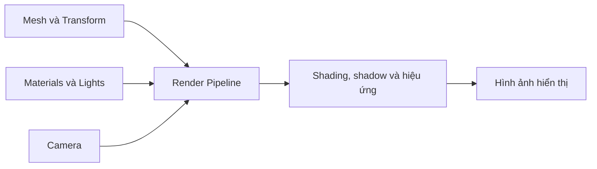

# Bài 04 — Khởi tạo Guided Project và lựa chọn Render Pipeline

> **Khóa học:** Creative Core · **Học phần:** Introduction to Creative Core  
> **Loại bài:** Thực hành thiết lập · **Môi trường:** Unity 6.x, hướng đến Unity 6.3  
> **Kết quả:** Một dự án URP, Scene làm việc và `StarterEnvironment` của guided project.

## 1. Vấn đề cần giải quyết

Trước khi bắt đầu thiết kế cảnh 3D, cần chọn cấu hình kết xuất phù hợp. Hai dự án có cùng mesh và texture nhưng khác render pipeline có thể cho kết quả ánh sáng và vật liệu khác nhau. Việc lựa chọn từ đầu giảm khả năng phải chuyển đổi material, shader hoặc thiết lập hậu kỳ khi dự án đã phát triển.

## 2. Mục tiêu học tập

- Giải thích được **rendering**, **render pipeline** và **Scriptable Render Pipeline**.
- So sánh **Built-In**, **URP** và **HDRP** dựa trên mục tiêu phần cứng và workflow.
- Tạo dự án **Universal 3D (URP)** và xác định Render Pipeline Asset đang áp dụng.
- Tạo Scene, nhập tài nguyên guided project và đặt `StarterEnvironment` vào Hierarchy.
- Chẩn đoán được lỗi cơ bản như vật liệu màu hồng hoặc thiếu prefab.

## 3. Từ dữ liệu 3D đến hình ảnh

**Rendering** là quá trình tính toán hình ảnh hiển thị dựa trên thông tin của cảnh. Đầu vào bao gồm hình học (mesh), vị trí và hướng, shader/material, camera, nguồn sáng và một số hiệu ứng; đầu ra thường là hình ảnh 2D từ góc nhìn camera. **Render pipeline** là trình tự các bước hệ thống dùng để tạo ra kết quả đó.

Sơ đồ cố ý đơn giản hóa pipeline; các chi tiết như render passes, culling và cấu hình pipeline tùy dự án. Nó giúp xác định tại sao thay đổi nguồn sáng hoặc shader có thể làm đổi ảnh cuối dù mesh giữ nguyên.

**So sánh ba lựa chọn trong Unity**

| Pipeline | Đặc điểm chính | Trường hợp phù hợp |
|---|---|---|
| **Built-In Render Pipeline** | Pipeline tích hợp truyền thống; ít khả năng tùy chỉnh kiến trúc kết xuất so với SRP | Duy trì dự án và shader cũ hoặc trường hợp phụ thuộc hệ thống Built-In |
| **Universal Render Pipeline (URP)** | Scriptable Render Pipeline đa nền tảng, có khả năng cấu hình chất lượng và hỗ trợ các workflow hiện đại | Dự án đa nền tảng, máy phổ thông, mobile, VR, nhiều dự án 3D sáng tạo |
| **High Definition Render Pipeline (HDRP)** | SRP hướng đến độ trung thực hình ảnh cao trên phần cứng phù hợp | Dự án PC/console cấu hình cao và diễn họa chất lượng cao |

**URP không đồng nghĩa đồ họa kém**, và **HDRP không tự động đẹp hơn**: chất lượng cuối còn phụ thuộc tài nguyên, bố cục, ánh sáng, thiết lập và mục tiêu hiệu năng. Những hệ thống như Shader Graph có workflow riêng cho SRP; material/shader được tạo cho một pipeline có thể không tương thích trực tiếp với pipeline khác.

**Creative Core dùng URP** để thống nhất môi trường thực hành giữa các chủ đề vật liệu, ánh sáng, hiệu ứng và hậu kỳ.

## 4. Chuẩn bị

- Cài **Unity Hub** và một phiên bản **Unity 6** phù hợp với tài nguyên hướng dẫn; ghi lại chính xác Editor version đã cài.
- Có quyền tạo dự án mới, đủ dung lượng lưu asset và kết nối mạng để tải starter files.
- Đã chọn **Alien Video Game Shop**, **Beachside Town** hoặc **Architectural Rendering**.
- Mở [tutorial chính thức](https://learn.unity.com/pathway/creative-core/unit/introduction-to-creative-core/tutorial/get-started-on-your-guided-project?version=6.3) để lấy tệp **GuidedProjectStarterFiles**.

**Lưu ý phiên bản:** Một số thành phần của nội dung/quiz Creative Core còn nhắc **Unity 6000.0 LTS**, trong khi mục lục hiện hiển thị **Unity 6.3**. Tên template, quality preset và giao diện có thể khác; hãy chọn theo *render pipeline và mục tiêu*, thay vì chỉ dựa vào ảnh chụp từ phiên bản khác.

## 5. Các bước thực hành

### 5.1. Tạo dự án URP

1. Mở **Unity Hub → Projects → New project**.
2. Chọn phiên bản Unity Editor thích hợp.
3. Chọn template **Universal 3D Sample** nếu có và muốn dùng sample đi kèm; nếu không, **Universal 3D** cũng là template URP phù hợp để thực hành.
4. Đặt tên theo dự án, ví dụ `GuidedProject_BeachsideTown`, chọn thư mục lưu và **Create project**.
5. Chờ Unity hoàn tất nhập package và mở Editor. Xác nhận không có lỗi import nghiêm trọng trong **Console**.

**Checkpoint 1:** dự án xuất hiện trong Unity Hub và mở được trong Editor; render pipeline là URP.

### 5.2. Kiểm tra Render Pipeline Asset

Trong Editor, mở **Edit → Project Settings → Graphics** và **Edit → Project Settings → Quality**. Ở những phiên bản Unity hiện đại, `Graphics` có thiết lập render pipeline mặc định, còn từng quality level có thể chỉ định pipeline asset riêng. Render Pipeline Asset giữ các cấu hình như bóng, chất lượng ánh sáng và một số lựa chọn kết xuất.

1. Tìm trường **Render Pipeline Asset** đang được áp dụng; chọn asset để xem trong Inspector.
2. Quan sát các tham số ánh sáng/bóng được hỗ trợ.
3. Nếu template có nhiều quality level, thử chuyển giữa chúng và so sánh hình ảnh **Scene/Game view**.
4. Không chỉnh sửa hàng loạt thông số khi chưa hiểu tác động; lưu ảnh trước và sau một thay đổi để dễ kiểm chứng.

**Lưu ý:** Tên các preset như `PC_High` hoặc `Mobile_Low` là ví dụ theo template; không phải tên mặc định được bảo đảm cho mọi phiên bản.

### 5.3. Tạo Scene làm việc

1. Tạo thư mục `Assets/Scenes` nếu dự án chưa có.
2. Trong Project window, nhấp phải trong thư mục đó và chọn **Create → Scene** (nhãn menu phụ có thể khác theo Editor), hoặc dùng cách tạo Scene mới của Editor.
3. Đặt tên theo concept, ví dụ `BeachsideTown`.
4. Mở Scene và lưu nó. Không cần xóa sample scene nếu chưa chắc chắn; giữ lại làm bản tham khảo.

**Checkpoint 2:** Scene mới có thể mở, chỉnh sửa và lưu lại mà không ảnh hưởng Scene mẫu.

### 5.4. Nhập starter assets

1. Tải **GuidedProjectStarterFiles** từ mục **Resources** của bài học Unity Learn. Kiểm tra định dạng tệp sau khi tải.
2. Nếu nhận được `.unitypackage`, trong Editor chọn **Assets → Import Package → Custom Package**, chọn tệp rồi xác nhận **Import**.
3. Nếu tệp là `.zip`, giải nén và đọc chỉ dẫn kèm theo trước khi nhập. **Không đổi tên `.zip` thành `.unitypackage`**.
4. Trong Project window, tìm cấu trúc `Assets/GuidedProject/<TênConcept>/Prefabs`.
5. Kéo prefab **`StarterEnvironment`** của concept đã chọn vào **Hierarchy**.
6. Kiểm tra Game view, ánh sáng, camera và lưu Scene.

**Checkpoint 3:** Prefab xuất hiện trong Hierarchy; có thể chọn và xem các Component trong Inspector.

## 6. Chẩn đoán lỗi thường gặp

| Triệu chứng | Khả năng nguyên nhân | Cách kiểm tra |
|---|---|---|
| Material hiện **màu hồng/magenta** | Shader thiếu, lỗi biên dịch hoặc không tương thích pipeline | Xem Console, shader của Material và hướng dẫn chuyển đổi tương thích URP |
| Không thấy `StarterEnvironment` | Nhập sai tệp, chưa nhập đủ asset hoặc tìm sai folder | Kiểm tra Project window và quá trình Import |
| Cảnh quá tối/trống | Camera hướng sai, thiếu ánh sáng, prefab nằm ngoài vùng nhìn | Kiểm tra Transform, Camera, Scene view và Lighting |
| Chất lượng không đổi khi chuyển preset | Các quality level dùng cùng cấu hình hoặc thay đổi chưa tác động trong Scene đang xem | Kiểm tra Graphics/Quality và asset áp dụng thực tế |
| Cảnh không còn sửa đổi sau chạy thử | Đã chỉnh thuộc tính tạm thời trong **Play mode** | Dừng Play mode, chỉnh lại ở Edit mode và lưu Scene |

Trong starter scene, một số material màu hồng có thể xuất hiện và sẽ được xử lý khi học Shaders & Materials. Tuy nhiên, điều đó **không** có nghĩa mọi lỗi magenta đều bình thường; vẫn phải kiểm tra thông báo lỗi và shader tương ứng.

## 7. Sản phẩm bàn giao và checklist

- [ ] Đã ghi lại Unity Editor version và tên template đã dùng.
- [ ] Dự án URP mở được mà không gặp lỗi nghiêm trọng.
- [ ] Đã xác định render pipeline asset hiện hành.
- [ ] Có Scene riêng cho guided project và đã lưu.
- [ ] Đã nhập starter assets và thêm `StarterEnvironment` đúng concept.
- [ ] Có ảnh Game view, ảnh Hierarchy và ghi chú về lỗi còn tồn tại.

## 8. Câu hỏi ôn tập

**Câu 1.** Render pipeline giải quyết công việc nào?  
A. Chỉ lưu prefab · B. Chỉ phát âm thanh · C. Chỉ đặt tên Scene · D. Xác định cách dựng dữ liệu cảnh thành hình ảnh  
**Đáp án: D.** Pipeline mô tả trình tự xử lý để tạo ảnh từ dữ liệu cảnh.

**Câu 2.** Pipeline được lựa chọn cho guided project Creative Core là gì?  
A. URP · B. Chỉ HDRP · C. Chỉ Built-In · D. Không cần pipeline  
**Đáp án: A.** URP phù hợp workflow thực hành đa dạng trong lộ trình.

**Câu 3.** Khi material chuyển màu hồng, hành động đầu tiên hợp lý là gì?  
A. Xóa hết texture · B. Kiểm tra shader, Console và tương thích pipeline · C. Tăng âm lượng · D. Đổi tên project  
**Đáp án: B.** Magenta thường cảnh báo shader không render đúng.

**Câu 4.** `StarterEnvironment` thường được đưa vào Scene bằng cách nào?  
A. Tìm trong Lighting settings · B. Đổi tên Camera · C. Kéo prefab từ Project window vào Hierarchy · D. Xóa Package Manager  
**Đáp án: C.** Đây là thao tác thêm một prefab instance vào Scene.

**Câu 5.** Vì sao cần kiểm tra Quality và Graphics settings?  
A. Để chọn phông chữ Markdown · B. Để tạo tài khoản người dùng · C. Để đặt tên script · D. Để xác định pipeline asset và thiết lập chất lượng đang dùng  
**Đáp án: D.** Hai khu vực có thể ảnh hưởng đến render pipeline đang hoạt động.

## 9. Tổng kết

Việc khởi tạo dự án không chỉ là chọn một template. Cần **hiểu mục tiêu render pipeline**, xác định cấu hình hiện hành và nhập đúng tài nguyên. Một Scene URP sạch, có `StarterEnvironment` và checklist được kiểm chứng là điểm khởi đầu phù hợp để phát triển guided project.

## 10. Tài liệu học thêm

- [Unity Learn — Get started on your guided project](https://learn.unity.com/pathway/creative-core/unit/introduction-to-creative-core/tutorial/get-started-on-your-guided-project?version=6.3) — tải starter files tại **Resources**.
- [Unity Hub — Create a new project](https://docs.unity.com/en-us/hub/project-create)
- [Unity Manual — Change or detect the active render pipeline](https://docs.unity3d.com/6000.1/Documentation/Manual/srp-setting-render-pipeline-asset.html)
- [Unity Manual — Importing local Asset packages](https://docs.unity3d.com/Manual/AssetPackagesImport.html)
