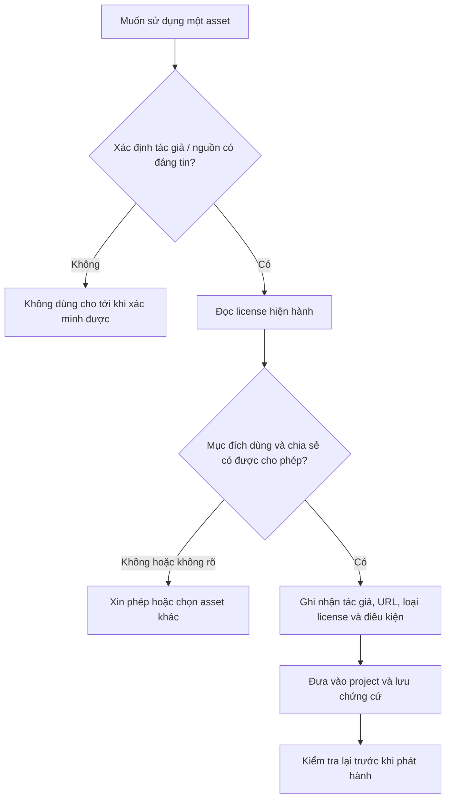

# Bài 05 — Bản quyền và quyền sử dụng tài nguyên cho nhà sáng tạo

> **Khóa học:** Creative Core · **Học phần:** Introduction to Creative Core  
> **Chủ đề:** Intellectual Property (IP), Copyright, License, Unity Asset Store, ghi công và bảo vệ sản phẩm.  
> **Lưu ý:** Kiến thức giáo dục tổng quát, **không phải tư vấn pháp lý**; luật áp dụng và điều khoản giấy phép cụ thể có thể khác nhau.

## 1. Vì sao bản quyền quan trọng trong dự án Unity?

Một cảnh Unity có thể chứa mesh do người A làm, texture từ người B, nhạc của người C và script của người D. Việc tải một tệp về máy hoặc sửa đổi màu sắc, kích thước của nó **không tự động trao quyền sở hữu hay quyền sử dụng không giới hạn**. Khi đăng trò chơi lên mạng, chia sẻ mã nguồn hoặc bán asset, người tạo dự án cần biết mình được phép làm gì với từng thành phần.

Ngược lại, khi tự tạo mô hình, tranh, âm thanh hay mã nguồn, bạn cũng nên hiểu cách xác lập quyền và lựa chọn điều khoản để người khác có thể sử dụng tác phẩm theo mong muốn.

## 2. Mục tiêu học tập

- Phân biệt **sở hữu trí tuệ**, **quyền tác giả/bản quyền**, **nhãn hiệu** và **giấy phép**.
- Giải thích sự khác nhau giữa **ý tưởng** và **cách thể hiện** có thể được bảo hộ.
- Đánh giá khả năng sử dụng một asset dựa trên chủ sở hữu, giấy phép và mục đích phát hành.
- Phân biệt các yếu tố **BY, NC, ND, SA** của Creative Commons và lưu ý riêng về Unity Asset Store.
- Tạo **asset attribution log** để quản lý nguồn gốc, bằng chứng giấy phép và cách ghi công.

## 3. Kiến thức pháp lý nền tảng

### 3.1. Intellectual Property (IP)

**Sở hữu trí tuệ** bao gồm nhiều loại quyền đối với thành quả trí tuệ và hoạt động sáng tạo. Trong lĩnh vực nội dung số, những nhóm cần phân biệt gồm:

| Quyền | Ví dụ | Lưu ý |
|---|---|---|
| **Copyright / quyền tác giả** | Tranh, mô hình 3D có tính sáng tạo, âm nhạc, mã nguồn | Chủ yếu bảo vệ cách thể hiện của tác phẩm, không bảo hộ mọi ý tưởng chung |
| **Trademark / nhãn hiệu** | Tên thương hiệu, logo dùng để nhận diện nguồn gốc thương mại | Có thể phát sinh vấn đề ngay cả khi tự vẽ lại logo quá giống |
| **Patent / sáng chế** | Giải pháp kỹ thuật đáp ứng điều kiện luật định | Không đồng nghĩa với bản quyền của đoạn mã cụ thể |
| **Trade secret / bí mật kinh doanh** | Bí quyết hoặc quy trình không công khai có giá trị | Phụ thuộc vào việc bảo mật và điều kiện pháp luật |

Ví dụ: ý tưởng về một trò chơi có người ngoài hành tinh bán hàng là mô típ tổng quát. Tuy nhiên, sao chép thiết kế nhân vật đặc trưng, hình ảnh cụ thể hoặc âm nhạc của một thương hiệu có thể phát sinh vấn đề bản quyền và quyền khác.

### 3.2. Quyền tác giả hình thành ra sao?

Ở nhiều quốc gia, quyền tác giả đối với một tác phẩm đủ điều kiện phát sinh khi tác phẩm được định hình ở dạng có thể nhận biết, **không cần có biểu tượng ©**. Tuy vậy, phạm vi bảo hộ, chủ sở hữu trong quan hệ lao động, thời hạn quyền và ngoại lệ phụ thuộc từng nước và hợp đồng. Không mặc định “tôi tự vẽ/sửa asset này” nghĩa là tôi có toàn bộ quyền với mọi thành phần gốc.

### 3.3. Ngoại lệ và public domain

Có những trường hợp sử dụng hợp pháp theo ngoại lệ, giới hạn quyền tác giả hoặc vì tác phẩm thuộc **public domain**. Tuy nhiên, **fair use** là cơ chế theo luật Hoa Kỳ, không phải giấy phép áp dụng tự động cho mọi dự án hoặc mọi quốc gia. Việc sử dụng trong học tập, trích một đoạn ngắn hay phi thương mại **không tự động bảo đảm hợp pháp**. Cần xét mục đích, bối cảnh, luật và quyền cụ thể.

**Public domain** không đồng nghĩa với **tải miễn phí**: một asset được phát hành miễn phí vẫn có thể hạn chế sửa đổi, thương mại hoặc phân phối lại.

## 4. License và quyền thực tế được cấp

**License** là sự cho phép sử dụng tác phẩm trong phạm vi và điều kiện quy định. Chủ sở hữu có thể vẫn giữ bản quyền khi cấp quyền cho bên khác. Trước khi đưa asset vào dự án, cần đọc được:

- Có được **dùng thương mại** không?
- Có được **sửa đổi** asset không?
- Có được **đóng gói trong game/app** để phân phối không?
- Có được **phân phối riêng file gốc hoặc file nguồn** không?
- Có phải **ghi công**, trả phí, tuân thủ điều kiện chia sẻ tương tự hoặc giới hạn số người sử dụng không?
- Điều khoản có phân biệt sản phẩm hoàn chỉnh, SDK/plugin, asset bị hạn chế hoặc trường hợp cho người dùng cuối trích xuất tài nguyên không?

**Royalty-free** không có nghĩa “không bản quyền” hay “không điều kiện”: thường chỉ liên quan đến cơ chế phí bản quyền định kỳ.

### 4.1. Creative Commons

| Ký hiệu | Ý nghĩa cần kiểm tra |
|---|---|
| **BY** | Ghi công theo điều kiện giấy phép |
| **NC** | Chỉ cho phép mục đích phi thương mại theo định nghĩa của giấy phép |
| **ND** | Không cho phép chia sẻ bản phái sinh đã sửa đổi theo điều kiện giấy phép |
| **SA** | Khi chia sẻ bản phái sinh, áp dụng cùng giấy phép hoặc giấy phép tương thích |
| **CC0** | Công cụ hiến tặng tác phẩm vào phạm vi công cộng theo cơ chế của CC, không phải một trong sáu giấy phép CC thông thường |

Sáu giấy phép Creative Commons thường gặp gồm: **CC BY**, **CC BY-SA**, **CC BY-ND**, **CC BY-NC**, **CC BY-NC-SA**, **CC BY-NC-ND**. Việc được chỉnh sửa *để làm việc nội bộ* và quyền *chia sẻ bản chỉnh sửa* có thể không đồng nhất; đọc đúng điều khoản. Creative Commons chủ yếu phù hợp cho tác phẩm sáng tạo, còn **phần mềm/mã nguồn nên dùng giấy phép phần mềm phù hợp** thay vì tự động chọn CC.

### 4.2. Unity Asset Store

Phần lớn nội dung trên Unity Asset Store được cấp phép theo **Standard Asset Store EULA**, nhưng vẫn có asset bị đánh dấu **Restricted** hoặc áp dụng **Non-standard EULA**. Điều khoản tiêu chuẩn thường cho phép tích hợp các asset hợp lệ vào sản phẩm kỹ thuật số có đóng góp sáng tạo đáng kể; **không được mặc định có quyền bán lại hoặc phát hành riêng nguyên asset**. Các asset thuộc loại SDK, công cụ hoặc phụ thuộc giấy phép theo người sử dụng (**per-seat**) có thể có hạn chế khác so với asset nội dung thông thường. Luôn kiểm tra trực tiếp **trang sản phẩm và EULA hiện hành** trước khi phân phối hoặc chia sẻ source project.

Ví dụ, việc gửi cả thư mục `Assets` lên kho GitHub công khai có thể làm lộ các asset mua theo giấy phép chỉ cho dùng trong sản phẩm cuối. Một project được phép build thành ứng dụng **không nhất thiết** được phép chia sẻ nguyên file nguồn của các asset đó.

## 5. Quy trình kiểm tra một asset trước khi sử dụng

Đây là quy trình kiểm tra rủi ro thực tế; nó không thay thế đánh giá pháp lý khi điều khoản mơ hồ, quyền lợi lớn hoặc có tranh chấp.

### 5.1. Sổ theo dõi nguồn asset

Tạo file `ASSET-LICENSES.md` hoặc bảng theo dõi riêng:

| Asset | Tác giả / đơn vị cấp quyền | URL / ngày kiểm tra | License | Hành động được phép | Ghi công cần có |
|---|---|---|---|---|---|
| *Ví dụ: texture gạch* | *Tên tác giả* | *URL được xác minh* | *CC BY 4.0 (nếu đúng)* | *Sửa đổi và dùng theo điều kiện BY* | *Tên, nguồn, license và thay đổi* |

**Ghi công** là tuân thủ một nghĩa vụ có thể phát sinh từ giấy phép; ghi công **không thay thế việc xin phép** nếu sử dụng nằm ngoài quyền được cấp. Khi dùng CC BY, một cách ghi công tốt gồm tiêu đề (nếu có), tác giả, nguồn, giấy phép và thông tin chỉnh sửa.

### 5.2. Bảo vệ tác phẩm của chính mình

Khi công bố model, âm thanh hoặc đồ họa do bạn tự tạo, hãy xác định: có muốn người khác sửa đổi không, có cho phép thương mại không, có yêu cầu ghi công không và có muốn các bản phái sinh tiếp tục mở không. Nếu tác phẩm có thành phần của người khác, **không thể cấp thêm quyền vượt quá những gì bạn đang có**. Kiểm tra quyền với đồng tác giả, hợp đồng lao động, cộng tác viên và nội dung bên thứ ba trước khi xuất bản.

## 6. Bài thực hành: kiểm toán giấy phép một Scene

1. Chọn ba asset có nguồn gốc khác nhau (ví dụ mesh, texture, âm thanh) từ thư viện mà bạn được phép xem và sử dụng.
2. Truy cập trang cấp phép của từng asset; ghi rõ **tên giấy phép và liên kết**.
3. Giả lập hai kịch bản: **(a) chỉ xuất build game**, **(b) công khai source project**. Đánh giá riêng quyền cho từng trường hợp.
4. Tạo `ASSET-LICENSES.md` với các trường ở mục 5.1.
5. Viết ghi công mẫu cho asset có yêu cầu attribution và đánh dấu asset chưa xác minh là **không được phát hành**.

**Đầu ra:** bảng kiểm toán ba asset và một quyết định phát hành có lý do.

## 7. Câu hỏi ôn tập

**Câu 1.** Việc sửa màu một texture có tự động xóa nghĩa vụ bản quyền không?  
A. Có nếu sửa đủ nhiều · B. Có nếu dùng trong bài tập · C. Không, phải xem quyền đối với bản gốc và license · D. Có nếu không ghi tên  
**Đáp án: C.** Thay đổi tài nguyên không tự động làm biến mất quyền đối với tác phẩm gốc.

**Câu 2.** `CC BY` yêu cầu điều kiện cốt lõi nào?  
A. Ghi công tác giả · B. Cấm mọi chỉnh sửa · C. Chỉ sử dụng phi thương mại · D. Luôn trả phí định kỳ  
**Đáp án: A.** Thành phần BY yêu cầu attribution.

**Câu 3.** Điều gì cần kiểm tra khi đưa asset mua từ Asset Store lên GitHub công khai?  
A. Chỉ kích thước ảnh · B. Chỉ FPS · C. Tên Scene · D. Quyền phân phối file asset nguồn theo EULA  
**Đáp án: D.** Quyền tích hợp vào sản phẩm khác với quyền phát hành riêng tài nguyên.

**Câu 4.** Tài nguyên “miễn phí” có nhất thiết thuộc public domain không?  
A. Có nếu được tải về · B. Không, miễn phí và phạm vi cấp quyền là hai vấn đề khác nhau · C. Có nếu có trên mạng xã hội · D. Có nếu đã sửa đổi  
**Đáp án: B.** Giá bằng 0 không có nghĩa từ bỏ mọi quyền.

**Câu 5.** Vì sao cần asset attribution log?  
A. Để đổi renderer · B. Để thay thế project · C. Để truy xuất nguồn gốc, giấy phép và nghĩa vụ khi phát hành · D. Để tăng số polygon  
**Đáp án: C.** Ghi chép có hệ thống giảm rủi ro quên điều kiện giấy phép.

## 8. Tổng kết

Trong phát triển 3D, **nguồn gốc tài nguyên và phạm vi giấy phép là một phần của chất lượng sản phẩm**. Hãy kiểm tra quyền trước khi sử dụng, lưu giấy phép và ghi công đúng; đặc biệt phân biệt giữa phân phối **ứng dụng hoàn chỉnh** với **phát hành tài nguyên nguồn**.

## 9. Tài liệu học thêm

- [Unity Learn — Copyright for creators](https://learn.unity.com/pathway/creative-core/unit/introduction-to-creative-core/tutorial/copyright-for-creators?version=6.3)
- [Unity Asset Store — EULA FAQ](https://assetstore.unity.com/browse/eula-faq)
- [Creative Commons — Giải thích sáu giấy phép](https://creativecommons.org/cc-licenses/)
- [Creative Commons — Cách ghi công tốt](https://wiki.creativecommons.org/wiki/Best_practices_for_attribution)
