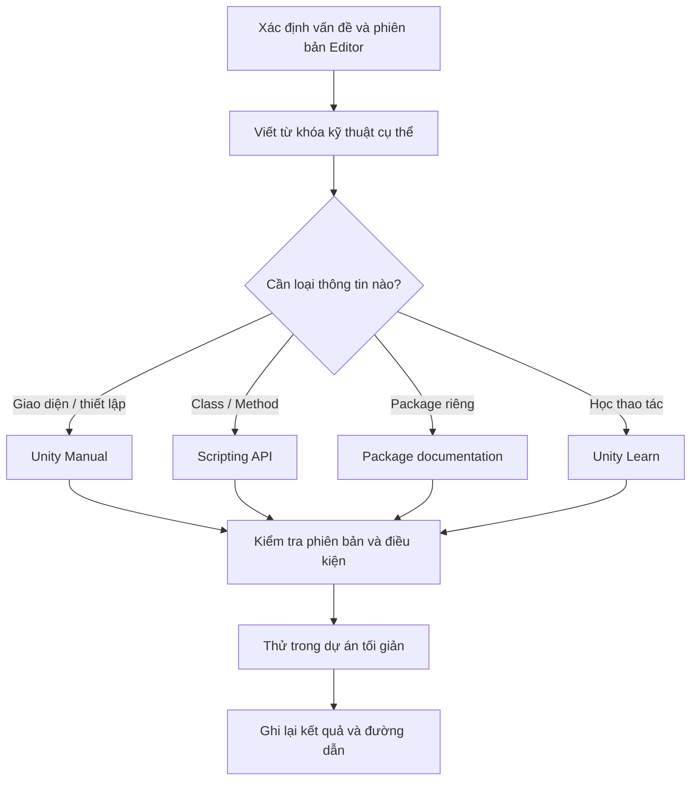

# Bài 06 — Tra cứu tài liệu kỹ thuật Unity hiệu quả

> **Khóa học:** Creative Core · **Học phần:** Introduction to Creative Core  
> **Trọng tâm:** Unity Documentation, Manual, Scripting API, tài liệu package và phương pháp tìm kiếm.

## 1. Vấn đề

Trong quá trình học Unity, không thể nhớ mọi menu, tùy chọn, phương thức và giới hạn của từng tính năng. Khi một nút được chuyển vị trí giữa hai phiên bản Editor hoặc một package thay đổi API, lời giải từ video cũ có thể không còn phù hợp. Biết **tra cứu tài liệu kỹ thuật đúng phiên bản** là kỹ năng giúp học độc lập và khắc phục lỗi có căn cứ.

Tài liệu kỹ thuật (*documentation*) là tập hợp các giải thích, quy trình và tham chiếu về sản phẩm. **Tutorial** thường dẫn qua một ví dụ cụ thể; **reference documentation** chú trọng mô tả đầy đủ tính năng, tham số, điều kiện và giới hạn của công cụ.

## 2. Mục tiêu học tập

- Phân biệt Unity Learn, Unity Manual, Scripting API và tài liệu package.
- Tìm đúng tài liệu về một tính năng trong **phiên bản Editor đang dùng**.
- Đọc bảng tham số và ví dụ trong trang API mà không nhầm với hướng dẫn dành cho người mới.
- Thiết kế quy trình tìm kiếm–thử nghiệm–đối chiếu để giải quyết lỗi trong project.

## 3. Hệ thống tài liệu Unity

| Nguồn | Sử dụng khi nào? | Ví dụ truy vấn |
|---|---|---|
| **Unity Learn** | Cần lộ trình, bài thực hành hoặc ví dụ từng bước | Học lighting cơ bản |
| **Unity Manual** | Cần hiểu cách dùng Editor, tính năng và thiết lập | Cách hoạt động của Hierarchy window |
| **Scripting API** | Cần chữ ký, thuộc tính, hàm và class khi lập trình | `MonoBehaviour`, `Transform` |
| **Package documentation** | Cần phiên bản, yêu cầu và workflow của package | `ProBuilder`, `Universal RP` |
| **Unity Discussions / Issue Tracker** | Cần tìm lỗi đã biết hoặc kinh nghiệm bổ sung | Một lỗi đặc thù Editor/package |

Một trang forum hay một đoạn trả lời trên mạng có thể hữu ích nhưng không thay thế việc kiểm tra tài liệu chính thức, đặc biệt khi lời giải liên quan version hay API đang thay đổi.

**Tài liệu khác hướng dẫn như thế nào?**

Ví dụ với **Hierarchy**: tutorial có thể yêu cầu kéo một prefab vào Hierarchy để tạo đối tượng; Unity Manual giải thích Hierarchy tổ chức GameObject theo scene và quan hệ cha–con như thế nào. Hai nguồn phục vụ hai câu hỏi khác nhau: **“làm lần đầu ra sao?”** và **“công cụ này hoạt động và có những tùy chọn gì?”**.

## 4. Quy trình tra cứu hiệu quả

Đừng tìm bằng câu quá rộng như “Unity lỗi màu” nếu có thể mô tả cụ thể: “URP material magenta after importing package”. Với phần mềm kỹ thuật, giữ nguyên thuật ngữ tiếng Anh thường tăng độ chính xác của kết quả.

### 4.1. Quy trình từng bước

1. Mở [Unity Documentation](https://docs.unity.com/), tìm đến **Unity Editor Manual**.
2. Xác minh phiên bản tài liệu; ưu tiên phiên bản tương ứng với **Help → About Unity** hoặc phiên bản ghi trong Unity Hub.
3. Dùng mục lục hoặc ô tìm kiếm với từ khóa chính xác; kiểm tra xem đang đọc **Manual** hay **Scripting API**.
4. Nếu dùng package, xác định package và version trong **Package Manager** hoặc thông tin dự án trước khi đọc hướng dẫn package đó.
5. Đọc các phần **Description**, **Requirements**, **Properties**, **Examples** hay phần tương đương.
6. Thử kết quả bằng thay đổi nhỏ, lưu ảnh Console hoặc ảnh Inspector, sau đó ghi lại liên kết đã dùng.

### 4.2. Thực hành điều hướng tài liệu

- Tra cứu **Hierarchy window** trong Unity Manual; tìm chức năng của quan hệ cha–con.
- Tra cứu package **ProBuilder** và xác định vị trí tài liệu riêng của package.
- Mở **Scripting API**, tìm `MonoBehaviour`; phân biệt mô tả class với ví dụ code.
- Nếu đọc được tài liệu của nhiều phiên bản, so sánh vị trí menu hoặc một thuật ngữ thay đổi. Không giả định các trang ở các version có cùng cấu trúc.

## 5. Thử thách tra cứu

Thử điền các ô trống chỉ bằng việc tra cứu tài liệu:

1. Trong hệ thống Lighting, **Light Cookie** là một kiểu mặt nạ áp dụng cho loại đối tượng nào?
2. Trong một mô tả workflow tài nguyên của Unity, các bước *Import, Create, Build, Distribute* đi kèm bước thứ năm nào?
3. Trong namespace `UnityEngine.Sprites`, tên class liên quan đến tiện ích dữ liệu sprite là gì?
4. Khi bắt đầu quy trình đưa sản phẩm lên Asset Store, cần tạo tài khoản thuộc vai trò nào?
5. Tài liệu lịch sử **Universal Render Pipeline** xuất hiện với tên trang đó từ phiên bản Unity nào?

**Đáp án tham chiếu của bộ thử thách Unity Learn:** (1) `Light`; (2) `Load`; (3) `DataUtility`; (4) `Publisher`; (5) `2019.3`.

Lưu ý: đây là **thử thách khám phá cấu trúc tài liệu và thông tin lịch sử**. Menu, workflow và trang tài liệu hiện tại có thể thay đổi, vì thế không nên dùng những đáp án lịch sử này như chỉ dẫn cấu hình tự động cho Unity 6.3.

## 6. Ví dụ: xử lý material màu hồng trong dự án URP

Giả sử import asset vào scene và thấy một bề mặt trở thành magenta. Không nên kết luận ngay nguyên nhân là texture hỏng.

1. **Mô tả vấn đề:** tên asset, material, pipeline hiện hành, Editor version và thông báo Console.
2. **Tra cứu:** chọn tài liệu về shader compatibility hoặc Render Pipeline Asset của đúng phiên bản.
3. **Đặt giả thuyết:** material sử dụng shader không tương thích với pipeline.
4. **Kiểm tra một thay đổi:** thử gán shader/material hợp lệ của URP cho một bản sao đối tượng, không làm mất cấu hình gốc.
5. **Đánh giá:** nếu magenta biến mất, giả thuyết được hỗ trợ; nếu không, tiếp tục kiểm tra biên dịch shader, package và dependencies.

Mục đích của ví dụ là minh họa **tư duy tra cứu có kiểm chứng**, không phải khẳng định mọi bề mặt magenta đều do cùng một nguyên nhân.

## 7. Những lỗi khi đọc documentation

- **Đọc nhầm phiên bản:** API hoặc giao diện có thể khác giữa Unity 2021 và Unity 6.x.
- **Nhầm Manual với Scripting API:** trang API phù hợp khi cần xác minh class/method, nhưng không phải luôn là hướng dẫn cài đặt trực quan.
- **Bỏ qua yêu cầu package:** mã đúng vẫn có thể không chạy nếu phụ thuộc hoặc phiên bản package không phù hợp.
- **Chỉ đọc snippet tìm kiếm:** cần mở trang chính thức và xem các lưu ý, giới hạn, bối cảnh.
- **Không thử nghiệm:** một lời giải hợp lý về lý thuyết vẫn cần được thử trong project thực tế.

## 8. Câu hỏi ôn tập

**Câu 1.** Bạn cần biết các thuộc tính và phương thức của `MonoBehaviour`. Nguồn ưu tiên là gì?  
A. Catalog asset · B. Scripting API · C. Cấu hình màn hình · D. Video bất kỳ  
**Đáp án: B.** Scripting API mô tả class và thành phần lập trình.

**Câu 2.** Khi tìm hướng dẫn cho package URP, điều nào quan trọng nhất?  
A. Số lượt thích · B. Độ dài URL · C. Tên avatar · D. Phiên bản Unity/package và tài liệu tương thích  
**Đáp án: D.** Phiên bản có thể quyết định tên, khả năng và thiết lập tính năng.

**Câu 3.** Tutorial và Manual khác nhau ở đâu?  
A. Tutorial thường hướng dẫn theo ví dụ; Manual hướng đến tham chiếu tính năng · B. Manual không có văn bản · C. Tutorial luôn cần code · D. Hai loại hoàn toàn giống nhau  
**Đáp án: A.** Chúng có thể trùng chủ đề nhưng khác mục đích trình bày.

**Câu 4.** Sau khi tìm được giải pháp trên web, bước nào có cơ sở nhất?  
A. Sửa toàn bộ scene · B. Xóa project · C. Kiểm tra điều kiện áp dụng rồi thử thay đổi nhỏ · D. Chép nguyên mọi lệnh  
**Đáp án: C.** Giảm thay đổi không kiểm soát giúp xác định đúng nguyên nhân.

**Câu 5.** Tại sao từ khóa kỹ thuật cụ thể hiệu quả hơn từ khóa chung?  
A. Để tăng số kết quả không liên quan · B. Giảm không gian tìm kiếm và gắn trực tiếp với lỗi · C. Để bỏ qua version · D. Để tránh đọc docs  
**Đáp án: B.** Từ khóa chính xác cải thiện độ liên quan khi tra cứu.

## 9. Tổng kết

Documentation là công cụ để **đưa ra quyết định kỹ thuật dựa trên thông tin có thể kiểm chứng**. Ghi rõ phiên bản, chọn đúng loại tài liệu, đọc điều kiện và kiểm thử thay đổi nhỏ là những thói quen có giá trị ở mọi mức độ kinh nghiệm.

## 10. Tài liệu học thêm

- [Unity Learn — Get started with Unity documentation](https://learn.unity.com/pathway/creative-core/unit/introduction-to-creative-core/tutorial/get-started-with-unity-documentation?version=6.3)
- [Unity Documentation — Trang chủ](https://docs.unity.com/)
- [Unity 6 — Tài nguyên, Manual, API và hướng dẫn](https://unity.com/campaign/unity-6-resources)
