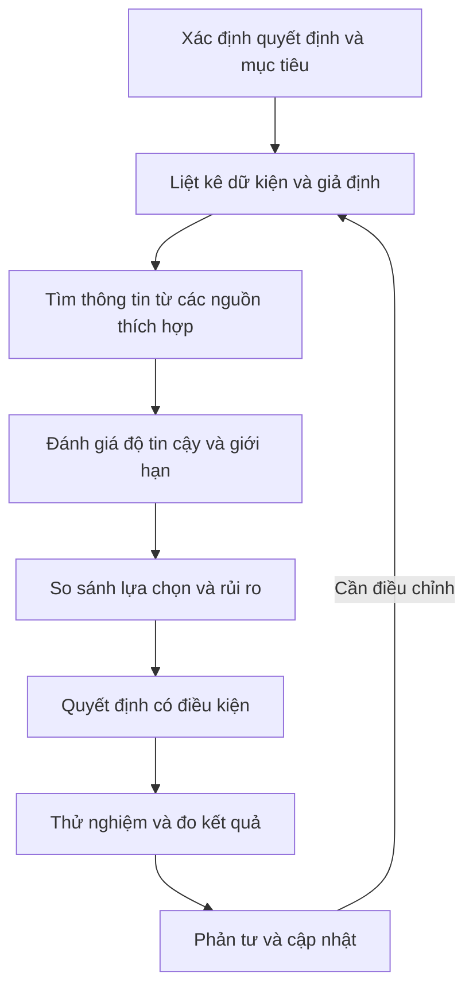

# Bài 07 — Phát triển tư duy đánh giá phản biện trong dự án sáng tạo

> **Khóa học:** Creative Core · **Học phần:** Introduction to Creative Core  
> **Trọng tâm:** Critical evaluation, tìm và đánh giá thông tin, nhận diện thiên kiến, quản trị rủi ro và ra quyết định có căn cứ.

## 1. Bối cảnh

Mỗi dự án Unity đều là chuỗi quyết định: chọn hướng mỹ thuật, có nên dùng URP hay HDRP, có nên làm một hiệu ứng tốn thời gian, hay ưu tiên hoàn thành trải nghiệm cốt lõi. Không phải quyết định nào cũng có đáp án tuyệt đối đúng. Kỹ năng quan trọng là **biết mình cần thông tin gì, đánh giá chất lượng thông tin, cân nhắc hậu quả rồi giải thích được lựa chọn của bản thân**.

**Critical evaluation (đánh giá phản biện)** là năng lực xem xét độ liên quan, độ tin cậy, bối cảnh và giới hạn của thông tin nhằm hỗ trợ quyết định. Nó không đồng nghĩa với việc chỉ trích người khác hay hoài nghi mọi ý kiến.

## 2. Mục tiêu học tập

- Giải thích vì sao đánh giá phản biện quan trọng đối với sản xuất nội dung 3D thời gian thực.
- Phân biệt dữ kiện, giả định, sở thích thẩm mỹ và các ràng buộc không thể thay đổi.
- Áp dụng bốn câu hỏi trọng tâm vào một quyết định sáng tạo.
- Đánh giá một nguồn thông tin theo tác giả, độ liên quan, độ tin cậy, bối cảnh và giới hạn.
- Lập biên bản quyết định và đánh giá lại kết quả sau khi thử nghiệm.

## 3. Những yếu tố ảnh hưởng đến một quyết định

Quyết định trong dự án sáng tạo thường kết hợp **yếu tố thực chứng** và **yếu tố chủ quan**. Việc nhận diện hai nhóm không nhằm loại bỏ cảm nhận nghệ thuật, mà giúp tránh biến sở thích cá nhân thành kết luận kỹ thuật không có bằng chứng.

| Loại yếu tố | Ví dụ trong Unity | Cách xử lý |
|---|---|---|
| Yêu cầu bắt buộc | Dự án phải chạy trên thiết bị mục tiêu | Đối chiếu đặc tả và kiểm thử thực tế |
| Nguồn lực | Thời gian, kỹ năng, số người, máy tính | Định lượng khả năng thực hiện và ưu tiên |
| Quan hệ phụ thuộc | Material cần tương thích render pipeline | Kiểm tra tài liệu kỹ thuật trước khi chọn |
| Tầm nhìn sáng tạo | Môi trường mang cảm giác hoài cổ, ấm áp | Dùng moodboard, concept và phản hồi người xem |
| Rủi ro, tốc độ | Hiệu ứng mới đẹp nhưng khó ổn định | Thử nguyên mẫu có phạm vi nhỏ, đặt mốc dừng |

Ví dụ, “tôi thích HDRP” là một sở thích hợp lệ; còn “HDRP sẽ chạy mượt trên tất cả thiết bị” là phát biểu cần bằng chứng. Một quyết định tốt có thể chấp nhận hi sinh một phần chất lượng hình ảnh để đáp ứng tính tương thích và mục tiêu sử dụng.

**Nhận diện thiên kiến**

- **Confirmation bias:** chỉ tìm ví dụ ủng hộ lựa chọn đã thích từ trước.
- **Sunk-cost bias:** tiếp tục đầu tư vào một tính năng vì đã dành nhiều thời gian, dù không còn phù hợp yêu cầu.
- **Authority bias:** coi lời khuyên của một người nổi tiếng đúng trong mọi bối cảnh, không kiểm tra điều kiện áp dụng.

Không cần loại bỏ mọi cảm xúc khỏi sáng tạo. Hãy ghi rõ điều gì là **ưu tiên thẩm mỹ**, điều gì là **kết luận kỹ thuật**, và bằng chứng nào có thể khiến bạn thay đổi quyết định.

## 4. Khung bốn câu hỏi ra quyết định

Trước một quyết định phức tạp, đặt bốn câu hỏi:

1. **Vì sao quyết định này quan trọng?** Xác định mục tiêu cần đạt và điều kiện thành công.
2. **Cần biết những gì?** Liệt kê dữ kiện còn thiếu, giả định và các lựa chọn khả thi.
3. **Ai bị ảnh hưởng?** Xem xét người dùng, người thiết kế, người kiểm thử và cộng tác viên.
4. **Rủi ro là gì, giảm thiểu thế nào?** Lên kế hoạch thử nghiệm, giới hạn phạm vi và phương án quay lui.



Sơ đồ thể hiện quá trình **lặp lại được**: một lựa chọn có thể đúng tại thời điểm có dữ liệu hiện tại nhưng cần cập nhật nếu kết quả kiểm thử hoặc yêu cầu dự án thay đổi.

## 5. Đánh giá chất lượng nguồn thông tin

Sau khi tìm được một lời khuyên, phải xem nó **có phù hợp với quyết định hiện tại không**. Năm câu hỏi đánh giá hữu ích:

| Câu hỏi | Ví dụ cách xem xét |
|---|---|
| **Ai đưa ra thông tin?** | Tài liệu Unity chính thức, kỹ sư có kinh nghiệm hay bình luận vô danh? |
| **Có liên quan trực tiếp không?** | Cùng Editor version, render pipeline, nền tảng mục tiêu? |
| **Đáng tin cậy đến đâu?** | Có giải thích cách kiểm tra, trường hợp áp dụng và giới hạn? |
| **Bối cảnh là gì?** | Là thử nghiệm của một dự án nhỏ hay khuyến nghị vận hành sản phẩm lớn? |
| **Còn thiếu gì?** | Thiếu thông tin phần cứng, chi phí, giấy phép hoặc phản hồi người dùng? |

Một bài đăng forum mô tả lỗi đã tự khắc phục có thể rất hữu ích để **đề xuất giả thuyết**, nhưng không đủ để kết luận mọi project gặp cùng một lỗi sẽ có cùng nguyên nhân. Tài liệu chính thức cũng cần kiểm tra **phiên bản và phạm vi**.

## 6. Ví dụ: có nên thêm một hiệu ứng phức tạp?

**Tình huống:** Trong guided project, bạn muốn thêm một hiệu ứng cổng dịch chuyển. Hiệu ứng hấp dẫn về mặt thẩm mỹ, nhưng không nằm trong các mục ưu tiên của phiên bản trình diễn.

### 6.1. Xác định mục tiêu

Mục tiêu chính là tạo cảnh 3D đủ sức truyền đạt concept, chạy ổn định trên máy dùng để trình diễn và đáp ứng những yêu cầu thiết kế đã chọn.

### 6.2. Thu thập thông tin

Cần biết: hiệu ứng có nằm trong Project Requirements không; cần asset và package nào; mức độ tương thích với URP; tổng thời gian tích hợp; hiệu quả trên thiết bị kiểm thử; ảnh hưởng của nó tới tính dễ đọc của cảnh.

### 6.3. So sánh lựa chọn

| Phương án | Lợi ích | Rủi ro | Cách kiểm tra |
|---|---|---|---|
| Không thêm hiệu ứng | Giữ phạm vi tập trung | Mất một điểm nhấn phụ | Cho người xem đánh giá cảnh hiện tại |
| Thử hiệu ứng tối giản | Kiểm chứng ý tưởng với chi phí thấp hơn | Có thể chưa đủ hấp dẫn | Thử riêng trong Scene mẫu |
| Tích hợp hiệu ứng phức tạp | Tiềm năng ấn tượng cao | Thời gian và hiệu năng khó dự đoán | Lập prototype, đo và quyết định sau |

**Kết luận có điều kiện:** ưu tiên thử hiệu ứng tối giản. Nếu kết quả giúp người xem hiểu cảnh hơn và không làm chậm các yêu cầu bắt buộc, mới xem xét phát triển tiếp. Đây là **ví dụ về cách suy luận**, không phải một chuẩn tối ưu chung cho mọi dự án.

## 7. Biên bản quyết định (Decision Log)

Trong quá trình triển khai dự án, tạo file `DECISIONS.md` và ghi:

```markdown
## Quyết định: [Tên quyết định]

- Ngày:
- Mục tiêu:
- Yêu cầu bắt buộc:
- Các lựa chọn:
- Dữ liệu và liên kết đã xem:
- Giả định chưa xác minh:
- Rủi ro / biện pháp giảm thiểu:
- Lựa chọn hiện tại và lý do:
- Cách kiểm chứng:
- Điều kiện xem xét lại:
- Kết quả sau kiểm thử:
```

Mỗi quyết định không cần dài. Điều quan trọng là **người khác có thể hiểu tại sao bạn chọn phương án đó** và khi nào nên điều chỉnh.

## 8. Bài tập áp dụng

Chọn một quyết định thật trong dự án: chọn pipeline, thay đổi ánh sáng, chọn asset từ ngoài hoặc thêm animation. Trả lời đủ bốn câu hỏi ở mục 4. Sau đó tìm **hai loại nguồn khác nhau** (ví dụ Manual và một thử nghiệm thực tế), đánh giá chúng theo năm câu hỏi ở mục 5. Ghi quyết định ban đầu, thực hiện một kiểm chứng nhỏ và đánh giá lại.

**Sản phẩm bàn giao:** một decision log có ít nhất hai phương án, một nguồn chính thức, một giả định cần thử và kết quả quan sát được.

## 9. Câu hỏi ôn tập

**Câu 1.** Critical evaluation chủ yếu giúp điều gì?  
A. Tránh mọi ý kiến khác biệt · B. Chọn phương án ngẫu nhiên · C. Đánh giá thông tin để đưa ra quyết định có căn cứ · D. Luôn chọn công nghệ mới nhất  
**Đáp án: C.** Kỹ năng liên kết thông tin, bối cảnh và hậu quả quyết định.

**Câu 2.** Khi bạn chỉ tìm video ủng hộ lựa chọn có sẵn, đó thường là biểu hiện của gì?  
A. Confirmation bias · B. Kiểm thử hồi quy · C. Tài liệu tham chiếu · D. Kiểm toán asset  
**Đáp án: A.** Chỉ tìm bằng chứng thuận chiều làm giảm chất lượng đánh giá.

**Câu 3.** Câu hỏi nào thuộc khung đánh giá quyết định?  
A. Ai có nhiều follower? · B. Asset nào có dung lượng lớn? · C. Tên Scene dài bao nhiêu? · D. Ai bị ảnh hưởng và có thể giảm rủi ro ra sao?  
**Đáp án: D.** Xem xét người liên quan và rủi ro là hai thành tố trọng tâm.

**Câu 4.** Một bài forum dùng Unity cũ có thể được xử lý thế nào?  
A. Làm theo ngay · B. Dùng làm giả thuyết, rồi kiểm tra version và thử nghiệm · C. Coi là vô nghĩa trong mọi trường hợp · D. Dùng thay mọi tài liệu khác  
**Đáp án: B.** Thông tin có thể hữu ích nhưng điều kiện áp dụng phải được xác minh.

**Câu 5.** Khi dữ kiện mới mâu thuẫn với quyết định ban đầu, nên làm gì?  
A. Cố giữ lựa chọn vì đã làm lâu · B. Bỏ qua phép đo · C. Đối chiếu mục tiêu và cập nhật quyết định nếu cần · D. Xóa decision log  
**Đáp án: C.** Quy trình phản biện có vòng lặp học từ bằng chứng.

## 10. Tổng kết

Đánh giá phản biện không làm giảm tự do sáng tạo; nó giúp người sáng tạo **thử nghiệm có định hướng**, giảm quyết định dựa trên giả định và truyền đạt lý do lựa chọn với đồng đội. Kết hợp mục tiêu rõ ràng, nguồn đáng tin, kiểm thử nhỏ và phản tư sẽ cải thiện chất lượng quyết định theo thời gian.

## 11. Tài liệu học thêm

- [Unity Learn — Develop your critical evaluation skills](https://learn.unity.com/pathway/creative-core/unit/introduction-to-creative-core/tutorial/develop-your-critical-evaluation-skills-4?version=6.3)
- [Unity Documentation](https://docs.unity.com/) — nguồn tham chiếu kỹ thuật khi ra quyết định về Editor và package.
