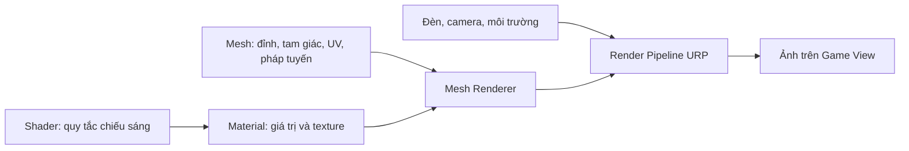

# Bài 01 — Bắt đầu với Shader và Material

> **Phần học:** Creative Core / Shaders and Materials  
> **Tên bài gốc:** Get started with shaders and materials  
> **Môi trường thực hành:** Unity 6.3, khuyến nghị project Universal Render Pipeline (URP)  
> **Nguồn gốc nội dung:** Dựa trên tệp đề cương do người học cung cấp; phần giải thích, ví dụ, bài tập, sơ đồ là nội dung bổ sung do biên soạn, không phải transcript hoặc bản dịch chính thức của Unity Learn.

## Mục tiêu học tập
- Phân biệt chính xác Mesh, Texture, Shader, Material và vai trò của ánh sáng.
- Tạo scene thử nghiệm URP/Lit và dự đoán thay đổi của Base Color, Metallic, Smoothness.
- Kiểm tra pipeline của dự án trước khi chọn Shader.

## 1. Tại sao cần học chủ đề này?
Một vật thể 3D có hình dạng đúng nhưng vẫn trông như nhựa, đá, kim loại hoặc kính tùy cách mô phỏng ánh sáng. **Hình học không đồng nghĩa với chất liệu**: mesh xác định vị trí bề mặt; shader tính màu đầu ra dựa trên ánh sáng và dữ liệu đầu vào; material chọn shader và cung cấp tham số. Đây là nền tảng cho nghệ thuật môi trường, nhân vật, sản phẩm và hiệu ứng trong Unity.

## 2. Mô hình khái niệm

| Thành phần | Quyết định | Ví dụ |
|---|---|---|
| Mesh | Hình dáng, biên dạng, bề mặt tam giác | Sphere, Cube, mô hình từ Blender |
| UV | Điểm trên mesh ứng với vị trí nào trên ảnh 2D | Lưới tọa độ `(u,v)` |
| Texture | Dữ liệu theo vị trí bề mặt | Ảnh màu, độ nhám, pháp tuyến |
| Shader | Phương pháp biến đầu vào thành màu pixel | `Universal Render Pipeline/Lit` |
| Material | Một cấu hình cụ thể của shader | `MAT_Ceramic_Blue` |
| Render pipeline | Tổ chức các bước render | URP, HDRP, Built-in |

**Điểm then chốt:** Hai object có thể dùng cùng một shader nhưng có Material khác nhau; nhiều object có thể cùng tham chiếu một Material để giữ diện mạo nhất quán.

### Giới thiệu PBR
**Physically Based Rendering (PBR)** là cách mô hình hóa phản xạ dựa trên các đại lượng gần với vật lý: màu nền (*base color*), tính kim loại (*metallic*) và độ nhẵn (*smoothness*). PBR không tự động làm scene giống ảnh chụp: kết quả còn phụ thuộc ánh sáng, dữ liệu texture và môi trường phản xạ. Khi bắt đầu với URP/Lit, ba tham số này là đủ cho một thí nghiệm có kiểm soát.

## 3. Thực hành: phòng thí nghiệm vật liệu đầu tiên
**Điều kiện:** tạo dự án bằng template **Universal 3D** (URP), mở `Window > Package Manager` để kiểm tra các package nếu cần. Hướng dẫn trong bộ này dùng URP, không áp dụng nguyên trạng cho Built-in hoặc HDRP.

1. Tạo scene `Scenes/01_MaterialLab.unity`. Thêm `Plane`, `Sphere`, `Cube`, `Directional Light` và một `Camera` nhìn thấy cả hai object.
2. Trong Project: `Assets > Create > Material`, đặt tên `MAT_Test_Lit`; ở Inspector chọn shader `Universal Render Pipeline/Lit`.
3. Kéo material lên Sphere; nhân đôi Sphere làm ba bản và tạo ba **material riêng** bằng Duplicate, tránh thay đổi cả ba khi đo.
4. Giữ nguyên ánh sáng, camera, kích thước object. Chỉ đổi một thông số trong mỗi lần quan sát.
5. Ghi bảng đối chiếu dưới đây; tạo ảnh chụp trước và sau.

| Ca thử | Metallic | Smoothness | Dự đoán cần kiểm tra |
|---|---:|---:|---|
| A — bề mặt phi kim thô | 0 | 0.1 | Vệt phản xạ rộng, mờ |
| B — phi kim bóng | 0 | 0.9 | Điểm phản xạ sắc, rõ hơn |
| C — kim loại bóng | 1 | 0.9 | Phản xạ có sắc màu vật liệu/môi trường rõ rệt |

**Lưu ý thí nghiệm:** Nếu scene chỉ có một màu nền phẳng và ít ánh sáng môi trường, thay đổi metallic có thể khó nhìn. Thử thêm skybox hoặc Reflection Probe phù hợp trước khi kết luận shader không hoạt động.

## 4. Phân biệt lỗi thường gặp
- **Vật thể hồng:** shader thiếu, biên dịch lỗi hoặc không tương thích render pipeline. Đọc Console, kiểm tra Shader trong Material và cấu hình URP. Không chữa bằng cách thay Base Color.
- **Bề mặt đen, quá tối:** xem ánh sáng và môi trường phản xạ trước khi chỉnh màu; đặc biệt với metallic cao.
- **Không thấy thay đổi:** chọn đúng material asset và đúng Renderer đang dùng; kiểm tra các slot Material của Mesh Renderer.
- **Scene khác Game View:** Scene View có thể sử dụng chế độ chiếu sáng hiển thị riêng; đánh giá cuối cùng trên Game View/Camera.

## 5. Bài tập và tiêu chí đạt
- **Cơ bản:** giải thích vì sao đổi hình dạng Sphere thành Cube không làm thay đổi shader được gán.
- **Ứng dụng:** tạo ba quả cầu biểu thị gốm, nhựa và kim loại; chỉ ra thông số quyết định sự khác biệt.
- **Kiểm chứng:** lưu `01_MaterialLab.unity`, chụp ảnh ba quả cầu và ghi tối thiểu một kết luận đúng về ánh sáng phản xạ.

## Tự kiểm chứng khi hoàn thành
- [ ] Nêu được khái niệm chính của bài bằng ví dụ trong Unity.
- [ ] Thực hiện được phép thử trước–sau và lưu scene/bằng chứng.
- [ ] Phân biệt kết quả quan sát thực tế với kết luận suy đoán.
- [ ] Kiểm tra phiên bản Render Pipeline/Shader khi áp dụng trên dự án khác.

## Tài liệu tham khảo và đối chiếu
- **1.** [Unity Learn — Creative Core Shaders and Materials](https://learn.unity.com/project/creative-core-shaders-and-materials)
- **2.** [Unity Manual 6.3 — Materials](https://docs.unity.com/en-us/engine/6000.3/manual/materials-and-shaders/materials)
- **3.** [Unity Manual 6.3 — URP/Lit reference](https://docs.unity.com/en-us/engine/6000.3/manual/materials-and-shaders/built-in/shaders-in-universalrp/reference/lit-shader)

> **Ghi chú tài liệu:** Các bước thao tác và thông số minh họa được thiết kế để tự học; vị trí menu/thuộc tính có thể thay đổi theo template, package và bản cập nhật. Các nguồn Unity ở trên được dùng để kiểm tra thuật ngữ và tính năng; không có tuyên bố đã kiểm thử trực tiếp bằng Unity Editor trong môi trường này.
