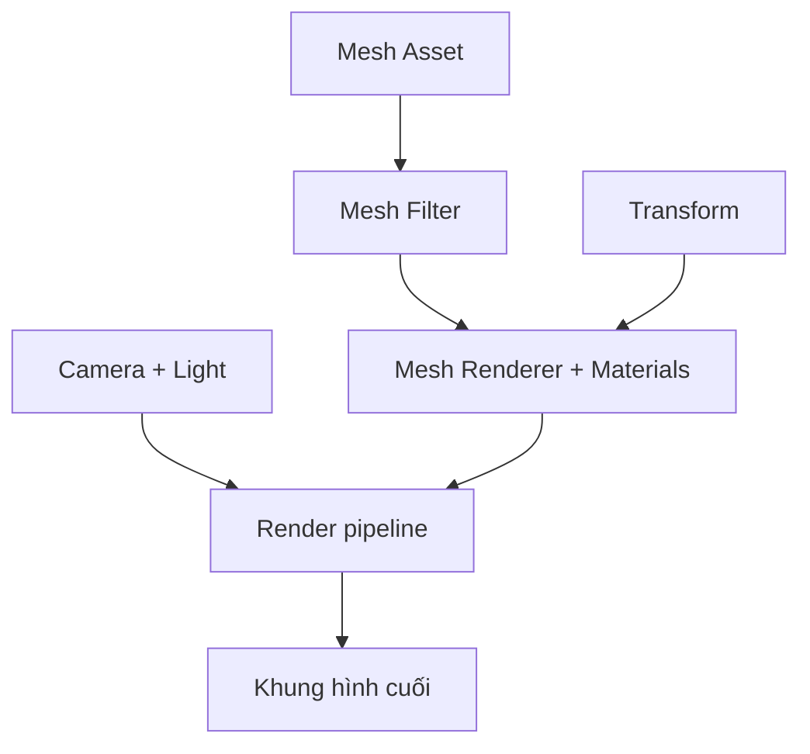

# Bài 02 — Khám phá Mesh và quá trình dựng hình

> **Phần học:** Creative Core / Shaders and Materials  
> **Tên bài gốc:** Explore meshes and rendering  
> **Môi trường thực hành:** Unity 6.3, khuyến nghị project Universal Render Pipeline (URP)  
> **Nguồn gốc nội dung:** Dựa trên tệp đề cương do người học cung cấp; phần giải thích, ví dụ, bài tập, sơ đồ là nội dung bổ sung do biên soạn, không phải transcript hoặc bản dịch chính thức của Unity Learn.

## Mục tiêu học tập
- Mô tả vai trò vertex, triangle, normal và UV trong một mesh.
- Giải thích đường đi từ Mesh Filter đến Mesh Renderer và Camera.
- Phân biệt lỗi hình học với lỗi shader hoặc texture.

## 1. Mesh thực sự chứa những gì?
Một **mesh** thường gồm tập các đỉnh (*vertices*) và chỉ số xác định các tam giác (*triangle indices*). Mỗi đỉnh có thể mang vị trí, pháp tuyến (*normal*), tiếp tuyến (*tangent*), tọa độ UV, màu đỉnh và những dữ liệu bổ sung. GPU biến tam giác thành các fragment; shader xác định màu của những fragment được render.

- **Vertex position:** tọa độ vị trí của đỉnh; quyết định hình học.
- **Normal:** hướng quy ước vuông góc bề mặt, dùng để tính phản xạ khuếch tán và specular.
- **UV coordinates:** vị trí lấy mẫu dữ liệu từ texture 2D; một mesh có thể có nhiều kênh UV.
- **Triangle winding:** thứ tự ba đỉnh định nghĩa hướng mặt; ảnh hưởng việc culling mặt sau.
- **Submesh:** chia mesh thành nhóm tam giác để gán các material slot khác nhau.

**Ngoại lệ:** nhân vật có hệ xương hoặc blend shape thường dùng `Skinned Mesh Renderer`, không phải cặp Mesh Filter + Mesh Renderer.

## 2. Chuyện gì diễn ra khi render?
1. CPU xác định các Renderer có khả năng xuất hiện trong khung hình và chuẩn bị lệnh vẽ.
2. Pipeline biến đổi đỉnh từ hệ tọa độ mô hình sang hệ camera và không gian cắt.
3. Rasterizer chuyển tam giác thành các fragment tại vùng ảnh phù hợp.
4. Shader tính màu và các phép kiểm tra độ sâu, loại bỏ mặt sau/blending được áp dụng theo trạng thái render.
5. Kết quả được tổng hợp thành Game View. Đây là mô hình khái quát, không phải danh sách cố định mọi pass nội bộ của URP.

## 3. Thực hành: phân biệt hình học và chất liệu
1. Tạo một `Sphere`, một `Cube`, một `Plane`, tất cả dùng cùng `MAT_Test_Lit` ở bài 01.
2. Đặt Camera cố định; bật sáng scene, quan sát vệt phản xạ trên Sphere và Cube.
3. Trong Mesh Renderer, kiểm tra danh sách `Materials`; nếu mô hình có submesh, xem số slot và material tương ứng.
4. Nhập mô hình từ Blender (hoặc dùng primitive) và đánh giá nơi texture bị kéo giãn. Kiểm tra UV của mô hình trong phần mềm 3D nếu có.
5. Thử vô hiệu hóa `Mesh Renderer`: hình học vẫn có thể tồn tại trong bộ nhớ/scene nhưng không xuất hiện trong hình render.

### Thí nghiệm pháp tuyến
Vẽ hoặc nhập một mặt phẳng với normals hướng không đồng nhất: ngay cả khi đường biên không đổi, vùng sáng có thể khác đi. Kết luận: **normal quyết định phản ứng ánh sáng, không nhất thiết quyết định silhouette**.

| Hiện tượng | Kiểm tra đầu tiên | Khả năng nguyên nhân |
|---|---|---|
| Mặt biến mất khi nhìn từ sau | Render Face / thứ tự tam giác | Back-face culling |
| Texture giãn trên một mặt | UV map và Tiling | UV không phù hợp |
| Các mặt có đường sáng gãy | Normal và smoothing groups | Pháp tuyến bị tách/không liên tục |
| Object không hiển thị | Renderer, Camera, layer, clipping | Không có lệnh vẽ hợp lệ |

## 4. Phương pháp kiểm chứng có công cụ
`Window > Analysis > Frame Debugger` cho phép xem các sự kiện vẽ tuần tự; nó hữu ích khi object bị khuất hoặc không biết draw call nào đã vẽ object. Không xem draw calls là số đo duy nhất của hiệu năng: cần kết hợp Profiler và GPU frame time.

## 5. Bài tập
- Vẽ sơ đồ liên hệ Mesh → Renderer → Pipeline → Camera và giải thích bằng lời.
- Dùng chung một material cho ba loại mesh; ghi ít nhất hai khác biệt hình ảnh do hình học, không phải shader.
- Chuẩn bị ảnh minh chứng một lỗi UV hoặc pháp tuyến và cách sửa.

## Tự kiểm chứng khi hoàn thành
- [ ] Nêu được khái niệm chính của bài bằng ví dụ trong Unity.
- [ ] Thực hiện được phép thử trước–sau và lưu scene/bằng chứng.
- [ ] Phân biệt kết quả quan sát thực tế với kết luận suy đoán.
- [ ] Kiểm tra phiên bản Render Pipeline/Shader khi áp dụng trên dự án khác.

## Tài liệu tham khảo và đối chiếu
- **1.** [Unity Manual 6.3 — Mesh components](https://docs.unity.com/en-us/engine/6000.3/manual/assets-and-media/asset-types/mesh/components-reference)
- **2.** [Unity Manual 6.3 — Frame Debugger](https://docs.unity.com/en-us/engine/6000.3/manual/analysis/graphics-performance-profiling/profile-rendering/frame-debugger/frame-debugger)
- **3.** [Unity Manual 6.3 — Draw texture in URP](https://docs.unity.com/en-us/engine/6000.3/manual/materials-and-shaders/shaders/writing-custom-shaders-urp/writing-shaders-urp/unlit-texture)

> **Ghi chú tài liệu:** Các bước thao tác và thông số minh họa được thiết kế để tự học; vị trí menu/thuộc tính có thể thay đổi theo template, package và bản cập nhật. Các nguồn Unity ở trên được dùng để kiểm tra thuật ngữ và tính năng; không có tuyên bố đã kiểm thử trực tiếp bằng Unity Editor trong môi trường này.
