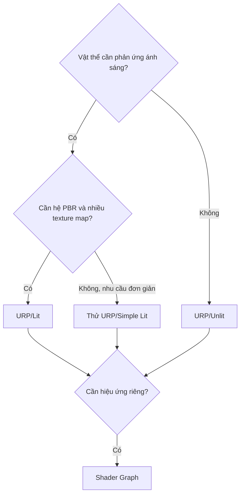

# Bài 03 — Khám phá các loại Shader

> **Phần học:** Creative Core / Shaders and Materials  
> **Tên bài gốc:** Explore shaders  
> **Môi trường thực hành:** Unity 6.3, khuyến nghị project Universal Render Pipeline (URP)  
> **Nguồn gốc nội dung:** Dựa trên tệp đề cương do người học cung cấp; phần giải thích, ví dụ, bài tập, sơ đồ là nội dung bổ sung do biên soạn, không phải transcript hoặc bản dịch chính thức của Unity Learn.

## Mục tiêu học tập
- Lựa chọn URP/Lit, Simple Lit hoặc Unlit dựa trên nhu cầu quan sát được.
- Phân biệt Shader asset với Material asset, shader đồ họa với C# script.
- Thực hiện so sánh phản ứng trước thay đổi ánh sáng.

## 1. Shader không phải một ảnh texture
**Shader** là chương trình chạy trong quy trình xử lý đồ họa, quy định cách bề mặt được biểu diễn. Một Shader có thể chứa logic xử lý đỉnh, lấy mẫu texture, tính chiếu sáng, hiệu ứng emissive và trạng thái blend/depth. **Material** là asset gán shader và các giá trị cho các thuộc tính của shader đó.

Unity có shader dựng sẵn, Shader Graph tạo graph trực quan và giải pháp tự viết bằng ShaderLab/HLSL. Với khóa cơ bản, sử dụng shader dựng sẵn trước, sau đó chuyển sang Shader Graph ở bài 10.

## 2. Chọn shader theo yêu cầu
| Shader trong URP | Đặc điểm | Tình huống nên thử |
|---|---|---|
| `Universal Render Pipeline/Lit` | Mô phỏng chất liệu có ánh sáng, metallic, smoothness và nhiều texture map | Gỗ, kim loại, đồ gốm, đá |
| `Universal Render Pipeline/Simple Lit` | Mô hình chiếu sáng đơn giản hơn Lit | Tài sản cần tiết kiệm hơn, kiểm thử trên cấu hình mục tiêu |
| `Universal Render Pipeline/Unlit` | Không dùng mô hình chiếu sáng vật lý như Lit | Biển chỉ dẫn phẳng, màu cố định, đồ họa stylized |
| Shader Graph tùy chỉnh | Cho phép tổ hợp node và định nghĩa tham số | Quét sáng, dải màu, màu dao động, hiệu ứng sáng tạo |

**Không có một shader tối ưu cho mọi trường hợp.** Một Unlit đẹp trong một scene có thể bị thiếu cảm giác thể tích; một Lit phức tạp có thể lãng phí cho lớp nền trang trí. Hiệu năng phải được đo trên nền tảng đích.

## 3. Thực hành so sánh có kiểm soát
1. Tạo ba Sphere giống hệt nhau và ba Material: `MAT_Lit`, `MAT_SimpleLit`, `MAT_Unlit`.
2. Gán shader tương ứng, chọn màu nhìn thấy tương tự; vì các mô hình shading khác nhau nên không nên coi màu pixel đầu ra nhất thiết bằng nhau.
3. Di chuyển hoặc xoay `Directional Light` và so sánh sự thay đổi của ba Sphere.
4. Đổi vị trí Camera và quan sát phản xạ specular của vật liệu Lit.
5. Kết luận shader nào phù hợp cho một biển thông tin, bức tượng gốm và vật thể phát sáng nghệ thuật.

## 4. Kiến thức mở rộng: render pass và độ sâu
Shader không chỉ là một công thức màu duy nhất. Rendering phụ thuộc vào **render pass**, depth testing, culling, blending và thứ tự vẽ. Vì vậy, đổi sang shader có chế độ transparent khác có thể gây thay đổi thứ tự vật thể, không chỉ màu sắc. Bài 07 giải thích riêng về vấn đề này.

## 5. Phòng lỗi
- Gán shader Built-in/Standard vào URP có thể hiển thị hồng; chọn shader hỗ trợ pipeline hoặc nâng cấp material.
- Shader Graph báo lỗi: mở graph, kiểm tra các kết nối sai kiểu và lưu/biên dịch lại.
- Chọn sai Material instance: kiểm tra `Mesh Renderer > Materials` và sửa đúng asset.

## 6. Bài tập
Thiết kế bảng quyết định cho ba vật thể bất kỳ trong game của bạn. Mỗi lựa chọn phải có **lý do**, **giới hạn** và **thử nghiệm chứng minh**.

## Tự kiểm chứng khi hoàn thành
- [ ] Nêu được khái niệm chính của bài bằng ví dụ trong Unity.
- [ ] Thực hiện được phép thử trước–sau và lưu scene/bằng chứng.
- [ ] Phân biệt kết quả quan sát thực tế với kết luận suy đoán.
- [ ] Kiểm tra phiên bản Render Pipeline/Shader khi áp dụng trên dự án khác.

## Tài liệu tham khảo và đối chiếu
- **1.** [Unity Manual 6.3 — Custom shaders](https://docs.unity.com/en-us/engine/6000.3/manual/materials-and-shaders/shaders)
- **2.** [Unity Manual 6.3 — URP/Lit reference](https://docs.unity.com/en-us/engine/6000.3/manual/materials-and-shaders/built-in/shaders-in-universalrp/reference/lit-shader)
- **3.** [Unity Manual 6.3 — Shader Graph](https://docs.unity.com/en-us/engine/6000.3/manual/materials-and-shaders/shaders/writing-custom/shader-graph)

> **Ghi chú tài liệu:** Các bước thao tác và thông số minh họa được thiết kế để tự học; vị trí menu/thuộc tính có thể thay đổi theo template, package và bản cập nhật. Các nguồn Unity ở trên được dùng để kiểm tra thuật ngữ và tính năng; không có tuyên bố đã kiểm thử trực tiếp bằng Unity Editor trong môi trường này.
