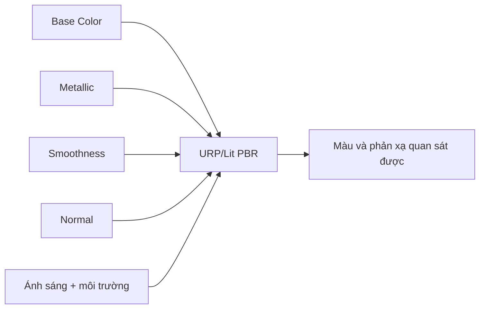

# Bài 05 — Mô phỏng bề mặt vật thể rắn với PBR

> **Phần học:** Creative Core / Shaders and Materials  
> **Tên bài gốc:** Simulate solid surfaces  
> **Môi trường thực hành:** Unity 6.3, khuyến nghị project Universal Render Pipeline (URP)  
> **Nguồn gốc nội dung:** Dựa trên tệp đề cương do người học cung cấp; phần giải thích, ví dụ, bài tập, sơ đồ là nội dung bổ sung do biên soạn, không phải transcript hoặc bản dịch chính thức của Unity Learn.

## Mục tiêu học tập
- Giải thích metallic/smoothness theo mô hình vật liệu kim loại và điện môi.
- Thiết kế vật liệu gỗ, gốm, kim loại bằng thông số có lý do.
- Thực hiện phép thử so sánh ánh sáng và môi trường phản xạ.

## 1. Các yếu tố vật lý tối thiểu
Một bề mặt rắn không chỉ có “màu”. Nhiều vật liệu phản xạ ánh sáng theo hai thành phần khái niệm: **khuếch tán** (*diffuse*) và **phản xạ gương** (*specular*). Với kim loại lý tưởng, thành phần phản xạ có thể mang màu của kim loại; với vật liệu phi kim (điện môi), ánh sáng khuếch tán mang màu nền rõ hơn. Trong URP/Lit, Metallic workflow cung cấp mô hình thực dụng cho người làm nội dung.

| Thuộc tính | Khoảng tham khảo | Ý nghĩa |
|---|---|---|
| Base Map / Color | RGB | Màu bề mặt hoặc dữ liệu albedo được dùng bởi shader |
| Metallic | 0–1 | 0: hành vi phi kim, 1: hành vi kim loại; giá trị trung gian hữu ích cho vùng chuyển tiếp map |
| Smoothness | 0–1 | 0: phản xạ trải rộng; 1: phản xạ sắc, hẹp |
| Normal Map | Dữ liệu hướng | Thay đổi hướng pháp tuyến để mô phỏng gờ, rãnh nhỏ |
| Occlusion | Trường che khuất | Làm giảm phần ánh sáng gián tiếp ở kẽ, góc, tùy shader |

**Smoothness khác với độ bóng được vẽ sẵn trong ảnh màu:** vệt phản chiếu thật thay đổi theo Camera và nguồn sáng. “Roughness” thường được các phần mềm khác sử dụng thay cho smoothness; không giả định mọi pipeline dùng phép chuyển đổi tuyến tính giống nhau. Khi nhập texture roughness từ Blender/Substance, kiểm tra cụ thể cách shader Unity đọc kênh dữ liệu.

## 2. Bộ thông số bắt đầu để so sánh (không phải bảng vật lý chuẩn)
| Vật liệu | Metallic gợi ý | Smoothness gợi ý | Điểm quan sát |
|---|---:|---:|---|
| Gốm mờ | 0 | 0.35 | Vệt phản xạ tương đối trải rộng |
| Gốm phủ men | 0 | 0.85 | Vệt phản xạ hẹp hơn |
| Gỗ chưa phủ | 0 | 0.2 | Thường thô hơn, cần vân gỗ từ texture |
| Thép đánh bóng | 1 | 0.9 | Phụ thuộc môi trường phản xạ |
| Kim loại xước | 1 | 0.45 | Phản xạ ít sắc hơn, chi tiết tốt hơn khi dùng map |

Giá trị chỉ là **điểm xuất phát để học**; độ nhám thực tế, ánh sáng, kết cấu và yêu cầu nghệ thuật sẽ quyết định kết quả cuối cùng.

## 3. Thực hành: mẫu trưng bày 5 vật liệu
1. Tạo 5 Sphere cùng kích thước; đặt trên một Plane màu trung tính.
2. Tạo 5 Material dùng `URP/Lit`, điền Metallic và Smoothness theo bảng.
3. Đặt một `Directional Light`, thêm môi trường/Reflection Probe nếu cần.
4. Chụp hai ảnh ở cùng góc Camera: một ảnh với ánh sáng/skybox A, một ảnh với B. Không đổi material giữa hai ảnh.
5. Ghi hiện tượng: vật liệu nào phụ thuộc mạnh vào phản xạ môi trường? Vật liệu nào có vệt sáng nhỏ nhất?

## 4. Tránh các quan niệm sai
- Tăng Metallic lên 1 không tự tạo bề mặt “sáng hơn”; một kim loại thiếu phản xạ có thể trông rất tối.
- Tăng Smoothness không đổi silhouette hoặc số polygon.
- Một vật liệu nhìn giống nước chỉ vì trong suốt là chưa đủ; khúc xạ và phản xạ là hiệu ứng khác, phụ thuộc shader/cấu hình.
- Không dùng màu base đen tuyệt đối cho mọi vùng tối chỉ để tạo “chiều sâu”; ưu tiên kiểm tra ánh sáng và map.

## 5. Bài tập
Dùng 5 mẫu vật liệu, ghi **giả thuyết → phép thử → quan sát → kết luận**. Phân biệt “chất liệu mô phỏng bằng tham số” và “vật liệu vật lý đo được”.

## Tự kiểm chứng khi hoàn thành
- [ ] Nêu được khái niệm chính của bài bằng ví dụ trong Unity.
- [ ] Thực hiện được phép thử trước–sau và lưu scene/bằng chứng.
- [ ] Phân biệt kết quả quan sát thực tế với kết luận suy đoán.
- [ ] Kiểm tra phiên bản Render Pipeline/Shader khi áp dụng trên dự án khác.

## Tài liệu tham khảo và đối chiếu
- **1.** [Unity Manual 6.3 — URP/Lit reference](https://docs.unity.com/en-us/engine/6000.3/manual/materials-and-shaders/built-in/shaders-in-universalrp/reference/lit-shader)
- **2.** [Unity Learn — Creative Core Shaders and Materials](https://learn.unity.com/project/creative-core-shaders-and-materials)

> **Ghi chú tài liệu:** Các bước thao tác và thông số minh họa được thiết kế để tự học; vị trí menu/thuộc tính có thể thay đổi theo template, package và bản cập nhật. Các nguồn Unity ở trên được dùng để kiểm tra thuật ngữ và tính năng; không có tuyên bố đã kiểm thử trực tiếp bằng Unity Editor trong môi trường này.
