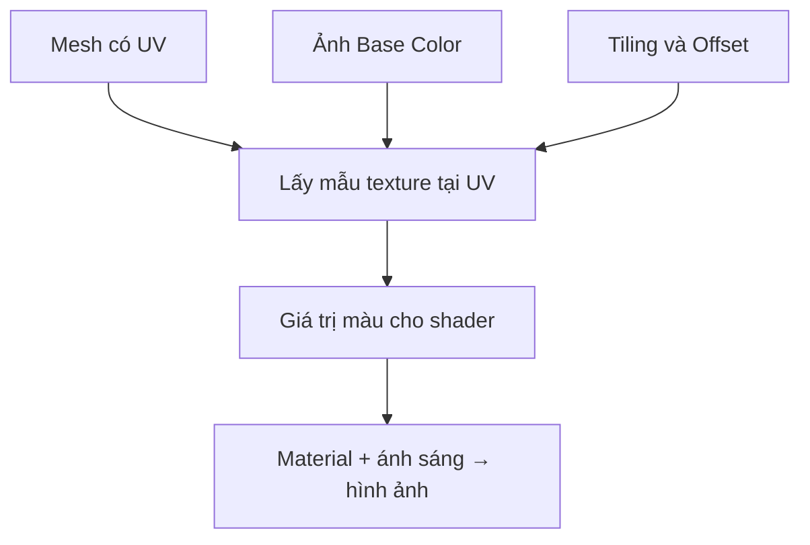

# Bài 06 — Ánh xạ vật liệu bằng Texture và UV

> **Phần học:** Creative Core / Shaders and Materials  
> **Tên bài gốc:** Map materials with textures  
> **Môi trường thực hành:** Unity 6.3, khuyến nghị project Universal Render Pipeline (URP)  
> **Nguồn gốc nội dung:** Dựa trên tệp đề cương do người học cung cấp; phần giải thích, ví dụ, bài tập, sơ đồ là nội dung bổ sung do biên soạn, không phải transcript hoặc bản dịch chính thức của Unity Learn.

## Mục tiêu học tập
- Giải thích UV mapping, Tiling/Offset, texture sampling và mipmaps.
- Gán Base Map cho Material và khắc phục lặp ảnh/giãn ảnh.
- Phân biệt texture màu với texture chứa dữ liệu phi màu.

## 1. Texture mapping là phép ánh xạ dữ liệu
Texture là một lưới dữ liệu (thường hai chiều) và shader lấy mẫu tại tọa độ do mesh cung cấp. Với UV `(u,v)`, `(0,0)` thường ứng với một góc của ảnh, `(1,1)` là góc đối diện; **UV không bắt buộc nằm trong 0–1**. Cách hình ảnh được lặp hay kéo dài phụ thuộc Wrap Mode và giá trị UV/Tiling.

Công thức trực quan: `UV_lấy_mẫu = UV_gốc × Tiling + Offset`. Đây là cách mô tả tác dụng phổ biến của tham số, không phải bảo đảm áp dụng cho mọi shader tự viết.

## 2. Các loại texture thông dụng
| Map | Dữ liệu chứa gì? | Ví dụ |
|---|---|---|
| Base Color (Albedo) | Màu bề mặt | Hoa văn gạch, vân gỗ |
| Normal | Hướng vi mô tương đối so với bề mặt | Vết khía, sợi vải |
| Metallic | Mức hành vi kim loại theo từng điểm | Đinh kim loại trên thân gỗ |
| Occlusion (AO) | Vùng lõm ít nhận ánh sáng gián tiếp | Kẽ đá, khe cạnh |
| Emission | Vùng phát sáng trên bề mặt | Dải LED, biểu tượng neon |

**Không đánh đồng ảnh màu và ảnh dữ liệu.** Base Color thông thường được xử lý theo quy trình màu sRGB; các map dữ liệu như metallic, roughness, normal cần được import/lấy mẫu phù hợp (thường không như ảnh màu). Luôn kiểm tra loại texture và các setting của dự án.

## 3. Thực hành: tạo vật liệu gạch lặp
1. Dùng một texture được phép sử dụng (texture tự tạo hoặc nguồn CC0). Nhập vào `Assets/Art/Textures/Environment/`.
2. Tạo Plane có Material `MAT_Brick_Floor` dùng URP/Lit; kéo texture vào `Base Map`.
3. Giữ Camera cố định, đổi `Tiling` từ `(1,1)` thành `(4,4)`; đặt `Wrap Mode = Repeat` nếu muốn lặp ảnh.
4. Đổi `Offset` theo trục U, V và quan sát texture trượt trên bề mặt.
5. Xoay Plane hoặc quan sát chéo góc; kiểm tra hiện tượng nhòe/răng cưa và cân nhắc `Mip Maps`, `Filter Mode`, `Aniso Level` phù hợp.
6. Dùng texture có đường kẻ ô để thấy lỗi UV. Nếu texture giãn không đều trên mesh tùy chỉnh, cần sửa UV trong phần mềm 3D thay vì chỉ tăng Tiling.

## 4. Quy tắc chất lượng texture
- Ảnh không seamless mà lặp bằng Repeat sẽ lộ đường nối.
- Độ phân giải lớn không đồng nghĩa luôn đẹp; phải tính tới GPU memory, khoảng cách Camera, mipmaps và nền tảng thiết bị.
- Normal Map không được gán trực tiếp như Base Color để mong có chi tiết ánh sáng.
- Khi chuyển texture từ phần mềm khác, kiểm tra thứ tự kênh packed texture, color space và khả năng lật kênh Y của normal map.

## 5. Bài tập định lượng
Tạo 3 mẫu `(1,1)`, `(2,2)`, `(4,4)` trên cùng một Plane; đếm số lần hoa văn xuất hiện theo mỗi trục. Chụp ảnh và nêu lý do texture có thể mờ/rối ở khoảng cách xa.

## Tự kiểm chứng khi hoàn thành
- [ ] Nêu được khái niệm chính của bài bằng ví dụ trong Unity.
- [ ] Thực hiện được phép thử trước–sau và lưu scene/bằng chứng.
- [ ] Phân biệt kết quả quan sát thực tế với kết luận suy đoán.
- [ ] Kiểm tra phiên bản Render Pipeline/Shader khi áp dụng trên dự án khác.

## Tài liệu tham khảo và đối chiếu
- **1.** [Unity Manual 6.3 — Draw texture in URP](https://docs.unity.com/en-us/engine/6000.3/manual/materials-and-shaders/shaders/writing-custom-shaders-urp/writing-shaders-urp/unlit-texture)
- **2.** [Unity Manual 6.3 — URP/Lit reference](https://docs.unity.com/en-us/engine/6000.3/manual/materials-and-shaders/built-in/shaders-in-universalrp/reference/lit-shader)
- **3.** [Unity Manual — Normal Map import settings](https://docs.unity.com/en-us/engine/6000.0/manual/materials-and-shaders/textures/textures-reference/texture-type-normal-map)

> **Ghi chú tài liệu:** Các bước thao tác và thông số minh họa được thiết kế để tự học; vị trí menu/thuộc tính có thể thay đổi theo template, package và bản cập nhật. Các nguồn Unity ở trên được dùng để kiểm tra thuật ngữ và tính năng; không có tuyên bố đã kiểm thử trực tiếp bằng Unity Editor trong môi trường này.
