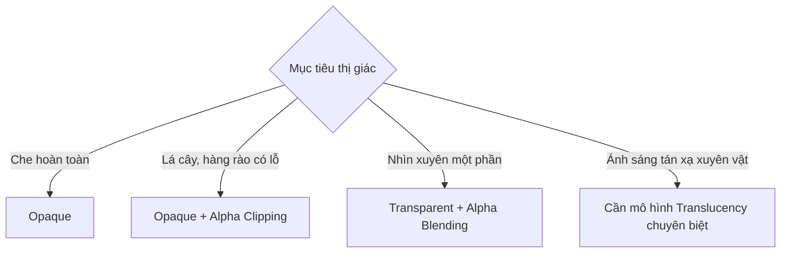

# Bài 07 — Tạo hiệu ứng trong mờ và trong suốt

> **Phần học:** Creative Core / Shaders and Materials  
> **Tên bài gốc:** Create translucent and transparent effects  
> **Môi trường thực hành:** Unity 6.3, khuyến nghị project Universal Render Pipeline (URP)  
> **Nguồn gốc nội dung:** Dựa trên tệp đề cương do người học cung cấp; phần giải thích, ví dụ, bài tập, sơ đồ là nội dung bổ sung do biên soạn, không phải transcript hoặc bản dịch chính thức của Unity Learn.

## Mục tiêu học tập
- Phân biệt Opaque, Alpha Clipping, Transparent và Translucency.
- Tạo vật liệu nhựa trong, kính đơn giản và lá cây cắt alpha bằng URP/Lit.
- Giải thích những giới hạn về độ sâu, sắp xếp thứ tự và bóng của vật liệu trong suốt.

## 1. Bốn khái niệm không nên dùng lẫn
| Thuật ngữ | Bản chất | Ví dụ |
|---|---|---|
| **Opaque** | Mọi điểm được vẽ đều che nền phía sau | Tường, đá |
| **Alpha Clipping / Cutout** | Pixel giữ lại hoặc bỏ đi dựa trên ngưỡng alpha | Tán lá cắt từ một tấm phẳng |
| **Transparency / Alpha Blending** | Trộn màu bề mặt và nền theo alpha | Nhựa màu mỏng, kính đơn giản |
| **Translucency** | Ánh sáng truyền xuyên và có thể bị tán xạ bên trong vật liệu | Sáp, da, lá được chiếu ngược sáng |

**Quan trọng:** URP/Lit Transparent hỗ trợ pha trộn trong suốt, nhưng **không đồng nghĩa** đã mô phỏng tán xạ dưới bề mặt (*subsurface scattering*) hay khúc xạ của kính. Hiệu ứng kính chân thực hơn có thể cần shader/phương pháp khác, tùy render pipeline.

## 2. Cách alpha blending hoạt động
Một mô hình đơn giản của alpha blending:

`Màu_kết_quả = alpha × Màu_bề_mặt + (1 - alpha) × Màu_phía_sau`

Trong đó `alpha = 1` nghĩa là che hoàn toàn và `alpha = 0` nghĩa là không đóng góp màu theo phép trộn này. Công thức giải thích chế độ **Alpha**, không đại diện cho mọi blending mode (`Additive`, `Multiply`, `Premultiply`) hay mọi thiết lập render. Chế độ `Premultiply` dùng cách xử lý màu alpha đã nhân trước và có các biến thể pipeline.

## 3. Thực hành 1: cốc nhựa trong đơn giản
1. Tạo Cylinder hoặc dùng mô hình có thành cốc rõ ràng; đặt phía trước một Cube đỏ để dễ quan sát.
2. Tạo `MAT_Transparent_Plastic` với shader `Universal Render Pipeline/Lit`.
3. Chọn `Surface Type = Transparent`, `Blending Mode = Alpha`; đặt alpha của `Base Map/Color` khoảng `0.3–0.5`.
4. Chọn Metallic thấp (nhựa là phi kim) và Smoothness cao. Quan sát từ 3 góc Camera.
5. Ghi rõ đây là **mô hình trong suốt đơn giản**: chưa biểu diễn độ dày kính và khúc xạ chính xác. Nếu vật thể có mặt trước/mặt sau, kiểm tra `Render Face` và thứ tự vẽ.

## 4. Thực hành 2: lá cây bằng alpha clipping
1. Tạo một Quad, gán texture PNG hoặc TGA có alpha (có quyền sử dụng).
2. Chọn URP/Lit, đặt `Surface Type = Opaque` và bật `Alpha Clipping`.
3. Điều chỉnh `Threshold` từ `0.2` tới `0.8`, xem đường viền lá biến đổi.
4. So sánh với `Transparent`: Alpha Clipping cho biên cứng và không thể tạo độ mờ một phần chỉ bằng ngưỡng.

## 5. Tại sao transparency hay gặp lỗi?
Transparent thường được render sau opaque và có thể phải sắp xếp theo độ sâu. Thứ tự có thể sai với **các mặt của cùng một mesh**, các vật thể trong suốt giao nhau hoặc khi dùng thiết lập depth khác nhau. Vì thế hiện tượng “mặt sau chồng lên mặt trước” không nhất thiết là lỗi UV hoặc ảnh alpha.

- **Object biến mất:** kiểm tra alpha, surface type và render queue.
- **Đường biên răng cưa:** Alpha Clipping tạo biên nhị phân; có thể cân nhắc anti-aliasing/alpha-to-coverage nếu pipeline hỗ trợ.
- **Nhựa trông xám/đục:** kiểm tra lighting/reflection và cách pha trộn, không chỉ alpha.
- **Đổ bóng lạ:** shadows của transparent/cutout có giới hạn theo shader và cấu hình; thử kiểm tra lại bằng ảnh trước/sau.

## 6. Câu hỏi tự kiểm tra
1. Vì sao lá cây trên một mặt phẳng nên cân nhắc cutout thay vì blending?
2. Tại sao một material có `alpha = 0.2` vẫn không nhìn xuyên nếu `Surface Type = Opaque` và không bật alpha clipping?
3. Vì sao đổi thứ tự hai object trong suốt đôi khi thay đổi kết quả?

**Sản phẩm:** một scene có ba mẫu Opaque, Cutout, Transparent và bảng so sánh chất lượng, giới hạn của từng mẫu.

## Tự kiểm chứng khi hoàn thành
- [ ] Nêu được khái niệm chính của bài bằng ví dụ trong Unity.
- [ ] Thực hiện được phép thử trước–sau và lưu scene/bằng chứng.
- [ ] Phân biệt kết quả quan sát thực tế với kết luận suy đoán.
- [ ] Kiểm tra phiên bản Render Pipeline/Shader khi áp dụng trên dự án khác.

## Tài liệu tham khảo và đối chiếu
- **1.** [Unity Manual 6.3 — URP/Lit reference](https://docs.unity.com/en-us/engine/6000.3/manual/materials-and-shaders/built-in/shaders-in-universalrp/reference/lit-shader)
- **2.** [Unity Learn — Creative Core Shaders and Materials](https://learn.unity.com/project/creative-core-shaders-and-materials)

> **Ghi chú tài liệu:** Các bước thao tác và thông số minh họa được thiết kế để tự học; vị trí menu/thuộc tính có thể thay đổi theo template, package và bản cập nhật. Các nguồn Unity ở trên được dùng để kiểm tra thuật ngữ và tính năng; không có tuyên bố đã kiểm thử trực tiếp bằng Unity Editor trong môi trường này.
