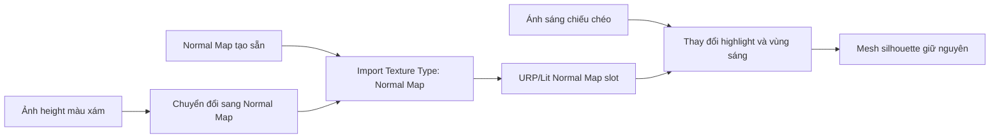

# Bài 08 — Tạo chi tiết bề mặt bằng Bump và Normal Mapping

> **Phần học:** Creative Core / Shaders and Materials  
> **Tên bài gốc:** Add physical texture with bump mapping  
> **Môi trường thực hành:** Unity 6.3, khuyến nghị project Universal Render Pipeline (URP)  
> **Nguồn gốc nội dung:** Dựa trên tệp đề cương do người học cung cấp; phần giải thích, ví dụ, bài tập, sơ đồ là nội dung bổ sung do biên soạn, không phải transcript hoặc bản dịch chính thức của Unity Learn.

## Mục tiêu học tập
- Phân biệt bump, normal, height/parallax và geometry displacement.
- Nhập Normal Map đúng Texture Type và điều chỉnh cường độ.
- Dùng phép thử ánh sáng chéo để kiểm chứng tính chất pháp tuyến giả lập.

## 1. Tạo độ gồ ghề mà không tăng polygon
Trong mô hình rasterization thông thường, độ sáng của một điểm phụ thuộc vào hướng **pháp tuyến** tại điểm đó. Normal Mapping thay pháp tuyến dùng trong shading bằng hướng được lưu trong texture; do đó tạo cảm giác có rãnh hoặc vết gồ **mặc dù biên dạng ngoài (silhouette) của mesh không đổi**.

| Kỹ thuật | Cái gì thay đổi? | Thay đổi silhouette? | Ứng dụng |
|---|---|---|---|
| Bump mapping từ height | Ước lượng pháp tuyến từ biến thiên độ cao | Không | Hoa văn nhám nhỏ |
| Normal mapping | Đọc hướng pháp tuyến từ texture | Không | Gạch, đá, da, đường rãnh |
| Parallax/height mapping | Dịch chuyển cách lấy mẫu texture theo góc nhìn | Thông thường không | Rãnh có cảm giác sâu hơn |
| Displacement hình học | Dời vị trí đỉnh hoặc bổ sung hình học | Có thể | Biên dạng đá, địa hình |

**Chú ý:** URP/Lit có thể có các thuộc tính Height Map/Parallax tùy phiên bản/tính năng, nhưng đó không đồng nghĩa displacement hình học.

## 2. Normal Map chứa thông tin gì?
Normal Map loại **tangent-space** thường mã hóa các thành phần hướng x, y, z thành màu RGB; vì pháp tuyến chưa biến đổi thường hướng ra ngoài bề mặt, nhiều normal map trông có sắc tím-xanh. Shader sử dụng hệ tiếp tuyến (*tangent basis*) của mesh để biến đổi hướng này. Việc map trông “đúng màu tím” **không bảo đảm** hướng kênh Y hay định dạng đã đúng.

## 3. Thực hành: bề mặt tường gạch có rãnh
1. Tạo Plane hoặc Cube; áp dụng Base Color texture của gạch ở bài 06.
2. Nhập normal map phù hợp. Chọn asset texture trong Project → Inspector → `Texture Type = Normal map` → `Apply`.
3. Với ảnh **heightmap màu xám**, có thể chọn `Create from Grayscale` khi import, nhưng không bật tùy chọn này trên file đã là normal map chuẩn.
4. Tạo `MAT_Brick_Normal` và kéo map vào `Surface Inputs > Normal Map` của URP/Lit.
5. So sánh cường độ `0` với `1`, quan sát tại ánh sáng chiếu xiên. Nếu phiên bản UI có thang đo khác, dùng các giá trị thấp/cao tương ứng.
6. Chụp hai ảnh cận cảnh và một ảnh nhìn silhouette của khối; giải thích vì sao rãnh không làm cạnh vật thể nhấp nhô thật.

## 4. Các lỗi hình ảnh thường gặp
| Hiện tượng | Kiểm tra |
|---|---|
| Vùng lõm trông như vùng lồi | Hướng kênh Y (green), convention DirectX/OpenGL, hướng UV |
| Normal map trông như ảnh màu bình thường | `Texture Type` chưa là Normal map; map gán sai slot |
| Bề mặt sáng tối bất thường | UV, tangents, normal mesh và ánh sáng |
| Mất chi tiết ở xa | Mipmap/filtering và độ phân giải texture |
| Vết nứt không thay đổi silhouette | Đây là giới hạn tự nhiên của normal mapping |

## 5. Bài tập nâng cao
Dùng một heightmap grayscale tự tạo (ví dụ các vòng tròn trắng đen), chuyển thành Normal Map, sau đó thay chiều ánh sáng. So sánh texture không normal và có normal; không thay hình học. Báo cáo phân biệt **độ cao được mã hóa** và **hình học được tạo thật**.

## Tự kiểm chứng khi hoàn thành
- [ ] Nêu được khái niệm chính của bài bằng ví dụ trong Unity.
- [ ] Thực hiện được phép thử trước–sau và lưu scene/bằng chứng.
- [ ] Phân biệt kết quả quan sát thực tế với kết luận suy đoán.
- [ ] Kiểm tra phiên bản Render Pipeline/Shader khi áp dụng trên dự án khác.

## Tài liệu tham khảo và đối chiếu
- **1.** [Unity Manual 6.3 — Normal map import](https://docs.unity.com/en-us/engine/6000.3/manual/materials-and-shaders/built-in/shader-built-in-configure-properties/standard-shader-texture-maps/material-parameter-normal-map/import)
- **2.** [Unity Manual — Normal Map import settings](https://docs.unity.com/en-us/engine/6000.0/manual/materials-and-shaders/textures/textures-reference/texture-type-normal-map)
- **3.** [Unity Manual 6.3 — URP/Lit reference](https://docs.unity.com/en-us/engine/6000.3/manual/materials-and-shaders/built-in/shaders-in-universalrp/reference/lit-shader)

> **Ghi chú tài liệu:** Các bước thao tác và thông số minh họa được thiết kế để tự học; vị trí menu/thuộc tính có thể thay đổi theo template, package và bản cập nhật. Các nguồn Unity ở trên được dùng để kiểm tra thuật ngữ và tính năng; không có tuyên bố đã kiểm thử trực tiếp bằng Unity Editor trong môi trường này.
