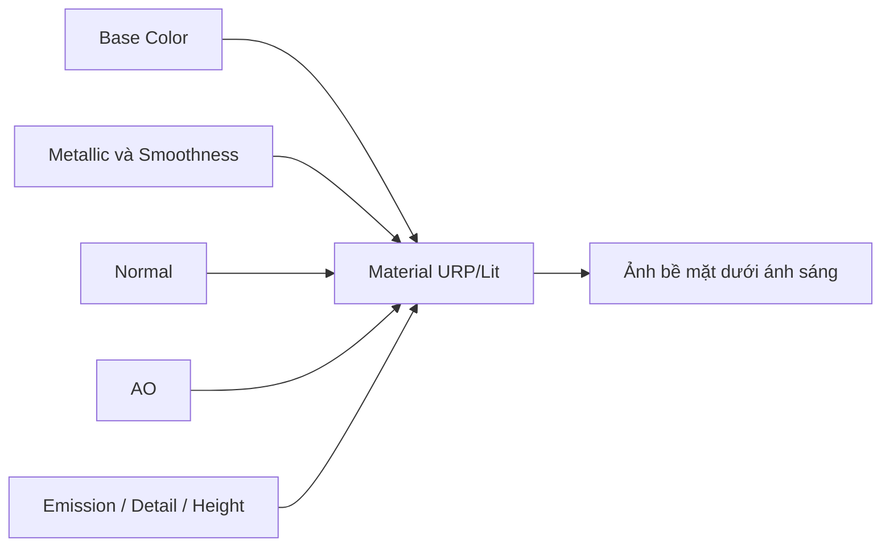

# Bài 09 — Tinh chỉnh bề mặt bằng các Texture Map nâng cao

> **Phần học:** Creative Core / Shaders and Materials  
> **Tên bài gốc:** Refine surfaces with more texture maps  
> **Môi trường thực hành:** Unity 6.3, khuyến nghị project Universal Render Pipeline (URP)  
> **Nguồn gốc nội dung:** Dựa trên tệp đề cương do người học cung cấp; phần giải thích, ví dụ, bài tập, sơ đồ là nội dung bổ sung do biên soạn, không phải transcript hoặc bản dịch chính thức của Unity Learn.

## Mục tiêu học tập
- Giải thích ảnh hưởng của Metallic, Occlusion, Emission, Height và Detail Map.
- Hiểu giới hạn của channel packing và cách nhập map từ phần mềm khác.
- Tạo một material hoàn chỉnh, thử bật/tắt từng map để xác định đóng góp.

## 1. Tại sao dùng nhiều loại map?
Một bức ảnh Base Color không chứa đủ thông tin để bề mặt phản ứng với ánh sáng. Trong PBR, các map bổ sung lưu dữ liệu khác nhau **theo từng vùng bề mặt**, giúp ví dụ đinh tán kim loại nằm trên gỗ, một dải đèn phát sáng hay các khe gạch có che khuất rõ hơn.

| Texture map | Ảnh hưởng chủ yếu | Lưu ý kỹ thuật |
|---|---|---|
| Metallic | Mức độ kim loại theo vị trí | Phần gỗ là phi kim, kim loại nên gần 1 |
| Smoothness | Độ sắc của phản xạ | Unity URP/Lit thường đọc từ alpha của Metallic Map hoặc Base Map tùy Source |
| Occlusion (AO) | Đóng góp ánh sáng môi trường trong khe/hốc | Không thay thế đổ bóng trực tiếp |
| Emission | Màu/bề mặt trông tự phát sáng | Không bảo đảm phát ánh sáng lên vật khác nếu thiếu cơ chế GI phù hợp |
| Height/Parallax | Cảm giác sâu bằng thay đổi tọa độ lấy mẫu | Thường không đổi silhouette |
| Detail Base/Normal | Chi tiết tần số cao nhìn gần | Cần điều chỉnh tiling độc lập để tránh nhiễu |

## 2. Channel packing: cần đọc từng kênh
Một texture RGBA có thể đóng gói nhiều trường dữ liệu để giảm số asset/số lượt lấy mẫu, nhưng **chuẩn kênh không giống nhau giữa mọi shader/pipeline**. Trong workflow của URP/Lit, Unity có hướng dẫn đóng gói để dùng các dữ liệu như Metallic, Smoothness và Occlusion; trước khi tự đóng gói, cần kiểm tra tài liệu và Inspector của **chính shader đang dùng**.

Ví dụ khi làm việc với một map chứa dữ liệu Metallic ở kênh R, Occlusion ở G, Smoothness ở A (theo mô tả của một quy trình URP), không nên gán nguyên ảnh đó vào một slot vốn chỉ đọc alpha mà hy vọng mọi kênh đều tự nhận đúng. Cần chọn đúng workflow/channel packing hoặc xử lý lại ảnh. Đừng giả định chuẩn **ORM** (Occlusion/Roughness/Metallic, thường R/G/B trong các công cụ khác) khớp mặc định URP/Lit.

## 3. Thực hành: tấm bảng kim loại cũ có đèn báo
1. Tạo Cube dẹt làm bảng, gán Base Color texture vết xước và vệt sơn, nguồn ảnh hợp lệ.
2. Gán Metallic Map sao cho phần bản lề/đinh tán có metallic cao, phần sơn hoặc nhựa có metallic thấp **nếu texture được thiết kế theo vùng**.
3. Gán Normal Map các vết xước và Occlusion Map ở đường kẽ, kiểm tra cách các map tạo hiệu ứng riêng.
4. Bật Emission và chọn màu biểu thị một vệt LED. Quan sát trực tiếp bề mặt; không kết luận phát sáng của map đã chiếu sáng các vật xung quanh nếu chưa kiểm tra.
5. Tạo hai bản sao: **chỉ Base Map** và **đủ map**. Đặt cùng đèn/camera và so sánh.
6. Tắt lần lượt Metallic, Normal, AO, Emission; ghi rõ phần thay đổi nhìn thấy được, phần khó quan sát và điều kiện của scene.

## 4. Xử lý màu và hiệu năng
- Base Color thường chứa dữ liệu màu, cần quy trình màu phù hợp; map kim loại/AO/roughness thường chứa dữ liệu đo lường hoặc tỷ lệ, không nên dùng cách diễn giải sRGB màu như với albedo.
- Thêm texture map thường tăng chi phí bộ nhớ và/hoặc lượt sample. Tuy nhiên lợi ích chất lượng có thể đáng giá; đo trên thiết bị đích.
- Texture atlas/packing có thể giảm số texture tách rời, nhưng sai kênh là lỗi dữ liệu và rất khó phát hiện nếu chỉ nhìn vật liệu dưới một nguồn sáng.

## 5. Bài tập
Làm bảng *ablation* bật/tắt từng map, chụp ảnh đối chứng cố định Camera, tạo một kết luận về **map nào đóng góp lớn nhất** trong từng vật liệu. Không đưa nhận xét tuyệt đối từ chỉ một điều kiện chiếu sáng.

## Tự kiểm chứng khi hoàn thành
- [ ] Nêu được khái niệm chính của bài bằng ví dụ trong Unity.
- [ ] Thực hiện được phép thử trước–sau và lưu scene/bằng chứng.
- [ ] Phân biệt kết quả quan sát thực tế với kết luận suy đoán.
- [ ] Kiểm tra phiên bản Render Pipeline/Shader khi áp dụng trên dự án khác.

## Tài liệu tham khảo và đối chiếu
- **1.** [Unity Manual 6.3 — URP/Lit reference](https://docs.unity.com/en-us/engine/6000.3/manual/materials-and-shaders/built-in/shaders-in-universalrp/reference/lit-shader)
- **2.** [Unity Manual 6.3 — Draw texture in URP](https://docs.unity.com/en-us/engine/6000.3/manual/materials-and-shaders/shaders/writing-custom-shaders-urp/writing-shaders-urp/unlit-texture)
- **3.** [Unity Manual — Normal Map import settings](https://docs.unity.com/en-us/engine/6000.0/manual/materials-and-shaders/textures/textures-reference/texture-type-normal-map)
- **4.** [Unity Manual 6.3 — Frame Debugger](https://docs.unity.com/en-us/engine/6000.3/manual/analysis/graphics-performance-profiling/profile-rendering/frame-debugger/frame-debugger)

> **Ghi chú tài liệu:** Các bước thao tác và thông số minh họa được thiết kế để tự học; vị trí menu/thuộc tính có thể thay đổi theo template, package và bản cập nhật. Các nguồn Unity ở trên được dùng để kiểm tra thuật ngữ và tính năng; không có tuyên bố đã kiểm thử trực tiếp bằng Unity Editor trong môi trường này.
