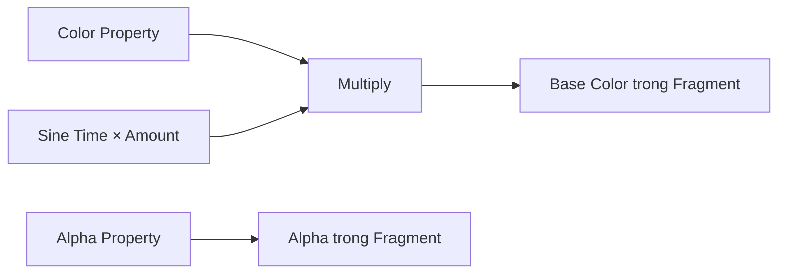
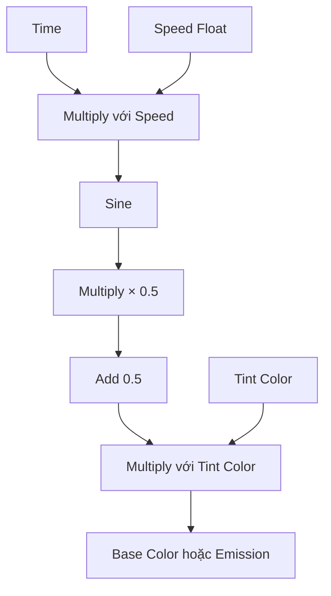

# Bài 10 — Bắt đầu với Shader Graph

> **Phần học:** Creative Core / Shaders and Materials  
> **Tên bài gốc:** Get started with Shader Graph  
> **Môi trường thực hành:** Unity 6.3, khuyến nghị project Universal Render Pipeline (URP)  
> **Nguồn gốc nội dung:** Dựa trên tệp đề cương do người học cung cấp; phần giải thích, ví dụ, bài tập, sơ đồ là nội dung bổ sung do biên soạn, không phải transcript hoặc bản dịch chính thức của Unity Learn.

## Mục tiêu học tập
- Tạo Shader Graph cơ bản và xuất thuộc tính Color vào Material Inspector.
- Lắp một graph dùng UV/Time để tạo biến đổi màu đơn giản.
- Biết lưu graph, tạo material và xử lý lỗi tương thích pipeline.

## 1. Shader Graph là gì?
Shader Graph là hệ thống biên soạn shader bằng **node** thay vì phải tự viết toàn bộ HLSL/ShaderLab. Mỗi node thực hiện phép toán hoặc trả về một nguồn dữ liệu; các cạnh biểu thị luồng dữ liệu từ đầu ra sang đầu vào. Graph không tự động là “miễn phí hiệu năng”: số texture sample và phép toán vẫn được GPU thực hiện.

**Phiên bản 6.3:** Unity bổ sung luồng tạo Shader Graph từ **template**. Vì vậy tên mục trong menu có thể khác các video cũ; hãy chọn template/target dành cho URP và kiểm tra Graph Inspector trước khi làm theo hướng dẫn từng bước.

## 2. Kiến trúc cơ bản của một graph

Graph minh họa nguyên lý; node `Time`, `Sine`, `Multiply` cần được kết nối đúng **kiểu dữ liệu** và độ lớn giá trị. Với Lit Graph, màu đưa vào Base Color còn chịu tác động của lighting. Với Unlit Graph, màu có thể ít phụ thuộc nguồn sáng hơn.

## 3. Thực hành 1: đổi màu từ Inspector
1. Mở project URP. Trong Project, chọn `Create > Shader Graph` rồi chọn một graph/template **URP Lit** hoặc **URP Unlit** (tên nhánh menu tùy giao diện Unity 6.3).
2. Đặt tên `SG_Custom_Color`; mở graph bằng nhấp đúp.
3. Trong Blackboard, thêm thuộc tính `Color` tên `Tint`, bảo đảm thuộc tính được **Exposed** nếu muốn thay trong Material Inspector.
4. Kéo `Tint` vào graph, nối với đầu vào Base Color (Lit) hoặc Base Color tương ứng của Unlit Fragment trong Master Stack.
5. Nhấn **Save Asset**; nhấp phải vào Shader Graph asset chọn `Create > Material` (hoặc tạo Material và chọn shader graph trong danh sách).
6. Gán material mới cho Sphere; chỉnh `Tint` trong Inspector, kiểm tra Sphere đổi màu.

## 4. Thực hành 2: màu sáng tối dao động theo thời gian
Một sơ đồ nguyên lý với scalar `Pulse = 0.5 + 0.5 × sin(Time × Speed)`:

Giá trị 0–1 của Pulse cho phép giảm mức sáng/tối có kiểm soát. Nếu đưa kết quả vào **Emission**, bạn tạo cảm giác sáng trên bề mặt (không mặc nhiên chiếu sáng thật ra scene). Để tránh tối hoàn toàn, thay `0.5 + 0.5sin(...)` bằng `0.75 + 0.25sin(...)`.

## 5. Xử lý lỗi Shader Graph
| Lỗi | Giải pháp ưu tiên |
|---|---|
| Vật thể hồng | Graph có lỗi hoặc Shader không tương thích pipeline; xem Console/Graph Inspector |
| Không thấy property | Kiểm tra Exposed, tạo lại material hoặc kiểm tra đúng shader của material |
| Graph thay đổi không phản ánh | Save Asset; bảo đảm đúng graph/material được gán |
| Giá trị vượt khoảng mong muốn | Dùng Saturate/Clamp cho hệ số scalar nếu thích hợp |
| Nhìn không đúng vì lighting | Kiểm tra đang dùng Lit hay Unlit, nguồn sáng và màu HDR |

## 6. Bài tập
Tạo một đèn tín hiệu đổi độ sáng theo thời gian với các property `Tint`, `Speed`, `Intensity`. Nộp ảnh graph và Inspector; mô tả rõ giá trị đầu vào, phép toán và hình ảnh đầu ra. Mở rộng: thêm UV để tạo hoa văn sọc chạy, rồi thảo luận chi phí sample của texture so với màu thủ tục.

## Tự kiểm chứng khi hoàn thành
- [ ] Nêu được khái niệm chính của bài bằng ví dụ trong Unity.
- [ ] Thực hiện được phép thử trước–sau và lưu scene/bằng chứng.
- [ ] Phân biệt kết quả quan sát thực tế với kết luận suy đoán.
- [ ] Kiểm tra phiên bản Render Pipeline/Shader khi áp dụng trên dự án khác.

## Tài liệu tham khảo và đối chiếu
- **1.** [Unity Manual 6.3 — Shader Graph](https://docs.unity.com/en-us/engine/6000.3/manual/materials-and-shaders/shaders/writing-custom/shader-graph)
- **2.** [Unity 6.3 — What’s New](https://docs.unity.com/en-us/engine/6000.3/manual/whats-new/unity63)
- **3.** [Unity Manual 6.3 — URP/Lit reference](https://docs.unity.com/en-us/engine/6000.3/manual/materials-and-shaders/built-in/shaders-in-universalrp/reference/lit-shader)

> **Ghi chú tài liệu:** Các bước thao tác và thông số minh họa được thiết kế để tự học; vị trí menu/thuộc tính có thể thay đổi theo template, package và bản cập nhật. Các nguồn Unity ở trên được dùng để kiểm tra thuật ngữ và tính năng; không có tuyên bố đã kiểm thử trực tiếp bằng Unity Editor trong môi trường này.
