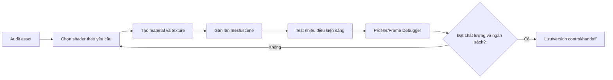

# Bài 12 — Ứng dụng Shader và Material vào dự án thực hành

> **Phần học:** Creative Core / Shaders and Materials  
> **Tên bài gốc:** Apply materials and shaders to your guided project  
> **Môi trường thực hành:** Unity 6.3, khuyến nghị project Universal Render Pipeline (URP)  
> **Nguồn gốc nội dung:** Dựa trên tệp đề cương do người học cung cấp; phần giải thích, ví dụ, bài tập, sơ đồ là nội dung bổ sung do biên soạn, không phải transcript hoặc bản dịch chính thức của Unity Learn.

## Mục tiêu học tập
- Lập kế hoạch vật liệu dựa trên danh mục asset trong một dự án thực tế.
- Áp dụng shader phù hợp cho gameplay, ánh sáng và phong cách nghệ thuật.
- Kiểm thử tính nhất quán và hiệu năng thay vì chỉ xem ảnh đẹp trong Editor.

## 1. Chuyển từ bài tập đơn lẻ sang production
Một dự án thực tế có nhiều kiểu bề mặt, góc Camera, ánh sáng và nền tảng chạy. Do đó thay vì tối ưu một vật thể riêng, bạn cần một **material style guide**: nhóm vật liệu, giới hạn thông số, quy tắc texture và nguyên tắc quản lý asset. Bài này dùng một dự án giả định (căn phòng nhỏ/khung cảnh 3D) làm ví dụ chuyển giao; không thay thế project chính thức của Unity Learn.

## 2. Kiểm kê tài sản trước khi triển khai
| Nhóm asset | Nhu cầu thể hiện | Shader/texture dự kiến | Rủi ro |
|---|---|---|---|
| Sàn/đường | Mặt lặp đều | URP/Lit + Base/Normal | Seams, tiling lệch |
| Khung kim loại | Phản xạ có định hướng | URP/Lit + Metallic/Smoothness | Thiếu môi trường phản xạ |
| Biển chỉ dẫn | Dễ đọc | URP/Unlit hoặc emissive stylized | Chói/không đủ tương phản |
| Lá cây | Biên dạng phức tạp | URP/Lit + Alpha Clipping | Răng cưa, overdraw |
| Cửa kính | Nhìn xuyên | URP/Lit Transparent | Sorting/depth artifacts |

## 3. Quy trình triển khai chuẩn

1. **Audit:** liệt kê asset chưa có material, shader đang dùng và các texture bị thiếu.
2. **Đặt mục tiêu quan sát:** ví dụ “khi Camera quay, mép kim loại có phản xạ nhưng chữ trên biển vẫn dễ đọc”.
3. **Xây material chung:** phân biệt phần nền, props, nhân vật, hiệu ứng. Dùng material variant khi nhiều asset chỉ khác vài property.
4. **Triển khai theo thứ tự:** nền/vật liệu lớn → vật liệu nhân vật/props → những hiệu ứng đặc biệt. Cố định ánh sáng và Camera khi so sánh.
5. **Kiểm thử:** Editor, Play Mode và một bản build trên thiết bị dự định nếu có thể. Lưu ảnh lỗi trước khi sửa.
6. **Kiểm soát hiệu năng:** kiểm tra thời gian GPU, overdraw, texture memory và draw call khi có liên quan; không lấy “số Material ít nhất” làm mục tiêu duy nhất.
7. **Handover:** chuẩn hóa thư mục, tên shader/material, giấy phép texture, screenshot và ghi chép các ngoại lệ kỹ thuật.

## 4. Các ràng buộc thiết kế đáng lưu ý
- **Phong cách:** chất liệu vẽ tay (stylized) vẫn cần nhất quán về ánh sáng; không bắt buộc mô phỏng PBR hoàn toàn nếu chủ ý nghệ thuật khác.
- **Kỹ thuật:** material quá nhiều keyword/variant và texture sample đắt có thể ảnh hưởng hiệu năng, cần đo thay vì phỏng đoán.
- **Tương thích:** project URP và Built-in/HDRP không thể coi là thay shader trực tiếp rồi chạy giống hệt; migration có thể phải nâng cấp material và cấu hình pipeline.
- **Dữ liệu:** nếu làm việc nhóm, giữ các file `.meta` trong Git và tránh mất tham chiếu texture/shader.

## 5. Kiểm thử nghiệm thu gợi ý
| ID | Tình huống | Kỳ vọng | Minh chứng |
|---|---|---|---|
| MAT-01 | Camera nhìn sàn ở góc xiên | Texture không giãn bất thường | Ảnh Game View |
| MAT-02 | Chuyển nguồn sáng | Lit phản ứng, Unlit ổn định về shading | Video ngắn |
| MAT-03 | Hai vật trong suốt giao nhau | Biết giới hạn hoặc có phương án kiểm soát | Ảnh và mô tả artifact |
| MAT-04 | Build trên nền tảng mục tiêu | Không xuất hiện material hồng | Kết quả build + screenshot |
| MAT-05 | Đồng nghiệp mở project | Đầy đủ asset và tham chiếu | Commit/ghi chú dependency |

## 6. Bài tập dự án
Chọn một scene đã có (hoặc dùng scene mẫu), hoàn thiện tối thiểu 6 material theo phong cách nhất quán. Nộp trước/sau, bảng thông số, danh mục texture hợp lệ và một bản kiểm tra hiệu năng. Giải thích **tại sao** chọn Lit/Unlit/Shader Graph cho từng nhóm.

## Tự kiểm chứng khi hoàn thành
- [ ] Nêu được khái niệm chính của bài bằng ví dụ trong Unity.
- [ ] Thực hiện được phép thử trước–sau và lưu scene/bằng chứng.
- [ ] Phân biệt kết quả quan sát thực tế với kết luận suy đoán.
- [ ] Kiểm tra phiên bản Render Pipeline/Shader khi áp dụng trên dự án khác.

## Tài liệu tham khảo và đối chiếu
- **1.** [Unity Manual 6.3 — Materials](https://docs.unity.com/en-us/engine/6000.3/manual/materials-and-shaders/materials)
- **2.** [Unity Manual 6.3 — URP/Lit reference](https://docs.unity.com/en-us/engine/6000.3/manual/materials-and-shaders/built-in/shaders-in-universalrp/reference/lit-shader)
- **3.** [Unity Manual 6.3 — Material Variants](https://docs.unity.com/en-us/engine/6000.3/manual/materials-and-shaders/materials/materialvariant-landingpage)
- **4.** [Unity Manual 6.3 — Batching](https://docs.unity.com/en-us/engine/6000.3/manual/analysis/graphics-performance-profiling/reduce-draw-calls/draw-call-batching/set-up)
- **5.** [Unity Manual 6.3 — Frame Debugger](https://docs.unity.com/en-us/engine/6000.3/manual/analysis/graphics-performance-profiling/profile-rendering/frame-debugger/frame-debugger)

> **Ghi chú tài liệu:** Các bước thao tác và thông số minh họa được thiết kế để tự học; vị trí menu/thuộc tính có thể thay đổi theo template, package và bản cập nhật. Các nguồn Unity ở trên được dùng để kiểm tra thuật ngữ và tính năng; không có tuyên bố đã kiểm thử trực tiếp bằng Unity Editor trong môi trường này.
