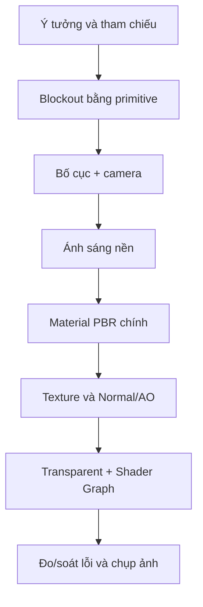

# Bài 11 — Thử thách: Sắp đặt tĩnh vật với nhiều chất liệu

> **Phần học:** Creative Core / Shaders and Materials  
> **Tên bài gốc:** Challenge: Create your still life composition  
> **Môi trường thực hành:** Unity 6.3, khuyến nghị project Universal Render Pipeline (URP)  
> **Nguồn gốc nội dung:** Dựa trên tệp đề cương do người học cung cấp; phần giải thích, ví dụ, bài tập, sơ đồ là nội dung bổ sung do biên soạn, không phải transcript hoặc bản dịch chính thức của Unity Learn.

## Mục tiêu học tập
- Thiết kế và hoàn thiện một cảnh tĩnh vật minh họa ít nhất 5 chất liệu.
- Có bố cục, nguồn sáng, camera và minh chứng bề mặt thay đổi đúng.
- Đánh giá kết quả bằng rubric kiểm chứng được thay vì nhận xét cảm tính.

## 1. Đề bài tự biên soạn dựa trên tên bài gốc
Dựng một **still-life composition** trong Unity: một bộ vật thể không chuyển động được sắp xếp có chủ ý trên bàn/kệ và chiếu sáng để trình bày sự đa dạng của vật liệu. Ví dụ: bình gốm, quả táo sơn màu, cốc kính, hộp kim loại, mảnh gỗ và một bảng đèn emissive.

> Đây là **đề bài mở rộng để thực hành**, không khẳng định là nguyên văn tiêu chí chấm của Unity Learn.

## 2. Mục tiêu sản phẩm và điều kiện
- **Scene:** `Scenes/11_StillLife.unity` có Camera, nguồn sáng, nền và đối tượng chính/phụ.
- **Chất liệu:** tối thiểu 5 material, trong đó có phi kim mờ, phi kim bóng, kim loại, một trong suốt/cutout và một có normal hoặc detail map.
- **Shader Graph:** ít nhất một hiệu ứng đơn giản dùng graph, nếu cấu hình URP hỗ trợ.
- **Bằng chứng:** ảnh tổng thể, ảnh cận cảnh và bảng tham số Material.

## 3. Quy trình thiết kế theo lớp

### Bước 1 — bố cục trước, chi tiết sau
Dùng các khối cơ bản; giữ vị trí Camera cố định để chụp ảnh trước/sau. Xây dựng một **điểm nhấn thị giác** (bình hoặc vật thể đặc biệt), hai vật thể phụ và những khoảng trống rõ ràng. Các nguyên tắc tam phần, cân bằng sáng tối và tương phản có thể được dùng như công cụ phân tích, không phải luật bắt buộc.

### Bước 2 — tập trung vào chất liệu
Tạo bảng màu vật liệu có phân cấp: kim loại phản chiếu tạo điểm nhấn; gốm mờ giúp mắt nghỉ; gỗ có texture tạo sự ấm áp; nhựa/kính trong suốt minh họa alpha blending. Không để tất cả vật liệu đều Smoothness = 1 vì rất khó phân biệt.

### Bước 3 — chiếu sáng và kiểm tra
Dùng một key light và fill light dịu nếu phù hợp. Với kim loại, kiểm tra môi trường phản xạ; với normal, dùng ánh sáng hơi lệch góc. Đánh giá cả tổng thể và cận cảnh.

### Bước 4 — hoàn thiện
Đặt tên asset rõ nghĩa; lưu scene; chụp từ ít nhất hai góc Camera; kiểm tra Console; xác nhận source ảnh/texture hợp lệ về giấy phép.

## 4. Rubric gợi ý (20 điểm)
| Tiêu chí | Điểm | Mức đạt kỳ vọng |
|---|---:|---|
| Bố cục, Camera và đọc hình | 4 | Điểm nhấn rõ, không chồng vật thể khó hiểu |
| Sử dụng Metallic/Smoothness hợp lý | 4 | Tối thiểu 3 phản ứng phản xạ khác nhau |
| Texture, UV, Normal/Detail | 4 | Map đúng, không giãn/lộ seam nghiêm trọng |
| Transparent, cutout hoặc Shader Graph | 4 | Hiệu ứng có mục đích, không lỗi render lớn |
| Tổ chức project, minh chứng, giải thích | 4 | Tái mở scene, kết luận có ảnh đối chứng |

## 5. Mẫu nhật ký thực nghiệm
| Thử nghiệm | Dự đoán | Quan sát | Điều chỉnh |
|---|---|---|---|
| Thép bóng: Smoothness 0.9 | Phản xạ sắc | Mặt quá tối | Tăng chi tiết environment/reflection |
| Lá cây: alpha clip 0.5 | Biên lá rõ | Viền bị khuyết | Giảm threshold / kiểm tra alpha source |
| Tường: normal map | Rãnh hiện rõ | Gần như phẳng | Kiểm tra import và ánh sáng xiên |

## 6. Tiêu chí nộp và tự kiểm tra
- [ ] File scene mở được trong project URP.
- [ ] Tối thiểu 5 chất liệu và mỗi chất liệu có lý do thiết kế.
- [ ] Mỗi ảnh tham chiếu/texture ghi rõ nguồn và điều kiện sử dụng.
- [ ] Có 1 bảng so sánh trước/sau cho ít nhất một material.
- [ ] Có ảnh nhìn toàn cảnh, ảnh cận và ghi chú hạn chế chưa giải quyết.

## Tự kiểm chứng khi hoàn thành
- [ ] Nêu được khái niệm chính của bài bằng ví dụ trong Unity.
- [ ] Thực hiện được phép thử trước–sau và lưu scene/bằng chứng.
- [ ] Phân biệt kết quả quan sát thực tế với kết luận suy đoán.
- [ ] Kiểm tra phiên bản Render Pipeline/Shader khi áp dụng trên dự án khác.

## Tài liệu tham khảo và đối chiếu
- **1.** [Unity Learn — Creative Core Shaders and Materials](https://learn.unity.com/project/creative-core-shaders-and-materials)
- **2.** [Unity Learn — Creative Core Mission](https://learn.unity.com/pathway/creative-core/unit/shaders-and-materials?version=6.3)
- **3.** [Unity Manual 6.3 — URP/Lit reference](https://docs.unity.com/en-us/engine/6000.3/manual/materials-and-shaders/built-in/shaders-in-universalrp/reference/lit-shader)
- **4.** [Unity Manual 6.3 — Shader Graph](https://docs.unity.com/en-us/engine/6000.3/manual/materials-and-shaders/shaders/writing-custom/shader-graph)

> **Ghi chú tài liệu:** Các bước thao tác và thông số minh họa được thiết kế để tự học; vị trí menu/thuộc tính có thể thay đổi theo template, package và bản cập nhật. Các nguồn Unity ở trên được dùng để kiểm tra thuật ngữ và tính năng; không có tuyên bố đã kiểm thử trực tiếp bằng Unity Editor trong môi trường này.
