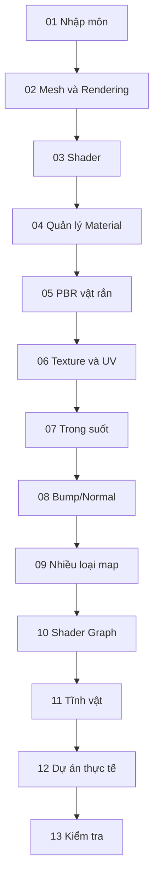

# KHÓA HỌC CREATIVE CORE — SHADERS & MATERIALS (TIẾNG VIỆT)

**Phiên bản trình bày:** 2026-10-29 · **Unity:** 6.3 · **Phạm vi thực hành:** URP  
**13 bài học:** được tái biên soạn theo thứ tự các tệp người học tải lên. Đây là **tài liệu tự học mở rộng**, không phải bản dịch chính thức, transcript hoặc bản sao bài giảng Unity Learn.

## Lộ trình

| # | Bài học | Năng lực chính |
|---:|---|---|
| 01 | [Bắt đầu với Shader và Material](001-get-started-with-shaders-and-materials.md) | Phân biệt chính xác Mesh, Texture, Shader, Material và vai trò của ánh sáng |
| 02 | [Khám phá Mesh và quá trình dựng hình](002-explore-meshes-and-rendering.md) | Mô tả vai trò vertex, triangle, normal và UV trong một mesh |
| 03 | [Khám phá các loại Shader](003-explore-shaders.md) | Lựa chọn URP/Lit, Simple Lit hoặc Unlit dựa trên nhu cầu quan sát được |
| 04 | [Quản lý Material trong dự án](004-manage-materials-in-a-project.md) | Tạo cấu trúc thư mục, quy tắc đặt tên và tái sử dụng material |
| 05 | [Mô phỏng bề mặt vật thể rắn với PBR](005-simulate-solid-surfaces.md) | Giải thích metallic/smoothness theo mô hình vật liệu kim loại và điện môi |
| 06 | [Ánh xạ vật liệu bằng Texture và UV](006-map-materials-with-textures.md) | Giải thích UV mapping, Tiling/Offset, texture sampling và mipmaps |
| 07 | [Tạo hiệu ứng trong mờ và trong suốt](007-create-translucent-and-transparent-effects.md) | Phân biệt Opaque, Alpha Clipping, Transparent và Translucency |
| 08 | [Tạo chi tiết bề mặt bằng Bump và Normal Mapping](008-add-physical-texture-with-bump-mapping.md) | Phân biệt bump, normal, height/parallax và geometry displacement |
| 09 | [Tinh chỉnh bề mặt bằng các Texture Map nâng cao](009-refine-surfaces-with-more-texture-maps.md) | Giải thích ảnh hưởng của Metallic, Occlusion, Emission, Height và Detail Map |
| 10 | [Bắt đầu với Shader Graph](010-get-started-with-shader-graph.md) | Tạo Shader Graph cơ bản và xuất thuộc tính Color vào Material Inspector |
| 11 | [Thử thách: Sắp đặt tĩnh vật với nhiều chất liệu](011-challenge-create-your-still-life-composition.md) | Thiết kế và hoàn thiện một cảnh tĩnh vật minh họa ít nhất 5 chất liệu |
| 12 | [Ứng dụng Shader và Material vào dự án thực hành](012-apply-materials-and-shaders-to-your-guided-project.md) | Lập kế hoạch vật liệu dựa trên danh mục asset trong một dự án thực tế |
| 13 | [Ôn tập và tự đánh giá Shader & Material](013-creative-core-shaders-and-materials-quiz.md) | Tự kiểm tra mối liên hệ giữa mesh, material, shader, texture và rendering |

## Cách học và minh chứng

1. Đọc mục tiêu, trước tiên viết một **giả thuyết** cho phép thử của bài.
2. Mở một project URP riêng (hoặc scene test) và làm từng bước. Thay đổi một tham số mỗi lần khi có thể.
3. Lưu **scene, ảnh trước/sau, giá trị Inspector và nhận xét**; ghi rõ thứ mình quan sát được khác với thứ chỉ suy ra từ lý thuyết.
4. Đối chiếu link Unity Manual cuối từng bài khi UI Editor không khớp với hướng dẫn.
5. Bài 11 áp dụng tổng hợp; bài 12 chuyển vào project của bạn; bài 13 tự đánh giá.

## Quy tắc kỹ thuật quan trọng

- `URP/Lit` không tương đương Built-in/Standard hoặc HDRP/Lit. Chuyển pipeline cần kiểm tra và nâng cấp material.
- Màu trắng/đen trong Base Map không tự đại diện cho mọi cơ chế vật lý. Phản xạ phụ thuộc shader, metallic, smoothness và lighting.
- Normal Map **không** tạo thêm hình học hoặc thay silhouette của mesh.
- `Transparent`, `Alpha Clipping` và hiệu ứng tán xạ xuyên vật không phải một khái niệm.
- Emission không bảo đảm làm sáng các vật lân cận nếu thiếu cấu hình chiếu sáng gián tiếp thích hợp.
- Bảng giá trị vật liệu trong tài liệu là **điểm bắt đầu cho thực nghiệm**, không phải dữ liệu vật lý được đo thực tế.

## Phân biệt nguồn

**Tệp nguồn đã cung cấp:** 13 file gồm tên bài, chủ đề, mục tiêu cơ bản và quy trình rất ngắn, phần lớn có nội dung template lặp lại. **Phần bổ sung:** các mô hình khái niệm, bảng kỹ thuật, sơ đồ Mermaid, thí nghiệm đối chứng, ví dụ mã, rubric và bài trắc nghiệm tự biên soạn. Vì tệp nguồn tự xác nhận `outline_based_not_official_transcript`, bộ này không gán các bước bổ sung là chỉ dẫn chính thức của Unity Learn.

**Nguồn đối chiếu chính:**
- [Unity Learn — Creative Core Shaders and Materials](https://learn.unity.com/project/creative-core-shaders-and-materials)
- [Unity 6.3 URP/Lit](https://docs.unity.com/en-us/engine/6000.3/manual/materials-and-shaders/built-in/shaders-in-universalrp/reference/lit-shader)
- [Unity 6.3 Shader Graph](https://docs.unity.com/en-us/engine/6000.3/manual/materials-and-shaders/shaders/writing-custom/shader-graph)
- [Unity 6.3 Materials](https://docs.unity.com/en-us/engine/6000.3/manual/materials-and-shaders/materials)
- [Unity 6.3 What's New](https://docs.unity.com/en-us/engine/6000.3/manual/whats-new/unity63)

## Giấy phép và bản quyền

Tài liệu mới được viết độc lập bằng tiếng Việt, có ghi nguồn tham chiếu. Không sao chép toàn văn bài Unity Learn. Texture/model của người học cần giấy phép riêng; khi phân phối dự án, hãy giữ thông tin tác giả/giấy phép của asset bên thứ ba.
