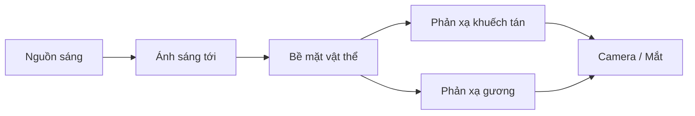

# Bài 01 — Nhập môn nghệ thuật và khoa học ánh sáng

*Creative Core · Lighting · Unity 6.3 · Get started with lighting*

## 1. Tóm tắt và mục tiêu

Ánh sáng không chỉ giúp nhận ra vật thể; nó cho biết chất liệu, độ sâu, thời điểm trong ngày và bầu không khí của một khung hình. Người thiết kế ánh sáng (*lighting artist*) cần kết hợp cách ánh sáng truyền trong thực tế với ý đồ thị giác và giới hạn hiệu năng của một ứng dụng thời gian thực.

Sau bài này, bạn có thể **chỉ ra nguồn sáng**, phân biệt phản xạ và khúc xạ, phân tích hướng chiếu sáng trong ảnh và đề xuất một bố cục ánh sáng phù hợp với cảm xúc cần truyền tải.

## 2. Ánh sáng và quá trình hình thành hình ảnh

Nguồn sáng phát ra bức xạ điện từ trong vùng nhìn thấy. Khi tương tác với vật thể, một phần năng lượng có thể được **hấp thụ**, **phản xạ**, **truyền qua** hoặc bị tán xạ. Camera/ mắt thu nhận ánh sáng từ những hướng đi tới cảm biến. Vì vậy, bề mặt không tự nhiên "có màu" cố định trong mọi điều kiện: hình ảnh cuối phụ thuộc đồng thời vào phổ nguồn sáng, tính chất vật liệu, hình học và camera.

Sơ đồ mô tả hai đường phản xạ thường gặp. Trong thực tế, cảm biến còn có thể thu nhận ánh sáng xuyên vật liệu, khúc xạ hoặc ánh sáng phản xạ nhiều lần qua các bề mặt khác.

### 2.1. Phản xạ khuếch tán và phản xạ gương

Bề mặt nhám phân tán ánh sáng ra nhiều hướng (*diffuse reflection*); bề mặt nhẵn tạo các thành phần phản xạ tập trung hơn (*specular reflection*). Trong đồ họa PBR, vật liệu thực tế thường có **cả hai** thành phần với tỷ lệ phụ thuộc tính chất bề mặt và góc quan sát; không nên hiểu kính và kim loại chỉ có một dạng phản xạ duy nhất.

### 2.2. Khúc xạ và truyền qua

Khi ánh sáng đi qua ranh giới hai môi trường có chiết suất khác nhau, hướng truyền có thể thay đổi (*refraction*), ví dụ khi đi từ không khí vào nước. Trong Unity, kết quả thể hiện còn phụ thuộc shader và render pipeline; đặt vật liệu Transparent **không đồng nghĩa** với tự động có khúc xạ vật lý đúng.

### 2.3. Hình học nguồn sáng

Nguồn sáng có kích thước biểu kiến lớn thường tạo vùng chuyển tiếp sáng–tối mềm hơn; nguồn sáng nhỏ, có hướng rõ rệt thường tạo bóng sắc hơn. Hướng, phổ/màu và cường độ của nguồn sáng cùng với khoảng cách, vật liệu và góc nhìn quyết định kết quả cuối. Đừng suy luận đơn giản rằng tăng Intensity luôn khiến ánh sáng "đi xa hơn": với nguồn sáng cục bộ, phạm vi chiếu sáng trong Unity còn chịu ảnh hưởng của `Range` và mô hình suy giảm.

## 3. Vai trò của ánh sáng trong kể chuyện

Một cảnh đêm có thể được nhận biết thông qua độ tối của nền, ánh sáng xanh lạnh từ ngoài trời và các vùng sáng vàng ấm do đèn đường. Với cùng mô hình 3D, thay đổi vị trí đèn có thể tạo cảm giác an toàn hoặc bí ẩn. Cần phân biệt **nguồn sáng có lý do trong cảnh** (đèn đường, cửa sổ) và **nguồn sáng phục vụ bố cục** (đèn làm nổi chủ thể nhưng không nhất thiết hiện diện trong thế giới cảnh).

Một quy trình phân tích ảnh tham khảo hiệu quả gồm: xác định nguồn sáng; vẽ hướng chiếu; đánh dấu vùng sáng nhất và vùng tối nhất; quan sát cạnh bóng và màu phản xạ; cuối cùng viết một câu mô tả cảm xúc dự định.

## 4. Thực hành phân tích cảnh ngoài trời

1. Mở scene ngoài trời của Creative Core, hoặc dựng sân nhỏ với mặt sàn, bậc thềm và vài cột đèn.
2. Xác định ánh sáng bầu trời, đèn đường, các dải sáng trang trí và nguồn sáng hướng nếu có.
3. Quan sát bóng trên sàn: hướng, độ dài, phần chuyển tiếp mềm/cứng.
4. Chụp hai ảnh ở cùng góc camera: một bố cục ban ngày và một bố cục hoàng hôn. Viết rõ **thay đổi nào** tạo ra cảm giác khác biệt.

Không cần thêm ánh sáng chỉ để ảnh sáng hơn. Hãy ưu tiên chủ thể có thể đọc được, màu sắc nhất quán và điểm nhấn thị giác.

## 5. Những ngộ nhận cần tránh

- **"Nền tối nghĩa là ánh sáng yếu"**: độ sáng ảnh còn phụ thuộc exposure, vật liệu và môi trường.
- **"Ánh sáng màu tạo đúng màu vật thể"**: màu quan sát là kết quả của phổ sáng tương tác với vật liệu.
- **"Bề mặt phát sáng luôn chiếu sáng môi trường"**: hiệu ứng phát sáng nhìn thấy không đảm bảo tạo ánh sáng trực tiếp lên các vật thể lân cận.

## 6. Kết luận

Thiết kế ánh sáng khởi đầu từ việc **quan sát đường đi của ánh sáng và mục tiêu thị giác**, không phải từ việc tăng số lượng Light. Một cảnh tốt có lý do ánh sáng rõ ràng, nổi bật chủ thể và kiểm soát được bóng đổ.

## 7. Câu hỏi ôn tập trắc nghiệm

### Câu 1

Ảnh cho thấy bóng đổ rất dài vào chiều tối. Điều gì giải thích hợp lý nhất?

A. Nguồn sáng ở vị trí thấp so với chân trời  
B. Vật liệu đã đổi màu  
C. Camera bắt buộc phải đặt thấp  
D. Không có ánh sáng môi trường  

**Đáp án:** A. **Giải thích:** Nguồn sáng chiếu xiên gần mặt đất thường tạo bóng dài trên mặt phẳng.

### Câu 2

Bề mặt nhám phản xạ ánh sáng chủ yếu như thế nào?

A. Chỉ truyền qua  
B. Tập trung vào một hướng duy nhất  
C. Phân tán năng lượng ra nhiều hướng  
D. Không thể phản xạ  

**Đáp án:** C. **Giải thích:** Vi cấu trúc không đồng đều làm thành phần phản xạ trở nên khuếch tán.

### Câu 3

Khi nhìn chiếc thìa kim loại, thành phần nào làm hiện rõ vùng phản xạ sáng?

A. Lightmap UV  
B. Phản xạ gương  
C. Collider  
D. Occlusion Culling  

**Đáp án:** B. **Giải thích:** Phản xạ gương tạo highlight và phản xạ môi trường dễ thấy trên kim loại.

### Câu 4

Đèn rọi chủ thể không có bóng đèn hiện trong cảnh thuộc loại nào?

A. Chỉ có thể là ánh sáng mặt trời  
B. Chỉ là hiệu ứng âm thanh  
C. Một nguồn sáng có chức năng bố cục  
D. Light Probe  

**Đáp án:** C. **Giải thích:** Key lighting phục vụ nhấn chủ thể, không nhất thiết có nguồn nhìn thấy.

### Câu 5

Bước nào nên làm trước khi chỉnh hàng loạt thông số đèn?

A. Vẽ sơ đồ hướng sáng và xác định chủ thể  
B. Tăng toàn bộ Intensity tối đa  
C. Xóa mọi vật liệu  
D. Bake ngay lập tức  

**Đáp án:** A. **Giải thích:** Phân tích yêu cầu thị giác giúp tránh tối ưu sai mục tiêu.

## 8. Tài liệu tham khảo và lưu ý phiên bản

- [Unity Learn — Get started with lighting](https://learn.unity.com/course/creative-core-lighting/tutorial/get-started-with-lighting?version=6.3) (Unity 6.3).

**Lưu ý:** Menu và tùy chọn có thể khác theo URP Asset, Quality Level, Unity Editor và loại shader đang dùng. Nội dung là bài giảng tiếng Việt độc lập được biên soạn và bổ sung để học tập, không phải bản dịch chính thức hay lời chép toàn văn của Unity.
