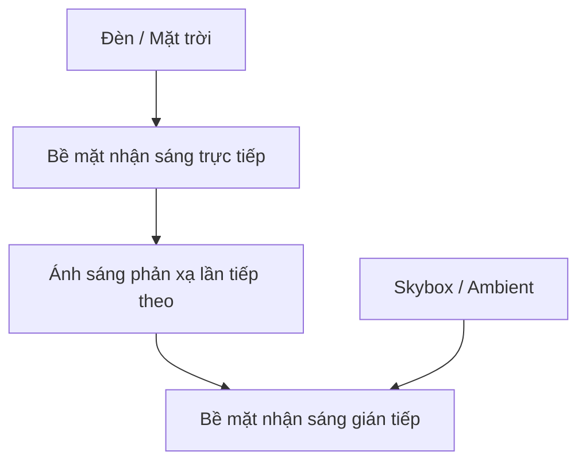

# Bài 02 — Ánh sáng trực tiếp, gián tiếp và các hệ thống Lighting trong Unity

*Creative Core · Lighting · Unity 6.3 · Get started with lighting in Unity*

## 1. Tóm tắt và mục tiêu

Unity render một khung cảnh từ sự kết hợp của nguồn sáng trực tiếp, ánh sáng môi trường, phản xạ và thông tin chiếu sáng tính trước. Bạn sẽ **phân biệt direct/indirect lighting**, giải thích *global illumination* (GI), và chọn được *Realtime*, *Baked* hoặc *Mixed* cho tình huống điển hình trong URP.

## 2. Ánh sáng trực tiếp và gián tiếp

**Direct light** là thành phần ánh sáng đến bề mặt trực tiếp từ nguồn phát; ví dụ, đèn rọi chiếu thẳng xuống sàn. **Indirect light** là thành phần đã tương tác với một hay nhiều bề mặt trước khi tới vị trí đang xét. Ví dụ, ánh sáng qua cửa sổ hắt lên sàn rồi phản chiếu vào tường. Bầu trời là nguồn ánh sáng môi trường được Unity mô phỏng, không được đồng nhất mọi trường hợp với ánh sáng nảy từ tường.

Thiếu gián tiếp, góc khuất dễ đen bất thường; thiếu điều tiết ambient, mọi vật có thể trông "phẳng" và mất chiều sâu.

## 3. Global Illumination và các chế độ nguồn sáng

**Global Illumination** là nhóm phương pháp xử lý chiếu sáng toàn cục, đặc biệt gồm những ảnh hưởng qua nhiều lần phản xạ. Cần tách **chế độ Light** với **hệ thống GI**: một đèn Realtime vẫn hoạt động mà không cần kích hoạt hệ thống realtime GI. Phạm vi GI khả dụng phụ thuộc pipeline và phiên bản; không suy ra một dự án URP sử dụng chung những tính năng GI như HDRP.

| Chế độ `Light > Mode` | Tính toán | Phù hợp | Hạn chế nổi bật |
|---|---|---|---|
| `Realtime` | Ánh sáng trực tiếp và bóng thời gian chạy | Đèn/đối tượng chuyển động | Chi phí GPU; bounce thực tế không tự xuất hiện nếu không có giải pháp GI |
| `Baked` | Tính trước đóng góp vào lightmap và/hoặc probes | Kiến trúc, đèn cố định | Không cập nhật kết quả bake khi di chuyển đèn |
| `Mixed` | Kết hợp realtime và baked theo Lighting Mode | Môi trường cố định nhưng có nhân vật động | Cần kiểm tra đúng cấu hình mixed và shadowmask |

Với `Mixed`, phần gián tiếp đã bake **không đổi** khi chỉnh màu hay cường độ đèn lúc chạy. Một đèn hoàn toàn `Baked` cũng không tự tạo phản xạ gương realtime; nếu cần điểm lóe/chất liệu kim loại sống động, phải dùng thêm nguồn realtime/mixed hoặc reflection phù hợp.

## 4. Bộ công cụ quan sát trong Unity

- `Window > Rendering > Lighting`: điều khiển môi trường, Lighting Settings và thông số bake; tên tab có thể khác nhau giữa các bản Editor.
- `Window > Rendering > Light Explorer`: xem và chỉnh nhiều nguồn Light tập trung.
- `Inspector > Light`: chọn `Type`, `Mode`, `Color`, `Intensity`, `Range`, `Shadows` tùy loại đèn.
- Các chế độ debug của Scene view/Rendering Debugger giúp phân tách ảnh hưởng của ánh sáng, vật liệu, lightmap hoặc phản xạ.

## 5. Thực hành so sánh ba chế độ

1. Tạo scene có sàn, tường, Sphere di động và Spot Light. Chụp ảnh chế độ Realtime ở góc cố định.
2. Đổi Light sang Baked, đánh dấu sàn/tường `Contribute GI`, bật `Baked Global Illumination` và `Generate Lighting` khi đã kiểm tra lightmap UV.
3. Dịch Spot Light sau khi bake nhưng không bake lại; đối chiếu sự khác biệt giữa hình học và dữ liệu ánh sáng đã lưu.
4. Di chuyển Sphere qua vùng sáng: nhận xét vì sao cần Light Probes cho ánh sáng gián tiếp/baked.
5. Thử Mixed và ghi lại những phần thay đổi lúc chạy, những phần vẫn phụ thuộc bake. Với mỗi lần đổi chế độ, ghi hình và thiết lập trước/sau.

## 6. Hạn chế kỹ thuật và cách suy luận

**Thấy hai lớp ánh sáng trên bề mặt?** Kiểm tra xem bạn có vô tình nhân đôi đóng góp đã bake bằng một nguồn realtime khác hay không. **Đèn Baked không tác động lên vật động?** Cần Light Probes hoặc thêm một nguồn realtime/mixed phù hợp. **Sàn sáng nhưng góc phòng tối?** Hãy khảo sát indirect bounces, ambient, hình học bít sáng và các thiết lập GI, không chỉ tăng cường độ đèn trực tiếp.

## 7. Kết luận

Chọn chế độ lighting là bài toán đánh đổi giữa **độ động**, **độ chân thực**, **hiệu năng** và **bộ nhớ lightmap**. Hãy quyết định xem cái gì có thể tính trước rồi mới triển khai ánh sáng.

## 8. Câu hỏi ôn tập trắc nghiệm

### Câu 1

Điểm khác nhau quan trọng nhất của ánh sáng gián tiếp là gì?

A. Luôn xuất phát từ Directional Light  
B. Đã phản xạ hoặc tương tác qua bề mặt trước khi đến điểm nhận  
C. Chỉ tồn tại ban đêm  
D. Không bị che khuất  

**Đáp án:** B. **Giải thích:** Ánh sáng gián tiếp bao gồm đóng góp từ các lần tương tác trước đó.

### Câu 2

Một ngọn đuốc người chơi cầm di chuyển liên tục nên ưu tiên chế độ nào?

A. Baked  
B. Reflection Probe  
C. Realtime  
D. Lightmap  

**Đáp án:** C. **Giải thích:** Realtime Light có thể cập nhật hướng, vị trí và bóng mỗi frame.

### Câu 3

Trong Unity, tạo đèn Realtime có bắt buộc dùng Realtime GI?

A. Có, luôn bắt buộc  
B. Không, nguồn sáng realtime vẫn hoạt động riêng  
C. Chỉ khi có Skybox  
D. Chỉ khi có Light Probes  

**Đáp án:** B. **Giải thích:** Tính nguồn sáng trực tiếp realtime và realtime GI là hai cơ chế khác nhau.

### Câu 4

Khi thay đổi Baked Light sau khi nướng, điều gì cần thiết để ánh sáng gián tiếp tương ứng cập nhật?

A. Rebake  
B. Đổi tên scene  
C. Di chuyển Camera  
D. Tắt mọi Mesh Renderer  

**Đáp án:** A. **Giải thích:** Dữ liệu bake không thay đổi tự động theo runtime transform của đèn.

### Câu 5

Vì sao scene Baked cần cân nhắc dung lượng bộ nhớ?

A. Vì lightmap là texture phải được lưu và tải  
B. Vì không tạo được bóng  
C. Vì bắt buộc chạy 240 FPS  
D. Vì không hỗ trợ màu  

**Đáp án:** A. **Giải thích:** Lightmap lưu dữ liệu chiếu sáng nên dùng bộ nhớ và dung lượng asset.

## 9. Tài liệu tham khảo và lưu ý phiên bản

- [Unity Learn — Get started with lighting in Unity](https://learn.unity.com/course/creative-core-lighting/tutorial/get-started-with-lighting-in-unity?version=6.3) (Unity 6.3).
- [Tài liệu UV cho lightmap](https://docs.unity3d.com/6000.3/Documentation/Manual/LightingGiUvs-GeneratingLightmappingUVs.html).
- [Tài liệu về Mixed Lighting](https://docs.unity3d.com/kr/current/ScriptReference/MixedLightingMode.html).

**Lưu ý:** Menu và tùy chọn có thể khác theo URP Asset, Quality Level, Unity Editor và loại shader đang dùng. Nội dung là bài giảng tiếng Việt độc lập được biên soạn và bổ sung để học tập, không phải bản dịch chính thức hay lời chép toàn văn của Unity.
